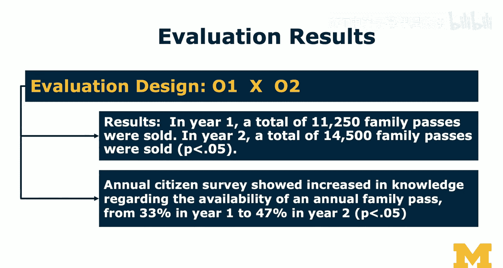
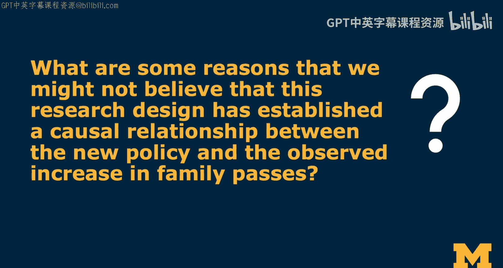
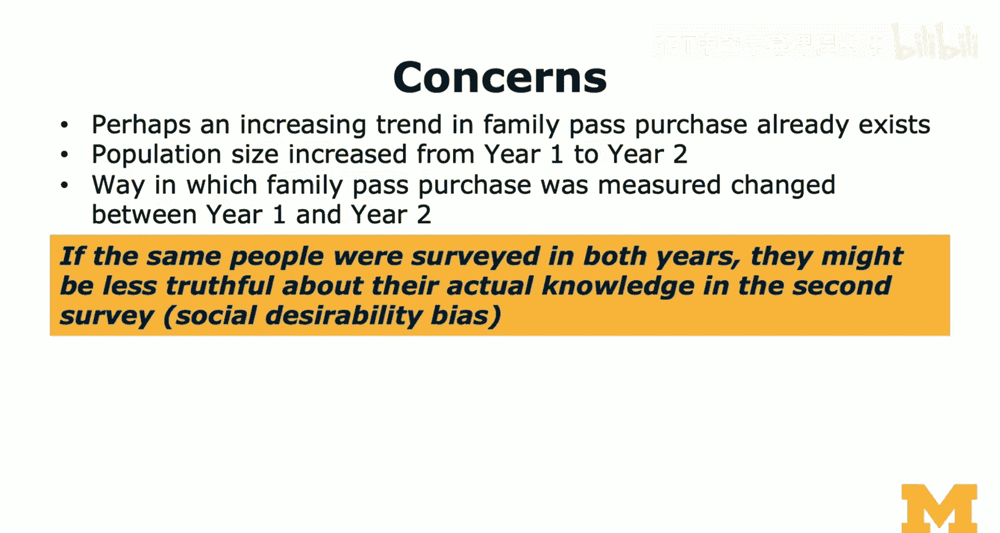
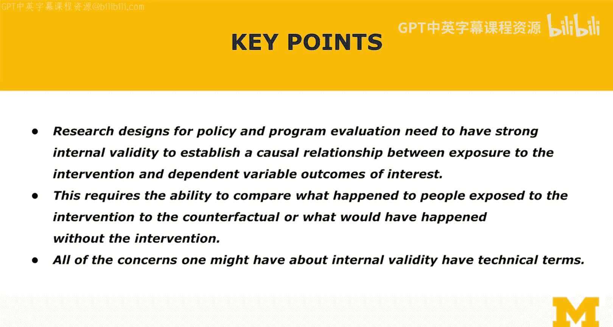

# 28：研究设计方案实例解析 🔍

在本节课中，我们将通过一个具体的实例，来解析研究设计方案的核心概念。我们将探讨如何评估一项政策干预的效果，并理解“内部效度”这一关键术语。通过这个例子，你将学会如何批判性地审视一个研究设计，识别其潜在缺陷，并思考如何构建更严谨的因果推断。

---

## 实例背景：城市年票降价政策

假设一个大型城市政府实施了一项新政策，将城市公共博物馆和动物园的家庭年票价格降低了10%。这背后的经济学原理是价格弹性，即希望通过降低价格来刺激需求，使更多家庭购买年票，从而享受这些公共文化产品。

现在，利益相关者希望知道：降低年票价格是导致了收入损失，还是确实增加了需求？这项政策改变的实际影响是什么？

## 研究设计方案：简单的前后测试设计

为了评估政策影响，我们可以采用一个简单的前后测试设计。在这个设计中：
*   **X** 代表政策干预，即新的年票价格。
*   **时间点一（前测）** 和 **时间点二（后测）** 的观测指标包括：
    1.  一年内售出的家庭年票数量。
    2.  通过市民调查收集的“过程评估”数据，用于了解市民是否知晓年票的存在及其降价信息。

假设我们实施了这一设计，并得到了以下结果：

*   作为出色的数据分析师，你向利益相关者展示了结果：
    *   第一年售出 **11,250** 张家庭年票。
    *   第二年售出 **14,500** 张家庭年票。
    *   统计检验显示，从观测1到观测2的差异具有统计学显著性（P值 < 0.05）。
*   在分析市民调查数据时，你发现了解年票可用性及价格的受访者比例从第一年的 **33%** 上升到了第二年的 **47%**，该差异同样具有统计学显著性。

## 评估设计的内部效度

上一节我们介绍了评估设计及其结果，本节中我们来看看这个设计是否足够严谨。我们是否相信降价直接导致了销量和知晓度的提升？我们是否有强有力的证据证明降价与观察到的增长之间存在因果关系？

这就引出了一个关键概念：**内部效度**。它指的是一个研究设计能够确立因果关系的强度。那么，这个简单的前后测试设计是否具有强大的内部效度呢？这本质上是在问：第一年的数据（前测）是否是一个良好的“反事实”参照组？

我们总是需要思考：有哪些理由可能让我们不相信这个设计确立了新政策与年票销量增长之间的因果关系？除了政策变化，还有哪些“竞争性假设”可以解释从第一年到第二年的变化？

以下是可能存在的几种担忧：

*   **趋势影响**：也许在政策干预前，家庭年票的购买量本身就处于上升趋势。我们只拥有一年的干预前数据，可能只是捕捉到了这个固有趋势，而非价格变化的效果。
*   **人口变化**：我们只关注了售出的年票数量。如果城市人口在第一年到第二年之间增长了，这本身就能解释销量的增加，而非价格差异。
*   **测量方式变化**：家庭年票购买的测量方式或数据系统是否发生了变化？数据收集和管理系统的改进，可能导致第二年更准确地捕捉到了购买行为，从而显示出“增长”，但这并非价格变化所致。
*   **社会期望偏差**：如果两年调查的是同一批人，他们在第二次调查中可能不会完全真实地报告自己的知晓情况。当被多次调查时，人们报告的知识、态度或行为的变化，可能反映了真实变化，也可能源于他们觉得“我应该知道这个”而做出不准确的回答。

我们应始终保持批判性和深思熟虑，审视研究设计是否足够强大，是否具备确立因果关系的内部效度。

## 总结与核心要点

本节课中我们一起学习了研究设计方案的实际应用与评估。总结一些关键要点：

1.  用于政策和项目评估的研究设计，需要具备强大的**内部效度**，才能确立干预措施（自变量）与感兴趣的结果（因变量）之间的**因果关系**。
2.  拥有强大的内部效度，要求我们能够将接受干预的分析单元（如人群）的结果，与一个**反事实**（即假设未接受干预会发生的情况）进行比较。
3.  当我们思考反事实的强度及其可能存在的担忧时，需要了解，研究设计内部效度可能面临的各种问题都有其特定的技术术语（我们将在后续课程中深入探讨）。

一个严谨的研究设计是进行可靠政策评估的基石。通过不断质疑和审视竞争性假设，我们可以更好地理解干预的真实效果。