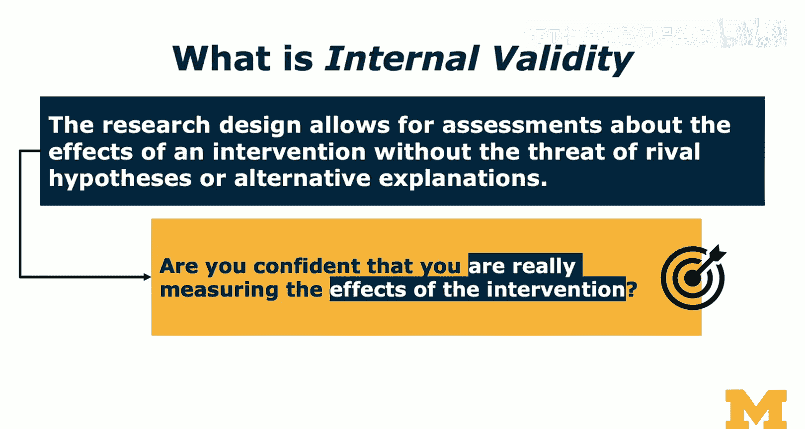
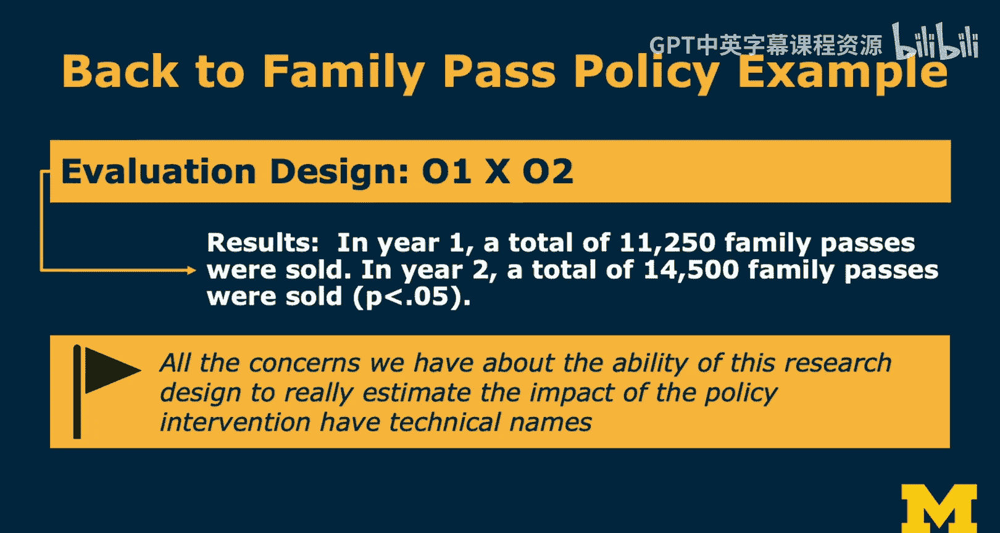
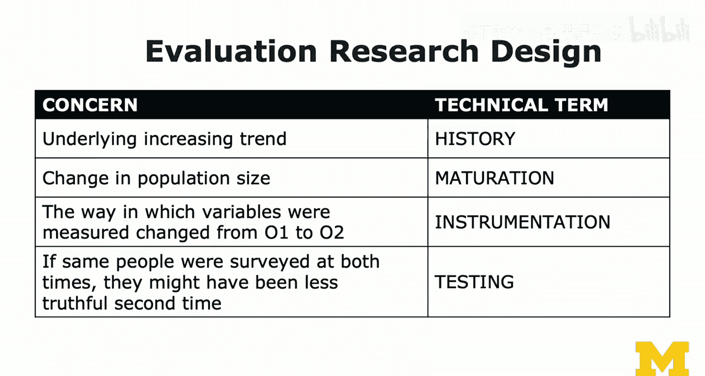
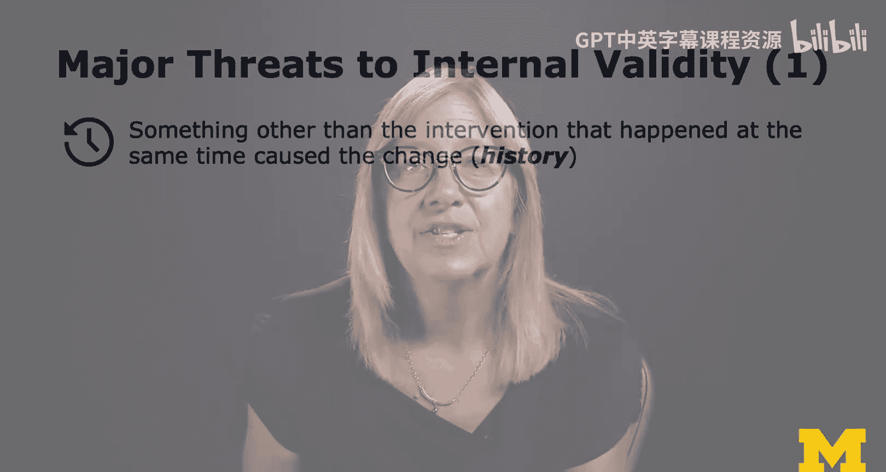
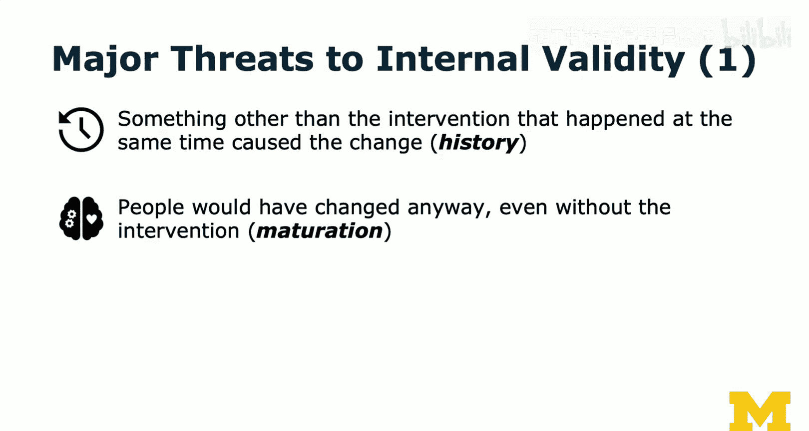
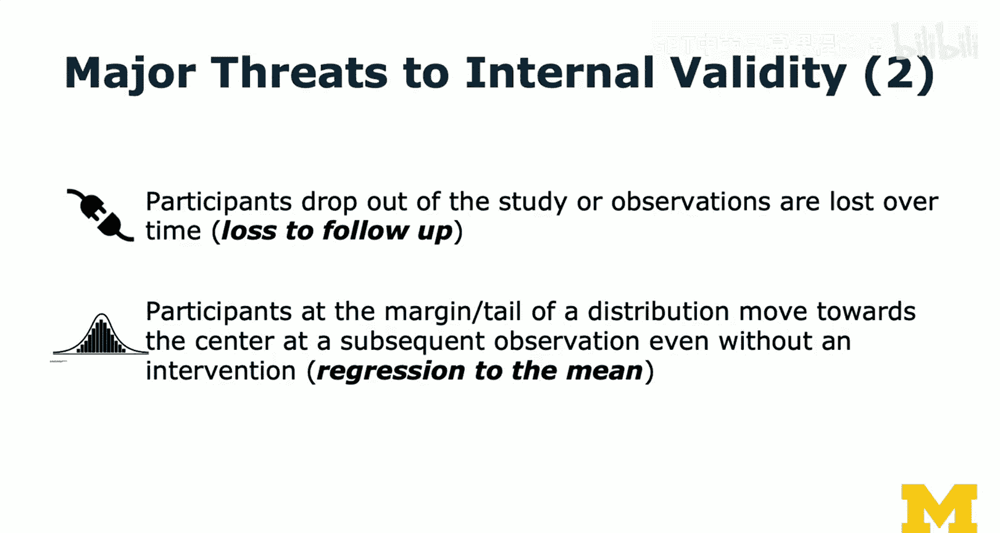

# 公共部门的R数据分析：29：内部效度与外部效度基础

## 概述

在本节课中，我们将继续学习项目与政策分析和评估领域的重要术语。我们将详细探讨**内部效度**的概念，并介绍**外部效度**。理解这些概念对于设计严谨的研究和准确解读评估结果至关重要。

## 什么是内部效度？

上一节我们介绍了研究设计的基本类型，本节中我们来看看如何评估一个研究设计的质量。当我们讨论研究设计的**内部效度**时，我们是在评估该设计在理解干预效果方面的强度，确保其不受竞争性假设或替代性解释的威胁。

更简单的说法是：我们是否有信心，我们测量到的是干预的真实效果，而不是研究设计中可能存在的其他因素？我们是否认为能够真正评估政策变化或项目干预的实施与结果之间的因果关系？

## 内部效度威胁示例：家庭通行证政策

为了更好地理解，让我们回顾之前讨论过的家庭通行证政策案例。该评估采用了简单的**前测-后测设计**，旨在研究城市公园和动物园的家庭通行证降价对销售量的影响。

结果显示，家庭通行证的总销售量显著增加，同时市民对通行证可用性和降价信息的知晓度也有所变化。

当我们思考这个研究设计在确立“是家庭通行证的价格变化导致了销量增加”这一结论时的强度时，我们可能会产生一些担忧。这些担忧都有其专业术语。

以下是可能威胁该研究内部效度的一些因素：

*   **历史效应**：如果家庭购买通行证、享受城市公园和动物园的趋势本身就在上升呢？我们的评估可能只是捕捉到了这一历史趋势，是这种上升的历史趋势导致了我们观察到的变化，而不一定是降价。
*   **成熟效应**：如果人口规模发生了变化呢？如果城市中的家庭数量或总人口数增长了，这就可以解释家庭通行证购买量的增加，而非降价。人口变化是一种趋势，它不同于历史事件，但同样可以解释结果。
*   **测量工具效应**：从时间点1到时间点2，测量变量的方式可能发生了变化。例如，更好地捕捉了通行证购买数据，或者数据收集转为在线方式等。这种测量或工具的变化可以解释时间点间的差异，而不一定是价格变化。
*   **测试效应**：如果同一批人在两个时间点都接受了调查，他们可能在第二次回答时不够诚实。这就是我们所说的测试效应。仅仅是多次调查人们这一事实，就可能导致他们改变答案。我们捕捉到的可能是这种测试效应，而非价格干预的效果。

以上是针对家庭通行证价格示例的一些主要内部效度威胁。

## 内部效度威胁的普遍类型

让我们更概括地回顾这些威胁：

*   **历史**：如果干预之外发生了其他事情（外部历史事件），那可能是导致变化的原因，而非干预本身。
*   **成熟**：即使没有干预，人们也可能自行发生变化。在我们之前的例子中，我们讨论的是人口规模增长，但人们随时间变化的方式还有很多。干预可能恰好发生在成熟变化的时间点，而观察到的变化只是正常的成熟过程，并非干预效果。在针对青少年和青年的项目评估中，这一点尤其需要注意，因为他们正在许多方面快速变化。
*   **测试效应**：从人类那里获取信息是一件复杂的事情，我们必须始终意识到这一点。
*   **失访/退出**：当我们试图比较时间点1和时间点2，并跟踪同一批人时，参与者可能会退出研究，或者我们丢失了他们的数据。如果我们观察的不是时间点1和时间点2的同一群人，那么这被称为失访或研究退出。如果我们观察的不是同一群人，那么这可能是我们看到的随时间变化的原因，而非干预。
*   **向均值回归**：这一点非常重要，稍后我会给出一个很好的例子。如果我们关注的是评估中某个我们关心的分布（如收入、成本）处于边缘或尾端的人群，那么在时间点1，他们处于该分布的尾端。仅仅由于人口数据收集的正常波动，在时间点2再次观察时，数据点会有一个**向均值回归**的趋势，即向分布的平均值或中心移动。例如，收入最低的人群、极端贫困人口、医疗成本最高的人、过去一年被捕次数最多的人。如果我们关注的是处于分布边缘或尾端的人群，即使没有干预，下次观察时，他们也可能会向更积极的平均值方向移动。我们需要意识到这一点。

## 总结

本节课中，我们一起学习了**内部效度**的核心概念及其对研究设计的重要性。内部效度关乎我们能否确信观察到的变化是由干预引起的，而非其他因素。我们探讨了多种可能威胁内部效度的因素，包括**历史**、**成熟**、**测量工具变化**、**测试效应**、**失访**和**向均值回归**。理解这些威胁有助于我们设计更严谨的评估，并对结果做出更准确的解释。在接下来的课程中，我们将继续探讨**外部效度**的概念。