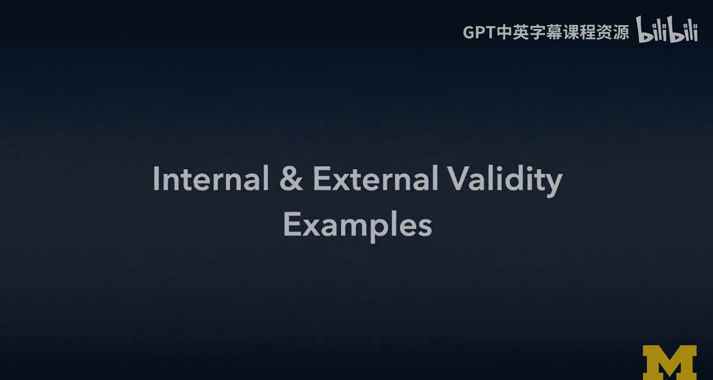
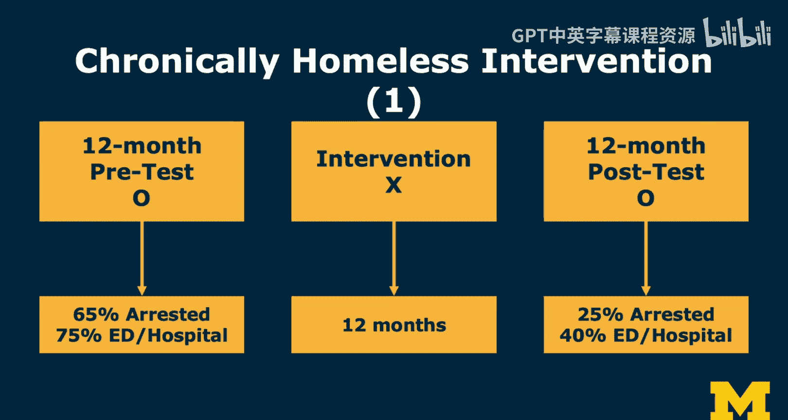
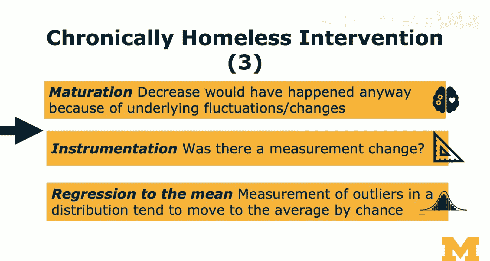
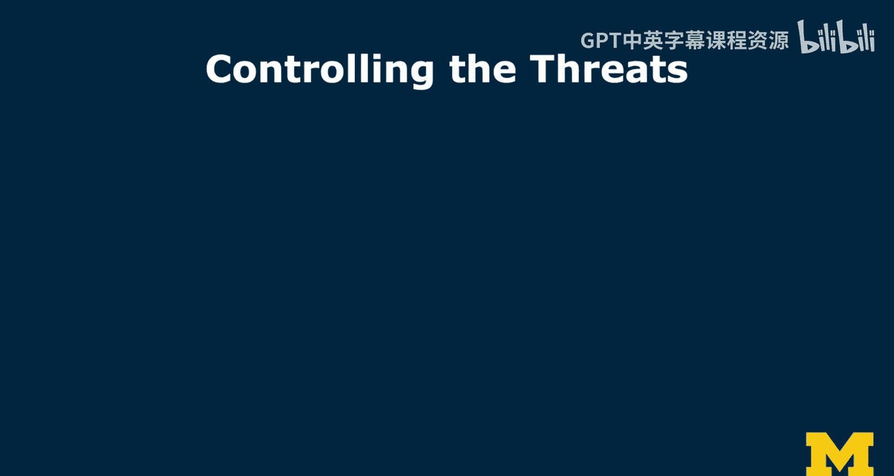
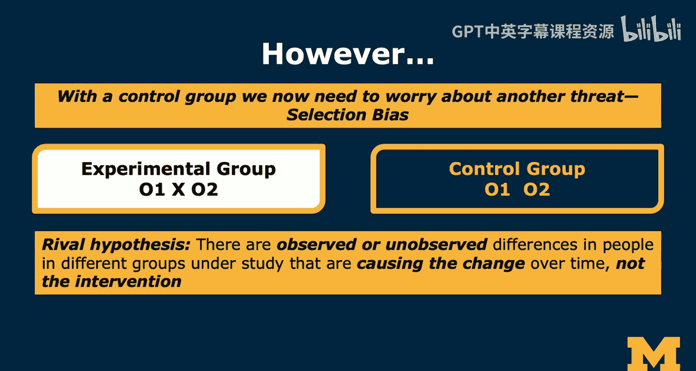
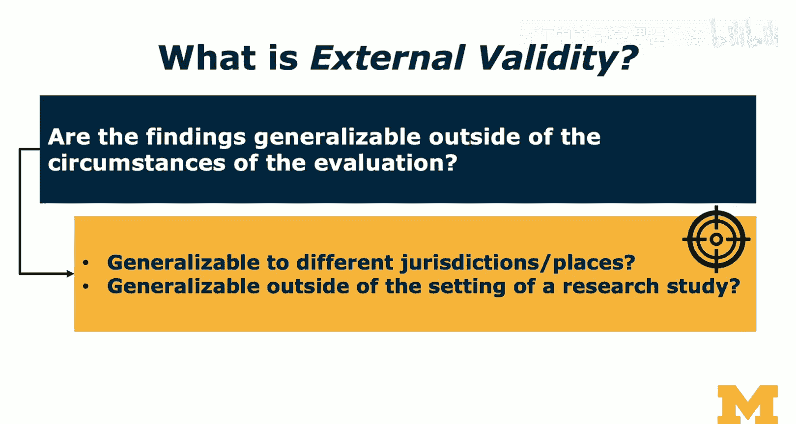

# 公共部门的R数据分析：30：内外效度典型案例分析 🏠📊

在本节课中，我们将通过一个关于“支持性住房”干预项目的具体案例，深入探讨研究设计中的内部效度与外部效度。我们将分析如何识别和应对可能威胁研究结论有效性的各种因素。

---

## 案例背景：针对长期无家可归者的干预

在任何大城市，长期无家可归者都是一个普遍问题。在某些城市，这一群体的比例尤其高。我们知道，在许多地方，长期无家可归者有着更高的被捕率和急诊/住院等医疗服务使用率。

为此，设计了一项干预措施，旨在为长期无家可归者提供住房，并辅以“支持性住房”服务。这种支持性住房通常通过个案管理的方式，提供额外的社会福利服务。

**干预内容**：提供支持性住房，并由个案管理员协助参与者连接社会福利和医疗服务。

在干预前的基线测量中，目标人群在12个月内的被捕率为 **65%**，有至少一次急诊或住院经历的比例为 **75%**。

干预实施了12个月。数据显示，在干预后的测试期，参与者的被捕率下降至 **25%**，急诊和住院使用率下降至 **40%**。

这看起来像是一次非常有效的干预。它不仅旨在提供住房，还旨在观察是否能减少对刑事司法系统和医疗系统等城市资源的消耗。

---

## 从内部效度角度审视设计 🧐

现在，让我们从内部效度的角度来思考这个研究设计。对于“是干预导致了被捕率和医疗使用率显著下降”这一结论，有哪些竞争性假设（即其他可能的解释）？

以下是需要考虑的几个内部效度威胁：

*   **成熟效应**：即使没有干预，这个群体是否也会自然改善？我们观察了他们12个月，他们当时有高被捕率和高医疗使用率。如果一年后再观察他们，是否会仅仅因为时间推移和自身变化（例如，被捕或经历健康危机后的自然波动）而看起来更好？我们无法确定。
*   **测量工具变化**：从前测到后测期间，测量方法或工具是否发生了变化？这需要仔细核查。
*   **向均值回归**：这个群体处于分布的两个极端——高被捕率和高急诊使用率。即使没有干预，仅仅由于统计上的“向均值回归”现象，他们在第二年是否也可能表现得更好？数据显示，这种情况确实可能发生。

那么，我们如何控制这些威胁研究设计内部效度的重要因素呢？简单的“前测-后测”设计可能显示干预有重要且显著的影响，但我们确实需要担心这些威胁。

---

## 控制内部效度威胁：引入对照组 ⚖️

通常，我们通过设置**对照组**或**比较组**来控制这些威胁。

我们会有一个接受干预的**实验组**，同时会有一个相似的、但未接受干预的**对照组**。通过比较两组，我们希望对照组能作为“反事实”参照，而两组之间的任何差异则可归因于干预效果。

然而，引入对照组后，我们必须担心另一个内部效度威胁：**选择偏倚**。

仅仅拥有对照组并不意味着内部效度就高。我们必须担心：这个对照组真的是一个好的反事实参照吗？实验组和对照组之间是否存在可观测的、或更令人担忧的**不可观测的差异**？也许正是这些组间差异导致了随时间发生的变化，而非干预本身。选择偏倚可能导致我们在没有干预效果时，错误地将其解释为有效。

---

## 内部效度 vs. 外部效度 🌍

我们一直在重点讨论研究设计的**内部效度**，即干预在**所研究的特定情境下**是否真的造成了差异，以及我们测量的结果效应是否不受那些有专业术语的威胁的影响。

与内部效度相对的是**外部效度**。我们也需要考虑这一点。

外部效度关注的是：我们的项目或政策评估结果，能否推广到评估情境之外？

*   **推广到不同地区**：例如，如果我们在罗马进行了这项针对长期无家可归者的支持性住房干预研究并得到了结果，这些结果能否推广或转移到非洲、东南亚或美国的城市？有时可以，有时则不行。
*   **研究情境本身的影响**：我们进行研究的方式（例如，参与者知道被研究、研究人员的特殊关注等）是否会影响干预效应的水平，或以其他方式影响我们所观察到的结果？我们稍后会详细讨论这一点。

总而言之，对于所有这些专业术语，我希望你真正思考的是：**内部效度**（研究设计确立因果关系的强度）及其各种威胁（及其专业名称），以及**外部效度**（研究结果的普遍适用性）。

---

## 总结 📝

本节课中，我们一起学习了一个关于支持性住房干预的案例，并借此深入分析了研究设计的效度问题。

我们首先回顾了案例背景和看似显著的干预效果。接着，我们从内部效度出发，探讨了可能挑战该结论的竞争性假设，如成熟效应、测量工具变化和向均值回归。为了控制这些威胁，我们引入了对照组的概念，但同时指出了可能随之而来的选择偏倚风险。

最后，我们对比了内部效度与外部效度。内部效度关乎“研究本身是否可靠”，而外部效度则关乎“研究结论能否推广”。理解并妥善处理这两类效度威胁，对于做出严谨、可信的政策评估至关重要。