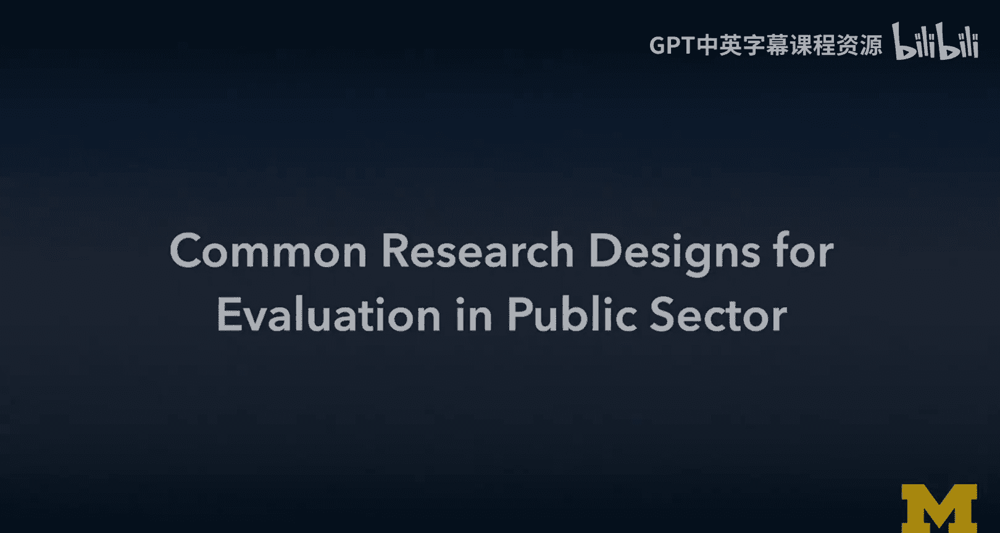
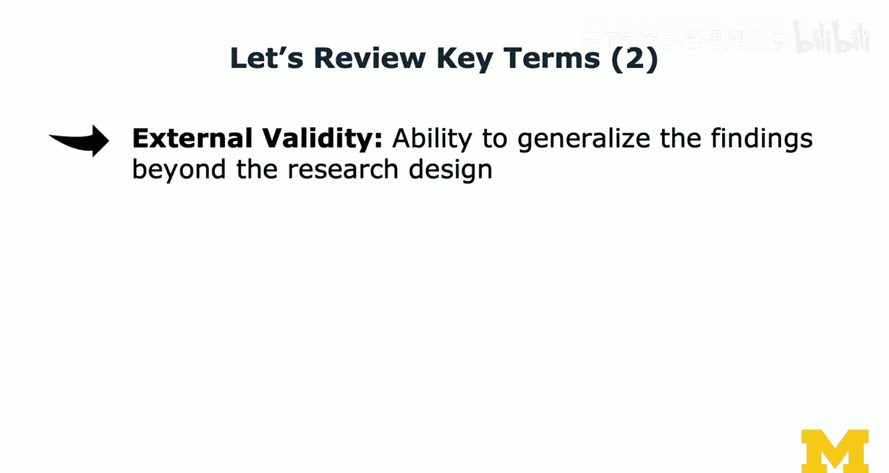
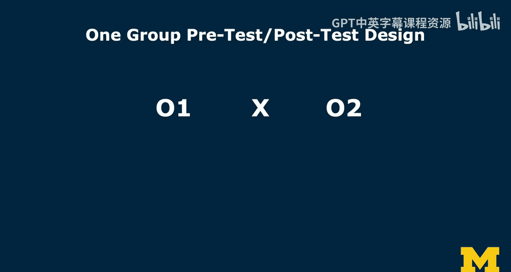
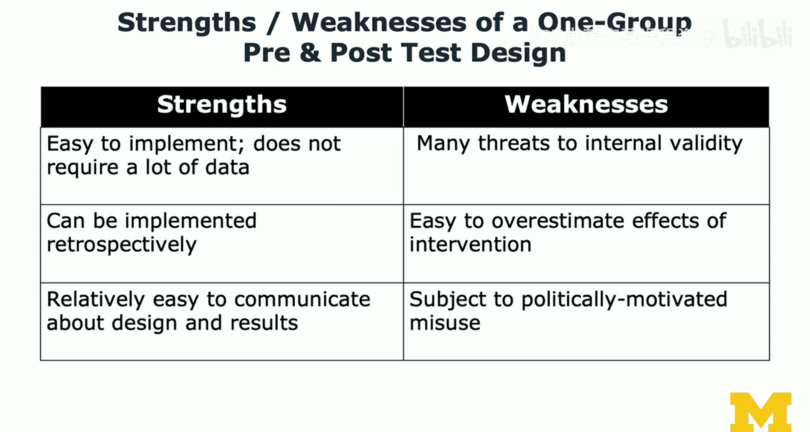
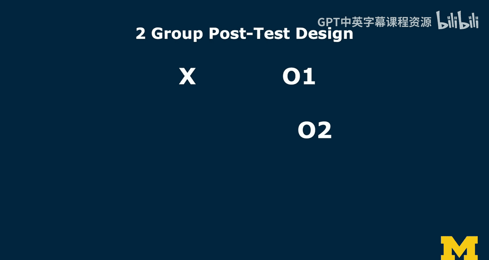
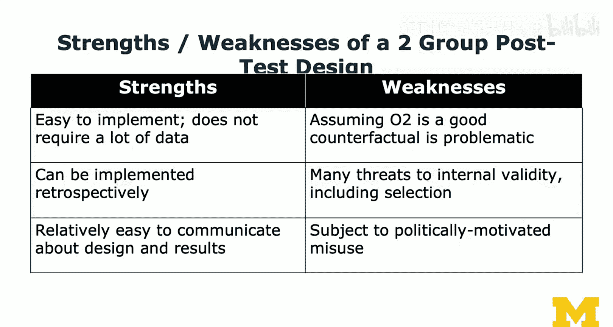
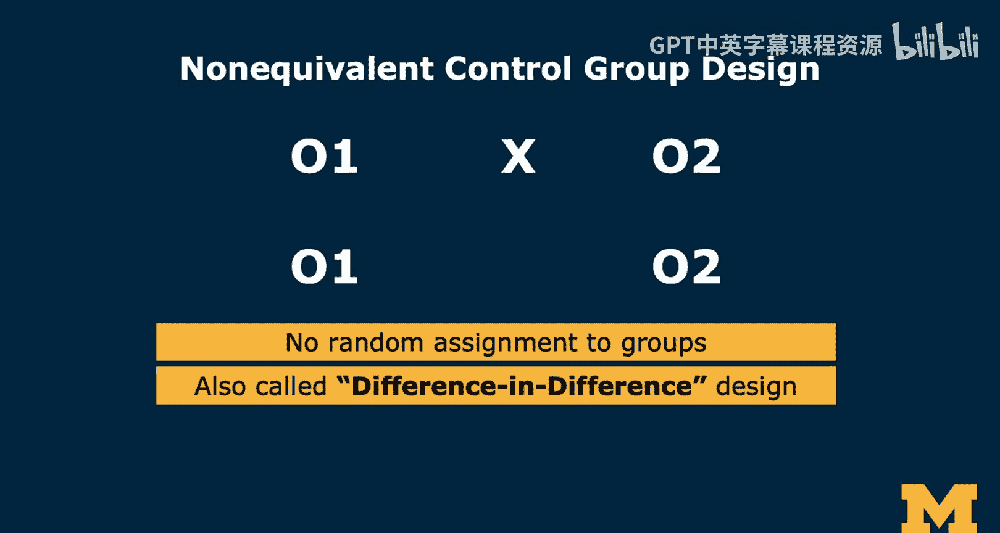
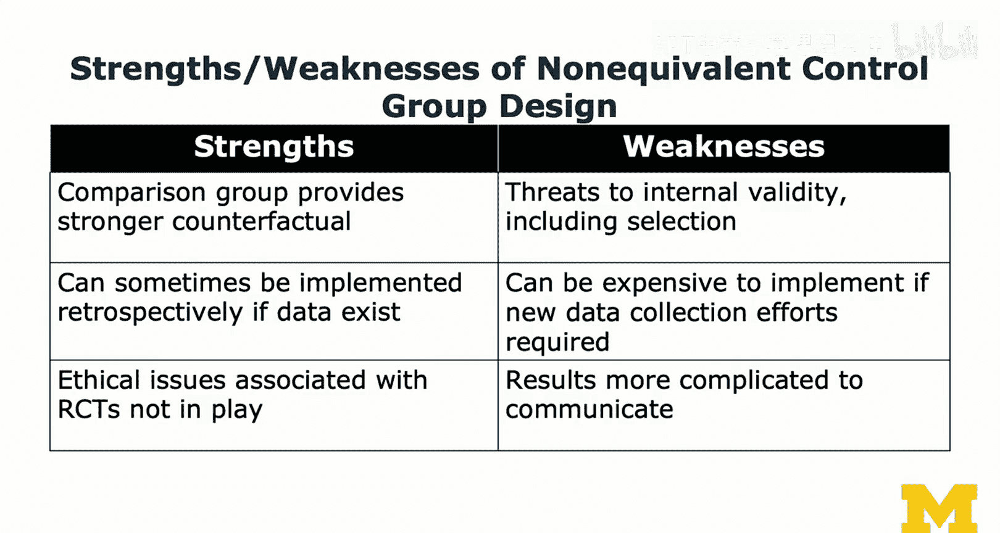
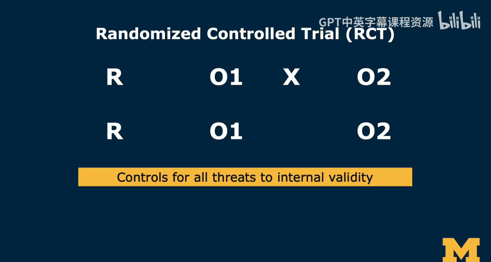
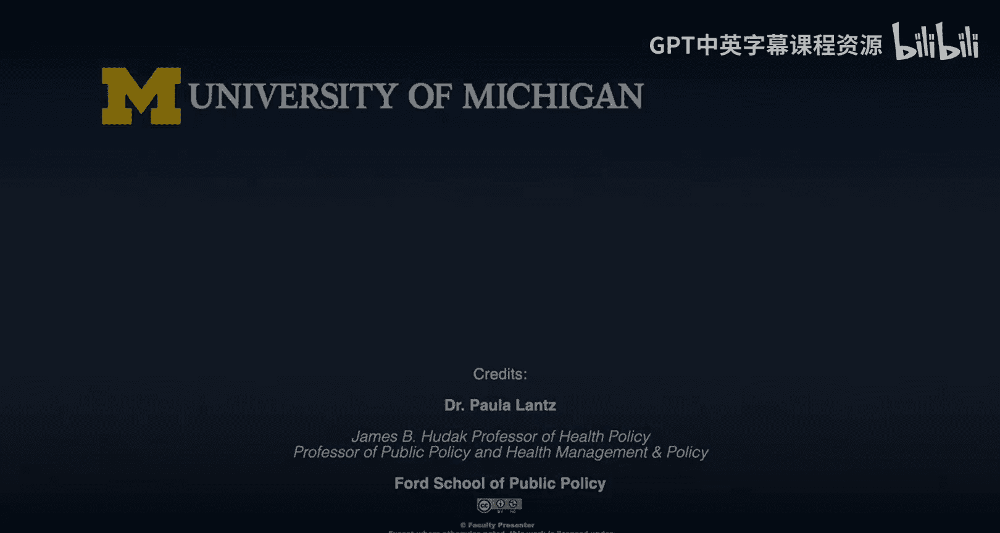

# 31：公共部门评估常用研究设计 📊

在本节课中，我们将回顾项目与政策评估中涉及的一些术语和技术概念，并通过介绍公共部门评估中常用的几种研究设计来加深理解。

## 概述

研究设计是评估项目或政策干预的整体规划。其核心在于**内部效度**，即研究设计衡量干预效果、建立因果关系的强度。一个强大的研究设计应没有内部效度威胁，并需要一个良好的**反事实**作为对比。此外，**外部效度**指的是将评估结果推广到研究设定和设计之外的能力。

## 单组前后测设计

上一节我们介绍了研究设计的基本概念，本节中我们来看看第一种常用设计：单组前后测设计。这种设计在项目与政策评估中应用广泛，但正如我们讨论过的，从内部效度的角度来看，它并非特别强大。

以下是该设计的优缺点分析：

**优点：**
1.  易于实施，通常不需要大量数据。
2.  可以回顾性实施。常见情况是政策变更后，利益相关者要求分析师获取政策实施前一年的数据，并与实施后的数据进行对比。
3.  如果不涉及讨论内部效度威胁等技术细节，该设计及其结果易于沟通。例如，可以轻松创建数据可视化来展示政策干预前后的变化。

**缺点：**
1.  存在许多内部效度威胁，如历史事件、成熟效应、测量工具变化、测试效应等。因此，很容易高估干预效果，因为从时间一到时间二的许多变化可能源于其他因素。
2.  该设计常被有意误用于政治目的。例如，有人可能用它来显示“自本届政府上任或政策变更以来，情况有所改善”，但这可能完全无关。有时使用者明知自己在高估干预效果，但出于政治目的仍会这样做。

## 两组后测设计

接下来，我们看看公共部门项目与政策评估中另一种非常常用的设计：两组后测设计。在这种设计中，一组接受干预，之后进行观测；另一组未接受干预，作为对照组。我们在干预后的同一时间点比较这两组，且没有关于任何一组的干预前信息。

那么，这个设计的反事实是什么？是对照组在观测点的状态。这是一个好的反事实吗？该设计存在哪些内部效度威胁？

以下是该设计的优缺点分析：

**优点：**
1.  易于实施，通常不需要大量数据。
2.  常用于数据已可用的场景，例如一个地方实施了政策而另一个地方没有，可以直接进行比较。
3.  可以回顾性实施，无需从一开始就规划评估设计。

**缺点：**
1.  此处的反事实问题极大，主要威胁是**选择偏差**。我们无法断言这两组除了是否接受干预外其他方面都相似。两组很可能在许多其他方面存在差异。
2.  因此，这不是一个建立因果关系的良好研究设计，内部效度威胁过多。这也意味着该设计常被误用于为项目或政策进行带有政治动机的论证。

## 非等效对照组设计

那么，这个设计如何呢？它被称为非等效对照组设计。我们同时拥有一个接受干预的组和一个未接受干预的对照组的**前后测**信息，并在相同的时间点（干预前、干预后）对它们进行比较。这里没有随机分组，我们只是寻找另一个城市、社区或学校组作为对照。

这个设计的对照组是一个好的反事实吗？该设计有时也被称为**双重差分设计**。

以下是该设计的优缺点分析：

**优点：**
1.  如果对照组除了未接受干预外，与干预组非常相似，那么它可以作为一个较好的反事实。这比之前讨论的设计提供了更强的反事实。
2.  如果前测观测数据已存在，有时可以回顾性实施。
3.  随机对照试验存在伦理问题（尤其是在公共部门），而非随机设计则避免了随机分配资源或政策可能带来的伦理争议。

**缺点：**
1.  仍然存在内部效度威胁，最主要的是**选择偏差**。我们无法确保两组在成熟过程、历史事件暴露、测量工具等方面完全一致。
2.  如果数据不存在，收集两组人群的前后测数据成本非常高昂。
3.  结果可能更复杂，向利益相关者或公众沟通的难度增加。

## 随机对照试验

我们指出了上述所有研究设计都存在内部效度威胁，除非我们进行真正的实验，即**随机对照试验**。

在RCT中，参与者被**随机分配**到接受干预组或不接受干预组（对照组）。我们拥有两组的前后测信息，并进行比较。随机化在理论上意味着，除了是否接受干预外，这两组在所有其他方面都应相同。

我们并非说没有测试效应或成熟效应，而是假设由于消除了选择偏差，两组经历着相同的成熟和测试效应。因此，如果我们观察到两组之间存在差异，那就可以归因于干预。

随机对照试验具有极强的内部效度，使我们能够有把握地说，两组间从时间一到时间二的不同变化是干预的结果。理论上，它能控制所有内部效度威胁，是我们用于建立因果关系的最强研究设计。

我们将在后续课程中结合具体案例更详细地讨论RCT。

## 总结

本节课我们一起学习了公共部门评估中四种常见的研究设计：单组前后测设计、两组后测设计、非等效对照组设计（双重差分设计）以及随机对照试验。我们分析了每种设计的优缺点，重点探讨了其内部效度强弱及主要威胁（尤其是选择偏差）。理解这些设计有助于我们更严谨地评估项目与政策效果，并识别可能被误用的论证。