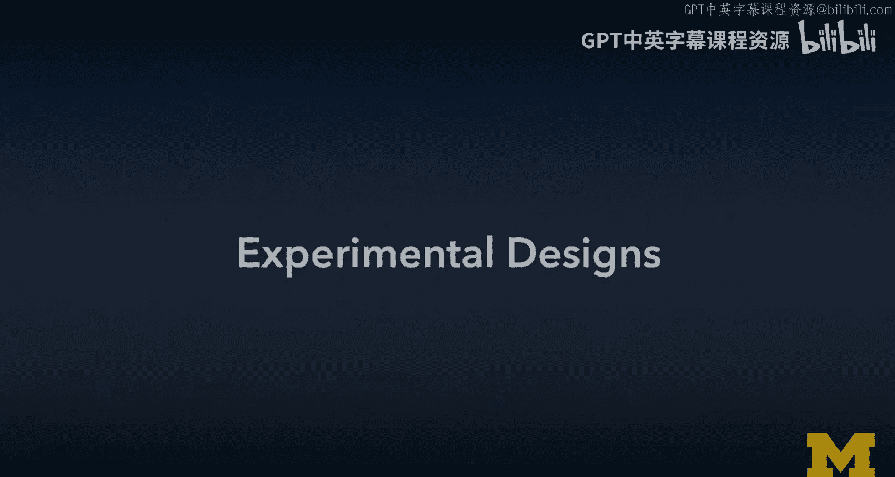
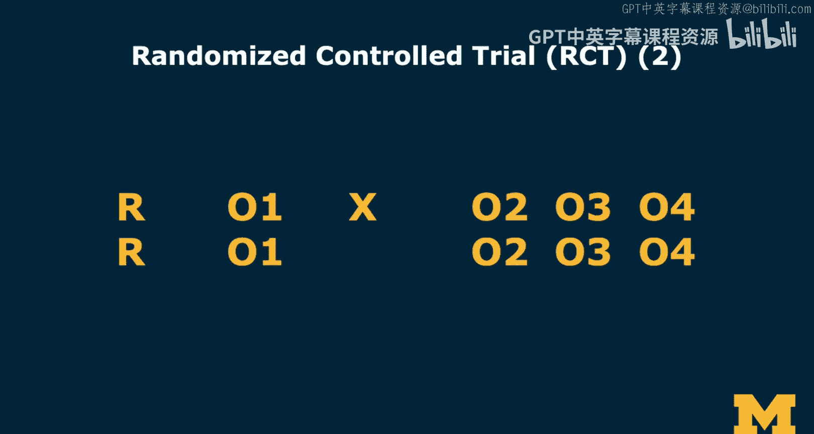
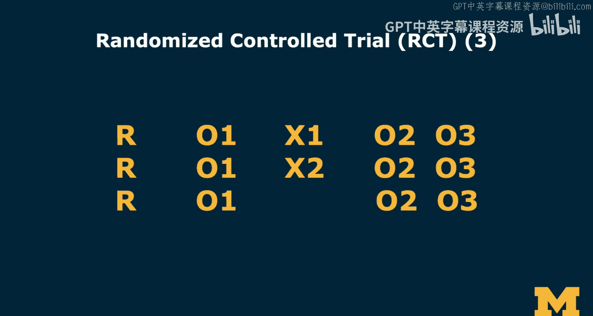
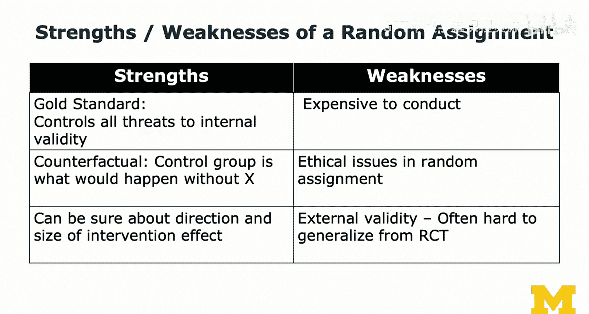
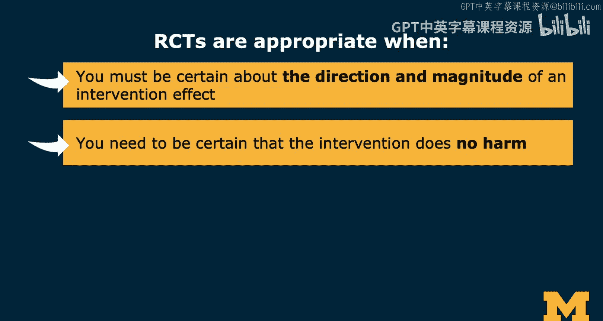
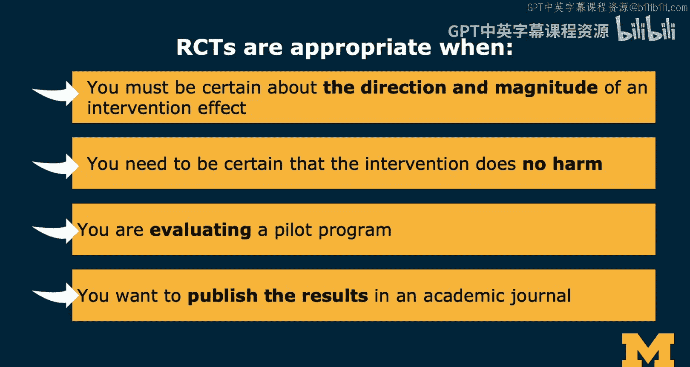
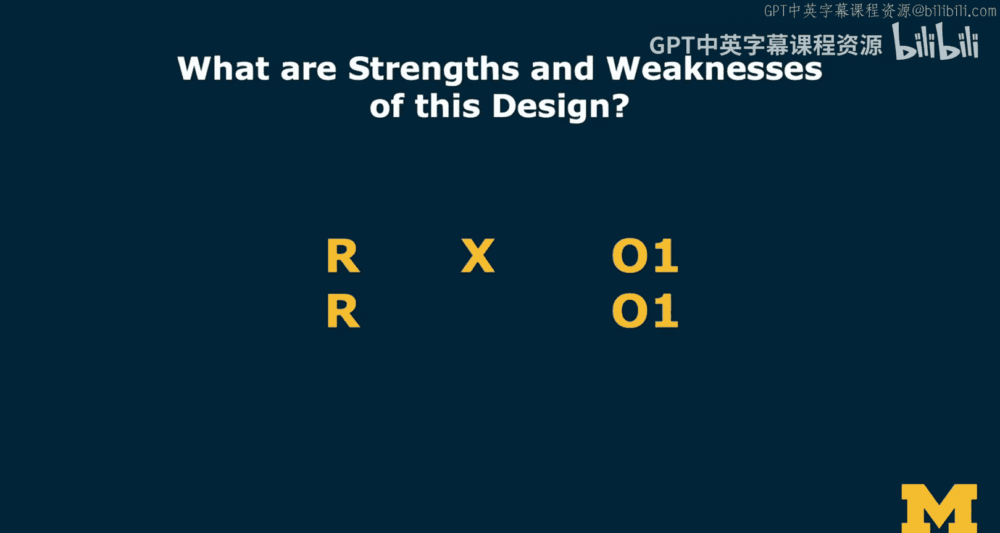
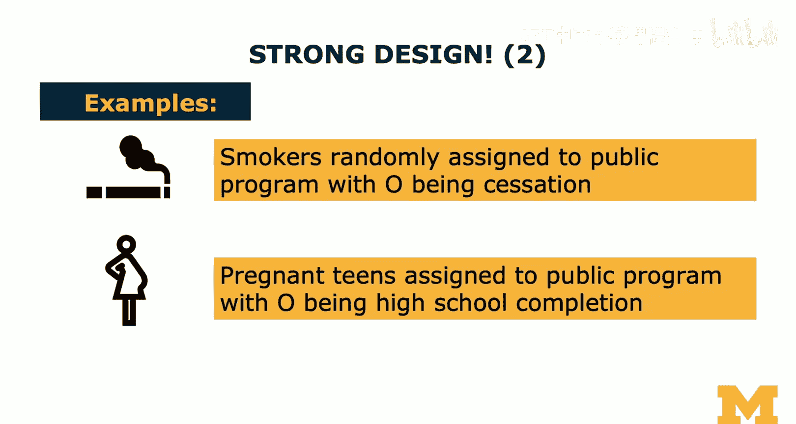
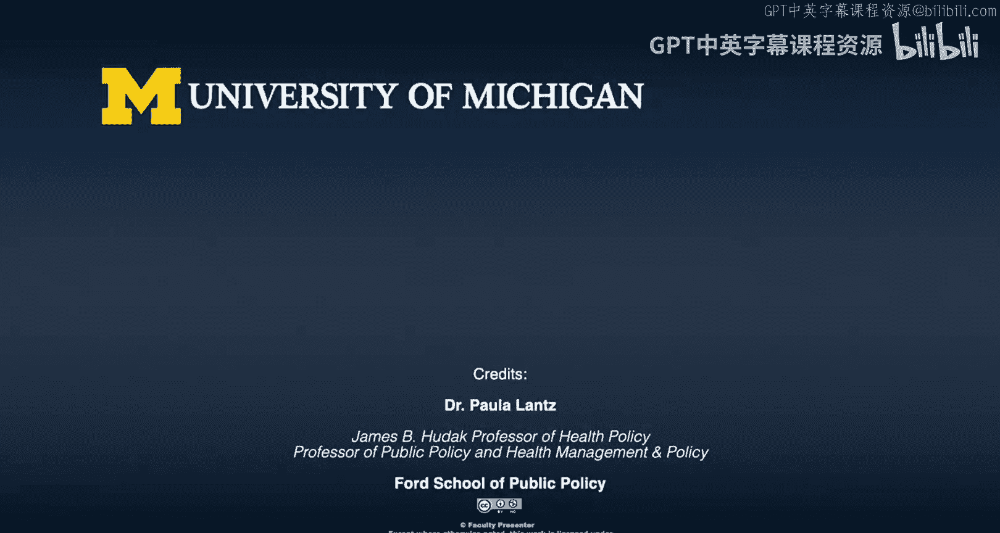

# 32：实验设计方法论 🧪

在本节课中，我们将要学习实验设计，特别是随机对照试验（RCT）的各种形式、其核心原理、优缺点以及适用场景。我们将通过具体的图示和例子来理解如何设计一个有效的实验，以评估公共政策或项目干预的效果。

## 随机对照试验的基本形式

上一节我们介绍了随机对照试验的概念。本节中我们来看看它的几种常见设计形式。

经典的随机对照试验包含两个组。参与者被随机分配到干预组或对照组。干预组接受某项新项目或政策改变，而对照组不接受。研究会在干预前和干预后两个时间点对两组进行比较。

## 包含多次后测的随机对照试验

随机对照试验的设计可以有多种主题和变体。以下是另一种设计形式。

在这个设计中，同样有两个被随机分配的组。但两组在干预前被观测，干预组接受干预后，会在**三个**不同的时间点被再次观测。

在公共部门，我们不仅想知道干预的短期效果，还想了解其长期影响。因此，干预效果可能在干预后立即测量，然后在六个月后、十二个月后，甚至一、三、五年后再次测量。这些研究设计具有时间维度，我们需要非常具体地规划。

## 测试多种干预的随机对照试验

随机对照试验也可用于同时测试多种干预的效果。

当你看到这个设计时，应该能轻松识别出它包含三个组。参与者被随机分配到接受**干预一**、**干预二**，或作为第三组**不接受任何干预（维持现状）**。所有组在干预前都被观测。然后，第一组和第二组分别接受两种略有不同的干预。很多时候，我们会比较这些细微的差异，因为我们不确定它们是否重要。之后，各组在干预后会被追踪观测两次。

## 随机对照试验的核心与优缺点

随机对照试验的关键在于**将参与者随机分配到干预组或对照组**。这是控制内部效度威胁的核心方法。通过随机分配，我们在研究设计中创造了一种情境，可以合理地假设这些组在除干预暴露外其他方面都是相同的。这就是我们的**反事实**。

那么，使用随机分配的研究设计（即随机对照试验）有哪些优缺点呢？

以下是其主要优点：
*   **黄金标准**：它是研究设计的黄金标准，广泛应用于实验室研究及几乎所有的临床和医学研究。
*   **控制内部效度**：它通过强大的反事实（即对照组）来控制内部效度威胁，让我们能很好地了解没有干预会发生什么。
*   **确定效果**：使用这种设计，我们不仅能回答“干预是否有效”这个模糊的问题，还能相当确定干预效果的**方向**（正向或负向）和**大小**。我们可以说干预使某事物增加了X%，或使负面事物减少了X%，或者我们相当确定干预没有产生任何差异。

以下是其主要弱点：
*   **成本高昂**：实施随机对照试验非常昂贵。
*   **伦理问题**：尤其在公共部门应用时，存在伦理问题。人们不喜欢感觉政府在他们身上做实验，社区也不喜欢被用作对照组，认为其数据被使用却未从中受益。
*   **外部效度局限**：从随机对照试验的结果进行推广有时很困难。研究环境中的一切都被高度控制，干预实施质量通常很高。如果推广到研究环境之外的真实世界，效果可能不同。因此，在内部效度和外部效度之间存在权衡。

## 何时应考虑使用随机对照试验

鉴于随机对照试验成本高昂且存在伦理问题，政府应在何时考虑进行随机对照试验呢？

以下是几种适合的情况：
*   **需要确定效果方向和大小**：当你真的想确定干预效果的方向和幅度时，非常适合考虑使用实验设计（随机对照试验）。
*   **干预可能造成伤害**：如果担心干预除了达成目标外，还可能以 unintended 的方式对人们造成伤害，或产生潜在的负面副作用，那么进行随机对照试验来非常确定地了解所有干预效果（包括正面和负面）是非常好的做法。
*   **试点项目或示范项目**：如果有一个包含评估资源的试点项目或示范项目，这是使用尽可能强健的研究设计的好时机。你不希望在一个内部效度不强的试点项目中使用弱的研究设计，从而对干预效果做出错误假设，然后将其推广和扩大，而实际上它并不奏效。
*   **学术发表**：对于希望将结果发表在学术期刊上的研究者来说，期刊通常要求强健的研究设计。从科学标准来看，使用尽可能强健的设计是好的，而随机对照试验正是那个黄金标准。

## 无前测的随机对照试验设计

现在，让我们看几种不同的设计，并思考它们的优缺点。再次强调，设计可以有主题和变体。这里有一个不同的设计，它有什么不同？

花点时间看看。这个设计**没有前测**。它仍然是一个随机对照试验，有两个组，一组接受干预，另一组不接受，但**只在干预后进行观测**。

我们如何看待这个设计？它实际上是一个强健的设计，但**只在特定情况下**如此。当你能**绝对肯定**干预组和对照组在基线观测点的主要结果或因变量上是**等效的**时，这才是强健的设计。

让我们举几个例子。有一个在公共卫生诊所对吸烟者进行的干预就使用了这种设计。这是一个戒烟干预，在时间点2观测的是戒烟率。只有已经在吸烟的人才会接受这个干预，因此我们知道在基线时我们处理的是吸烟者。然后他们被随机分配接受戒烟干预或不接受。所以我们并不真的需要基线数据，因为要进入研究，他们必须已经是吸烟者。

另一个例子，有许多针对青少年怀孕的干预措施，目标是帮助已生育的青少年实现一些人生目标，包括完成高中学业。在这种情况下，研究设计中的每个人都是孕妇且正在读高中，目标是看干预是否帮助人们完成高中学业。因此，我们并不真的需要前测观测，因为后测观测（完成高中学业）在前测时并不相关。

所以，随机对照试验的设计确实存在多种主题和变体的机会。

## 总结

本节课中我们一起学习了随机对照试验的实验设计方法论。我们了解到，随机分配是RCT的核心，它通过建立强健的反事实对照组来最大程度地控制内部效度威胁。我们探讨了RCT的多种形式，包括经典的双组前后测设计、包含多次后测以评估长期效果的设计，以及同时测试多种干预的设计。我们也分析了RCT作为研究“黄金标准”的优点（如高内部效度、能确定效果方向和大小）和缺点（如成本高、存在伦理问题、外部效度可能受限）。最后，我们讨论了政府或研究者应考虑使用RCT的几种情况，例如当需要高度确定干预效果、担心干预有潜在危害、或进行资源充足的试点项目时。理解这些设计原则对于在公共部门进行严谨的数据分析和政策评估至关重要。

