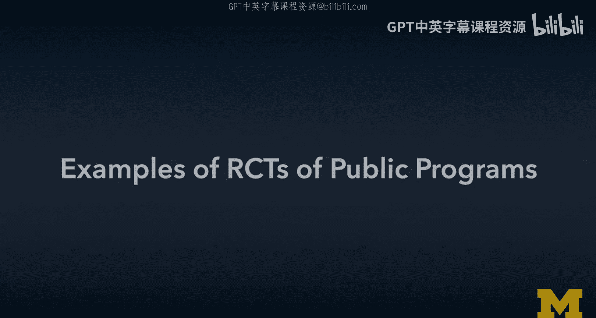
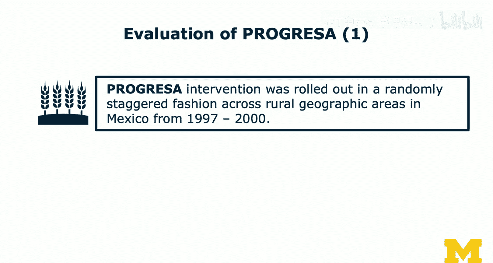
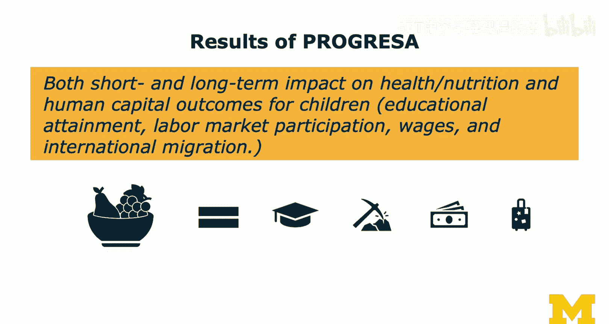
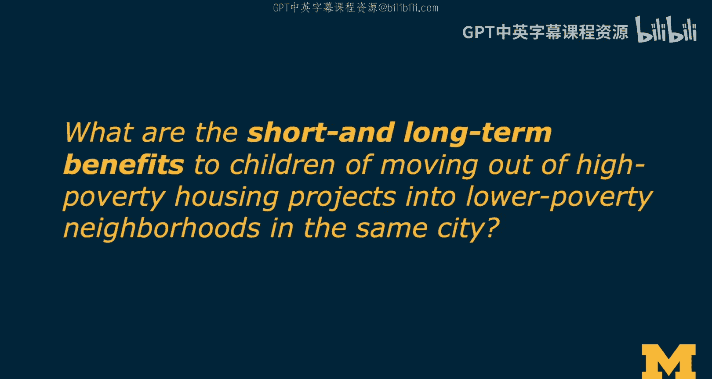
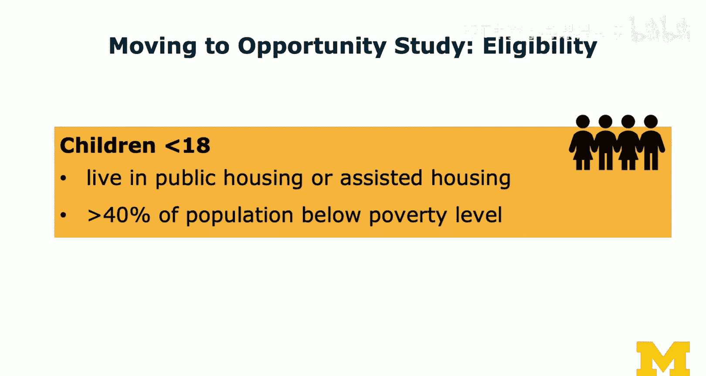
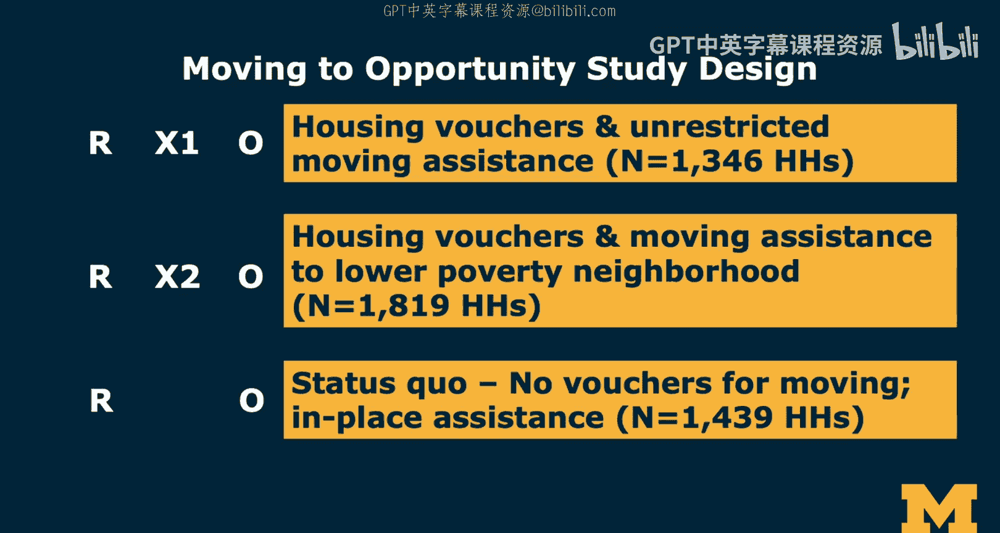
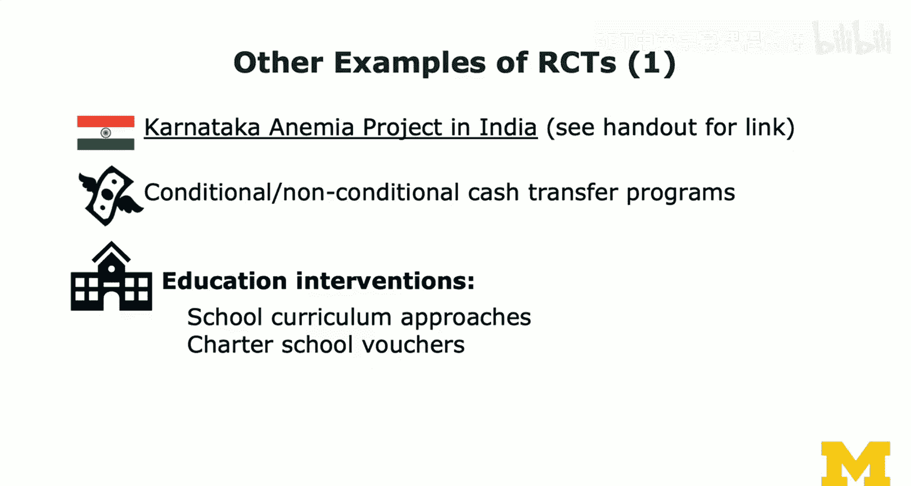
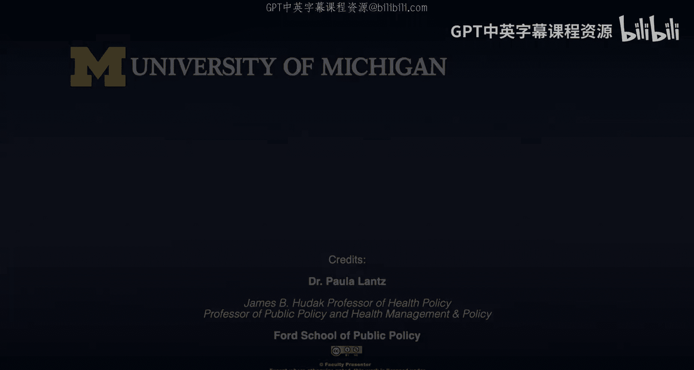

# 公共部门的R数据分析：33：公共项目随机对照试验（RCT）案例 🧪

在本节课中，我们将学习两个由政府实施的著名随机对照试验案例。我们将了解这些试验的设计、实施过程以及主要发现，从而理解RCT在公共项目评估中的实际应用。

## 概述

随机对照试验是评估公共项目有效性的黄金标准。你可能想知道，政府在评估公共项目时，究竟有多频繁地使用RCT？答案可能比你想象的更频繁。本节将介绍两个广为人知的公共项目RCT案例：墨西哥的“进步计划”和美国的“向机会迁移”干预研究。

## 墨西哥“进步计划”的RCT评估 🇲🇽

上一节我们介绍了随机对照试验的基本原理，本节中我们来看看它在实际公共项目中的第一个应用案例。

“进步计划”是墨西哥一项大型社会福利项目，其RCT评估非常著名。该干预措施的核心目标是改善墨西哥农村地区家庭、儿童及其父母的健康状况、营养状况和贫困状况。

该干预措施被称为**有条件现金转移支付**。这意味着向家庭提供现金，但并非无条件给予。现金转移支付的前提是家庭必须满足某些特定行为条件。

*   现金支付给家庭的女性户主。
*   支付金额取决于满足的条件，最高可达其月收入的三分之一。
*   这笔额外的月度现金对家庭生活可能产生重大影响。

以下是“进步计划”干预措施的具体条件：

*   家庭成员必须接受预防性医疗保健，包括对儿童至关重要的免疫接种，以及在当地社区卫生中心进行的健康检查（含牙科检查）。
*   对于有5岁以下儿童和哺乳期母亲的家庭，母亲必须参加营养监测诊所，接受营养教育干预。
*   对于孕妇，条件是其必须前往诊所接受产前护理，获取营养补充剂和额外的孕产妇健康教育。

“进步计划”的评估巧妙地利用了项目本身的特点：该计划于1997年至2000年间，在墨西哥农村地区以随机、交错的方式逐步推广。这种情况在政府项目中很常见，原因可能是资源有限（尤其是在大国），无法同时在所有地区推行新项目，或者没有足够的人手来良好地执行。当项目以交错方式推出时，研究人员可以借此机会，实际上**随机地**确定推广顺序，这有助于实验的设置。

这正是该研究采用的方法。研究人员利用了这种随机交错的实施方式，比较了先接受干预的地区和尚未接受（但未来将接受）干预的地区。这是一项规模庞大的研究，涵盖了墨西哥506个不同社区中近14,500个家庭的约90,000人。

那么，研究发现了什么？他们发现，接受有条件现金转移支付的家庭，其儿童的健康、营养和人力资本成果在短期和长期内都产生了积极影响。这包括：
*   儿童的教育程度
*   他们的劳动力市场参与度和所获工资
研究人员对这些家庭进行了长期跟踪。此外，研究还发现了对国际移民的影响，移民数量有所增加。这可能是因为干预提高了教育程度，增强了在墨西哥境外寻找工作机会的能力。

因此，“进步计划”被认为是一项有效的社会福利项目。其结论之所以具有说服力，正是基于它是以随机对照试验的方式设计和实施的。

## 美国的“向机会迁移”干预研究 🏙️

接下来，我们转向另一个不同但同样属于社会福利领域的问题。

许多国家和地区都关注这样一个问题：将儿童从高贫困率的公共住房项目迁移到同一城市内贫困率较低的社区，会对他们产生哪些短期和长期的益处？大量公共住房聚集了高密度的贫困家庭，一个核心问题是：这种居住环境对儿童有何影响？如果儿童迁出这些高贫困率住房，搬到同一城市内贫困水平较低的不同社区，又会怎样？

在美国的城市背景下，这是一个重要问题。为此，一项旨在回答此问题的研究被设计出来，即“向机会迁移”研究。这同样是一个历史案例，但其结果至今仍被广泛引用，并且该研究也被视为政府参与随机对照试验的一个典范。

美国住房与城市发展部在五个城市（巴尔的摩、波士顿、芝加哥、洛杉矶和纽约）招募家庭参与了这项实验研究。参与资格如下：
*   在这五个城市中，家中有18岁以下儿童的家庭。
*   居住在公共住房或政府补贴/援助住房中。
*   根据人口普查数据，所在社区有超过40%的人口生活在贫困线以下。

那么，“向机会迁移”干预的研究设计是怎样的呢？

在这个案例中，实际上设置了两个不同的干预组和一个控制组。
*   **干预组1（X1）**：向家庭提供住房券，且搬迁不受限制。基本思路是：政府提供补贴住房券，家庭可以搬到城市里任何他们想去的地方，目的只是让他们搬离高贫困、高密度的低收入住房区。
*   **干预组2（X2）**：同样提供住房券，但搬迁受到限制，只能迁往贫困率较低的社区。
*   **控制组**：随机分配，不提供搬迁用的住房券。他们会获得一些资源，用于解决家庭可能面临的一些问题，但不提供任何搬迁援助。

因此，我们共有三组，包含两种不同的干预措施。虽然图中只显示了一个后续观察点，但实际上，这些家庭和儿童被跟踪随访了多年，这些儿童的未来状况也得到了长期追踪。

该研究的主要发现有哪些？“向机会迁移”研究产生了大量学术出版物，其中一些亮点包括：
*   在任一干预组中，均未发现对儿童的学业表现或其与刑事司法系统的关联有显著影响。干预组与对照组在这些方面没有表现出差异。
*   然而，研究观察到参与家庭的父母在身心健康结果上有所改善，并且这些改善持续了相当长的时间。
*   此外，研究确实发现，对于搬迁时年龄较小的儿童（13岁以下），虽然对其学业表现没有影响，但长期跟踪显示，他们在成年后的年收入有所增加。但这仅适用于搬迁时年龄较小的儿童。

## 其他RCT案例与应用领域

除了上述两个案例，政府还使用了大量其他随机对照试验的例子。以下是一些其他领域的RCT应用：
*   **印度的一项大型项目**：旨在应对贫血这一重要的公共卫生问题，其研究设计非常出色。
*   **大量有条件现金转移支付项目**：以及一些无条件现金转移支付项目，形成了非常有趣的研究文献，其中几乎都使用了随机对照试验。如果你对此类干预感兴趣，有很多资料可供查阅。
*   **众多教育干预措施**：例如学校课程方法，以及在美国比较公立学校、私立学校和特许学校学生教育成果的研究，其中许多都使用了随机对照试验。

由此可见，在公共部门中，随机对照试验的应用案例非常广泛。

## 总结

本节课中，我们一起学习了两个经典的公共项目随机对照试验案例：墨西哥的“进步计划”和美国的“向机会迁移”研究。通过这两个案例，我们看到了RCT如何被用于评估有条件现金转移支付和住房政策等复杂社会干预的效果。这些研究不仅展示了RCT方法的严谨性，也揭示了其在揭示项目真实影响（无论是积极、消极还是中性）方面的强大能力。它们证明，通过精心设计的随机实验，政府能够更科学、更有效地评估公共项目的价值，从而为政策决策提供坚实证据。