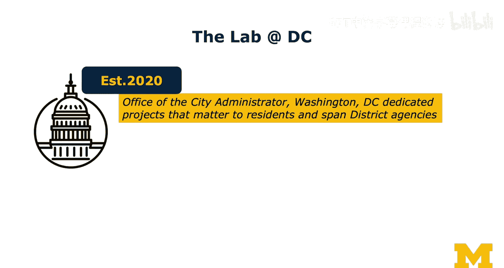
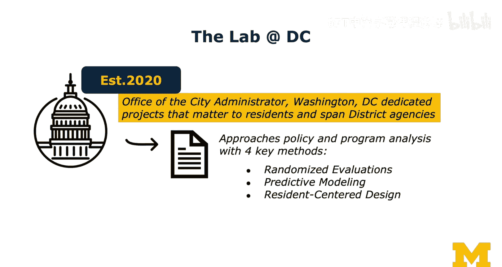
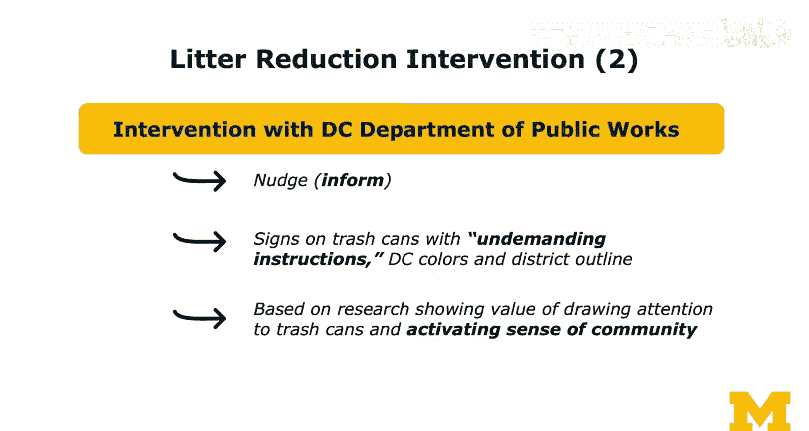
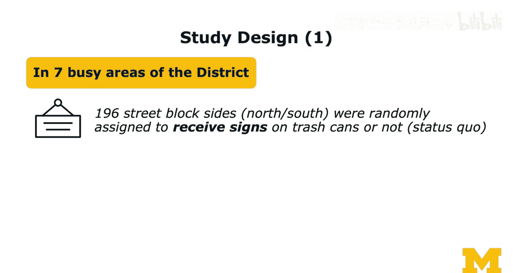
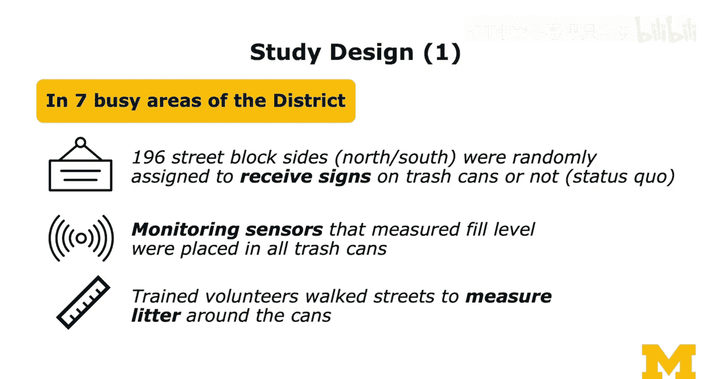
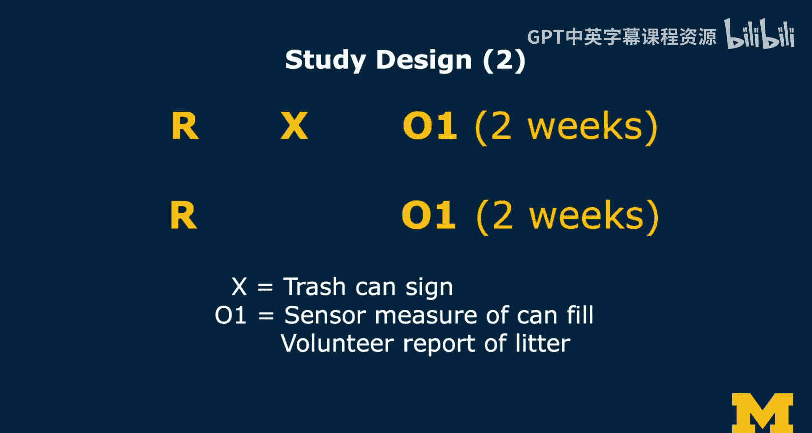
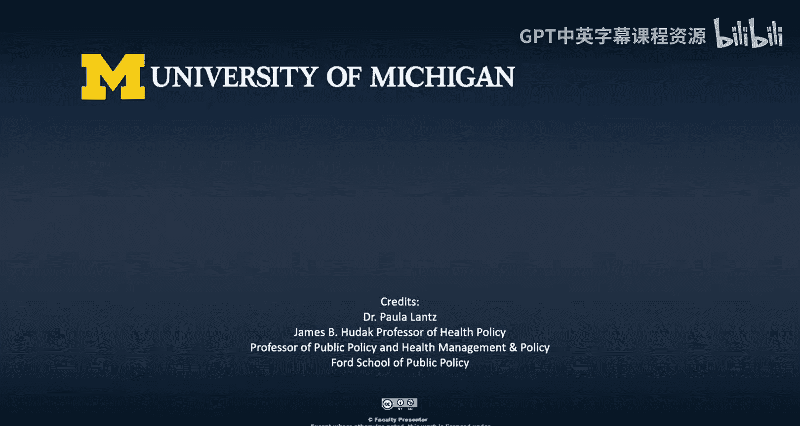

# 公共部门的R数据分析：34：华盛顿特区垃圾桶干预案例研究预告

在本节课中，我们将介绍一个由华盛顿特区政府实验室进行的随机对照试验案例。我们将了解该研究的背景、设计思路以及评估方法，为后续的数据分析和代码实践做好准备。

## 研究背景与机构介绍

上一节我们介绍了评估研究设计的基本语言，本节中我们来看看一个具体的应用案例。

这项研究由华盛顿特区的“实验室”机构进行。这是一个非常酷的倡议，于2020年在市行政长官办公室下成立。该实验室是一个由研究人员和分析师组成的团队，致力于开展那些“对特区居民至关重要”且“跨越政府机构”的项目。

该实验室采用四种关键方法进行政策和项目分析：

*   随机评估
*   预测建模
*   以居民为中心的设计
*   行政数据分析

实验室已经开展了多项不同的项目评估，今天我们只讨论其中一项：一项关于减少垃圾干预措施的效果评估。

## 问题定义与干预设计

首先，华盛顿特区居民认为需要解决的问题是什么？街道上的垃圾或废弃物是哥伦比亚特区乃至全球许多城市普遍存在的问题。

除了有碍观瞻，清理垃圾需要花费资金。用于垃圾清理的税款就无法用于其他重要事项。垃圾还可能对区域的房产价值产生负面影响。最后，特区的一些垃圾会流入穿城而过的主要河流，加剧水污染问题。

因此，实验室与特区公共工程部合作设计了一项干预措施。这项干预措施非常简单，它使用了我们之前讨论过的“信息”政策杠杆，或者说是一种通过在垃圾桶上使用标识牌对人们进行的简单“助推”。

这些标识牌使用了实验室所称的“非强制性指令”，即告知而非恳求。希望你还记得我们之前讨论过的区别。垃圾桶上的标识还使用了特区的颜色。

这项干预设计基于研究表明，简单的助推有时可以改变行为，特别是当它们同时能引起人们对解决方案（在本例中是垃圾桶）的注意，并且试图激发社区归属感时——后者希望通过在标识中使用特区的颜色和形状来实现。

以下是一张放置在垃圾桶上的标识牌照片：“爱护特区，请勿乱扔垃圾，将垃圾放入桶中。”

## 研究设计与评估方法

现在，评估研究的设计如下：在特区七个繁忙区域，190个街道区块（街道的北侧或南侧）被随机分配接受其垃圾桶上的标识牌，或不接受（即维持现状）。

在某些街道，一侧被随机分配接受干预，而特区的其他街道则作为反事实或现状对照组。所有垃圾桶上都安装了监测传感器。此外，还培训了志愿者来测量垃圾桶周围的垃圾。

让我们看一下研究设计的图形表示。共有196条街道，其中约一半被随机分配在街道一侧的垃圾桶上放置标识，其余的则保持原状作为对照组。

两周后，对所有垃圾桶进行了测量，包括传感器测量的垃圾桶内新增填充物，以及志愿者观察到的垃圾情况。

## 总结

本节课中，我们一起学习了华盛顿特区垃圾桶干预案例的背景和研究设计。我们了解到，该研究旨在通过简单的标识牌“助推”来减少乱扔垃圾的行为，并采用了严格的随机对照试验设计进行评估。在接下来的课程中，我们将深入分析这项试验的数据和代码。