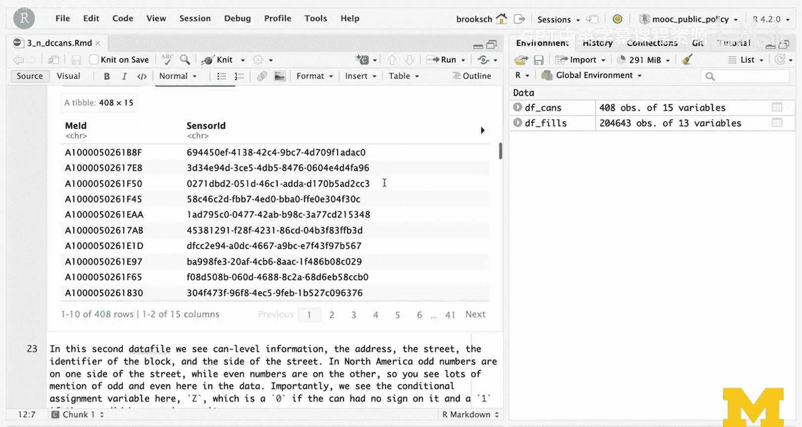
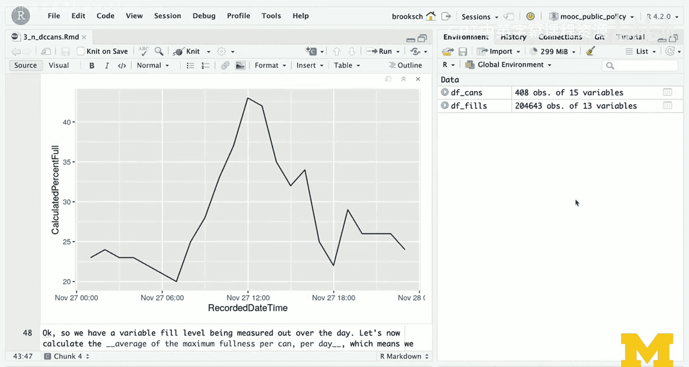
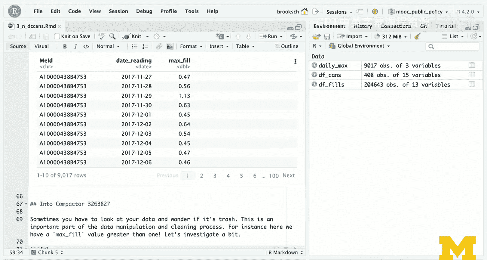
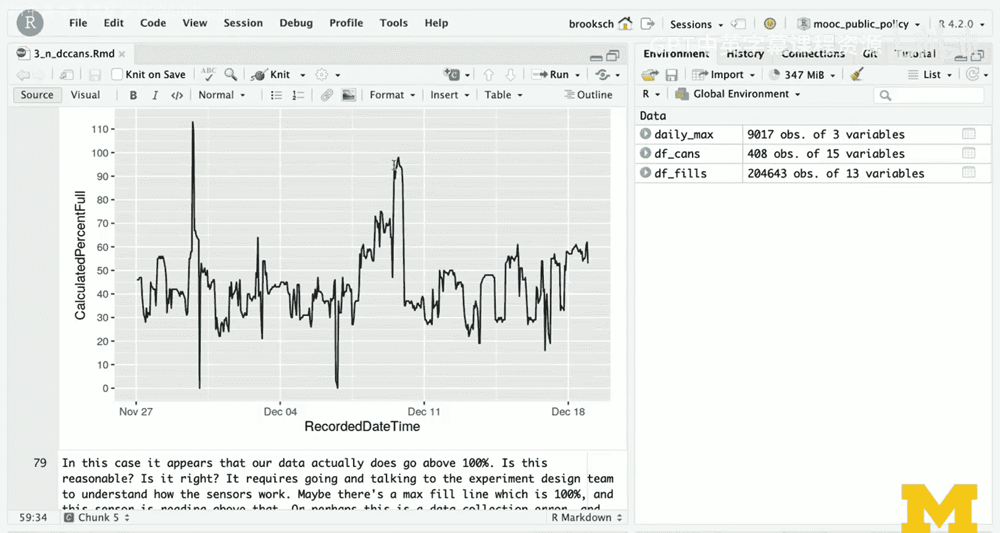
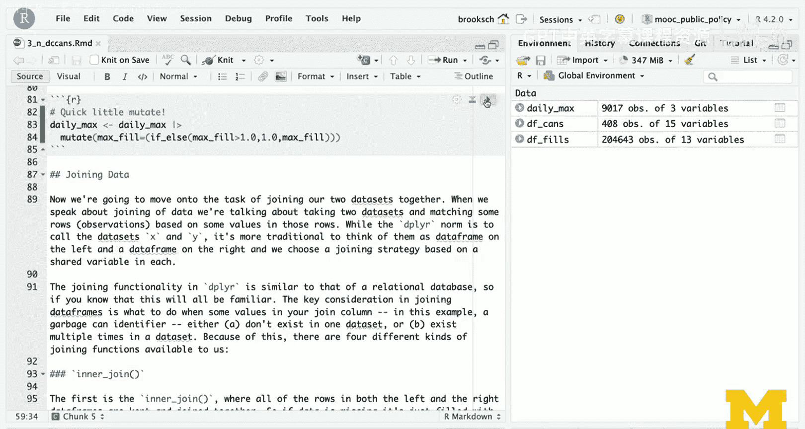

# 35：华盛顿特区垃圾桶干预数据分析 🗑️


在本节课中，我们将学习如何分析一项来自华盛顿特区实验室的行为干预实验数据。该实验旨在探究在公共垃圾桶上张贴积极信息（行为助推）是否能有效减少街道垃圾。我们将使用R语言进行数据导入、清理、转换与分析，并最终评估干预效果。

---

华盛顿特区实验室是华盛顿特区市行政办公室的一项卓越倡议。兰斯博士已经介绍了该实验室的工作以及我们今天将要探讨的具体案例。这个小组的卓越之处在于，他们不仅像越来越多的政府机构一样公开数据，更进一步公开了他们使用的整个科学过程。这是更高层次的问责制和透明度。这为每个人提供了学习有效和无效方法的机会，并允许任何人以极低的门槛提升技能、质疑假设并做出贡献。我能够利用他们已完成的工作，在本讲座中进行部分复制分析，而无需与实验室的任何人员实际交谈，这既不可思议又十分罕见。

现在，让我们关注他们感兴趣的案例。垃圾会产生异味，市政当局可以尝试采用不同策略来减少市中心等高密度区域的垃圾。公共垃圾桶很常见，这项研究提出的问题是：垃圾桶上以积极信息形式呈现的行为助推，能否减少街道上的垃圾量？如果可以，这将是一种成本极低的干预措施，可以以最小的成本推广到所有公共垃圾桶。为了在2017年测试这一点，该市选择了繁忙区域的若干街道，并随机分配一些垃圾桶张贴标识，另一些则不贴。兰斯博士介绍的随机化方法非常重要，因为我们预期某些垃圾桶的垃圾量可能仅基于城市交通模式就会发生变化。

接下来，我将重点分析收集到的数据。我们感兴趣的结果变量是**每个垃圾桶每天最大满溢度的平均值**，传感器安装在垃圾桶上以按体积测量这个满溢度。让我们查看数据。

---

## 加载与查看数据

首先，我将加载 `tidyverse` 包，并导入名为 `litter_can_fills.csv` 的数据文件。

```r
library(tidyverse)
df_fills <- read_csv("litter_can_fills.csv")
glimpse(df_fills)
```

数据显示了垃圾桶、传感器、满溢度、位置和日期等信息。但是，数据中没有关于垃圾桶被分配到的条件（即是否贴有助推标识）的信息。因此，我们需要在另一个数据文件中查找该信息。

---

## 导入实验分配信息

接下来，我将加载包含实验分配信息的文件 `litter_cans_randomized.csv`。

```r
df_cans <- read_csv("litter_cans_randomized.csv")
glimpse(df_cans)
```

在第二个数据文件中，我们可以看到垃圾桶级别的信息：地址、街道、街区标识符和街道侧。重要的是，我们看到了条件分配变量 `Z`，如果垃圾桶没有标识，则 `Z` 为 `0`；如果有标识，则 `Z` 为 `1`。

这种数据排列方式很常见：一个文件包含所有实验观测值（`df_fills`），另一个文件包含分配条件详情和样本总体信息（`df_cans`）。我们需要将这两个数据框合并起来，这意味着我们将进一步学习R的操作。数据集中有一个唯一的垃圾桶标识符 `meID`，这将是我们成功合并的关键。


---

## 数据准备与合并

但在合并之前，需要注意的是，我们获得的基础数据实际上并不包含研究团队感兴趣的结果度量。回顾一下，该度量是**每个垃圾桶每天最大满溢度的平均值**。让我们回到 `df_fills` 查看几个变量：`recorded_datetime`、`meID` 和 `calculated_percent_full`。

看起来我们有一个垃圾桶标识符、测量值的时间戳以及满溢百分比。但仔细观察，你会发现满溢度在一天内被测量了多次。因此，让我们对单个垃圾桶进行一些探索性数据分析。

---

## 探索性数据分析与指标计算

我将随机选取第一个垃圾桶，筛选出11月27日的数据，并用 `ggplot` 绘图。

```r
library(lubridate)
# 示例：查看特定垃圾桶某一天的满溢度变化
sample_can <- df_fills %>%
  filter(meID == "某个ID", date(recorded_datetime) == ymd("2017-11-27"))



ggplot(sample_can, aes(x = recorded_datetime, y = calculated_percent_full)) +
  geom_line() +
  labs(title = "单日垃圾桶满溢度变化", x = "时间", y = "满溢度 (%)")
```

图表显示了该垃圾桶在一天内随时间变化的满溢度水平。我们需要计算的是“每个垃圾桶每天最大满溢度的平均值”。这意味着我们需要找出给定日期下垃圾桶的最大满溢度，然后计算每个垃圾桶在所有天数中该最大值的平均值。


现在是你暂停视频并自己尝试的好时机。对于我的解决方案，我将使用 `lubridate` 包。我将把 `recorded_datetime` 转换为实际的日期对象，这将自动去掉时间成分。当然，你也可以用其他方法处理，比如将其视为字符串并提取感兴趣的部分。

```r
# 创建日期变量并计算每日最大满溢度
df_daily_max <- df_fills %>%
  mutate(recorded_date = date(recorded_datetime)) %>% # 提取日期
  group_by(meID, recorded_date) %>% # 按垃圾桶和日期分组
  summarise(max_fill_raw = max(calculated_percent_full, na.rm = TRUE), .groups = 'drop') %>%
  mutate(max_fill = max_fill_raw / 100) # 转换为0-1之间的比例
```

有时你必须查看数据并思考它是否是“垃圾”，这是数据操作和清理过程的重要部分。例如，这里我们有一个大于1的 `max_fill` 值。这实际上意味着什么？让我们深入调查一下。

---

## 数据质量检查与清理

我将用这个新垃圾桶更新折线图，并添加一些分面以便查看。

```r
# 调查异常值
problem_can <- df_daily_max %>% filter(max_fill > 1) %>% slice(1) %>% pull(meID)
df_fills %>%
  filter(meID == problem_can) %>%
  ggplot(aes(x = recorded_datetime, y = calculated_percent_full)) +
  geom_line() +
  labs(title = "异常垃圾桶满溢度时间序列", x = "时间", y = "满溢度 (%)")
```

图表显示，在整个观测期内，该垃圾桶的满溢度确实有时超过了100%，也有几次降到了0。在这种情况下，我们的数据确实超过了100%。这合理吗？正确吗？这需要与实验设计团队沟通，以了解传感器的工作原理。可能有一个100%的最大满溢线，而传感器读取的是堆积在该线以上的数据。或者，这可能是一个数据收集错误，数据需要进一步清理。

无论如何，作为分析师，与更大的团队合作并探索数据以理解它，这一点很重要。在这个具体案例中，DC实验室的团队选择将数值上限设为100%，我们也将这样做。

```r
# 将最大满溢度限制在100%（即比例1.0）
df_daily_max <- df_daily_max %>%
  mutate(max_fill_capped = pmin(max_fill, 1.0))
```



现在，我们已经计算出了每个垃圾桶-日期组合的最大满溢度（并进行了封顶处理）。下一步是计算每个垃圾桶在整个实验期间该最大值的平均值，这将是我们最终的分析指标。


```r
# 计算每个垃圾桶的平均每日最大满溢度
df_can_outcome <- df_daily_max %>%
  group_by(meID) %>%
  summarise(avg_max_fill = mean(max_fill_capped, na.rm = TRUE), .groups = 'drop')
```

---

## 合并数据与初步分析



现在，我们有了包含结果指标 `avg_max_fill` 的数据框 `df_can_outcome`。我们需要将其与包含实验条件 `Z` 的 `df_cans` 数据框合并。使用共同的键 `meID` 进行连接。

```r
# 合并实验条件与结果数据
df_analysis <- df_cans %>%
  inner_join(df_can_outcome, by = "meID")

# 查看合并后的数据
glimpse(df_analysis)
```

现在数据已经准备就绪。我们可以进行初步的组间比较，例如计算有标识组（`Z == 1`）和无标识组（`Z == 0`）的平均 `avg_max_fill`。

```r
# 按实验条件分组汇总
summary_stats <- df_analysis %>%
  group_by(Z) %>%
  summarise(
    mean_avg_max_fill = mean(avg_max_fill, na.rm = TRUE),
    sd_avg_max_fill = sd(avg_max_fill, na.rm = TRUE),
    n = n(),
    .groups = 'drop'
  )
print(summary_stats)
```


为了更直观地比较，我们可以绘制箱线图。



```r
ggplot(df_analysis, aes(x = factor(Z), y = avg_max_fill, fill = factor(Z))) +
  geom_boxplot() +
  labs(title = "行为助推标识对垃圾桶平均满溢度的影响",
       x = "实验条件 (0=无标识, 1=有标识)",
       y = "平均每日最大满溢度 (比例)") +
  theme_minimal()
```

---

## 总结





本节课中，我们一起学习了如何分析华盛顿特区实验室的一项行为干预实验。我们从导入原始传感器数据和实验设计数据开始，经历了数据探索、关键指标（每日最大满溢度的平均值）的计算、数据质量检查与清理（处理超过100%的数值），以及最终的数据合并。通过初步的描述性统计和可视化，我们可以开始评估在公共垃圾桶上张贴积极标识这一简单干预措施的效果。这为后续可能进行的统计显著性检验（如t检验）奠定了基础。整个过程展示了在公共部门数据分析中，从原始数据到可解释结果的完整工作流程。