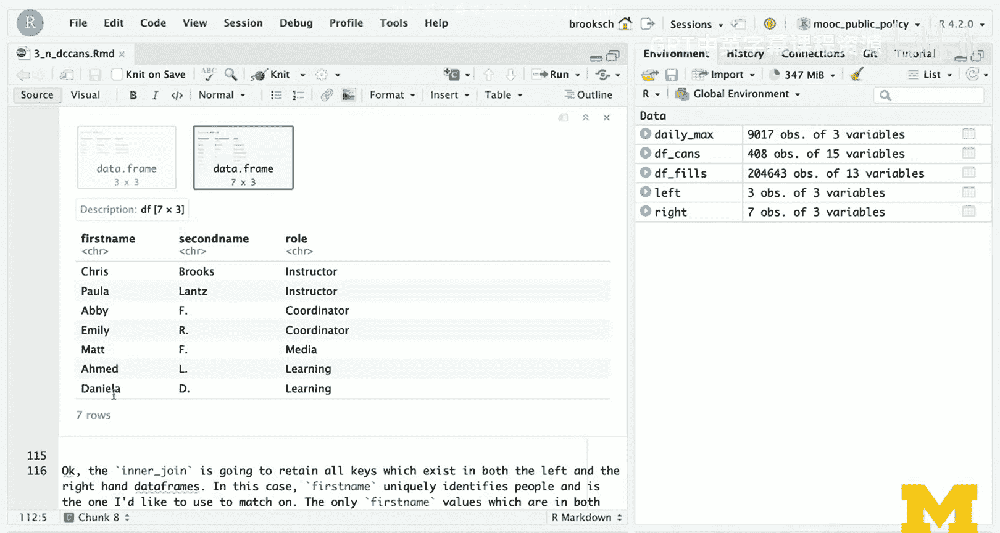
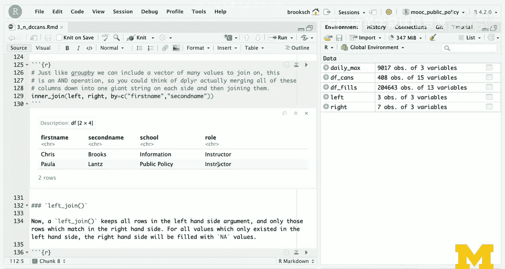
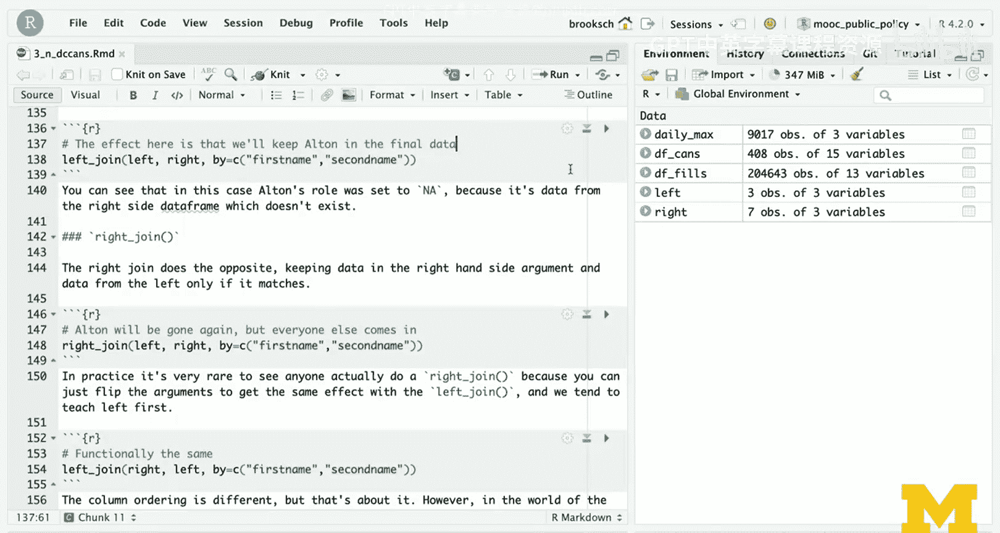
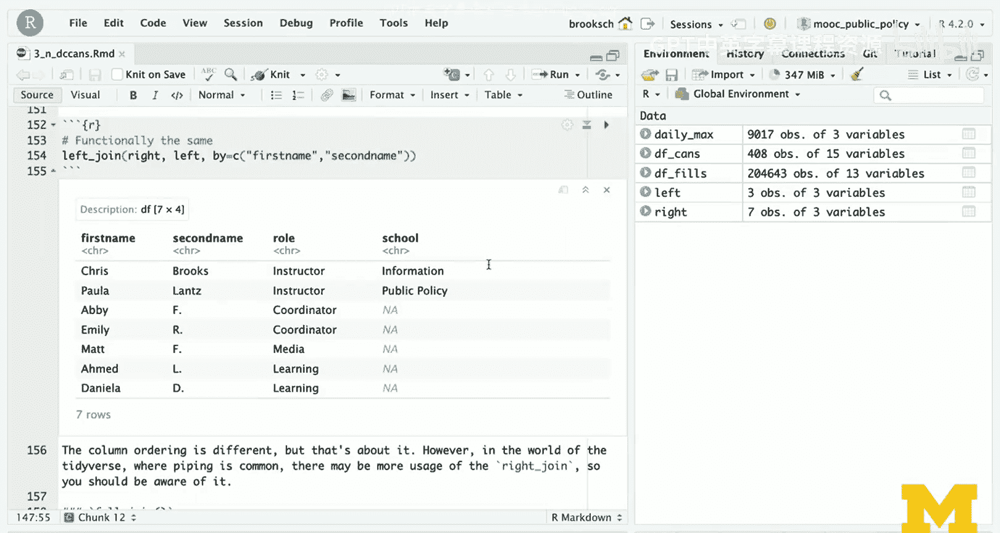
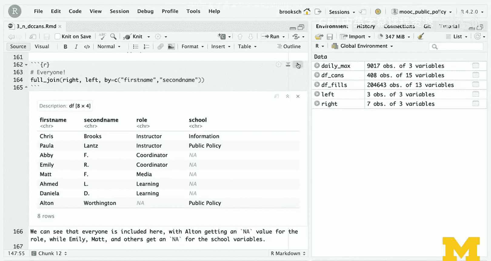

# 公共部门的R数据分析：115：数据整合 🧩


在本节课中，我们将学习如何将两个数据集合并在一起。数据整合是数据分析中的关键步骤，它允许我们基于某些共享变量，将不同来源的信息关联起来。

## 数据连接概述

上一节我们介绍了数据清洗，本节中我们来看看如何将两个数据集连接起来。

当我们谈论数据连接时，指的是基于行中的某些值，将两个数据集的行（观测值）进行匹配。虽然 `dplyr` 包的惯例是将数据集称为 `X` 和 `Y`，但更传统的理解方式是将它们视为左侧数据框和右侧数据框。然后，我们根据每个数据框中共享的变量来选择连接策略。

R中的连接功能类似于关系型数据库。如果你熟悉数据库操作，那么这些概念对你来说会很熟悉。连接数据框时的关键考虑是，当连接列中的某些值在一个数据集中不存在或存在多次时，该如何处理。因此，我们实际上有四种不同的连接函数可供使用。

## 四种连接类型


以下是四种主要的连接类型及其工作原理。

### 1. 内连接

内连接会保留左侧和右侧数据框中都存在的所有行，并将它们连接在一起。如果数据缺失，则用 `NA` 值填充。如果一个键在一侧出现两次或更多次，那么它也会被连接相应次数。

让我们通过一个例子来理解。假设我们有两个关于课程团队的数据框。

**左侧数据框 (`left_df`)** 包含讲师信息：

```r
left_df <- data.frame(
  first_name = c("Chris", "Paula", "Alton"),
  last_name = c("Brooks", "Lance", "Worthington"),
  school = c("Information", "Public Policy", "Public Policy")
)
```



**右侧数据框 (`right_df`)** 包含核心开发团队信息：

```r
right_df <- data.frame(
  first_name = c("Chris", "Paula", "Abby", "Emily", "Matt", "Ahmed", "Daniela"),
  last_name = c("Brooks", "Lance", "M.", "S.", "B.", "R.", "G."),
  role = c("Instructor", "Instructor", "Media", "Learning", "Coordination", "Media", "Learning")
)
```

如果我们基于 `first_name` 和 `last_name` 进行内连接，只会保留两个数据框中都存在的键（即 Chris Brooks 和 Paula Lance）。


```r
inner_joined <- inner_join(left_df, right_df, by = c("first_name", "last_name"))
```

结果将是一个包含两行的数据框。如果两个数据框中有同名的列（如 `last_name`），`dplyr` 会自动添加后缀（如 `.x` 和 `.y`）来区分它们。

### 2. 左连接

左连接会保留左侧参数中的所有行，并且只保留右侧参数中与之匹配的行。对于仅存在于左侧的值，右侧的列将用 `NA` 填充。



```r
left_joined <- left_join(left_df, right_df, by = c("first_name", "last_name"))
```


在这个例子中，结果将包含 Chris、Paula 和 Alton。Alton 的 `role` 列将是 `NA`，因为右侧数据框中没有他的信息。

### 3. 右连接



右连接与左连接相反，它会保留右侧参数中的所有行，并且只保留左侧参数中与之匹配的行。

```r
right_joined <- right_join(left_df, right_df, by = c("first_name", "last_name"))
```

在这个例子中，Alton 将不会出现在结果中，但右侧数据框的所有人（包括 Abby、Emily 等）都会出现，Chris 和 Paula 的信息也会被保留。在实践中，右连接很少使用，因为通过交换参数顺序使用左连接可以达到同样效果。但在 `tidyverse` 的管道操作中，右连接有时会更方便。


### 4. 全连接

全连接会保留左侧和右侧数据框中的所有行，并在适当的位置用 `NA` 值填充缺失的数据。



```r
full_joined <- full_join(left_df, right_df, by = c("first_name", "last_name"))
```


这将得到一个包含所有参与者的列表。Alton 的 `role` 是 `NA`，而 Emily、Matt 等人的 `school` 变量是 `NA`。

## 总结




本节课中我们一起学习了数据整合的四种基本连接操作：内连接、左连接、右连接和全连接。理解这些连接类型的区别对于合并来自不同来源的数据至关重要。在实际操作中，最常用的是左连接和内连接。选择哪种连接方式取决于你的分析目标：是想保留所有观测（全连接），只想保留匹配的观测（内连接），还是想以一个数据集为基准合并另一个数据集的信息（左/右连接）。掌握这些技能将使你能够更有效地进行复杂的数据分析。