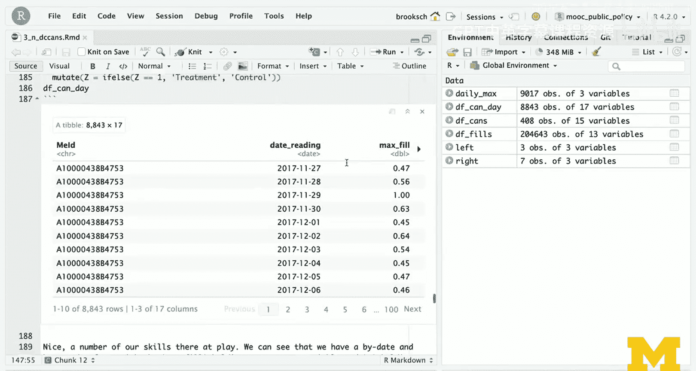
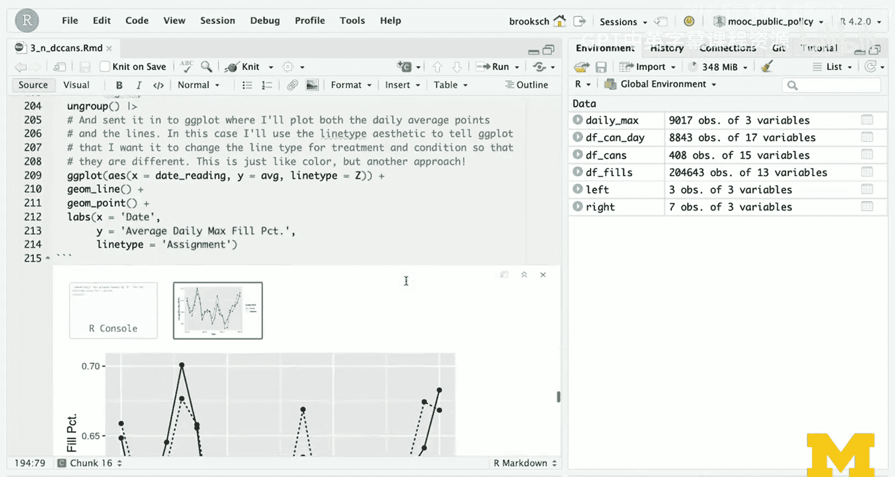
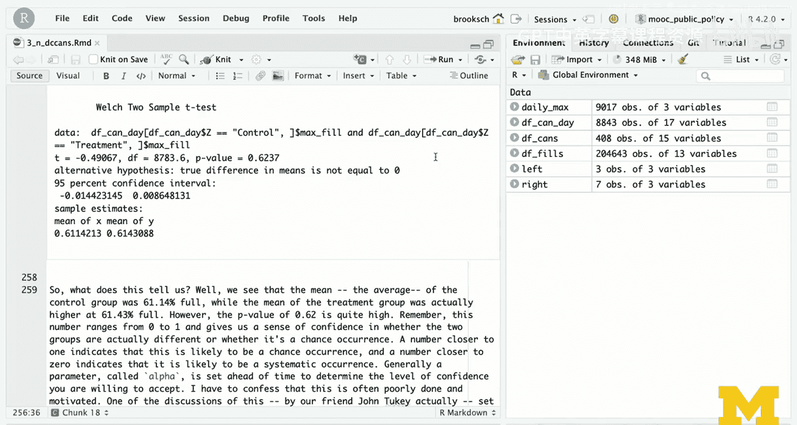

# 公共部门的R数据分析：第37章：华盛顿特区垃圾桶干预总结 🗑️📊


在本节课中，我们将学习如何整合多个数据集，对实验数据进行可视化探索，并运用统计检验（T检验）来评估干预措施（在垃圾桶上贴标签）的效果。我们将使用R语言中的`dplyr`和`ggplot2`等工具来完成这些任务。

---

上一节我们介绍了数据操作的基本工具，本节中我们来看看如何将多个数据集合并，以便进行更全面的分析。

我们已有`DF_fills`和`DF_Maxs`数据集，但还需要引入`condition`参数，即垃圾桶是否贴有标签的信息。我们将基于包含此信息的`daily_Max`数据集创建一个新的数据框。



具体操作是，将`daily_Max`数据框与`DF_canNs`数据框进行左连接。这会排除那些没有日均最大填充值记录的垃圾桶。同时，我们还需要剔除那些没有被分配为实验组或对照组的垃圾桶（即没有处理分配信息的记录）。

以下是合并与清理数据的步骤：

1.  使用`left_join`合并`daily_Max`和`DF_canNs`。
2.  使用`filter`过滤掉`Z`列（条件分配）为`NA`的记录。
3.  分组操作后，使用`ungroup`移除分组结构，以避免影响后续计算。
4.  将`Z`列中的数值（0和1）转换为更具可读性的标签“control”和“treatment”。


```r
df_can <- daily_Max %>%
  left_join(DF_canNs) %>%
  filter(!is.na(Z)) %>%
  ungroup() %>%
  mutate(Z = ifelse(Z == 0, "control", "treatment"))
```

完成这些步骤后，我们得到了一个按日期和垃圾桶编号组织的新数据框`df_can`，其中`max_fill`是我们的结果变量，`Z`是我们的条件分配变量。

---



在开始推断性检验之前，我们应该先尝试将数据可视化，以便直观地检查数据并形成初步假设。


我的兴趣在于做一个合理性检查，并直观感受两组数据（贴标签与未贴标签）是否真的存在差异。如果绘制两组`max_fill`的平均值随时间变化的曲线，我应该能得到可以直观比较的图形。

由于这是按条件和日期分组的数据，我将按`Z`（条件）和`date_reading`（日期）进行分组，然后计算两组的平均值。计算完成后，同样需要取消分组。接着，将数据传递给`ggplot`，同时绘制每日平均数据点和连线。这里，我将使用`linetype`美学映射来区分处理组和对照组的线条类型。

```r
df_can %>%
  group_by(Z, date_reading) %>%
  summarise(avg_fill = mean(max_fill)) %>%
  ungroup() %>%
  ggplot(aes(x = date_reading, y = avg_fill, linetype = Z)) +
  geom_point() +
  geom_line() +
  labs(x = "Date", y = "Average Max Fill (%)", linetype = "Condition")
```

那么，你认为这两条曲线是相同的还是不同的？花点时间回顾一下上面的数据表。我们还可以如何可视化这些数据，以更深入地理解其含义？

---

作为第二个例子，我认为按城市区域来查看数据会很有趣。由于我们只有七个区域，将其放入一张图中是合理的。

我的问题是：对于这个任务，我们应该使用`cowplot`还是分面（facets）？由于我们希望所有子图都是同一种类型（点线图），并且我们有一个变量（`area`）来指示不同的兴趣组，因此分面方法正是我们所需要的。

以下是创建分面图的步骤：

1.  按`area`、`Z`和`date_reading`进行分组。
2.  计算每个组的平均`max_fill`。
3.  在`ggplot`中添加`facet_wrap`，按`area`变量进行分面展示。

```r
df_can %>%
  group_by(area, Z, date_reading) %>%
  summarise(avg_fill = mean(max_fill)) %>%
  ungroup() %>%
  ggplot(aes(x = date_reading, y = avg_fill, linetype = Z)) +
  geom_point() +
  geom_line() +
  facet_wrap(vars(area)) +
  labs(x = "Date", y = "Average Max Fill (%)", linetype = "Condition")
```

从视觉上看，这些区域间的趋势看起来非常相似。因此，我认为现在应该基于所有垃圾桶的每日最大填充值进行T检验。

---



在R中进行T检验相当简单。调用`t.test`函数并传入两个样本，即对照组和处理组的垃圾桶最大填充值。

那么，应该使用配对T检验还是非配对T检验呢？只有当两个条件下的样本主体（此处指单个垃圾桶）是相同时，才使用配对T检验。这里的情况并非如此，因此我们将使用默认的非配对T检验。

请注意，我们现在暂时离开了`tidyverse`环境，回到了基础的R语法。

```r
t_test_result <- t.test(
  df_can$max_fill[df_can$Z == "control"],
  df_can$max_fill[df_can$Z == "treatment"]
)
print(t_test_result)
```

这个结果告诉我们什么？我们可以看到，对照组的平均最大填充率为61.14%，而处理组的平均值为61.43%，实际上略高一些。然而，P值为0.62，相当高。

P值的范围是0到1，它为我们提供了两组数据是否真正存在差异的信心程度，还是仅仅是偶然发生的结果。数值越接近1，表明这很可能是偶然发生的；数值越接近0，则表明很可能是系统性差异。

通常，会事先设定一个称为**α（alpha）**的参数，以确定你愿意接受的置信水平。在社会科学中，常将α阈值设为0.05，这意味着接受一个只有5%可能性是随机产生的结果。

但需要注意的是，随着观测数量的增加，P值会缩小。因此，一个有12个垃圾桶、P值为0.05的实验，其信号强度实际上远高于一个有100个垃圾桶、P值为0.005的实验。P值的含义没有改变，但我们如何解释它以及如何处理它却需要深思。

此外，还必须考虑**效应大小**（如果观察到差异，差异实际有多大）以及作为决策者时某项干预的**成本**。本次干预成本低廉，可以轻松在华盛顿特区的所有垃圾桶上推广，但我们的效应方向实际上是错误的（处理组填充率更高，与期望减少填充的假设相反）。因此，即使我们确信存在差异，我们也不会想张贴这些标签。

---


本节课中我们一起学习了如何合并与清理实验数据，使用`ggplot2`进行多角度的数据可视化以探索模式，并执行了非配对T检验来评估干预效果的统计显著性。我们发现，尽管处理组的平均填充率略高，但较高的P值（0.62）表明这种差异很可能是偶然产生的，不具有统计显著性。结合效应方向错误（期望降低但实际略增）的考量，可以得出结论：张贴标签的干预措施在减少垃圾桶填充率方面可能没有显著效果。这展示了数据分析在公共政策评估中的实际应用：即使结果不显著或与预期相反，严谨的分析也能为决策提供关键依据，避免无效或反效果的资源投入。