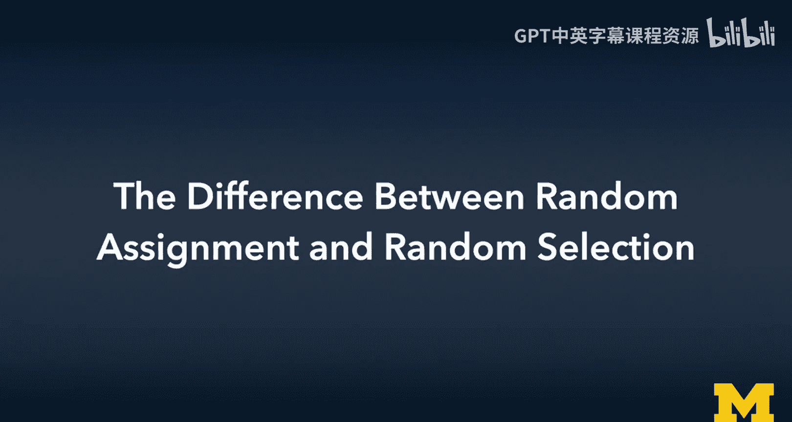
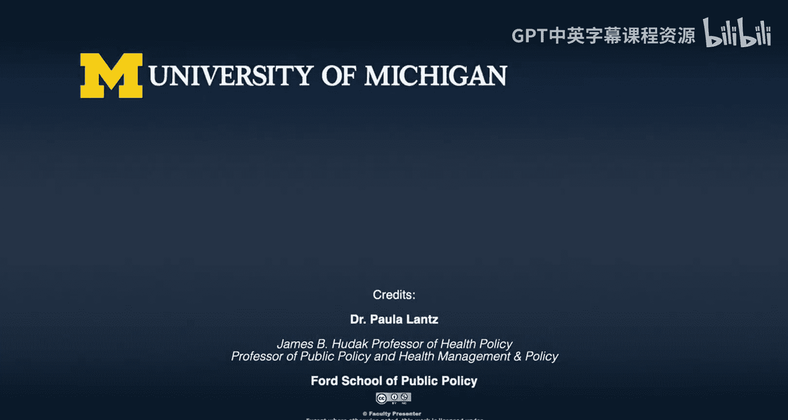

# 38：随机分配与随机抽样的区别 🎲

在本节课中，我们将要学习随机分配与随机抽样这两个核心概念的区别。这两个术语都包含“随机”一词，在研究设计中都非常重要，但理解它们之间的差异至关重要。

## 随机抽样 📊

上一节我们介绍了这两个概念的基本定义，本节中我们来看看随机抽样。

随机抽样，也称为概率抽样或随机选择，是一种从总体中选择成员参与研究的方法。这种方法常用于调查、焦点小组或用户体验反馈等研究。

以下是随机抽样的关键点：
*   它是一种选择研究参与者的方法。
*   其目标是确保样本能够代表总体。
*   常用于基于人群的调查等各类研究。

## 随机分配 🧪

了解了如何选择参与者后，我们来看看如何将他们分组进行研究。

随机分配是一种将样本参与者（通常是人员，但也可能是学校、社区或社区健康中心等其他研究单位）分入对照组和实验组的方法。在研究设计中，参与者被随机分配以决定是否接受某种干预。我们在讨论随机对照试验时一直在谈论这个概念。

以下是随机分配的关键点：
*   它是一种将已选定的参与者分入不同组别的方法。
*   其目标是创建在干预前完全相同的组别。
*   仅用于评估某种干预或处理效果的研究中。

## 随机分配的实施方法 ⚙️

那么，随机分配是如何进行的呢？研究人员有多种方法来随机决定参与者或单位属于处理组还是对照组。

以下是常见的随机分配方法：
*   使用简单的随机方法，例如掷骰子或抛硬币。
*   更常见的是使用随机数生成器。

真正的随机分配只有在每个个体或单位进入干预组或对照组的机会完全相同时才有效。在随机决定研究组分配的方法中不能存在任何偏见或缺陷。这正是随机对照试验有效的原因。通过这种方式，我们可以构建反事实：对照组与处理组完全相同，唯一的区别在于是否接受了干预。

## 总结 📝

本节课中我们一起学习了随机分配与随机抽样的核心区别。**随机抽样**关乎如何从总体中**选择**研究参与者，而**随机分配**关乎如何将已选定的参与者**分配**到不同的研究组别（如处理组和对照组）。理解这一区别对于设计和解读公共政策评估及其他领域的研究至关重要。