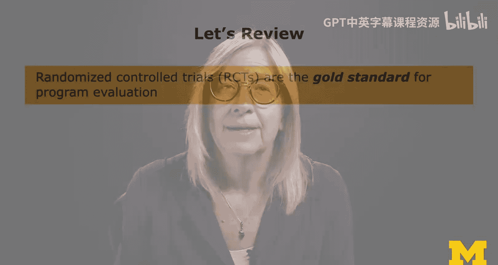
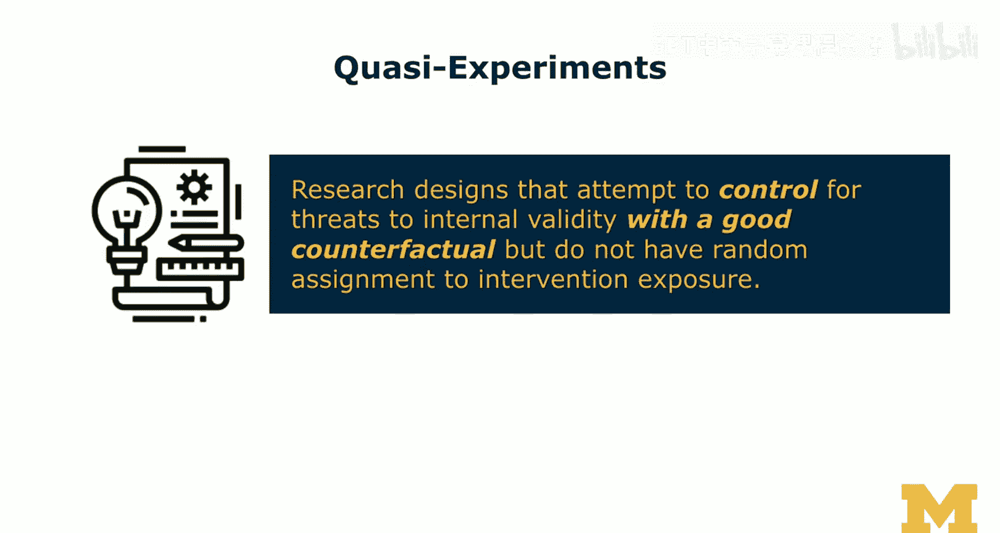
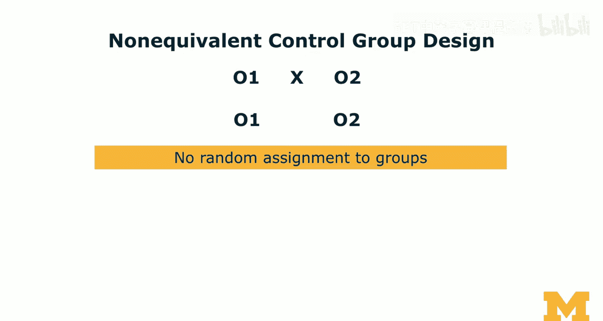
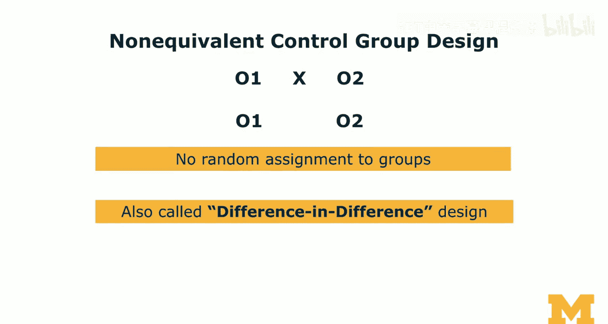
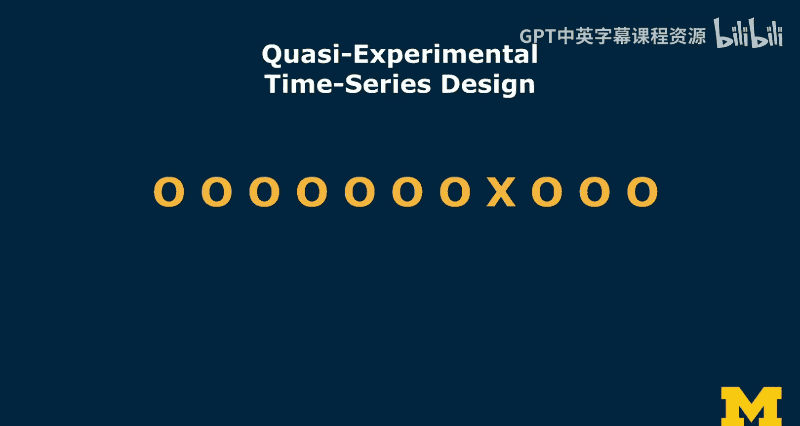
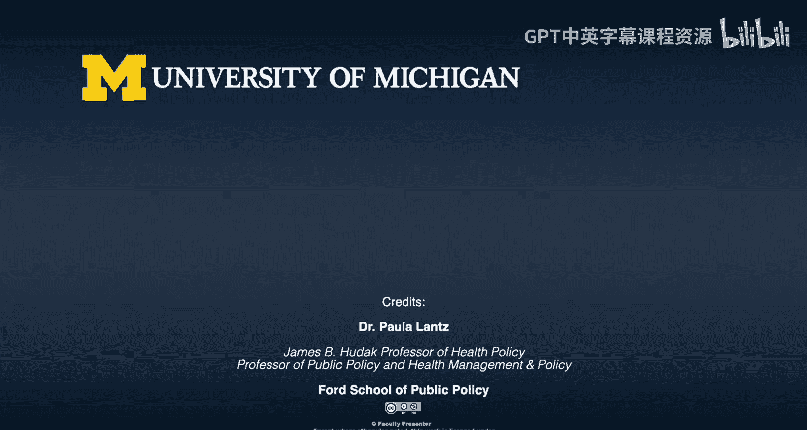

# 39：准实验设计方法 🧪

在本节课中，我们将要学习准实验设计方法。这是一种在无法进行随机分组时，用于评估项目或政策效果的重要研究设计。我们将回顾随机对照试验的优缺点，并介绍两种在公共部门评估中常用的准实验设计。

上一节我们介绍了随机对照试验作为评估的“黄金标准”。本节中我们来看看当随机分配不可行时，我们可以采用哪些替代方案。

## 随机对照试验回顾 📊

随机对照试验是项目和政策评估的黄金标准，有时也应用于公共部门项目的评估。然而，它存在许多缺点。

随机对照试验的优点在于其出色的**内部效度**。它确实是建立项目、政策、服务等干预措施与我们希望影响的结果之间**因果关系**的黄金标准。

然而，其缺点也很明显。随机对照试验实施起来成本高昂、复杂且耗时。在数据收集方面存在严峻挑战，需要为处理组和对照组收集完全相同的数据。此外，还存在一些伦理问题，我们将在后续课程中讨论。

## 什么是准实验设计？ 🤔

准实验设计是一大类研究设计的统称。这些设计试图通过构建良好的反事实组来控制所有对内部效度的威胁，但它们实际上**没有**对干预暴露进行随机分配。

以下是两种在公共部门项目与政策评估研究中经常使用的准实验设计。

### 非等效对照组设计

第一种设计称为**非等效对照组设计**。从幻灯片上可以看到，它看起来像随机对照试验，但关键区别在于两组参与者并非通过随机方式决定谁接受干预。没有对处理组进行随机分配。

我曾在一项社区研究中实际应用过这种设计。我们让四个县接受了一项针对女性癌症筛查（乳腺X光检查和巴氏涂片检查）的大众媒体干预。在该州另一片区域，我们选取了四个县作为对照组。我们通过调查获得了关于知识、态度、认知和癌症筛查行为的基线信息。

然后，干预组的四个县接受了干预。12个月后，我们进行了第二次调查，以观察干预县在知识、态度和行为方面的改善是否比对照组更显著。结果发现确实如此。再次强调，这里没有随机分配，在进行基于地理区域的干预时，随机分配确实很难实现。但这种研究设计在公共部门评估中应用广泛，且效果良好。

这种设计也被称为**双重差分设计**。如果你听到这个术语，要知道它指的就是这种非等效对照组设计。

### 时间序列设计

另一种在公共部门政策研究中常用的设计是**时间序列设计**。在这种设计中，你在一段时间内进行多次观测（可以是年、季度等）。图中的“O”代表最合适的时间单位。你先建立一条趋势线，然后在某个政策、变革或干预实施后，观察趋势线之后的变化。这是一种非常适合政策评估工作的优秀设计。

敬请期待，因为我们接下来将更深入地探讨时间序列设计。

## 总结 📝

本节课中我们一起学习了准实验设计方法。我们回顾了随机对照试验作为“黄金标准”的优缺点，并介绍了两种重要的准实验设计：**非等效对照组设计**（或称双重差分设计）和**时间序列设计**。这些方法在无法进行随机分配时，为评估公共部门项目和政策的因果效应提供了可行的替代方案。