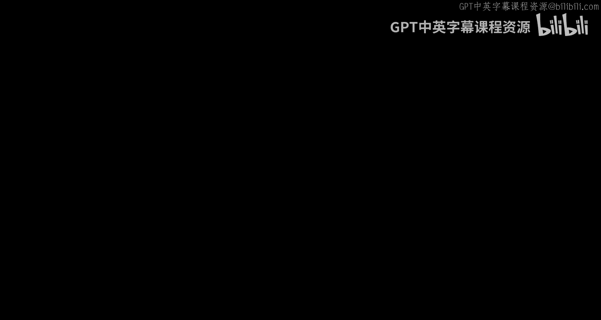
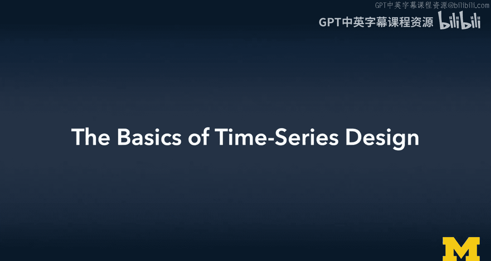
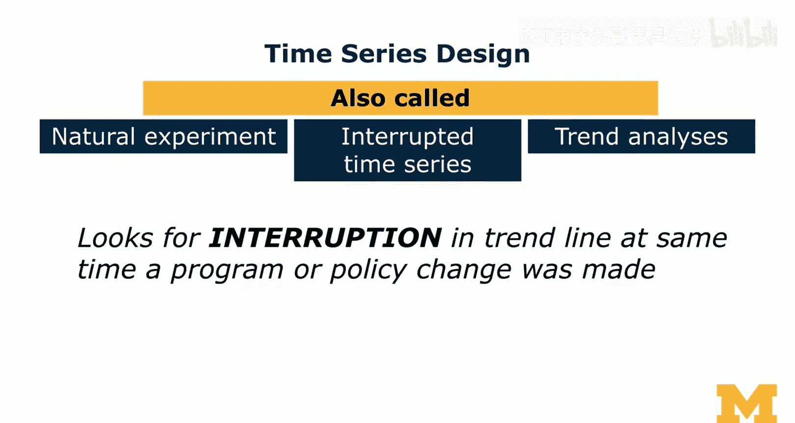
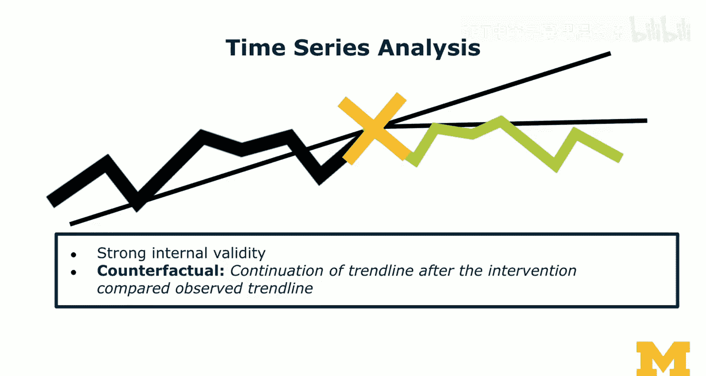
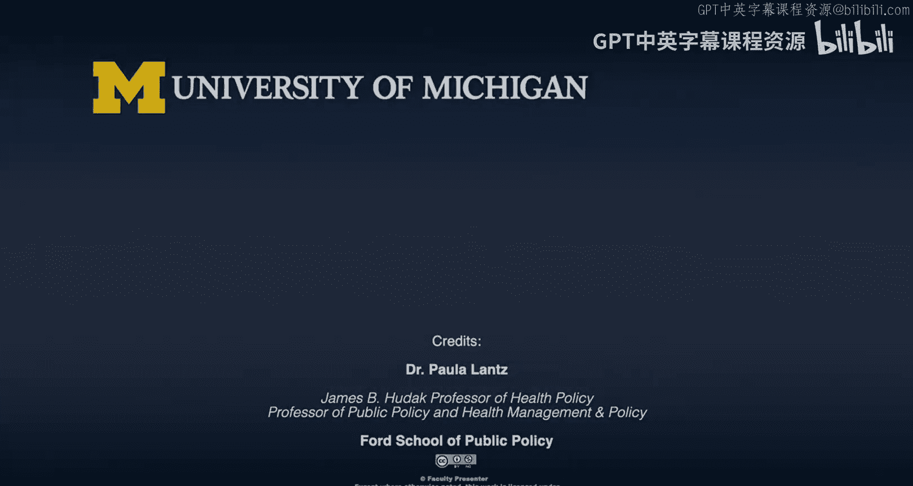

# 公共部门R数据分析：40：时间序列设计基础原理 📈

在本节课中，我们将要学习时间序列设计的基础原理。这是一种通过分析数据在时间上的趋势变化，来评估政策或项目干预效果的研究方法。

## 概述

时间序列设计，也被称为自然实验、中断时间序列或趋势分析。这种研究设计的核心是，寻找在某个项目或政策变化发生的同时，趋势线中出现的“中断”或变化。

## 趋势与噪声

上一节我们介绍了时间序列设计的基本概念。本节中我们来看看趋势线的特点。

事物随时间变化，并且经常上下波动。我们有时称这种波动为趋势线中的“噪声”。没有一条趋势线是绝对平坦或完全呈直线上升/下降的。但我们可以在趋势线中识别出模式。

回想高中几何，我们处理线条时喜欢计算其斜率。斜率告诉我们这条线是上升、下降还是保持平坦。同时，我们也关注这条线的截距。时间序列分析正是利用了我们确定趋势线斜率和截距的能力，来观察它们是否在项目、政策变化或新干预措施实施时发生了改变。

## 与前后测设计的对比

现在，回想一下我们的前后测设计。如果只观察干预前的一个时间点和干预后的一个时间点，我们并不真正理解干预前的趋势，甚至干预后的趋势。我们可能会误解数据，误以为变化是由干预引起的，但实际上可能只是捕捉到了趋势线波动（噪声）的一部分。

因此，在政策、项目或干预实施前追溯更长时间的数据，能为我们提供更多信息。实际上，拥有的时间点越多，我们就越能准确地确定政策变化前那条线的斜率和截距，然后与之后的情况进行比较。

## 时间序列分析原理

这里涉及很多内容。但再次观察那条笔直的黑线。那是一条通过政策变化标记“X”之前的数据点拟合出来的线，并延伸至未来。我们在这里的意思是，存在一条具有特定斜率和截距的趋势线。如果一切保持不变，我们可以预测这条趋势线将以相同的斜率持续到未来。

然而，那条波动的黄线代表了现实世界的情况。从“X”点开始，我们拟合出了一条新的趋势线。我们看到这条线平坦得多。

在趋势分析中，我们做的事情非常简单：**将干预后观察到的实际趋势线，与假设干预后无变化时我们预测会发生的趋势线进行比较**。在这个案例中，我们看到某个原本上升的趋势在干预实施后停止了增长。

## 内部效度

那么，时间序列分析是否具有良好的内部效度？实际上，是的。

我们的反事实在这里是：**假设没有干预，趋势线在干预后的延续情况**。我们可以相当确定，那就是没有干预时世界可能的样子。这即是我们的反事实。

但我们也需要关注一些对内部效度的威胁，稍后会再讨论。

## 总结

本节课中我们一起学习了时间序列设计的基础原理。我们了解到，这种方法通过比较干预前后数据趋势线的斜率和截距变化，来评估干预效果。它利用更长时间跨度的数据来构建反事实，相比简单的前后测设计，能更有效地控制历史等因素的影响，从而提供更强的因果推断证据。