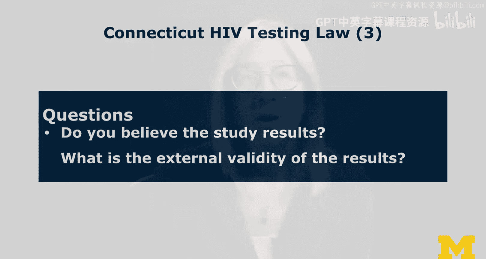
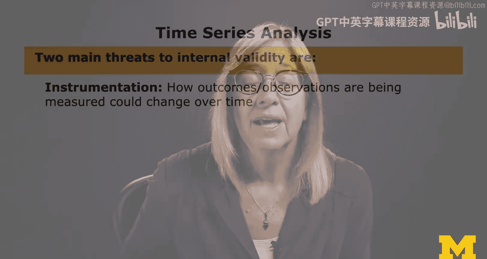
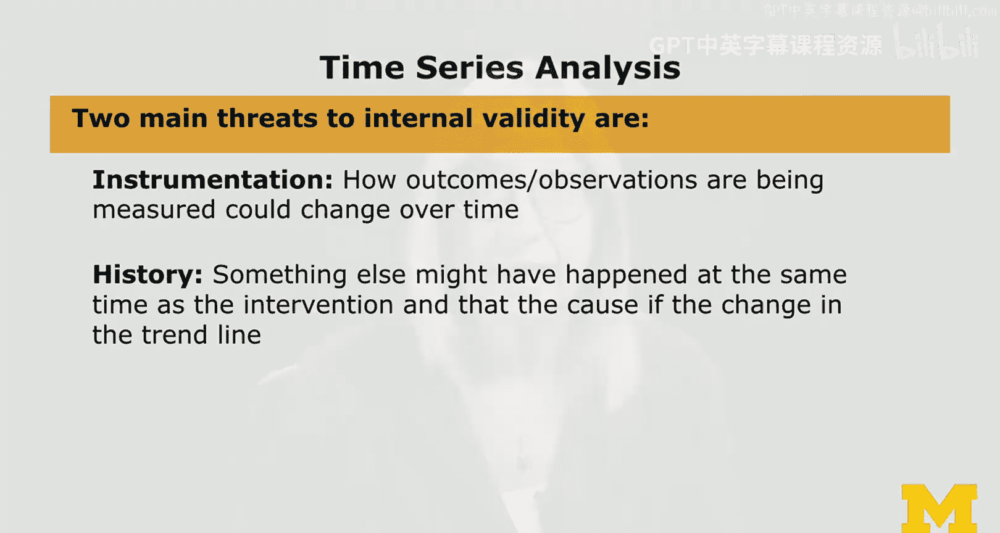
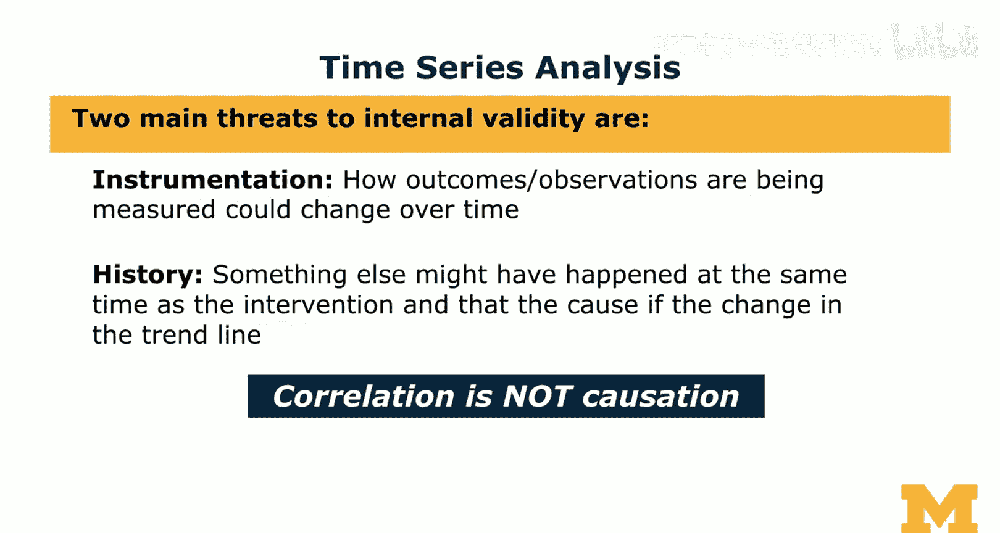

# 41：时间序列设计应用实例 🕰️

在本节课中，我们将学习时间序列设计在公共政策评估中的一个具体应用实例。我们将通过分析美国康涅狄格州一项关于未成年人HIV检测法律变更的影响，来理解时间序列设计如何用于评估干预措施的效果。

## 案例背景与设计

上一节我们介绍了时间序列设计的基本概念，本节中我们来看看一个具体的应用实例。

1992年10月，美国康涅狄格州实施了一项法律变更。在此之前，未成年人进行HIV检测必须获得父母同意。在此之后，18岁以下的未成年人无需父母同意即可进行HIV检测。

研究者希望评估这项法律变更是否对州内青少年的HIV检测率产生了影响。他们期望这项变更能减少障碍，让更多担心暴露于HIV风险的青少年愿意接受检测。

评估采用的时间序列设计如下：
*   **观测期**：法律变更前后各12个月。
*   **观测对象**：在政府资助的诊所发生的就诊次数和HIV检测次数。
*   **设计表示**：使用`O`代表每月在诊所的观测值（就诊和检测次数）。设计可表示为：`O1 O2 ... O12 X O13 O14 ... O24`，其中`X`代表1992年10月的法律变更点。

## 研究结果与数据可视化

以下是研究者发现的结果可视化呈现。

图表显示，代表每月接受检测的未成年人数量（红线）在法律生效后显著上升。代表每月就诊但未接受检测的未成年人数量（蓝线）则相应下降。数据表明，检测数量在法律变更的时点（1992年10月）立即出现了显著增加。

以下是具体的统计结果：
*   政策实施前后的诊所访问量增加了**44%**，该差异具有统计学显著性。
*   未成年人中进行的HIV检测数量**翻了一倍**。
*   被认定为高风险（涉及吸毒或高风险性行为）的未成年人的就诊和检测数量**增长了两倍**，而这正是法律希望重点覆盖的群体。

## 研究的效度评估

现在，我们需要评估这项研究结果的可信度，这涉及到研究的内部效度和外部效度。

### 内部效度

内部效度关注研究设计本身能否证明是法律变更导致了观测到的变化。对于任何时间序列分析，有两个主要的内部效度威胁。

首先是**测量工具效应**。这意味着我们追踪测量事物的方法可能随时间发生了变化，并且这种变化恰好发生在政策变更时点。在本案例中，诊所前后收集数据的方式没有改变，因此测量工具效应不太可能解释观测到的变化。

其次是**历史效应**。我们需要考虑是否在干预实施的同一时间发生了其他事件，导致趋势线发生变化，而非干预本身。对于康涅狄格州的HIV法律变更，没有发现明显的竞争性假设，如没有名人被诊断出HIV，没有其他政策变更或大规模媒体宣传活动。变化在法律生效时点非常突兀，因此历史效应在这里不构成主要威胁。

然而，我们必须始终牢记**相关性不等于因果性**。在审视时间序列分析结果时，必须仔细考虑这些内部效度威胁。

为了同时控制这两种内部效度威胁，可以采用**多重时间序列设计**。这种设计在政策和项目评估中应用广泛。

### 多重时间序列设计

以康涅狄格州的案例为例，我们可以引入一个或多个未实施该法律变更的州作为对照组，比较康涅狄格州与这些州随时间变化的趋势。这种设计有时也用于跨国比较。

多重时间序列设计能更有力地排除竞争性假设（尤其是历史效应），因此从内部效度角度看，这是一种非常强大的设计。研究者常利用不同州或地区在不同时间点实施（或取消）政策的特点，来精确推断干预`X`是否是导致趋势线变化的真正原因。

### 外部效度

外部效度关注研究结果能否推广到其他情境。假设我们相信康涅狄格州的研究结果，那么这些发现能否推广到其他州、其他国家，或其他类型的诊所？这是项目评估中始终需要思考的重要问题。

## 总结

本节课中，我们一起学习了时间序列设计在公共政策评估中的实际应用。我们通过康涅狄格州未成年人HIV检测法律变更的案例，了解了如何设计时间序列研究、解读可视化结果，并评估研究的内部效度（如测量工具效应和历史效应）与外部效度。我们还介绍了更严谨的多重时间序列设计，它通过引入对照组能更有效地确立因果关系。这个案例展示了如何利用观测数据来评估政策干预的实际效果。