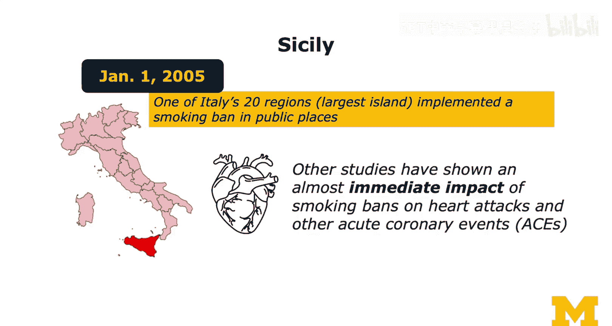
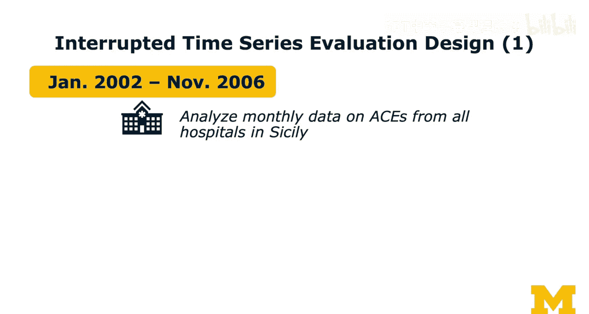
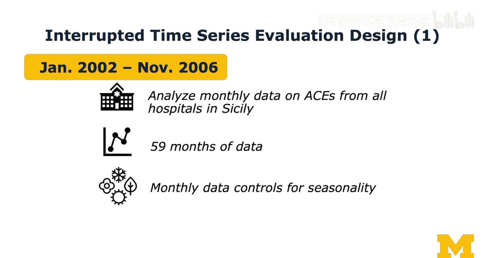
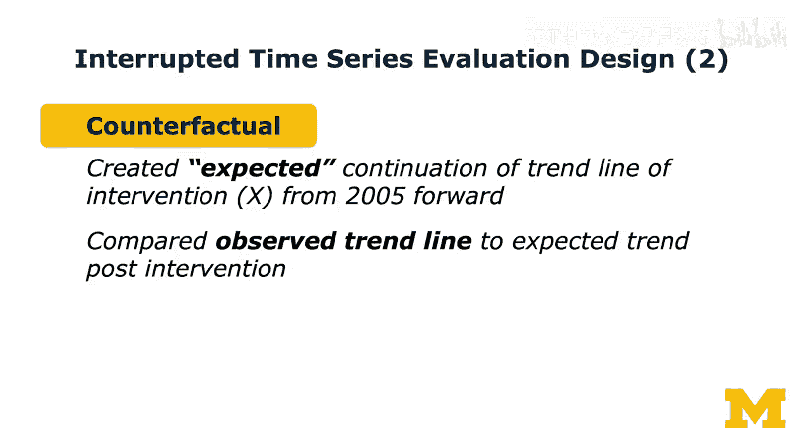
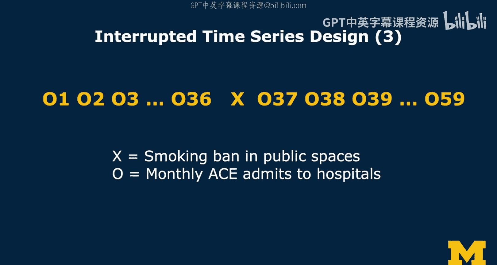

# 公共部门的R数据分析：42：西西里岛禁烟令案例研究背景与设计 🚬

在本节课中，我们将学习一个真实政策评估案例的背景与研究设计。我们将以意大利西西里岛的禁烟令为例，探讨如何使用中断时间序列设计来评估一项公共卫生政策的效果。

## 案例背景

上一节我们介绍了政策评估的基本概念，本节中我们来看看一个具体的应用案例。西西里岛是意大利的20个大区之一，也是该国最大的岛屿。我本人虽未到访过，但听闻其风景秀丽。

2005年1月1日，西西里地方政府实施了一项新的烟草控制政策，禁止在公共建筑和场所吸烟。此类禁烟令已在许多司法管辖区推行，多项评估表明，其对心脏病发作和其他类型的急性冠状动脉事件（ACE）几乎能产生立竿见影的效果。

这里实际上存在一个生物学机制：暴露于二手烟可能引发患有严重心脏病的人的急性冠状动脉事件。因此，西西里希望以多种方式评估其新禁烟令，同时也想观察政策变更后，岛上是否出现了此类即时健康结果。

## 研究设计

为了进行评估，研究采用了**中断时间序列评估设计**。研究人员分析了从2002年1月到2006年11月期间，西西里所有医院的月度ACE数据。

需要记住的是，当一个干预措施实施前后都有多次观测时，研究设计才被称为时间序列。这样我们才能观察在干预引入的同时，趋势线的**截距**或**斜率**是否发生了变化。

研究人员利用了59个月的数据。我不确定他们为何没有使用2006年12月的数据来凑足60个月或整整五年的数据，但我们手头有59个月的数据。数据的分析单位是月份，而非整年甚至季度。他们使用月份作为时间序列的时间单位，这一点很重要。

因为吸烟与几乎所有其他人类行为一样，具有季节性。事实上，人们在夏季或较热的月份往往比寒冷时吸烟更少。因此，使用月度数据能提供更多观测点，也有助于控制因季节变化引起的波动。

## 反事实与比较

在此研究设计中，**反事实**是2005年新政策引入后的预期趋势线。利用2002年至2005年政策变更前的数据，可以预测出一条未来的预期趋势线。

然后，将2005年和2006年实际数据得出的实际或观测到的趋势线，与预期或预测的趋势线进行比较。在这类研究中，我们通常比较的是：如果趋势线在**没有干预**的情况下继续发展，我们可能会预期什么；与**干预或政策变更后**实际观测到的情况。

正是这种**预期（或反事实）** 与**实际观测结果**的比较，使我们能够衡量吸烟政策变更的影响。

研究设计的示意图大致如下所示。我没有写出全部59个观测点，因为那对于一张幻灯片或任何人来说都太多，难以阅读和消化。但我希望你能看到，在这个研究设计中，在政策变更（用X表示）之前，有三年（36个月）的月度观测数据；之后，还有23个月（近两年）的月度观测数据。

在此设计中，O（即月度观测值）代表西西里岛因急性冠状动脉事件导致的住院率。以上就是本次案例研究的设计框架。

## 总结

本节课中，我们一起学习了西西里岛禁烟令案例研究的背景与评估设计。我们了解到，该研究采用了**中断时间序列设计**，通过比较政策实施前后的月度急性冠状动脉事件住院率数据，并构建**反事实**的预期趋势线，来评估禁烟政策的实际效果。理解这个设计框架是后续进行数据分析和解读结果的基础。