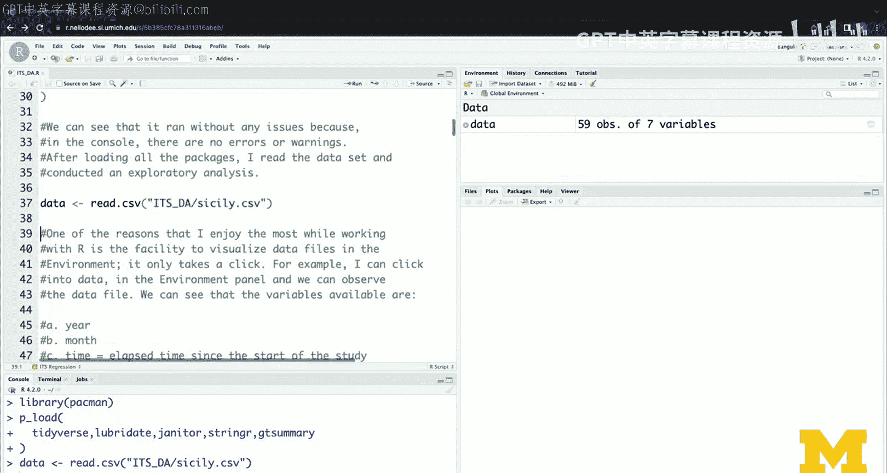
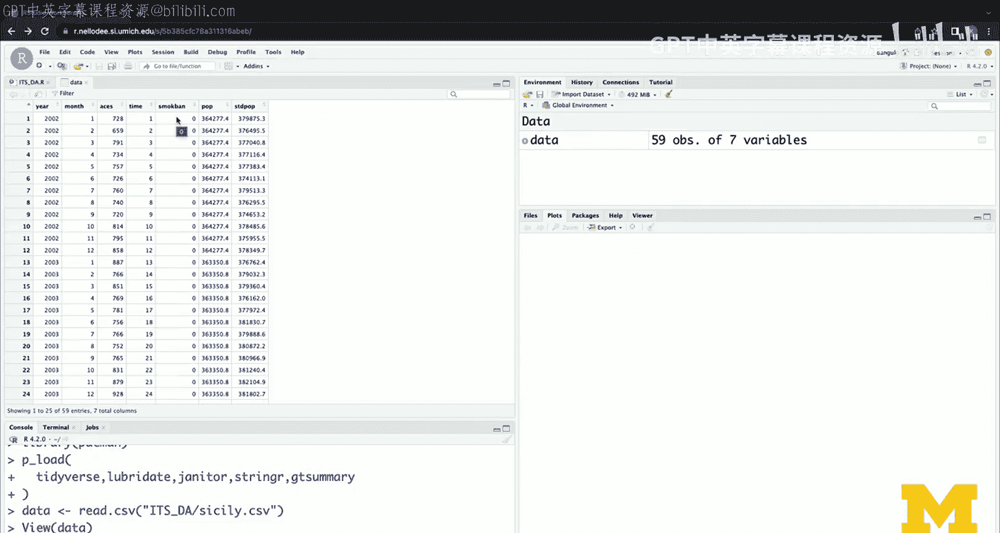
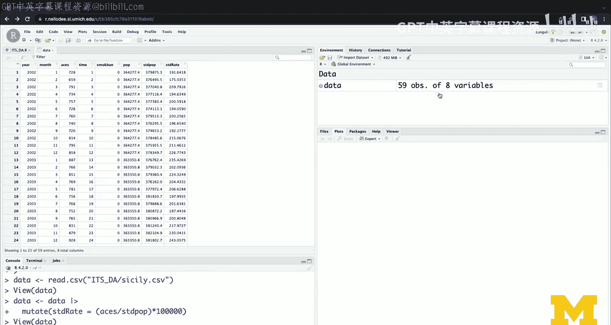
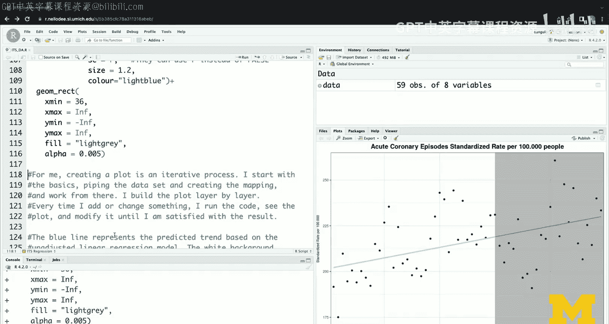
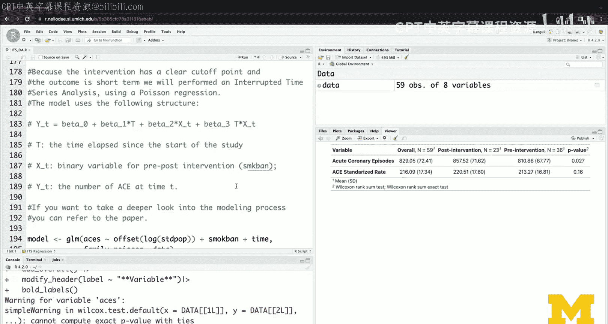
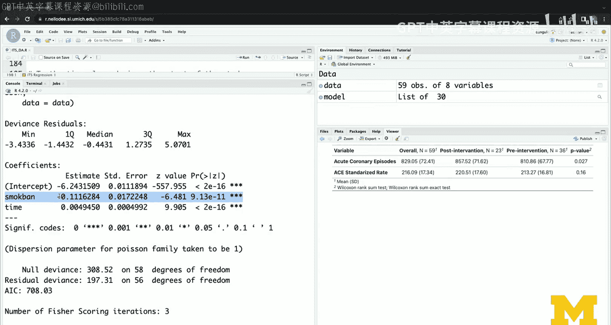
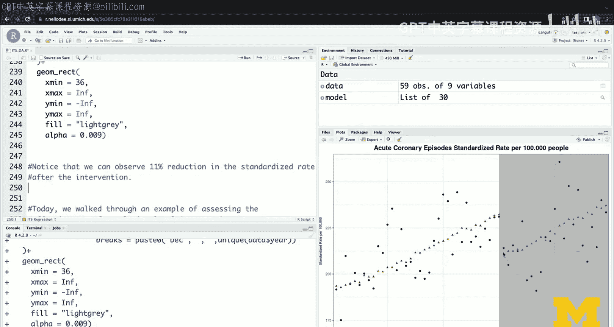

# 公共部门的R数据分析：122：西西里岛禁烟令：流行病学实证研究 🚬📊


在本节课中，我们将学习如何运用中断时间序列分析来评估一项公共卫生干预措施的效果。我们将以意大利西西里岛禁烟令对急性冠状动脉事件发生率的影响为例，重现伦敦卫生与热带医学院教程中的分析结果。课程将涵盖典型的数据分析流程，并探讨政策分析师在其中的切入点。

## 数据准备与探索性分析

上一节我们介绍了课程目标，本节中我们来看看如何准备数据并进行初步探索。

首先，我们需要加载必要的R包并导入数据集。数据集包含了西西里岛在实施人群层面健康干预措施前后，每月急性冠状动脉事件的数量。

```r
# 使用pacman包便捷地加载所需包
if (!require("pacman")) install.packages("pacman")
pacman::p_load(tidyverse, gt, gtsummary)


# 读取CSV格式的数据集
data <- read.csv("your_data_file.csv")
```

加载数据后，我们可以通过点击RStudio环境面板中的数据对象来查看其结构。该数据集包含59个观测值和7个变量，关键变量包括：
*   `year_month`: 年月
*   `aces`: 急性冠状动脉事件数量
*   `time`: 时间序列变量（1到59）
*   `smoke_ban`: 干预变量（干预前为0，干预后为1）
*   `population`: 人口数
*   `std_population`: 标准化人口

为了评估干预效果，我们首先需要创建一个标准化发病率变量。



```r
# 创建标准化发病率变量（每10万人）
data <- data %>%
  mutate(std_rate = (aces / std_population) * 100000)
```


## 数据可视化

在进行了基本的数据准备后，接下来我们通过可视化来直观地观察干预前后的趋势变化。




由于我们拥有随时间推移的多次观测数据，可以创建一个标准化发病率随时间变化的散点图，以视觉评估干预前后趋势是否存在差异。



以下是创建该图的步骤代码：

```r
# 创建散点图与趋势线
plot_basic <- data %>%
  ggplot(aes(x = time, y = std_rate)) +
  geom_point() + # 添加数据点
  geom_smooth(method = "lm", se = FALSE, color = "blue") + # 添加未调整的线性趋势线
  geom_rect(aes(xmin = intervention_time, xmax = max(time),
                ymin = -Inf, ymax = Inf),
            fill = "gray", alpha = 0.01) + # 用灰色矩形标出干预后时期
  theme_bw() + # 使用黑白主题
  labs(title = "急性冠状动脉事件标准化发病率随时间变化",
       x = "时间序列",
       y = "标准化发病率（每10万人）") +
  theme(plot.title = element_text(hjust = 0.5)) # 标题居中

print(plot_basic)
```


在这张图中，蓝线代表了基于未调整线性回归模型的预测趋势。白色背景代表干预前时期，灰色背景代表干预后时期。图中显示，干预后时期的大部分数据点都位于趋势线下方，而非随机分布在趋势线两侧，这暗示了干预后急性冠状动脉事件可能有所减少。

## 描述性统计与初步检验

通过可视化我们看到了可能的趋势，本节我们将使用统计量进行初步的组间比较。

在进行适用于中断时间序列设计的统计建模之前，我们先检验干预前后急性冠状动脉事件的平均值是否存在显著差异。我们将使用`gtsummary`包来创建一个描述性统计汇总表。

以下是生成汇总表的代码：



```r
# 创建描述性统计表，按干预状态分组
summary_table <- data %>%
  select(aces, std_rate, smoke_ban) %>%
  tbl_summary(by = smoke_ban, # 按干预变量分组
              statistic = list(all_continuous() ~ "{mean} ({sd})"),
              digits = all_continuous() ~ 2) %>%
  add_p() # 添加组间比较的p值

summary_table
```

该表格类似于学术论文中的表1，它展示了每个变量的总体均值（标准差），以及干预前和干预后分组的均值（标准差），最后提供了组间比较的p值。初步分析可能显示，在5%的显著性水平下，急性冠状动脉事件的原始数量在干预前后有显著差异，但经人口标准化后的发病率可能未见统计显著差异。

## 中断时间序列模型分析


上一节我们进行了初步比较，但中断时间序列分析能更准确地评估干预的即时效应和趋势变化。

鉴于该干预有明确的起始时间点，且结局是短期效应，我们将采用泊松回归进行中断时间序列分析。模型结构如下：

**模型公式**：
`glm(aces ~ time + smoke_ban, data = data, family = poisson(link = "log"))`

其中：
*   `aces` 是每个时间点的结局事件数。
*   `time` 是研究开始以来的时间。
*   `smoke_ban` 是指示干预前（0）与干预后（1）的变量。

以下是运行模型并解读结果的代码：

```r
# 拟合中断时间序列泊松回归模型
its_model <- glm(aces ~ time + smoke_ban,
                 data = data,
                 family = poisson(link = "log"))

# 查看模型摘要
summary(its_model)
```




查看控制台输出的模型摘要。对于`smoke_ban`（干预）变量，我们关注其估计值和p值。如果p值小于0.05，则表明该变量显著。一个负的估计值意味着在干预后时期，事件数量有所下降。例如，结果可能显示在禁烟令实施后，急性冠状动脉事件数量平均显著下降了约11%。

## 模型预测与结果可视化

最后，我们将模型的预测结果可视化，以更直观地展示分析结论。



我们将保存模型的预测值，并绘制一个新的图形，用模型预测的趋势线替代之前的简单线性趋势线。


以下是使用模型预测值进行可视化的代码：

```r
# 将模型预测值添加到数据集
data$predicted <- predict(its_model, type = "response")

# 绘制包含观测值与模型预测值的图形
plot_final <- data %>%
  ggplot() +
  geom_point(aes(x = time, y = std_rate), alpha = 0.6) + # 观测值
  geom_line(aes(x = time, y = (predicted / std_population) * 100000),
            color = "red", size = 1) + # 模型预测趋势线
  geom_vline(xintercept = intervention_time, linetype = "dashed") + # 干预时间线
  theme_bw() +
  labs(title = "中断时间序列分析：模型预测趋势",
       x = "时间序列",
       y = "标准化发病率（每10万人）") +
  theme(plot.title = element_text(hjust = 0.5))

print(plot_final)
```



在这张最终的图中，红色线条代表了中断时间序列模型的预测趋势。可以清晰地观察到，在干预时间点（虚线标示）之后，预测的发病率水平出现了一个向下的“中断”或偏移，这量化地支持了干预措施有效的结论。

## 总结


本节课中，我们一起学习了如何评估一项人群层面干预措施的有效性。我们以西西里岛禁烟令为例，完整演练了从数据加载、探索性可视化、描述性统计，到构建中断时间序列泊松回归模型并解读结果的全过程。我们使用了令人信服的可视化图表来呈现现象，并运用统计模型量化了干预效果（例如，观察到约11%的下降）。虽然这些模型有时理解起来颇具挑战，但这正是跨学科团队合作的魅力所在。作为政策分析师，与统计学家及其他背景的专家互动协作，将是你们工作中至关重要的一部分。