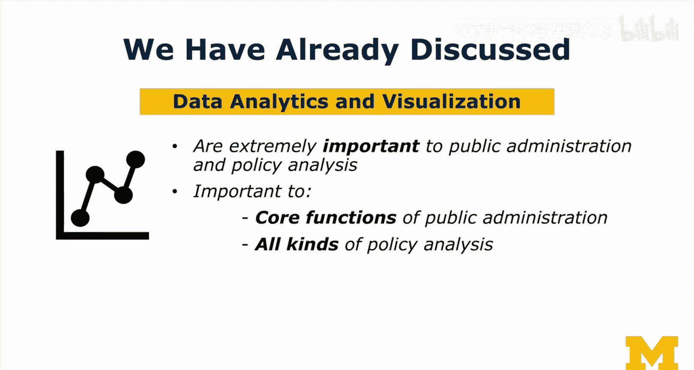
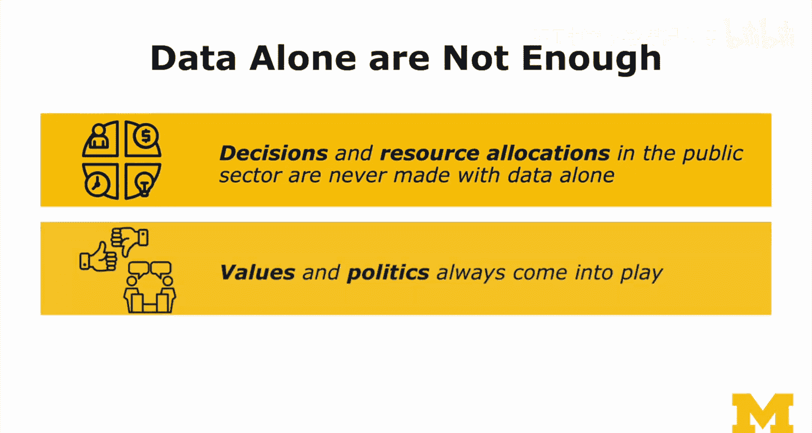
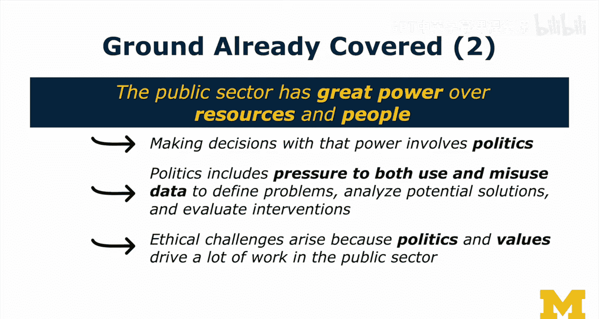
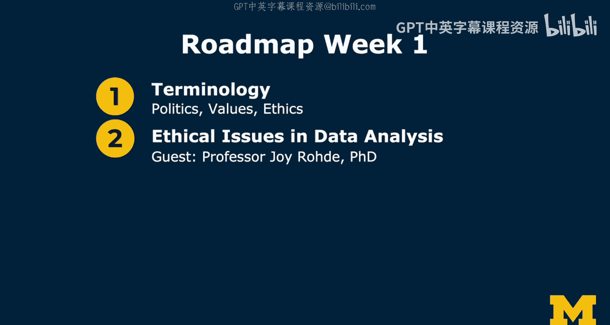
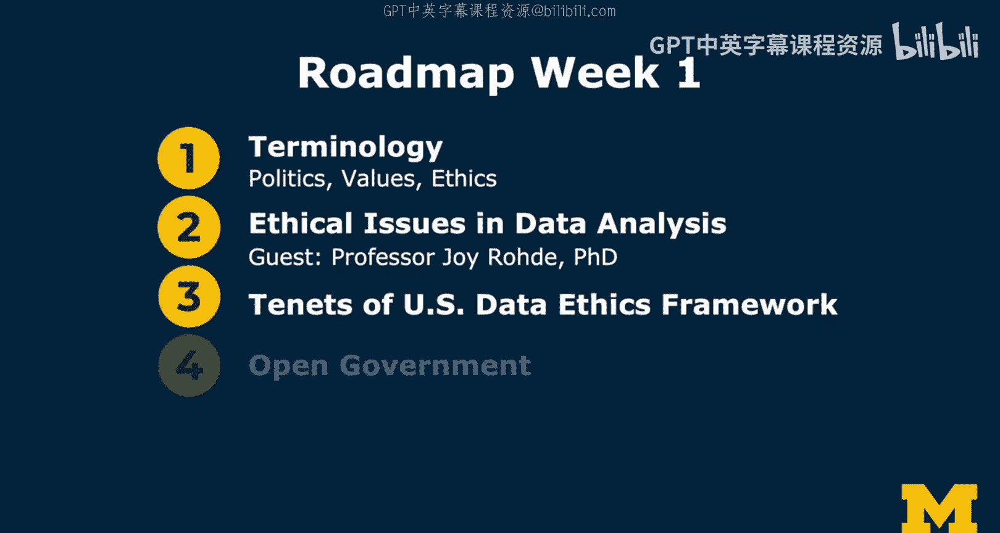

# 公共部门的R数据分析（基础、数据探索、决策支持）：4.1：政治与伦理回顾 🧭

在本节课中，我们将回顾本系列课程中已讨论过的政治与伦理核心概念，并概述第四门课程的新学习内容。我们将重点理解数据、价值观、政治和伦理在公共部门决策中的相互作用。

## 课程回顾

上一节我们介绍了公共部门数据分析的整体框架。本节中，我们来回顾一下贯穿整个系列课程的政治与伦理主题。

我们一直强调数据分析与数据可视化在公共行政所有核心职能以及各类政策分析（包括前瞻性政策分析和回顾性分析或政策评估）中的重要作用。

然而，布鲁克斯教授和我始终强调，仅凭数据不足以做出基于证据的明智行政和政策决策。公共部门的决策和资源分配从来不是仅基于数据分析，因为价值观和政治总是参与其中。

## 公共部门的四大支柱

以下是我们在所有课程中讨论的、基于价值观的四大支柱，这些价值观有时会相互竞争：

*   **经济性**：涉及公共部门应向市场提供哪些商品和服务、向公众提供哪些服务的决策。
*   **效率**：指公共部门资源应以最优化的方式使用，使投资获得最大回报。
*   **有效性**：指公共部门的工作应产生改变和积极影响，应实现特定的目标和目的。
*   **公平性**：涉及理解所有公共政策都伴随着负担和收益，而这些负担和收益的分配需要公平，这是一种价值观。

此外，公平性还包含一种视角，即所有人和社区都应获得（在许多情况下有权获得）实现平等结果所需的机遇和资源。

## 政治与伦理的挑战

公共部门对社会经济、政治机遇、资源以及人们的生活方式拥有巨大权力。伴随这种广泛决策权而来的是政治。政治包括利用和误用数据与信息来定义问题、分析潜在解决方案以及评估政策、项目和其他类型干预措施的压力。

正因如此，各种伦理挑战随之出现，因为政治和相互竞争的价值观在很大程度上驱动着公共部门的工作。

## 本节新内容概述

基于我们已经讨论过的内容，我们将在本系列第四门课程的第一周涵盖以下新内容：

首先，我们将更深入地探讨一些术语，包括政治、价值观和伦理。

其次，我的同事、密歇根大学福特公共政策学院的乔·罗迪教授将加入课程，为大家概述数据系统和数据分析中作为基本组成部分的伦理问题。罗迪教授是一位历史学家，在科学技术史以及价值观和伦理在公共政策工作中的角色方面拥有深厚的专业知识。

第三，我将回来与大家讨论一个由美国近期制定和实施的数据伦理框架。

第四，我还将向大家介绍开放政府数据的概念。

让我们开始吧。

## 总结

本节课中我们一起回顾了政治与伦理在公共部门数据分析中的基础性作用，明确了数据决策必然受到价值观和政治因素的影响，并预览了本课程即将深入探讨的新主题，包括核心术语、数据伦理框架以及开放政府数据。