# 公共部门的R数据分析：2：核心术语：政治、价值观与伦理 🎯

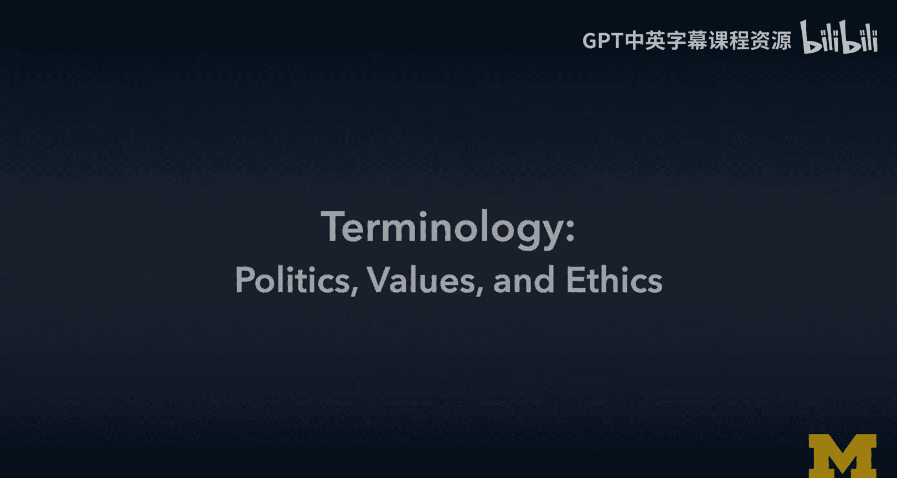

在本节课中，我们将深入探讨公共部门数据分析工作中至关重要的三个核心概念：**政治**、**价值观**与**伦理**。理解这些术语是理解公共决策背景和数据分析在其中所扮演角色的基础。

## 政治与权力

上一节我们介绍了数据分析的宏观背景，本节中我们来看看“政治”在公共部门语境下的具体含义。

在最简单的定义中，**政治**指的是**一群人（通常持有不同观点、价值观，并拥有不同程度的权力和影响力）试图做出决策的过程**。这个词通常与公民政府内的行为相关联，并且常常带有负面含义。人们认为政治涉及残酷的策略、权力运用、博弈、谎言等。

然而，政治实际上存在于所有人类群体互动中，包括企业环境、学术界、宗教组织和家庭。任何需要群体做出决策的地方都存在政治。由于群体动态和涉及权威与权力的社会关系，**政治指的是用于影响、制定和执行群体内决策的策略、方法与手段**。

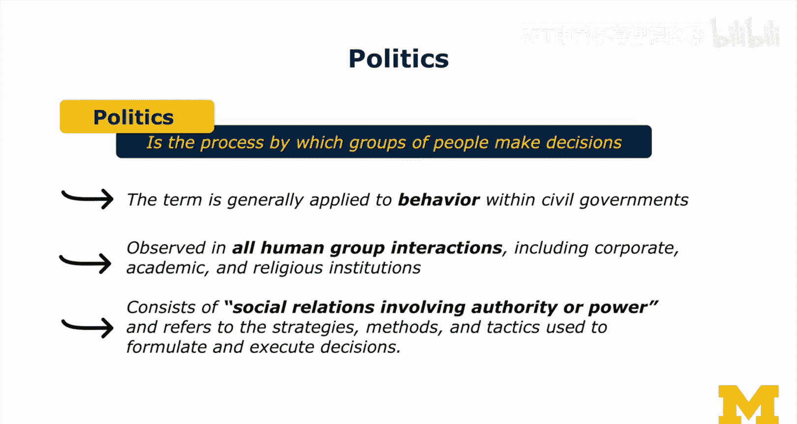

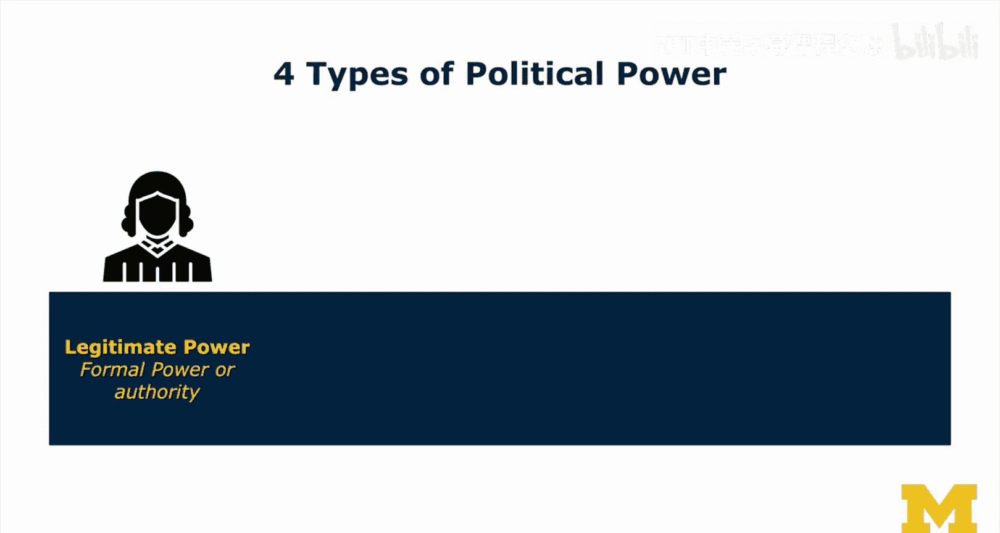

接下来，让我们更具体地谈谈权力。政治学家确定了四种主要的权力类型。

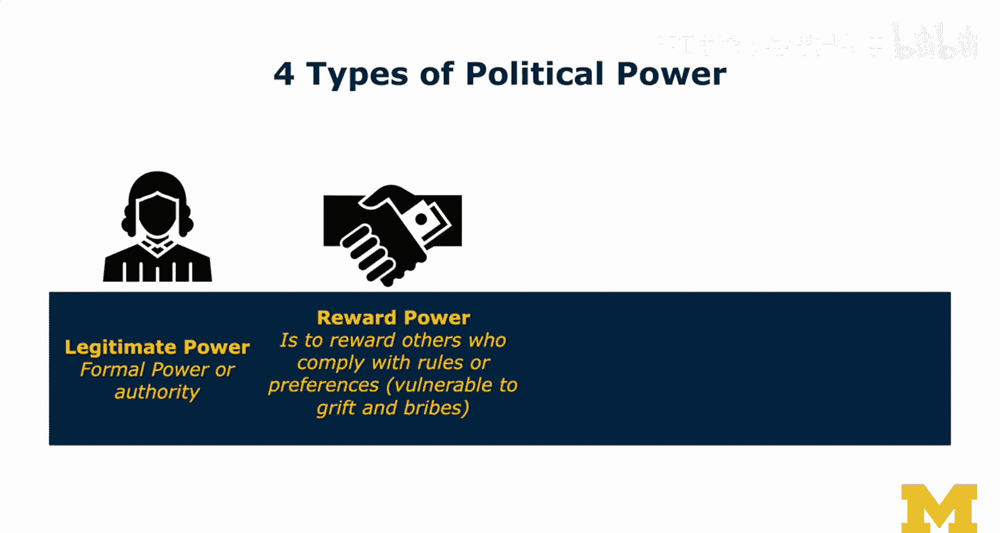

以下是四种主要的权力类型：

1.  **合法权力**：这是正式的或成文的权力，来源于拥有权威职位，如市长、州长、法官、总理、总统、政府机构部长、项目主任等。某人因其角色而拥有权力。
2.  **奖赏权力**：指有能力奖励那些遵守规则或尊重他人偏好的人。例如，美国的游说者可以通过提供竞选捐款来奖励投票符合其偏好的国会议员。另一个例子是监管机构，他们有权通过不处以罚款或刑事指控来奖励遵守规则的企业。奖赏权力容易以贿赂、贪污或不正当影响的形式被滥用。一个重要的例子是政府合同：当政府通过合同购买商品和服务时，有权授予这些合同的人拥有巨大的奖赏权力，因此可能容易滥用这种权力。
3.  **专家权力**：这种权力来自于拥有与行政和政策决策相关的特定专业知识。例如，科学或法律专业知识可以带来影响决策结果的能力。数据科学和数据分析是专家权力的另一个重要例子。将数据带入决策过程应该并且经常会对结果产生影响。
4.  **参照权力**：这种权力源于他人希望效仿或忠于某个个人、团体或事业。人们通常可以因为具有魅力或其他特质而拥有影响他人及决策过程及其结果的权力。世界领导人通常拥有这种权力，当然也拥有合法权力和奖赏权力。一个人可以拥有多种类型的权力。

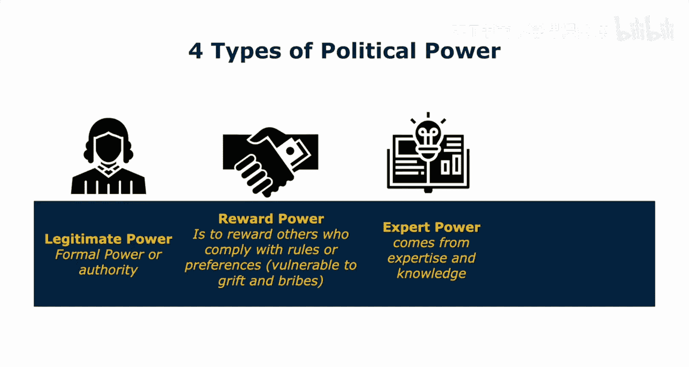

## 价值观

理解了权力如何运作后，我们转向驱动决策的另一个核心要素：价值观。

**价值观**简单来说，是关于什么是好的、什么应该被促进和实现的广泛信念。我们可以长时间讨论价值观，但在公共部门工作中，我们需要考虑两种主要类型。

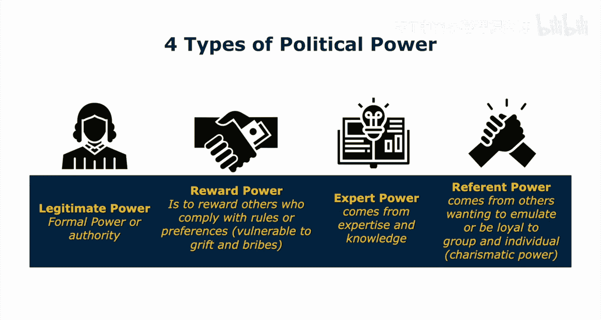

以下是两种主要的价值观类型：

*   **工具性价值观**：指关于实现期望目标的手段或过程的偏好。
*   **终极性价值观**：指关于期望的最终状态或结果的偏好。

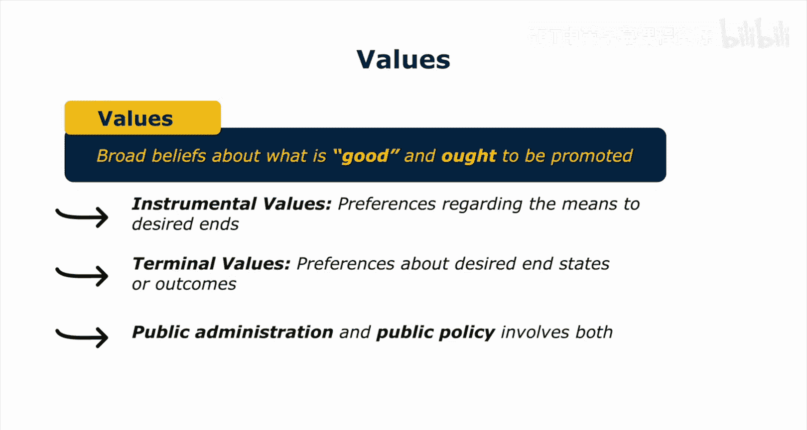

公共行政和公共政策都涉及这两大类价值观。例如，一个终极性价值观可能是每个人都能够长寿健康地生活，而实现这一目标的一些工具性价值观则包括获得营养食品、清洁环境、高质量医疗保健的价值观。再举一个例子，一个终极性价值观是法官需要在裁决中公平公正，而实现这一终极目标价值观的一些工具性价值观包括职业伦理行为准则。

许多不同的价值观影响着公共部门的工作。当然，你已经知道经济、效率、效能和公平这四大核心支柱价值观。其他通常与公共部门相关的价值观包括客观性、问责制、透明度、开放性、信任、尊重、社区参与、平等代表权、可持续性等等。还有一些价值观通常与公务员（即在公共部门工作的人员）的工作和行为相关，包括专业性、响应性、专业知识、正直、公正、问责制、领导力等许多其他价值观。

## 伦理

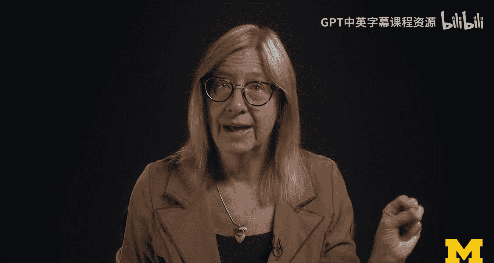

最后，让我们转向伦理。首先需要理解的是，**伦理是由价值观驱动的**。

**伦理**是关于行为、举止和行动的一套道德或价值观驱动的标准，用以区分什么是好的或对的，与什么是坏的或错的。显然，什么是好的、对的、坏的、错的，是一套价值观。**伦理行为**是指在总体或主导的道德规范背景下被认为是好的或对的行为。

这里再介绍一个术语：**道德推理**。这是道德规范的应用，是运用逻辑和决策规则进行批判性分析，以确定在特定情况下什么是对、什么是错，以及应该做什么或不应该做什么。道德推理体系的例子包括功利主义、义务论、美德伦理学等。请放心，我们现在不会深入哲学课程。

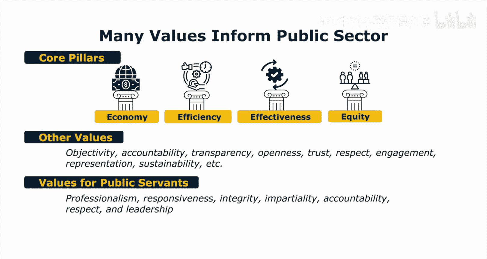

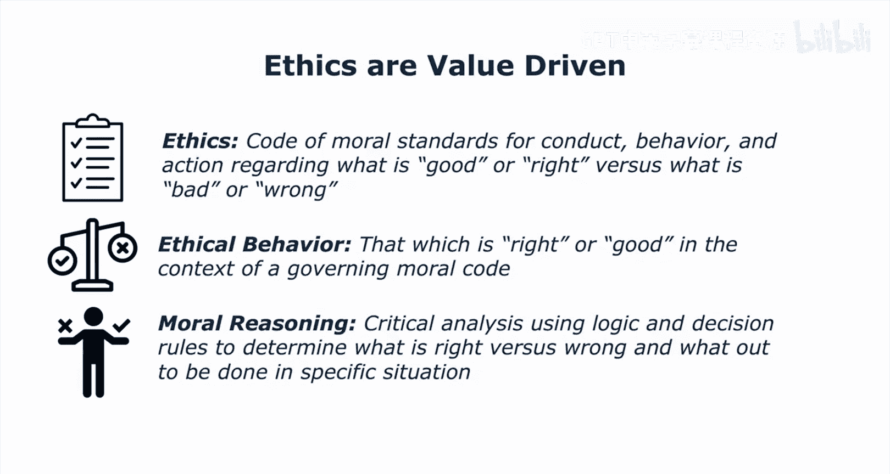

然而，让我们再花一分钟思考一下政府背景下的伦理，以及政府本身如何反映不同文化和历史背景（包括宗教背景）。当我们谈论伦理和道德推理时，我们能否将其视为某种普世的东西，超越国家和不同政府形式？关于这个深刻问题的一个观点被称为**伦理普遍主义**，它声称对与错的标准确实是普世的，因此超越或高于文化、社会、宗教和时代（或当前历史背景）。这就是伦理普遍主义。

有一个与之竞争的思想流派叫做**伦理相对主义**。它提出，什么被认为是道德的或不道德的，必须根据当地和当时的道德标准来判断。这意味着伦理是相对的，因此可以也确实会因地点、文化和时间而异。

最后一个思想流派将前两者结合在一起，称为**综合社会背景理论**，但它实际上相当简单。这个观点认为两者兼有：存在一些**一阶的、普世的伦理规范**，这些规范应该优先于**二阶的、更具时代性的伦理规范**。例如，“谋杀是坏的”是一个一阶伦理规范，大多数人同意。而饮酒消费则是一个相对的伦理规范，因文化、宗教和时代而异。

## 总结

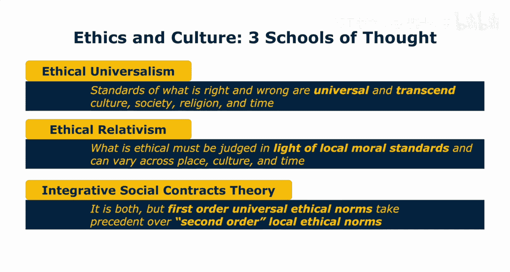

本节课中我们一起学习了政治、价值观与伦理这三个核心概念。

那么，为什么我们要涵盖这些有趣的哲学内容？更重要的是，为什么它对公共部门（包括数据分析）的工作如此关键？**价值观和伦理在五个关键领域扮演着重要且必不可少的角色**：

1.  社会问题最初是如何被定义或构建为“问题”的。
2.  在识别和优先考虑哪些社会状况或问题需要并值得公共干预时。
3.  在设计公共部门的行政和政策应对措施时。
4.  在政策分析的重要工作中。
5.  在公务员的行为中。

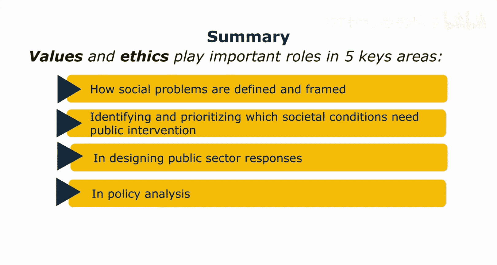

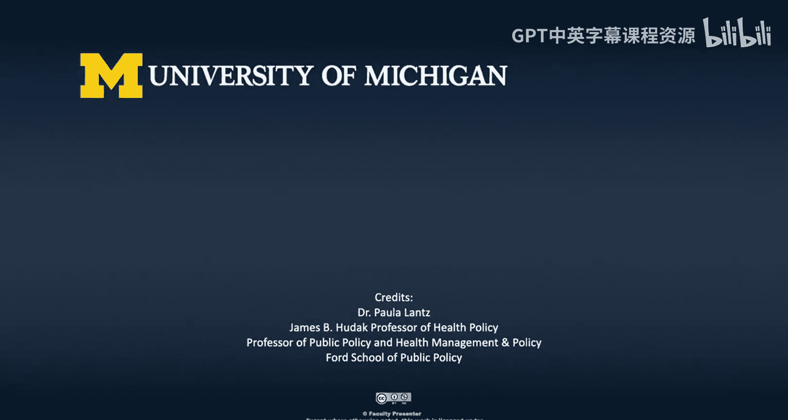

我们将在后续课程中更多地讨论所有这些内容。