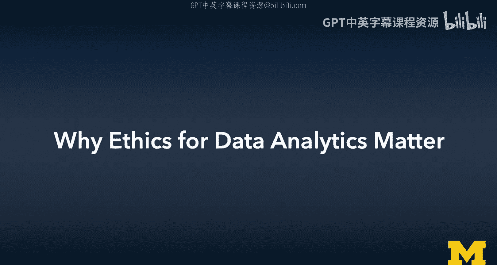
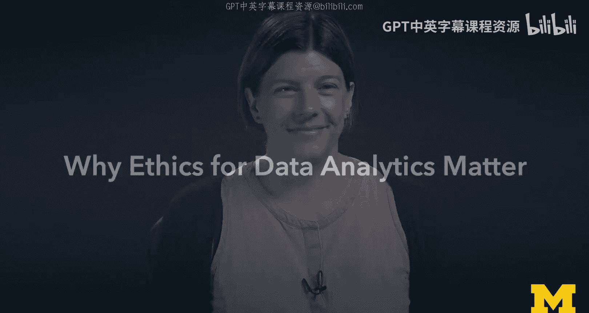
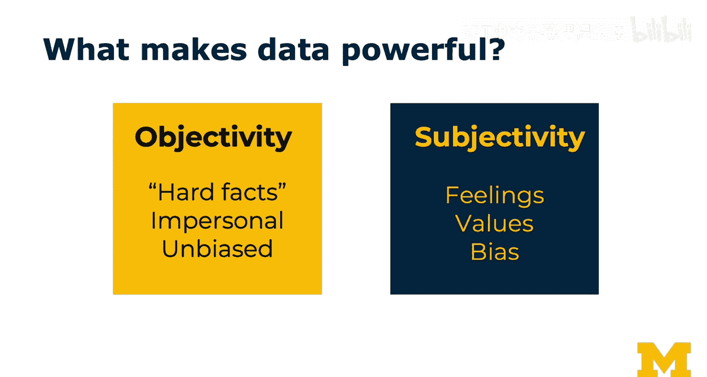
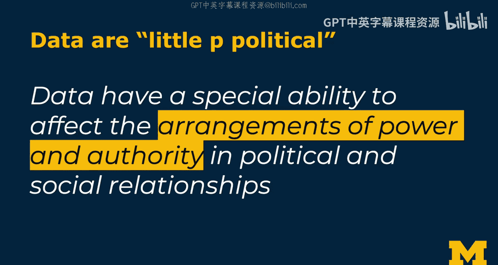
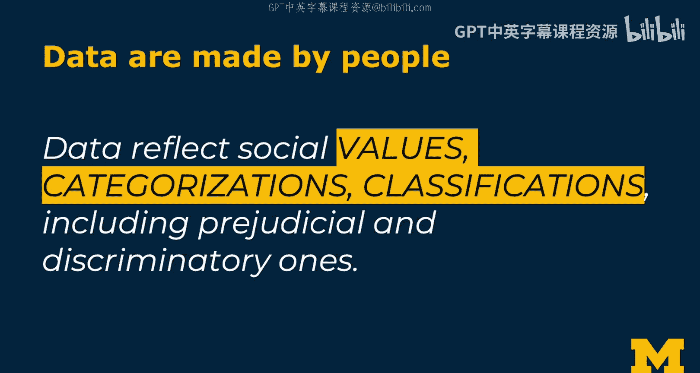
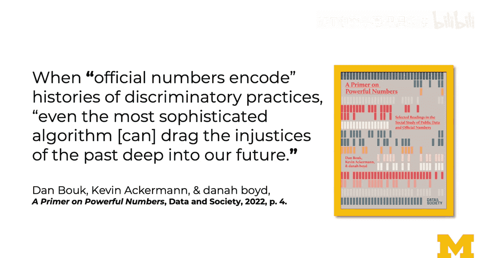
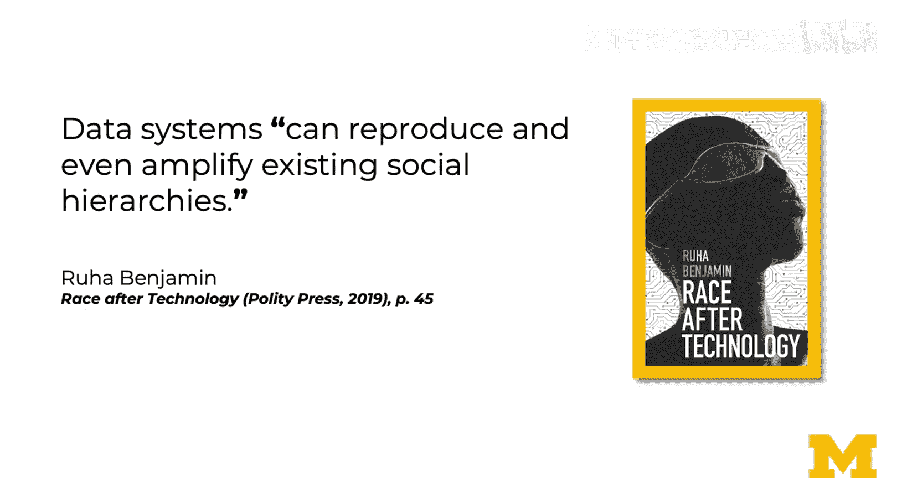

# 3：数据分析伦理的重要性 📊

在本节课中，我们将探讨数据分析在公共政策领域所拥有的特殊力量，并理解这种力量为何会带来重要的伦理挑战。我们将看到，数据远非中立，它们承载着社会价值与历史偏见，因此需要我们在收集、分析和使用时保持伦理上的审慎。

## 数据的力量与责任 💪

上一节我们介绍了数据分析作为治理工具的强大能力。本节中，我们来看看这种能力背后的责任。

数据是强大的。数据分析能为改善治理提供强大的工具。但正如古老的格言所说：能力越大，责任越大。当你处理数据，为政策分析或决策制定而收集、分析和使用数据时，你就在运用权力。因此，每当处理数据时，你总是置身于引发重要伦理问题的领域。

数据分析伦理为何重要？为何这是你需要关注的问题？因为违反伦理规范，即使是无意的，也会侵蚀良好政策实践所依赖的公众信任。了解并关注数据分析的伦理将帮助你维持甚至建立公众信任。伦理将帮助你为了公共利益而使用数据。

## 数据在公共政策中的力量来源 🤔

为了理解数据为何在公共政策中拥有如此大的力量，我们需要进行一些哲学层面的探讨。

在现代社会中，只要数据被恰当地创建和使用，我们通常将其视为对周围世界准确而透明的描述。我们认为数据是**客观的**，与创建和使用者的个人观点或解释相分离、相绝缘。我们将数据与世界中的事物本身联系起来，视其为**硬事实**，是既定的。我们认为客观的事物是主观事物的对立面。主观性包括个人感受、品味、意见和偏见，也包括政治意识形态。

数据与客观性的关联，是赋予其在公共政策中特殊力量的重要原因。政策官员不应基于主观性做决策，不应让个人利益、所属政党的利益或特定政府部门的利益单独影响其行动和选择。他们理应超越那些主观因素，做出有利于其所服务和代表的公众利益的决策。因此，通过使用数据，政策分析者和官员表明，他们的结论和决策是基于非个人的、客观的基础得出的。他们向公众传递了“应该信任他们及其决策”的信号。

## 数据的“小写p”政治性 ⚖️

上一节我们探讨了数据因被视为客观而拥有的力量。本节中，我们来看看这种力量如何使其具有政治性。

那段哲学探讨的结论是：数据或许是客观的，但在人类社会关系中始终存在的权力关系方面，数据并非中立。数据是我喜欢称之为“**小写p政治性**”的事物。当我说“小写p政治性”时，我指的不是政党或保守/自由价值观（我认为那些是“**大写P政治性**”）。我指的是数据拥有一种特殊能力，能够影响政治和社会关系中的权力与权威安排。我们相信数据是客观的，这赋予了数据一种特殊力量，是其他形式的知识和论证所不具备的。

你可以想象这一见解带来的一些重要影响。以下是其中之一：

## 数据的潜在危害与历史教训 ⚠️

数据收集、共享和分析既能带来帮助，也可能造成伤害。这些伤害常常是数据收集和分析过程中无意或未预料到的后果。

例如，对政府了解其人口至关重要的**人口普查数据**，也可能被用于作恶。在第二次世界大战期间，占领荷兰和挪威的纳粹政府利用人口普查数据来定位、监禁和谋杀犹太公民。美国政府也曾利用人口普查数据，在二战期间定位并拘留日裔美国人，将他们关进拘留营，并贴上“潜在国家敌人”的标签。他们被拘禁多年，失去了家园和生计。

这并不意味着我们不应收集和共享人口普查数据，但它意味着政府数据可能对人们的生活产生严重的实质性影响。我们需要谨慎行事，确保我们的数据制作、分析、共享和使用既关注潜在利益，也关注潜在危害。

## 数据中的社会偏见与算法歧视 🔍

通常，数据的政治力量比上述例子更为微妙，因为我们视数据为客观。我们有时会错误地认为数据凭空而来，只是存在于世界中等待我们去收集。但数据是由人和机构创造的，它们反映了创造和使用数据的社会中人们的价值观和思维方式。数据反映了我们用来理解和思考社会世界的分类和划分，这些分类我们经常使用甚至未曾察觉。因此，数据能够反映其来源社会的偏见。

以**审前风险评估**为例。这是美国数据科学家创建的数据库算法工具，用于给被指控犯罪并等待审判的人分配一个风险分数。该分数旨在帮助法官判断此人在候审期间是否会犯罪（若是，则应继续关押），或者很可能不会犯罪（若是，则可释放候审）。我们希望将如此重要的决策建立在最佳数据之上，这是合理的。这对公共安全和被指控者都至关重要。那些被保释的人更有可能保住工作、支付房贷或租金，并维持与子女和家庭的持续联系。

但对风险评估系统的审计发现，该系统存在歧视性。与白人相比，该系统将非裔美国人标记为因有较高再犯罪风险而需要继续关押的可能性是前者的两倍。然而，对实际人口行为（即来自现实世界的**真实情况**）的研究并未显示这一点。该系统错误且具有歧视性的原因在于，用于设计它的数据无意但不可磨灭地烙印着美国种族歧视的历史。这些数据反映了数十年来对非裔美国人社区的过度监管和过度起诉。

正如专家所写：“当官方数据编码了歧视性实践的历史，即使是最复杂的算法，也可能将过去的不公正深深拖入我们的未来。”

## 总结与核心要义 📝

如果你仔细观察，可能已经注意到数据并不总是像我们想象的那样客观。数据并非我们政治和社会体系之外世界的透明反映。数据，尤其是与政策相关的数据，反映了我们的历史、社会和价值观。因此，我们需要深思熟虑并谨慎地使用它们。

正如普林斯顿大学专家Ruha Benjamin所说：“如果我们不注意社会规范和结构如何塑造数据系统，它们就能复制甚至放大现有的社会等级。”

总而言之，“数据自己会说话”这句老话很少成立。数据并非中立。它们拥有特殊力量，因为我们视其为客观的，将其与充满价值观和利益的混乱世界分离开来，从而认为它们比其他类型的知识和决策输入更可靠。但数据，尤其是关于人和社会的数据，能够体现和反映人与社会的价值观、世界观甚至偏见。这意味着，在创建、管理、共享和使用数据时，需要持续关注伦理问题。

本节课中，我们一起学习了数据在公共政策中的力量来源、其“小写p政治性”、潜在的历史危害，以及数据如何反映和固化社会偏见。理解这些是成为负责任的数据分析实践者的第一步。