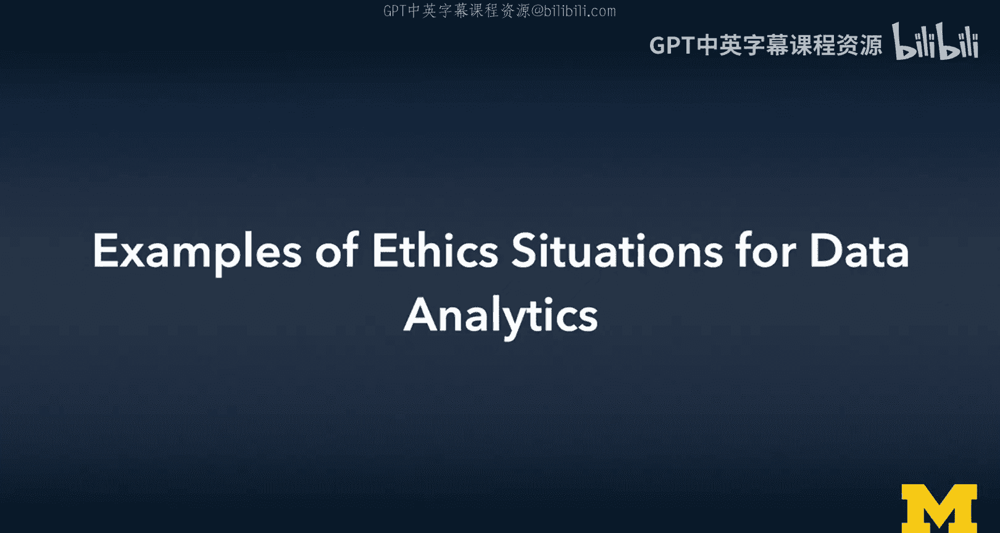
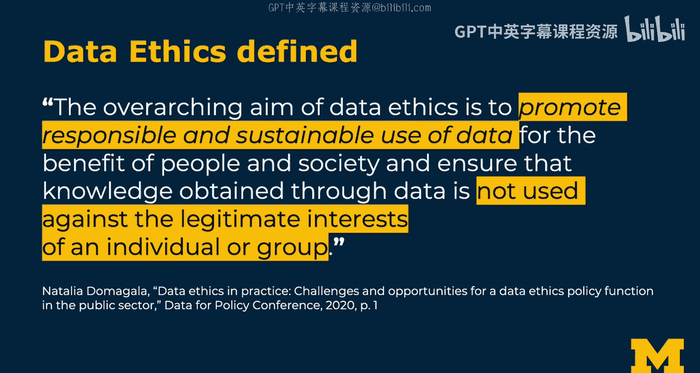
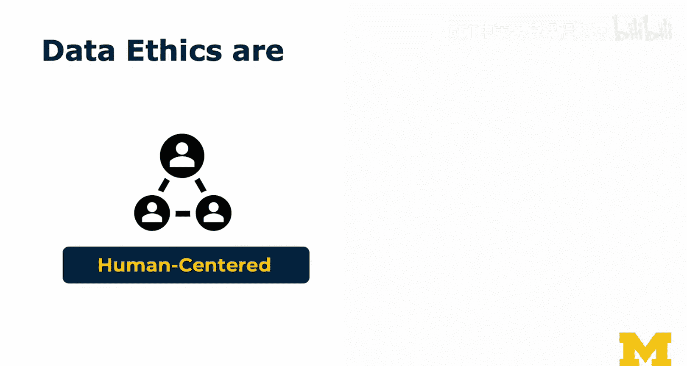
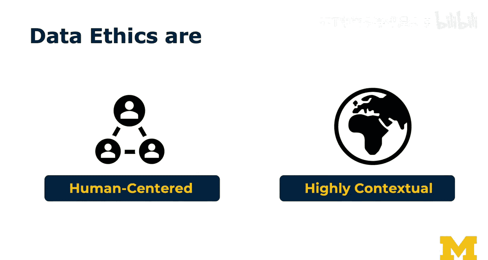
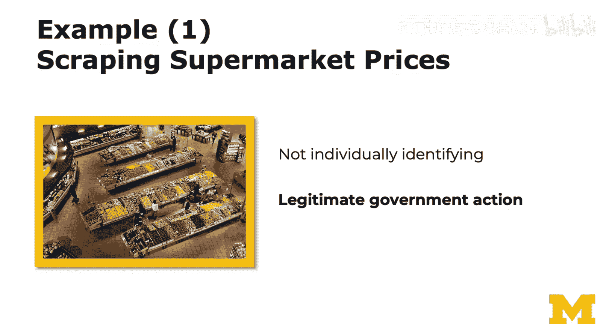
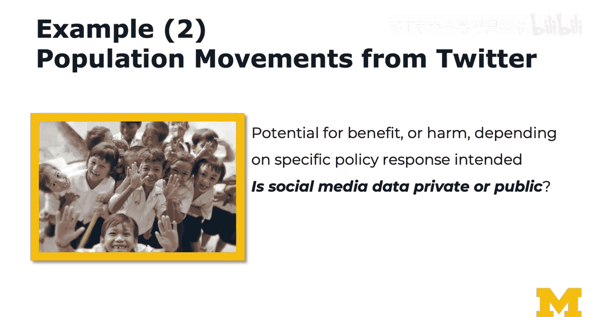
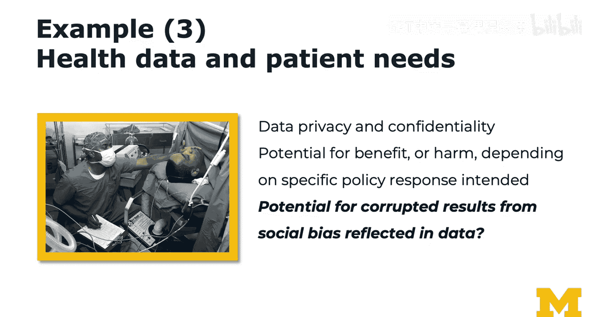
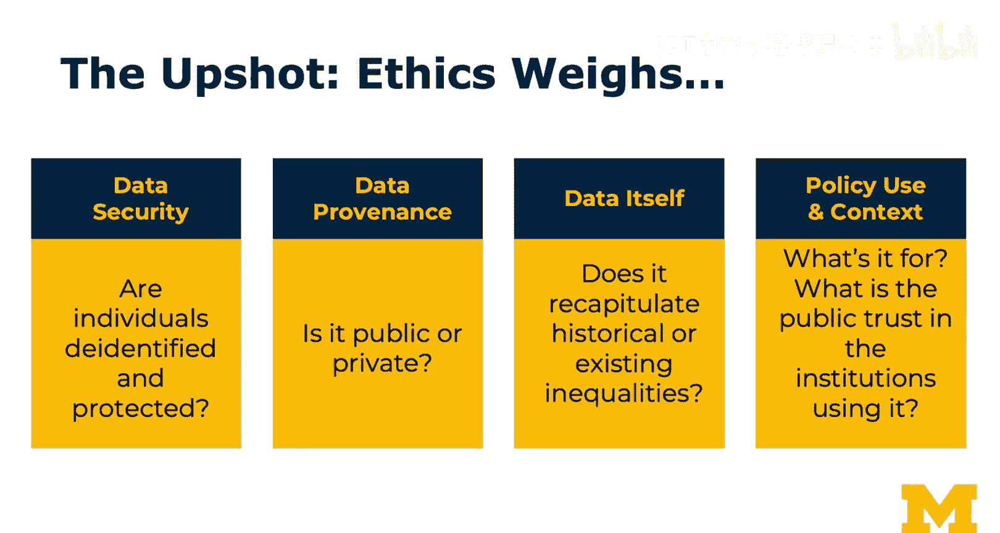
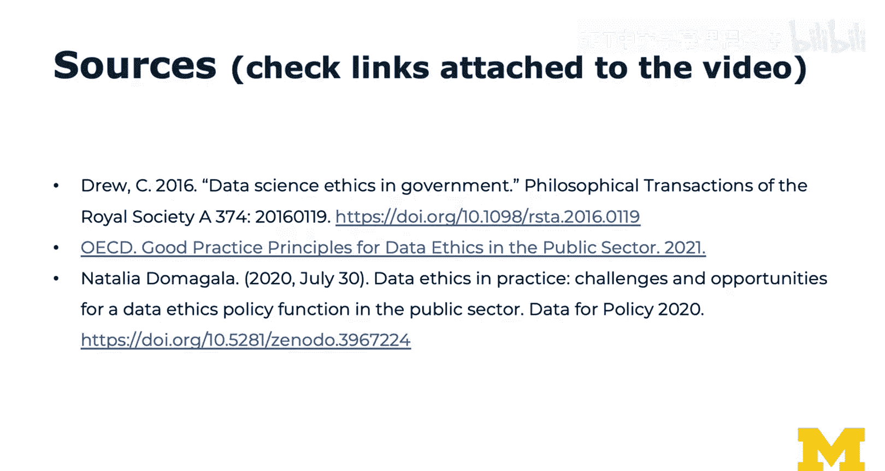

# 4：数据分析伦理情境案例 📊

在本节课中，我们将探讨数据分析中的伦理问题。通过理解数据的政治力量，我们希望你能认识到数据分析需要伦理方面的专业知识。

## 什么是数据伦理？🤔

数据伦理的总体目标是促进负责任和可持续地使用数据，以造福社会大众，并确保通过数据获得的知识不被用于损害个人或群体的合法权益。

数据伦理并不仅限于分析实践本身。伦理问题贯穿于数据价值周期的各个阶段，包括数据创建、管理与清理、存储、共享、使用和处置。这是一个广阔的领域，数据伦理的理论与实践正处于快速发展阶段。

这个领域也因司法管辖区而异，并且存在许多空白。目前没有单一公认的数据分析法律体系。一些司法管辖区有相关法律，如果你在这些地区工作，你和你的组织了解这些法律非常重要。但伦理不仅仅是法律，它还涉及在更广泛的道德、政治和文化背景下，什么是正确或错误的。

这意味着数据伦理必须关注人们对政府和其他组织如何收集和使用其数据的担忧。例如，英国、加拿大、澳大利亚以及经济合作与发展组织（OECD）等司法管辖区和组织，已经提出了可以指导你的伦理框架，但这些框架仍在不断完善中。

随着新的数据源、数据集和分析方法的出现，数据伦理也在不断发展。同时，随着数据分析扩展到公共政策的新领域，从经济学到社会福利服务再到国家安全，数据伦理也在持续演进。

所有这些都表明，数据伦理教育不是一蹴而就的，而是一个持续的过程，我鼓励你将其融入你的专业发展和实践中。请记住，数据是强大的，它们的使用和政策不仅可能导致更好或更差的决策，如果不谨慎使用，还可能复制和加深不平等。如果不以符合伦理的方式进行，数据分析可能会侵蚀人们对政府的信任。

## 指导数据伦理的良好实践与理念 💡

鉴于指导数据伦理的复杂局面，有哪些良好的实践和理念可以指导你呢？

首先，因为数据伦理关乎维护和建立公众信任，良好的数据伦理实践是以人为本的。它关注并回应公众如何看待数据，例如，他们认为什么是公共数据，什么是私人数据。它也回应公众认为哪些政府行为和决策是合适的，以及公众对某些政府甚至特定政府机构的信任程度。

例如，作为美国公民，我可能可以接受政府使用我申请州身份证时提供的信息来向我提供选举信息，但我不能接受情报机构挖掘我的Twitter动态来了解我对最新政治新闻的看法。

其次，数据伦理具有高度情境性。它们不是“一刀切”的。必须在特定数据分析项目的背景和功能中评估其伦理性，并且它们的伦理与它们旨在支持或告知的更广泛政策项目的伦理密切相关。

## 现实世界潜在数据项目案例分析 🔍

让我们通过观察一些现实世界中潜在的数据项目来探讨这一点。

以下是第一个例子。一个国家统计局从超市网站上抓取价格信息以监测经济问题。

这看起来相当无害：它不识别个人，数据可能不会复制对某些人群的污名或偏见。在许多国家的背景下，公民期望并希望政府跟踪影响他们作为消费者的经济问题。

让我们看另一个例子。一个国家统计局使用Twitter上的数据来追踪人口群体的流动，以便规划提供地方服务。

预测地方服务不断变化的需求可能对人口非常有益。但在我们确定之前，我们至少需要问两个问题。第一，我们谈论的是什么服务？我们是在谈论在发展的社区中建立新的学校和卫生诊所吗？还是指针对控制难民等弱势或边缘化人群而增加的安保力量？用途很重要，数据伦理不能脱离应用背景来考虑。

我们需要问的第二个问题是，那些数据被分析的Twitter用户如何看待政府挖掘他们的社交媒体。在大数据时代，数据通常确实是由成千上万甚至数百万个人创造的。这些人通常不认为他们通过社交媒体帖子和其他数字痕迹创造了公共数据。研究表明，人们对社交媒体是个人还是公共的持有不同看法。因此，这个例子提出了关于公众对其数据的来源和使用的期望问题。这些问题需要在你特定社会的规范和期望背景下得到解答。

这是最后一个例子。一个公共卫生办公室使用数据分析来了解接受某些公共卫生相关福利的人们的更广泛需求。他们在研究中发现，不同群体有不同的需求。我们如何评估这一点？

首先，健康数据非常敏感。因此，这里的伦理实践需要仔细地进行匿名化处理。其次，与前面的案例类似，用途在这里确实很重要。这可能非常有益，但也可能具有潜在的歧视性。例如，如果结论所基于的数据本身已经隐藏了不平等。

例如，在美国，分析人员发现一些健康数据集反映了医疗保健提供中种族差异的历史。基于此类数据的研究可能显示白人患者比非裔美国患者需要更多的公共支持，这反映的是历史差异，而非真实情况。因此，在这种情况下，伦理实践必须努力确保研究不会无意中重复有偏见的规范和社会结构。

## 关键伦理考量总结 📝

这些例子得出的结论是，你需要考虑的伦理问题包括：
*   **数据的安全性**：个人是否被去标识化并受到保护？
*   **相关数据的来源**：人们认为它是公共的还是私人的？它是否模糊不清，因此仍然敏感？
*   **数据本身**：它是否重复了历史或现存的不平等？你能否以一种避免将这些不平等延伸到未来的方式分析它？
*   **政策背景**：数据的用途是什么？公众对使用这些数据的机构的信任度如何？潜在的益处和危害是什么？

对这些问题的答案往往是复杂的，需要仔细权衡利弊。

## 结语：数据伦理是一个持续的过程 🔄

这些只是让你入门的一些考量。我想强调的是，数据伦理不是在项目开始或结束时勾选的复选框，而是一个持续的、迭代的、整体的和情境化的过程。作为一名数据分析师，你并非独自承担责任。良好的伦理实践应该分布在你所在的机构或组织中。

本节课中，我们一起学习了数据伦理的核心概念、其情境性特点，并通过案例分析探讨了在现实项目中需要考虑的关键伦理问题。记住，负责任的数据分析是建立和维护公众信任的基石。