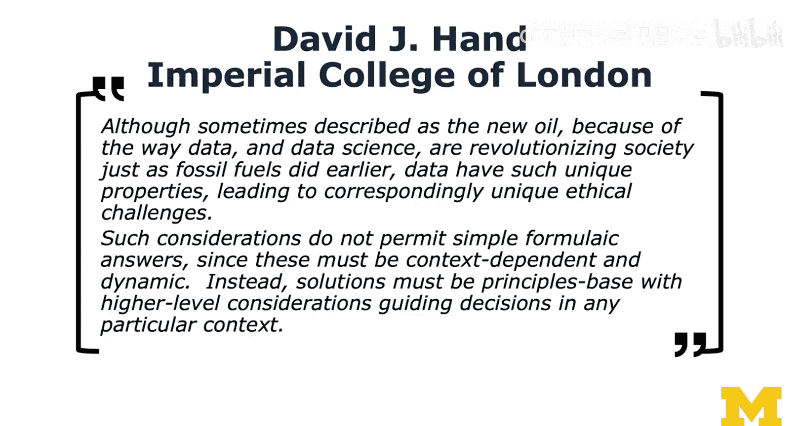
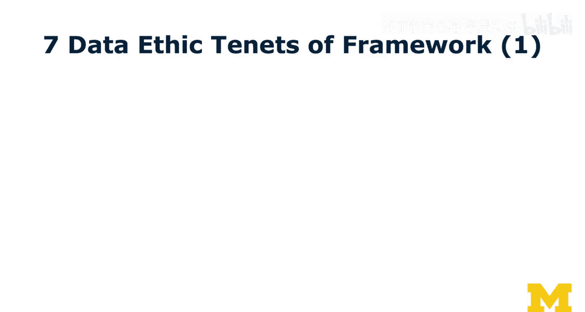
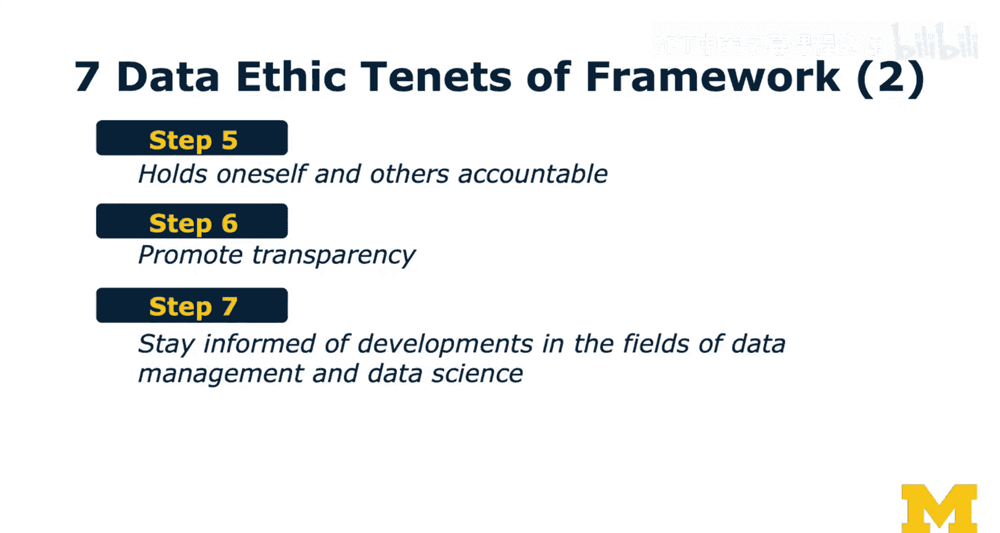
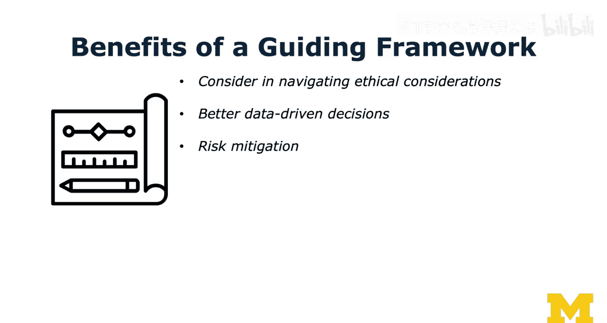
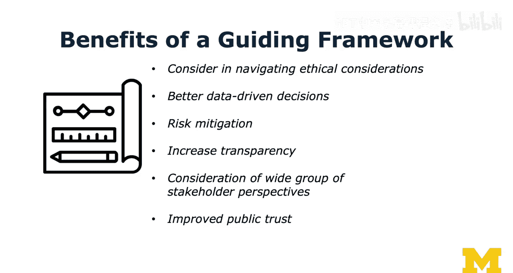
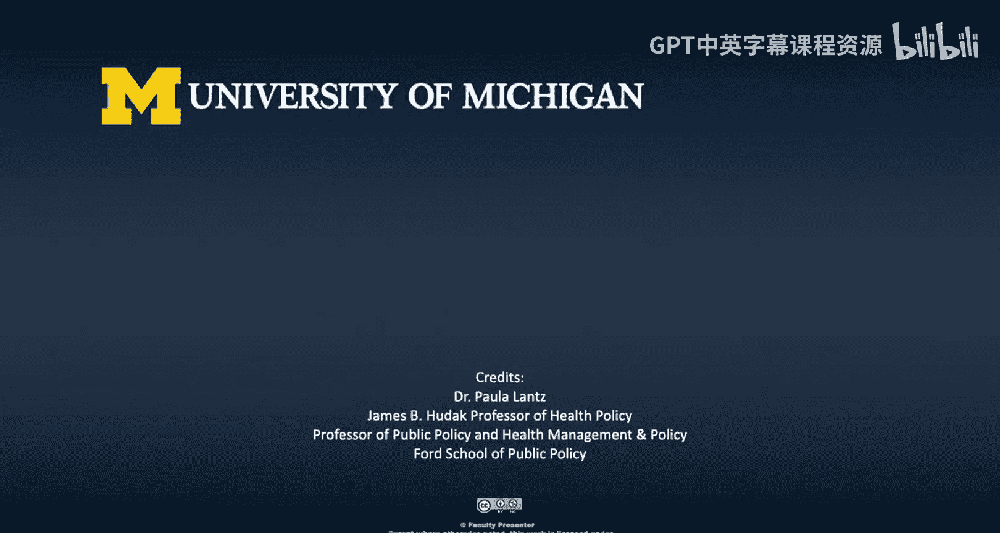

# 5：美国数据伦理框架基本原则 📜

在本节课中，我们将学习美国联邦政府制定的数据伦理框架。这个框架旨在为公共部门的数据工作者提供一套核心原则，以指导他们在数据获取、管理和使用过程中做出符合伦理的决策。

上一节我们探讨了数据科学带来的变革与挑战，本节中我们来看看如何通过一套原则性的框架来应对这些挑战。

---

## 引言：数据伦理的必要性

伦敦帝国理工学院的David Hand教授曾这样评价数据和数据科学：

> 尽管数据有时因其像化石燃料一样革命性地改变社会而被描述为“新石油”，但数据具有独特的属性，这导致了相应独特的伦理挑战。这些考量不允许简单的公式化答案，因为它们必须依赖于具体情境且是动态的。相反，解决方案必须基于原则，由更高层次的考量来指导特定情境下的决策。

Hand教授的核心观点是，在数据科学、数据技术和数据分析这个爆炸性发展的新世界中，我们需要一套原则或路标作为路线图，以识别和应对其中无数的伦理挑战。

作为世界上最大的数据生产者和使用者之一，美国联邦政府近期迎接了这一挑战。众多不同的利益相关者共同协作，制定了《联邦数据战略》及相关的行动计划。在该计划中，联邦政府总务管理局被委以重任，负责开发一个**数据伦理框架**。

该框架旨在协助联邦雇员、管理者和领导者在获取、管理和使用数据时做出伦理决策。

---

## 数据伦理框架的七大原则 🧱

这个数据伦理框架包含七项原则（或称信条），它们共同促进了一系列价值观和相应的伦理行为。框架将这些原则呈现为层层递进的步骤，较低层级的步骤为后续步骤奠定了坚实的基础。

以下是这七大原则的总结：

1.  **遵守适用的法规、条例、专业实践和伦理标准。**
    这意味着不违反法律和法规，并遵循覆盖你工作的现有职业道德准则。

2.  **尊重公众、个人和社区。**
    尊重他们的处境、利益、优先事项和观点。

3.  **尊重隐私和保密性。**
    正如你所知，这是数据系统和数据分析的核心价值。

4.  **在工作中保持诚实、正直和谦逊。**

5.  **对自己和他人负责。**
    这与上一条原则密切相关。

6.  **促进工作的透明度。**

7.  **随时了解数据管理和数据科学领域的发展。**
    这不仅包括技术发展，也包括伦理考量的演变。

我强烈建议你阅读这份报告，深入了解每一项原则。

---

## 框架的价值与益处 💡

拥有这样一套伦理指导框架，为公共部门的数据分析领域带来了诸多益处：

*   **提供决策指南**：它为每个人提供了一套重要的原则，用于应对伦理困境和考量。
*   **改善决策质量**：它有助于改进并促成更好的数据驱动型决策。
*   **降低风险**：政府因不道德行为（包括数据滥用）而面临诉讼和其他负面后果的风险很高。遵循这些原则有助于降低此类风险。
*   **增加政府透明度**：遵循这些原则可以增加政府的透明度。
*   **纳入多元视角**：它有助于引入并考虑更广泛的利益相关者观点。

所有这些都至关重要，并将共同助力提升**公众信任**，而公众信任对于公共部门的工作至关重要。

---

## 总结

本节课中，我们一起学习了美国联邦政府数据伦理框架的七大基本原则。从遵守法律、尊重个人，到保持透明和持续学习，这些原则为公共部门的数据实践构建了一个坚实的伦理基础。理解和应用这个框架，不仅能帮助我们在工作中避免伦理陷阱，更能提升决策质量、增强公众信任，最终更好地服务于公共利益。