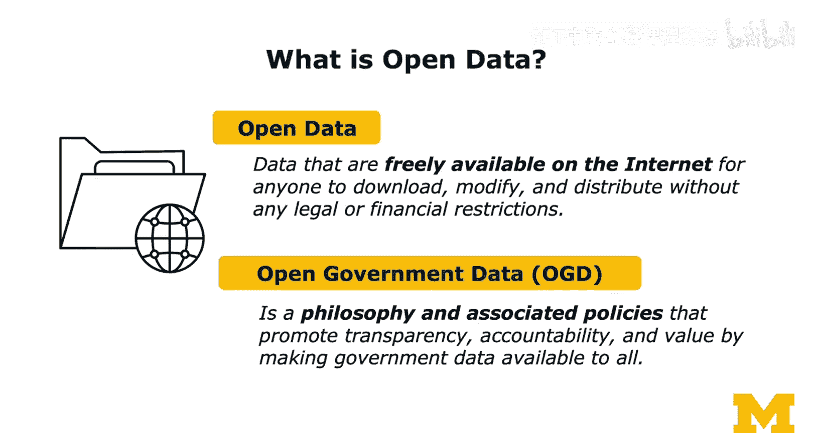
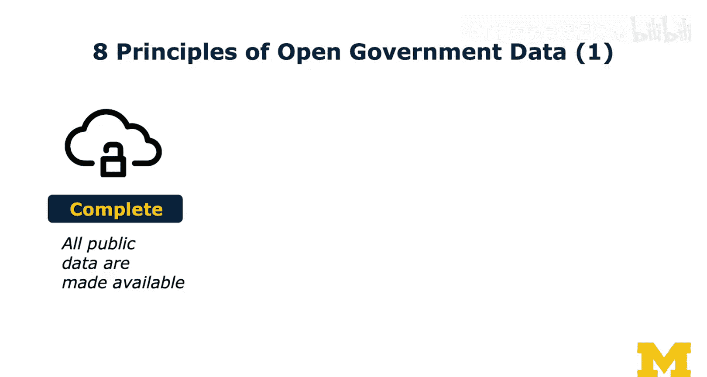
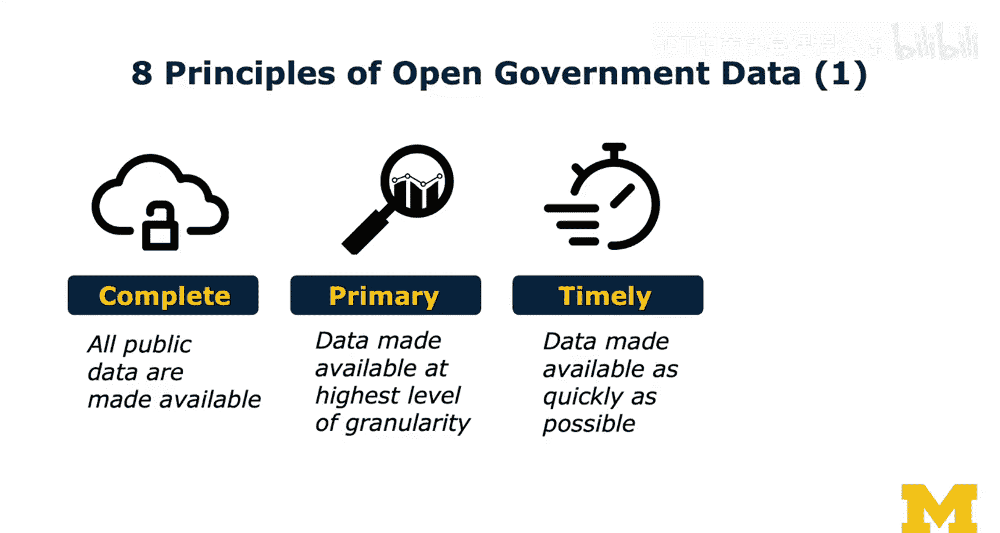
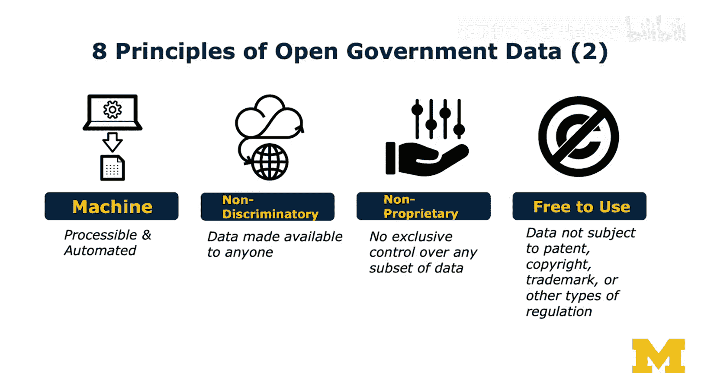
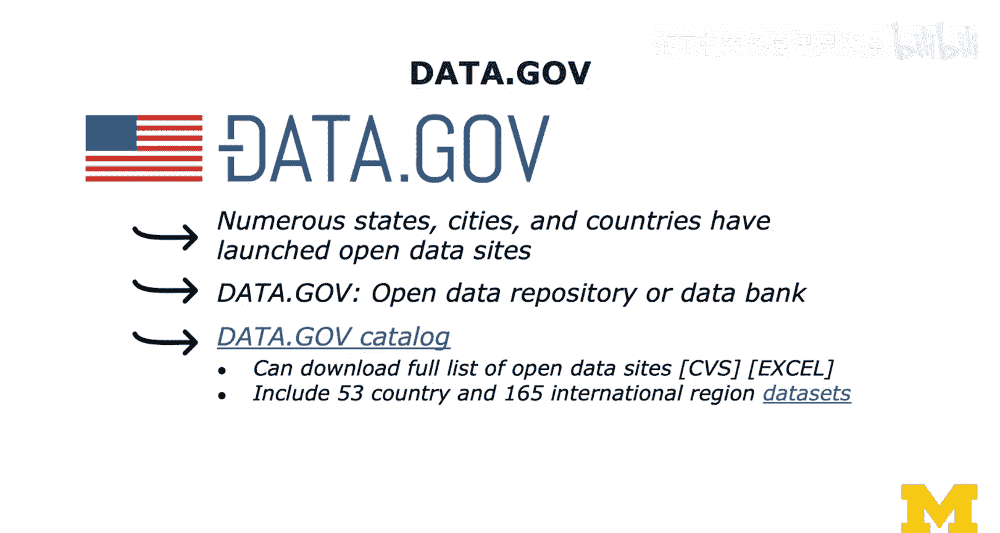

# 6：本周补充：开放政府数据八项原则 📚

在本节课中，我们将学习开放政府数据的概念及其背后的八项核心原则。这些原则旨在指导政府如何公开数据，以促进透明度、问责制和社会价值的创造。

开放数据，广义而言，是指任何人均可在互联网上免费下载、修改、分析和分发，且不受重大法律或财务限制的数据。开放政府数据是一种理念，伴随一系列政策，通过向所有人开放政府数据来促进透明度、问责制和社会价值。

上一节我们介绍了开放政府数据的基本概念，本节中我们来看看支撑这一理念的八项具体价值原则。

以下是开放政府数据的八项核心原则：

*   **完整性**：这并不意味着所有政府数据都必须公开。与医疗、公共医疗保健计划、养老金系统缴款与支付、个人普查答案等相关的个人数据需要受到保护并保持私密。然而，在法律允许的情况下，数据应尽可能以完整的方式公开。众所周知，将经过**去标识化处理**（即移除所有识别信息）的数据提供给公众使用也是可行的。
*   **原始性**：数据应以其最原始或最高**粒度**的级别提供。这意味着应提供去标识化的个体级别数据，而不仅仅是按城市、社区、县或更高级别汇总的数据。
*   **及时性**：从事这项工作的人都知道，清理数据、去除标识符、处理缺失变量和缺失数据等需要时间。数据在公开发布前需要做大量工作。然而，这项工作应尽可能快速高效地完成，以确保数据在发布时仍然及时、重要且相关。
*   **可获取性**：数据应为最广泛的用户群体提供，并可用于多种目的。
*   **机器可读性**：公开发布的数据应能被计算机处理。
*   **非歧视性**：任何人都应能访问和使用数据。您不应为使用数据而提交提案，不应需要特定资质或地位，也不应满足任何访问标准。
*   **非专有性**：这意味着政府或任何其他实体都不应对数据或其任何子集拥有独占控制权。
*   **免许可性**：数据应没有重大的访问和使用监管障碍。开放政府数据不应受专利、版权、商标或其他规则和条例的约束。

了解这些原则后，让我们花点时间探索一个由美国政府运营的开放数据仓库。

这个网站名为 **Data.gov**，您可以在 `data.gov` 找到它。该网站提供了许多州、县及其他国家开放数据站点的链接。它包含来自多个国家和国际地区的数据，是一个丰富的全球开放数据站点库或仓库。Data.gov 网站有一个 Excel 电子表格形式的目录，您可以在其中看到开放数据站点的完整列表以及每个站点的链接。这里有大量内容可供探索，涵盖了 **53 个国家和 165 个世界地区**的开放政府数据站点。请花点时间看看有哪些数据可供您或任何其他人通过开放政府数据运动使用。

本节课中我们一起学习了开放政府数据的八项核心原则：完整性、原始性、及时性、可获取性、机器可读性、非歧视性、非专有性和免许可性。这些原则共同构成了开放、透明和负责任的政府数据实践的基石。我们还简要介绍了 Data.gov 这一全球开放数据资源门户，鼓励大家积极利用这些公共数据资源进行探索和分析。