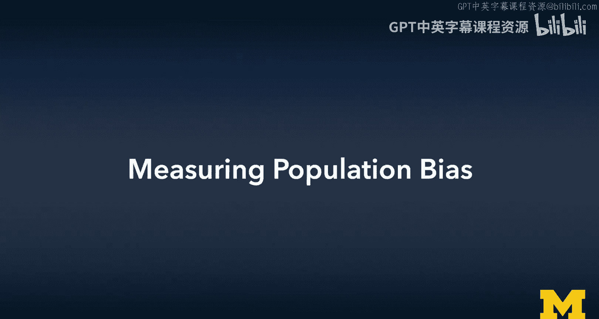
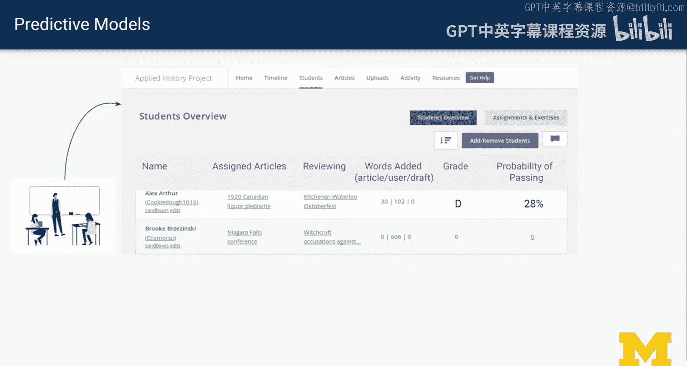
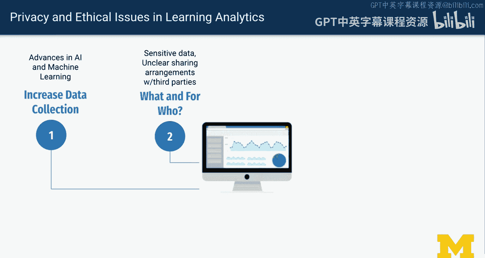
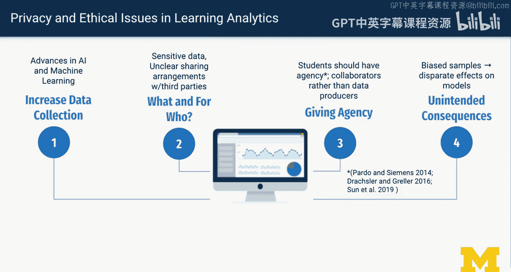
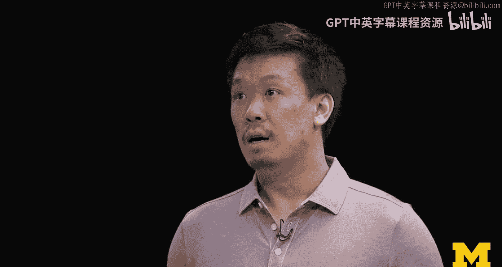
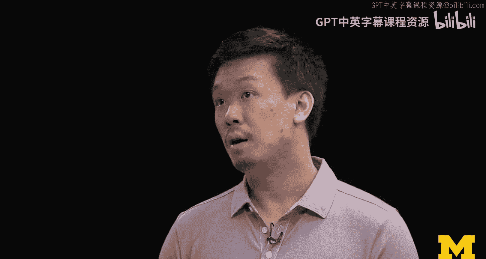
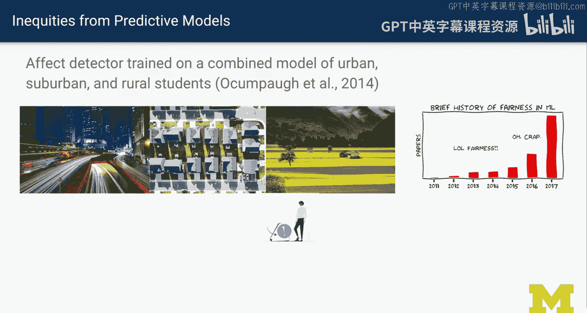
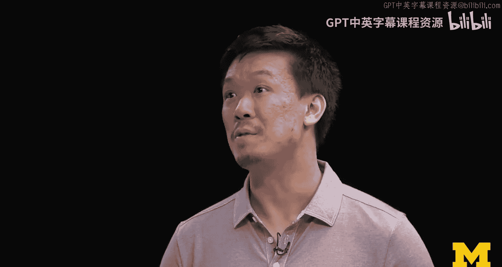
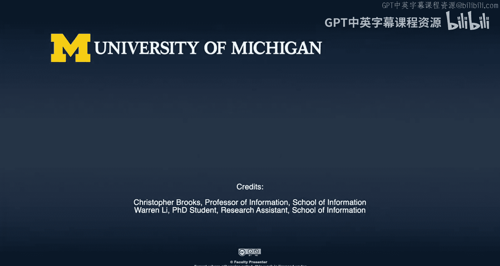

# 公共部门的R数据分析：7：人口偏差测量方法 📊

在本节课中，我们将学习学习分析中的人口偏差测量方法。我们将探讨学生同意分享数据倾向的差异，以及这种差异如何影响预测模型的公平性与有效性。

## 概述

今天，我们很高兴向您介绍沃伦·李，他是密歇根大学信息学院与我合作的博士研究生。沃伦目前是博士五年级，他的研究专注于学习过程，以及学习者如何与数据系统、人工智能和数据收集系统互动。他今天展示的研究是与我的合作者弗洛伦斯·施瓦巴以及我指导的另一位博士生孙凯文共同完成的。我的研究重点是学习分析，我致力于利用数据科学来理解学习现象并帮助学习者，这通常涉及构建学习者的预测模型。

确保这些数据有意义至关重要。我们在本课程中已经简要讨论过偏差和人口偏差，这正是沃伦今天工作的主题。非常感谢沃伦的加入，我期待听到他的分享。

谢谢邀请，我很高兴来到这里，也感谢精彩的介绍。正如克里斯提到的，今天我们将讨论学生在同意参与学习分析方面的倾向差异。这听起来有点复杂，“倾向”指的是他们分享数据的可能性，而“学习分析”指的是利用数据来更好地理解学习者并帮助改善他们的学习。

## 学习分析的应用与数据收集

为了给您一个例子，在课堂上使用数据的一个领域是预测模型。例如，假设学生正在上课，他们正在参与课程材料的学习。

我们可能有不同的公司开发软件，以帮助识别可能面临风险的学生。这里有一个例子：一名学生课程成绩为D，我们担心他可能无法通过。这项工作的希望在于能够进行干预，也许我们可以为他们提供一些支持，从而扭转局面。

事实上，在本课程的Coursera学习管理系统中，他们也使用了预测模型。虽然我自己不常使用它们，但学生们可能已经注意到，在整个课程中他们会收到一些小提示，比如“如果你完成这项作业，你通过这门课程的机会会更大”。我很想听听他们对这些提示的看法。我认为非常有趣的是，许多供应商正在投入大量工作来构建这些系统，而不管机构是否需要。同时，像密歇根大学这样的机构，也对构建我们自己的预测分析工具和仪表盘非常感兴趣。

确实，当我们讨论与其他公司共享数据时，我们实际上会谈到其中一些担忧。例如，这当然会引发一些隐私和伦理问题。

## 数据隐私、伦理与机构问题

正如您所暗示的，许多这类系统会导致数据收集的增加。它们基于人工智能和机器学习算法，为了构建这些模型，我们需要大量数据。这自然引出了一个问题：数据是什么？为谁服务？不幸的是，很多时候这些是敏感数据，可能是您的学业记录、人口统计信息等，有些人可能并不总是愿意分享这些信息。情况变得复杂，因为与第三方、外部公司等的共享安排并不明确。

即使是像我们这样的校内研究人员，为了获取学生数据，也必须经过一系列不同的程序。这里涉及很多方面，包括相关立法、本地政策，当然还有学生的最大利益，这是我们所有人都致力于维护的。

这正好是一个完美的过渡，因为许多研究人员以及学生本人都希望拥有自主权，并指出我们应该赋予学生自主权。因为这有助于体现对他们决定的尊重，我们应该将他们视为合作者，而不仅仅是数据生产者。我们不仅仅是生成数据，我们是这个过程的一部分。

## 自主权与样本偏差的后果

但有时也会产生一些意想不到的后果。例如，我们知道样本偏差——当模型不能代表全部人口时，这会对不同的亚群体产生不同的影响。因此，如果我们允许所有人选择退出，并且所有人都选择退出，这可能会对一些模型产生负面影响，对某些特定群体尤其如此。这一点尤其令人担忧，因为我们知道教育成就本身就存在差异。

确实，在美国，我们经常根据种族或民族来思考这些群体。我们在本课程中已经通过BRFSS和其他行为系统看过一些相关数据。但这实际上是一个全球性问题，不仅限于种族和民族，它还可以沿着任何可以划分群体的界限分解，例如性别界限，但也包括学科领域和教育准备程度，例如家庭中第一代大学生。

我很高兴您提到这一点，因为在这项特定研究中，我们关注的是性别和种族。但正如您所说，存在许多不同的群体，甚至不同国家和文化中的群体构成也可能有所不同。

## 预测模型中的公平性问题示例

为了给出预测模型中不公平现象的具体例子，近年来，如右侧漫画所示，人们对机器学习公平性的兴趣日益增长。我这里举一个例子：Ocompal等人在2014年训练了一个模型，一个“情感检测器”——这只是试图模拟学生情绪的一种花哨说法。例如，也许有人在课堂上感到沮丧或无聊，我们试图检测这些行为。他们的做法是收集了大量来自城市、郊区和农村学生的数据。

他们发现，该模型对城市学生和郊区学生的表现相当好，但对农村地区的学生则不然。部分原因在于农村地区的学生数量要少得多。这就是我们所说的模型对不同群体的不同影响。例如，您可能需要将它们分开，并分别训练这些模型。

我认为这确实说明了问题。这是宾夕法尼亚大学出色的研究，我认为它确实强调了从您希望支持的人群中收集数据的必要性。实际上，在教育领域和学习科学领域，我们面临着巨大的可重复性危机。正如您所知，进行这些调查或进行全面的实验非常昂贵，而且需要大量时间。因此，即使我们有1000名学生，如果这些学生都来自同一个群体，我们能真正推广的结论是有限的。我认为这项出色的工作确实将这个问题推到了教育数据挖掘领域的前沿。

## 预测错误的后果

正如您提到的，这极其重要。那么，让我们也谈谈预测错误可能带来的一些后果。例如，如果某人被标记为“有风险”，这会带来负面刻板印象。我们不想只是简单地给每个人贴上“有风险”的标签，因为这会产生一些负面后果。同样，如果我们错误地分类学生，我们最终会错过一些本可以更早为学生提供支持的干预机会。

我认为我们在研究中面临的一个挑战是，预测和干预之间存在差异，但它们确实需要齐头并进。我们需要识别需要帮助的学生，然后我们需要能够进行干预以实际帮助这些学生。当然，有些干预措施我们可以用来帮助每个人，比如在作业前一晚发送一封电子邮件提示，或者提前一周发送提醒。这些是轻量级且容易实施的。

但对于像密歇根大学这样的大型机构来说，提供个性化的辅导建议或打电话联系某人则比较困难。不过，我们确实会为那些被识别为最高风险的学生提供此类帮助。因此，干预和预测这两个部分确实需要紧密结合。

确实，正如您提到的，这是一个复杂的难题。存在那些简单的干预措施，比如给每个人发邮件，但也有一些成本更高的干预，例如建议某人完全换一门课，这将产生巨大的影响。

## 总结

本节课中，我们一起探讨了学习分析中人口偏差的测量及其重要性。我们了解了预测模型在教育中的应用、数据收集带来的隐私与伦理问题、赋予学生数据自主权的必要性，以及样本偏差如何导致预测模型对不同群体产生不公平的影响。通过具体的研究案例，我们看到了确保数据代表性和模型公平性的挑战。最后，我们讨论了预测与干预必须相结合，才能有效支持学生，并认识到不同干预措施的成本与复杂性。理解这些概念对于在公共部门负责任地开展数据分析至关重要。