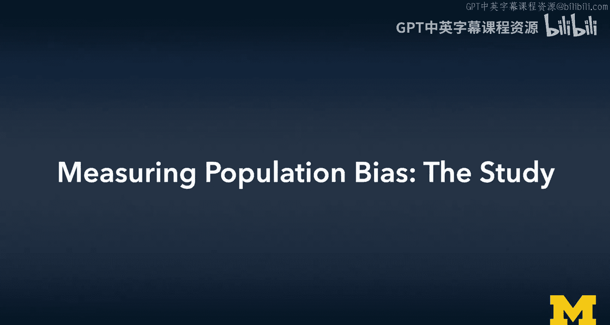
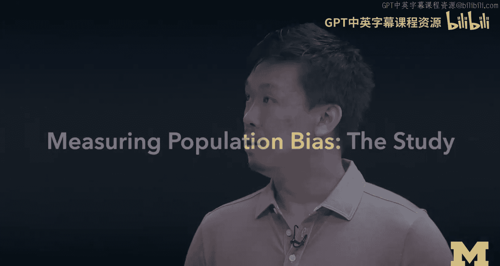
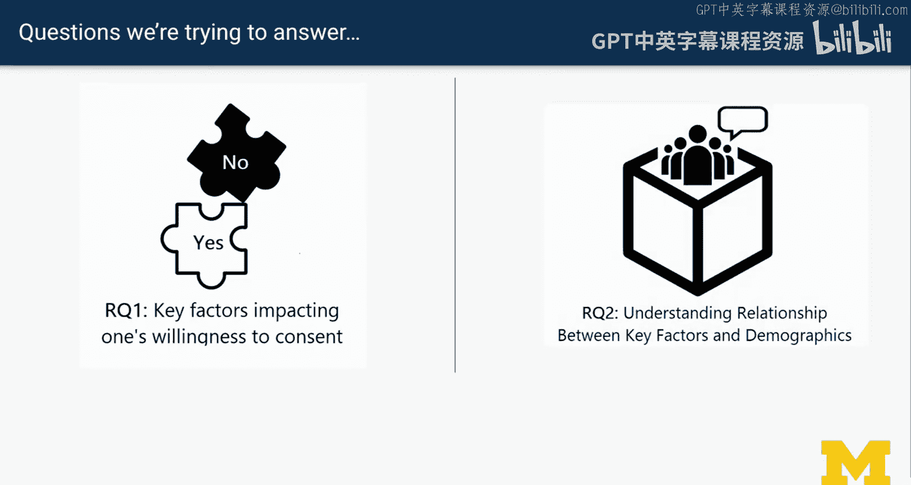
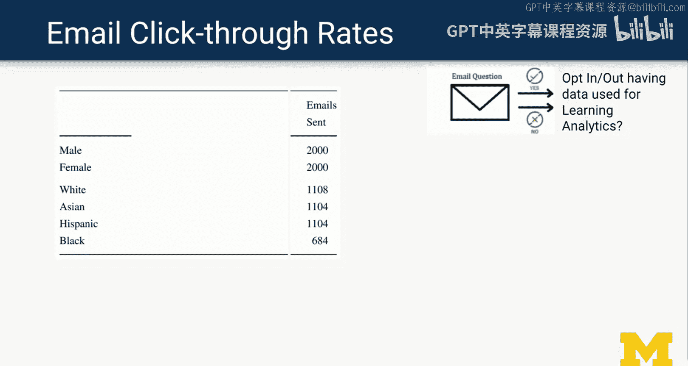
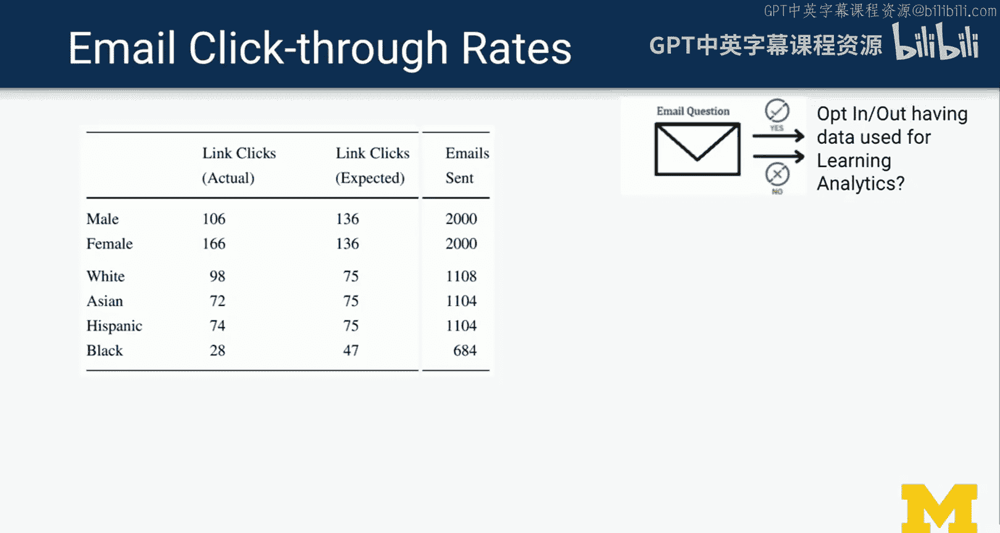
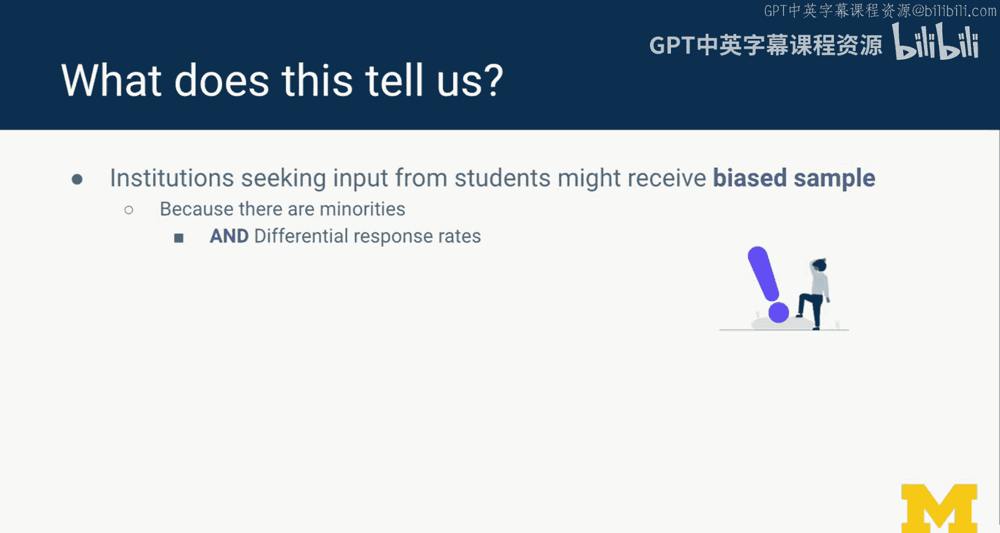
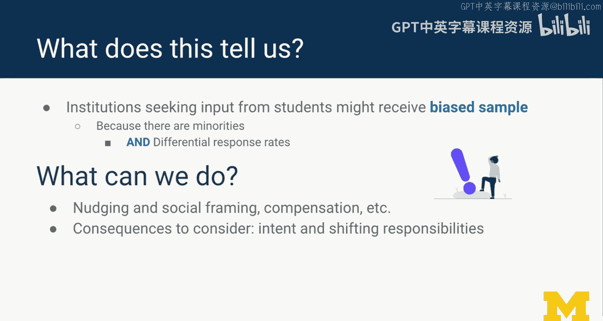
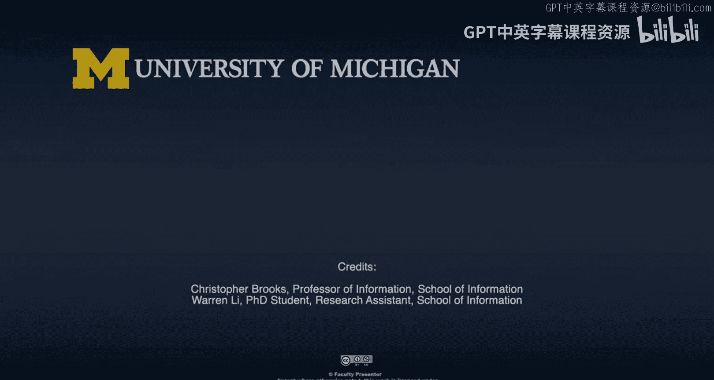

# 公共部门的R数据分析：8：人口偏差测量实证研究 📊

在本节课中，我们将学习一项关于学生数据使用同意意愿的实证研究。这项研究旨在探讨影响学生同意意愿的关键因素，并分析这些因素如何与人口统计学特征相关联。我们将了解研究设计、数据收集过程、观察到的响应偏差以及由此引发的关于数据代表性、同意机制和干预措施的思考。

---

上一节我们介绍了研究背景与核心问题，本节中我们来看看研究的具体设计与数据收集方法。

为了回答研究问题，我们向密歇根大学的4000名大一新生发送了一封仅包含一个问题的电子邮件。该问题询问学生是否同意将其数据用于学习分析。

以下是邮件发送的群体分层策略：

*   **性别**：男性和女性各2000封邮件。
*   **种族**：我们力求在各群体间尽可能平衡。但实际操作中，白人学生样本略多，黑人学生样本略少。这是因为在密歇根大学这样规模的机构中，黑人学生属于少数群体。为了确保他们的观点得到代表，我们几乎联系了所有符合条件的黑人新生。

这种群体规模不均等的情况，是数据分析中常见的挑战。在本专业的其他课程中，我们讨论过**加权变量**是处理此类问题的一种方法。例如，在BRFSS数据中，我们可以根据人口规模和响应率对结果进行加权。然而，本研究的兴趣点不在于事后的加权处理，而在于首先理解不同群体对我们的调查是否从一开始就存在不同的响应倾向。

---

上一节我们了解了数据收集的框架，本节中我们来看看实际观察到的响应情况与预期之间的差异。

我们计算了预期的链接点击数和实际的链接点击数。预期值基于一个总体假设：所有群体的响应率相同，均为观察到的总响应率（约7%）。

以下是预期点击与实际点击的对比观察结果：

*   **白人学生**：实际点击量显著高于预期值。此处的比较是将白人学生与所有其他种族分类（亚裔、西班牙裔、黑人）的学生合并后的群体进行对比。
*   **黑人学生**：实际点击量远低于预期值。
*   **女性学生**：与男性相比，女性的响应率也高于预期。

这些结果清晰地揭示了两点：第一，你调查的各个子群体规模本身就不相等；第二，你从各子群体获得的响应率也各不相同，并非均匀分布。因此，在解读结果时，必须考虑这些偏差。如果你认为所测量的变量（本例中是同意倾向）受人口统计学特征影响，那么这种响应率的差异就尤其值得关注。

---

上一节我们看到了响应中存在的偏差，本节中我们来探讨这种低响应率现象及其深层含义。

这项研究中一个非常有趣的现象是，只有约7%收到邮件的学生做出了响应。我们最初的假设是学生希望拥有自主权，但绝大多数学生甚至不愿意参与这封关于数据使用的邮件互动。

一些其他机构已将回答此类问题设为强制要求，而另一些机构则认为无需询问。事实上，我们论文的一位评审就提出：“你们何必问他们？我们不需要问他们。”这也是一种合理的立场。这引出了关于同意、自主权和代表性的复杂议题。

尽管在法律上我们可能无需征得同意，但本研究关注的是“如果我们询问，会发生什么”的假设情况。我们认为征得同意是重要的，并希望观察其效果。目前，在加州、欧洲、加拿大等许多司法管辖区，从数据被收集者那里获取同意正变得越来越重要，尽管要求不尽相同。

---

上一节我们讨论了低响应率现象，本节中我们基于这些发现来思考可能的解决方案及其潜在影响。

那么，面对这些信息，我们可以做些什么？以下是一些可能的干预措施：

*   **助推**：通过设计选择架构，温和地影响人们的决策。
*   **社会框架**：解释分享数据为何可能有益。
*   **补偿**：为学生分享数据提供某种形式的补偿。

然而，这些干预措施也伴随着后果。根据行为者的意图，我们可能希望鼓励人们分享或做出同意决定，但不应对其施加必须同意的压力。这个领域涉及大量行为心理学研究。有时网站上存在被称为“黑暗模式”的负面设计，有时则是非常积极的引导。

当我们为了获取数据而“助推”人们时，会产生许多有趣的问题：例如，助推是否会改变他们将要提供的数据？是否会将他们置于不同的思维框架中？在本例中，如果我们通过告知机构做出良好决策的重要性来助推，猜测不仅会有更多人响应，而且会更积极地同意分享数据。但我们想了解的是真实的意愿。

这些旨在改善偏差和响应率的干预措施，实际上也可能改变你的数据，从而给数据增加更多维度的偏差。这是一个值得未来研究探讨的非常有趣的问题。

---

上一节我们探讨了可能的干预措施，本节中我们最后来看看学生们实际的选择及其背后的关键影响因素。

一个关键问题是：在不同群体中，学生们实际的选择是什么？他们是否同意分享数据？我们发现了什么？

情况有些复杂，但我们发现有三个主要因素对学生是否同意产生显著影响：

1.  **对数据收集的普遍担忧**：如果学生对数据收集的总体担忧程度更高，他们同意的可能性自然更低。
2.  **对机构的信任**。
3.  **对教师的信任**：这一点甚至比信任机构更为重要。

---

本节课中我们一起学习了一项关于学生数据同意意愿的实证研究。我们回顾了研究如何通过分层抽样设计调查，并发现了显著的响应率偏差，特别是不同种族和性别群体之间的差异。我们探讨了低响应率现象背后的含义，以及为改善偏差可能采取的干预措施（如助推）及其潜在风险。最后，我们了解到影响学生同意决策的三个关键因素：对数据收集的担忧、对机构的信任，以及对教师的信任。这项研究凸显了在公共部门进行数据分析时，理解并解决数据收集阶段的人口偏差对于确保决策公平性与代表性的至关重要。