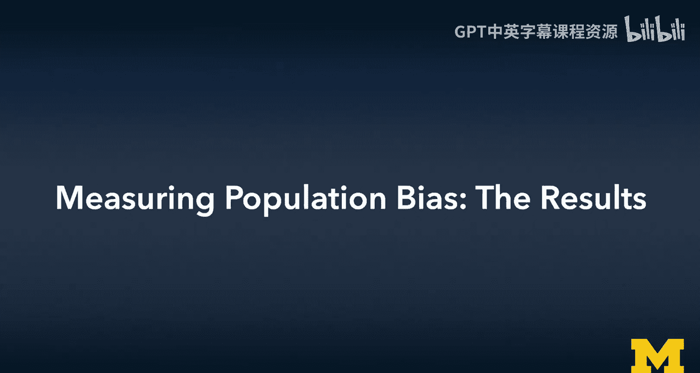
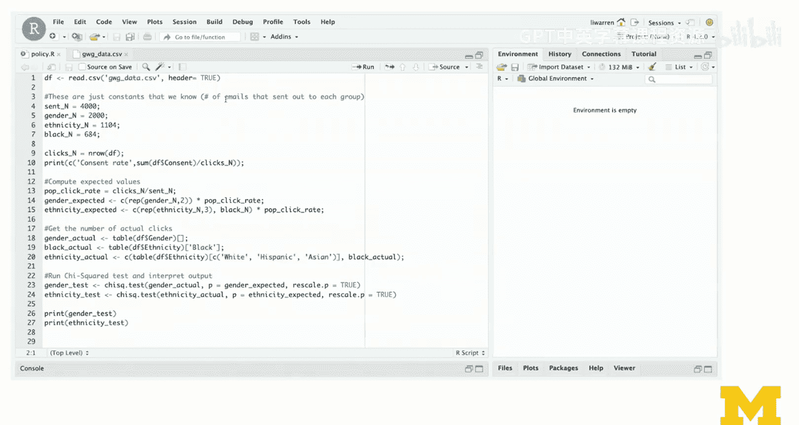
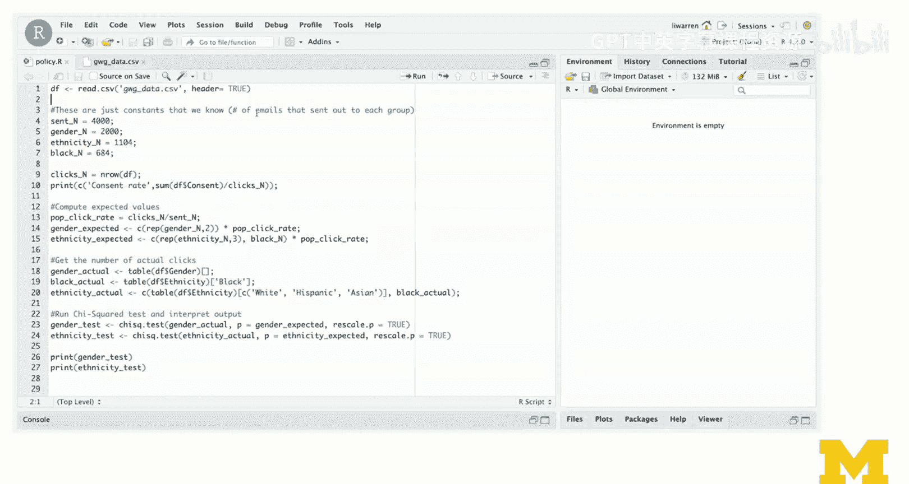
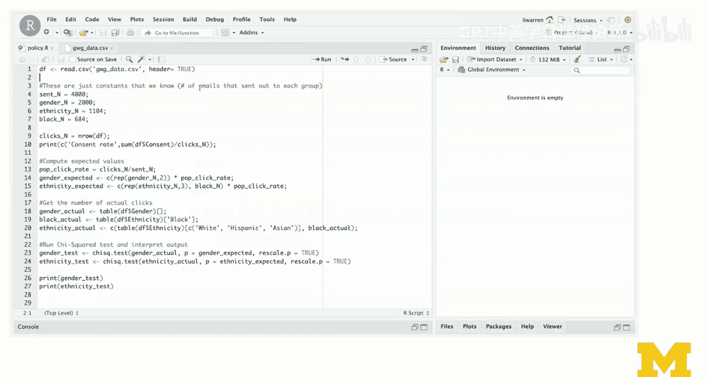
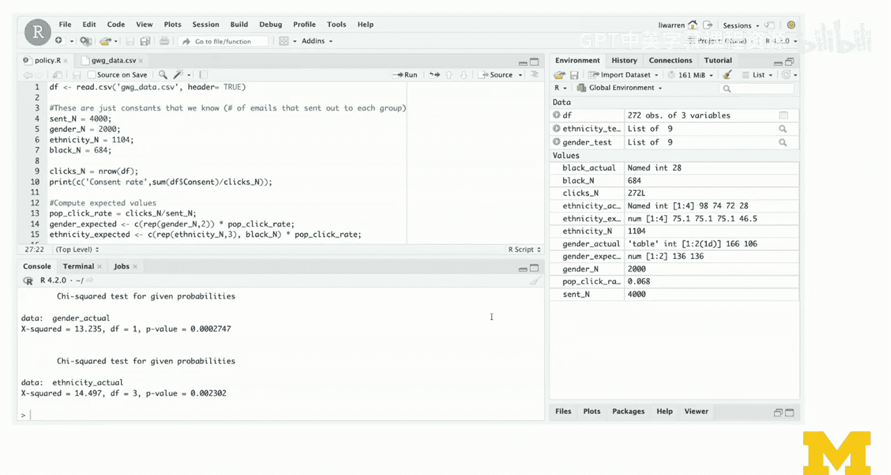

# 9：人口偏差测量结果分析 📊



在本节课中，我们将学习如何分析一项研究中的人口偏差。我们将使用R语言，通过卡方检验来评估数据收集过程中是否存在基于性别和种族的系统性偏差。课程将涵盖数据读取、预期值计算、实际值统计以及统计检验的完整流程。

---


上一节我们介绍了研究背景和定性分析的重要性，本节中我们来看看具体的R代码实现和数据分析过程。

## 数据准备与常量定义

首先，我们需要读取数据并定义一些已知的常量。数据文件是一个CSV格式的文件，包含三列：`consent`（是否同意使用数据）、`gender`（性别）和`ethnicity`（种族）。

以下是读取数据和定义常量的R代码：

```r
# 读取数据
data <- read.csv("your_data_file.csv")

# 定义已知常量
sent_emails <- 4000  # 发送的邮件总数
gender_population <- 2000  # 性别分组的人口基数
ethnicity_population <- 1104  # 特定种族分组的人口基数（例如黑人学生）
```

## 计算汇总统计量

在进行分析之前，我们先计算一些基本的汇总统计量，例如总体同意率。



以下是计算同意率的代码：


```r
# 计算总体同意率
consent_rate <- sum(data$consent) / nrow(data)
print(paste("总体同意率：", round(consent_rate * 100, 2), "%"))
```

## 计算预期值与实际值

接下来，我们需要计算在假设无偏差的情况下，各人口分组预期的点击（同意）数量，并与实际观察到的数量进行比较。

预期点击率的计算公式为：
**预期点击率 = 总点击次数 / 发送邮件总数**

然后，用各分组的人口基数乘以这个预期点击率，得到该分组的预期点击数。




以下是计算预期值和实际值的代码：

```r
# 计算总体点击率（同意即视为点击）
population_click_rate <- sum(data$consent) / sent_emails

# 计算性别分组的预期点击数
expected_clicks_gender <- gender_population * population_click_rate

# 计算种族分组的预期点击数（示例为黑人学生分组）
expected_clicks_ethnicity <- ethnicity_population * population_click_rate

# 从数据中统计各分组的实际点击数
# 注意：数据文件只包含点击了的学生
actual_clicks_gender <- table(data$gender)
actual_clicks_ethnicity <- table(data$ethnicity)
```


## 执行卡方检验

为了判断观察到的差异是否具有统计显著性，而非随机波动，我们使用卡方检验。卡方检验用于检验两个分类变量之间是否独立。




在R中，我们使用 `chisq.test()` 函数。我们可以直接传入观察频数和预期频数。

以下是执行卡方检验的代码：




```r
# 对性别进行卡方检验
# 使用预期比例，例如男女各占一半，则传入 c(0.5, 0.5)
# 也可以直接传入预期频数，函数会自动归一化
chi_gender <- chisq.test(actual_clicks_gender, p = c(0.5, 0.5))
print(chi_gender)

# 对种族进行卡方检验（以两个主要类别为例）
# 假设预期分布为均匀分布
chi_ethnicity <- chisq.test(actual_clicks_ethnicity)
print(chi_ethnicity)
```

## 结果解读与注意事项

运行上述代码后，我们将得到卡方检验的P值。在社会科学中，通常将显著性水平（alpha）设定为0.05。

以下是结果解读的关键点：
*   **P值 < 0.05**：拒绝原假设，认为点击率与性别/种族**存在显著关联**，即存在统计上的偏差。
*   **P值 >= 0.05**：没有足够证据拒绝原假设，不能认为存在显著关联。


需要强调的是，统计显著性（P值小）并不等同于实际意义的显著性（效应量大）。当样本量很大时，即使很小的差异也可能产生极小的P值。因此，必须结合我们在之前幻灯片中看到的实际差异大小来综合判断。

此外，数据本身也存在局限性：
1.  数据来源于学生信息系统，其中的分类（如“性别”实为生理性别）可能与社会定义不完全吻合。
2.  种族分类基于联邦报告要求，某些类别（如“两个或更多种族”、“美国印第安人”）样本量过小，可能被排除在分析之外。
3.  分析样本本身可能存在偏差（例如，愿意回答“为什么”的学生群体不能代表全体）。

---


本节课中我们一起学习了如何使用R进行人口偏差分析。我们完成了从数据读取、常量定义、计算预期与实际值，到执行和解读卡方检验的全过程。重要的是，我们认识到统计分析是理解偏差的工具之一，但必须结合数据收集的背景、分类的定义限制以及定性分析的洞察，才能对研究结果形成全面、审慎的理解。在应对政策制定或数据分析中的偏差问题时，需要从统计、数据收集、清洗到整体设计进行多维度考量。