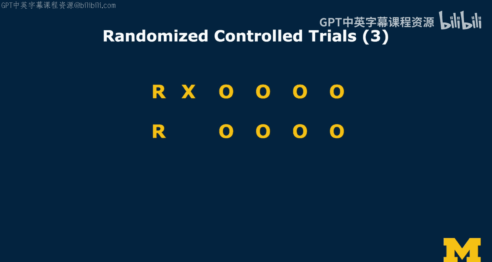
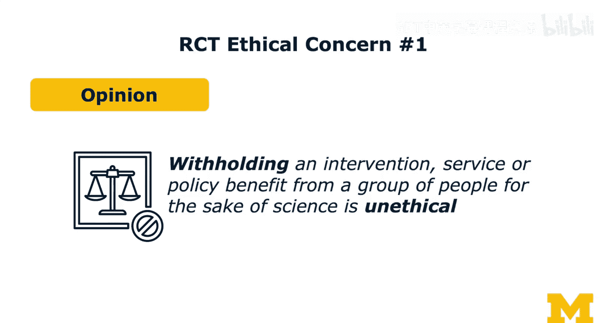
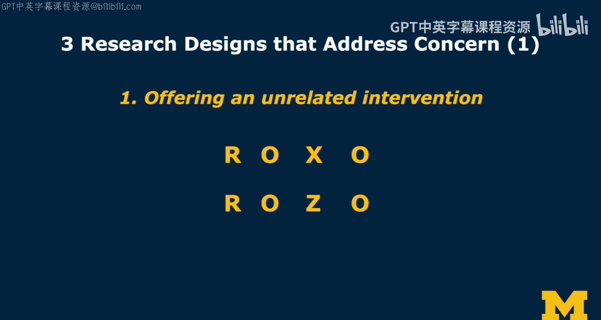
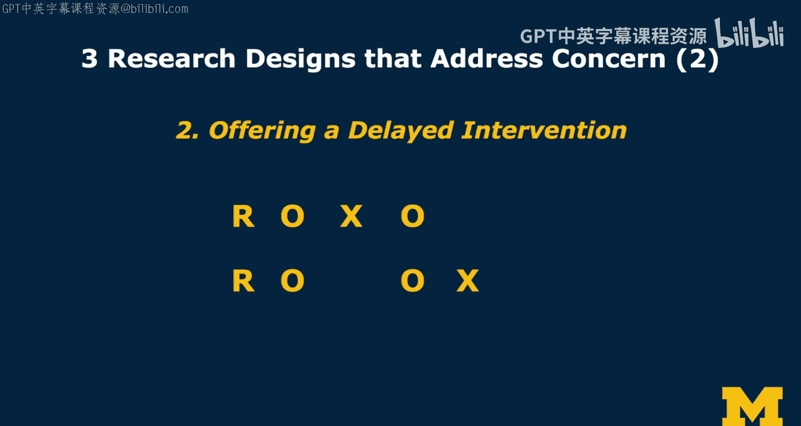
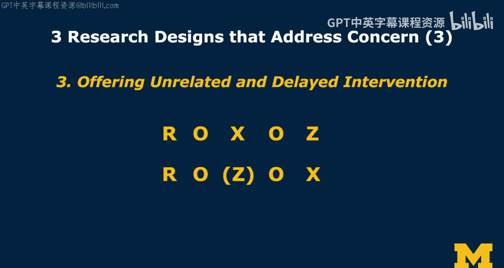

# 10：随机对照试验中的伦理问题 🧪


在本节课中，我们将回顾随机对照试验这一强大的研究设计，并重点探讨其伴随的伦理问题。正如我们在课程三中讨论过的，随机对照试验因其能有效隔离和理解项目、政策或其他干预措施的效果，而具有最强的内部效度。

上一节我们介绍了随机对照试验的基本设计，本节中我们来看看其设计的一些变体，并深入探讨三个主要的伦理关切。

## 随机对照试验的设计变体 🔄

随机对照试验的设计存在一些变化。以下是其经典设计，其中两组被随机分配接受或不接受干预，并在干预前后都进行观察（用O表示）。

```
Group 1 (干预组): O1 -> [干预] -> O2
Group 2 (对照组): O1 -> [无干预] -> O2
```


在另一种版本中，研究可以包含三组，这些组被随机分配接受两种不同干预中的一种，或作为不接受任何干预的对照组。

```
Group A: [干预 A]
Group B: [干预 B]
Group C (对照组): [无干预]
```

在第三个例子中，可以设计一个实验，其中两组被随机分配接受或不接受干预，然后在干预后对两组进行多次观察。在这个特定例子中，干预后有四个观察点。

```
Group 1 (干预组): O1 -> [干预] -> O2 -> O3 -> O4 -> O5
Group 2 (对照组): O1 -> [无干预] -> O2 -> O3 -> O4 -> O5
```




实验设计有许多主题和变体，其共同因素是**随机分配**是否接受干预。正是由于这种随机分配以及实验的性质，使用这类研究设计会带来一系列伦理问题。

## 随机对照试验的主要伦理关切 ⚖️

我们将讨论随机对照试验的三个主要伦理关切：
1.  为了科学而扣留可能有效的干预措施。
2.  提供安慰剂或影子干预。
3.  在未获得知情同意的情况下对人群进行实验。

### 伦理关切一：扣留干预措施

许多人认为，为了研究、科学或政策分析，而将一项干预、服务或政策福利从一群人那里扣留，是不道德的。人们不应该被当作实验品，尤其是因为扣留资源或有益服务可能会伤害他们。一些人认为，如果一项干预措施好到足以在研究中进行试验，就不应该使用一个实际上会将其从某些人那里扣留的研究设计。



然而，另一些人则认为，在评估之前，我们永远无法真正知道一项干预是否有效，而且许多干预措施会产生意想不到的后果或伤害。最坏的情况不是干预无效或效果中性，有时干预措施确实会以设计时未预料到的方式伤害人们。因此，除非我们使用具有良好内部效度的强大研究设计，否则我们将无法知道干预是否真正有效，或者是否带来了意想不到的有害后果。因此，这里存在两种相互竞争的观点。

### 应对策略：替代性研究设计

为了应对实验中扣留可能有效干预措施的伦理关切，实际上可以使用一些替代性的研究设计。

以下是其中一种设计的图示。让我用文字解释：这里有两组人，被随机分配接受两种完全无关的干预措施之一。这些组互为比较组或对照组，但**每组都接受一项可能有效的服务或项目**。在干预前后都对两种干预的潜在效果进行观察。

```
Group A: O1 -> [干预 A] -> O2
Group B: O1 -> [干预 B] -> O2
```




要使这种设计有效，两组都必须接受干预，但干预措施必须**完全无关**，不能存在一种干预的暴露会影响另一种干预效果的可能性。我熟悉的一个例子是针对孤寡老人的上门护理干预，其中一组被随机分配在家中接种流感疫苗，而另一组被随机分配接受预防跌倒（尤其是在浴缸中）的干预。

第二种用于解决扣留干预措施伦理关切的设计称为**延迟干预设计**，其中对照组或比较组实际上在实验完成、研究人员知道干预是否有效后的某个未来时间点接受干预。如果干预有积极效果，那么对照组可以在延迟或稍后的时间接受它。

第三种可以考虑的设计实际上是前两种的结合，它同时提供了**无关干预和延迟干预**。两组被随机分配接受两种无关干预中的一种，然后在效果评估后，将干预措施给予另一组。这种设计的技术术语是**延迟干预交叉法**。

```
第一阶段：
Group A: O1 -> [干预 A] -> O2
Group B: O1 -> [干预 B] -> O2


第二阶段（交叉后）：
Group A: O3 -> [干预 B] -> O4
Group B: O3 -> [干预 A] -> O4
```






## 总结 📝


本节课中我们一起学习了随机对照试验的设计变体及其伴随的核心伦理问题。我们探讨了扣留可能有效干预措施这一主要伦理关切，并介绍了三种替代性研究设计——**使用无关干预的对照组**、**延迟干预设计**以及**延迟干预交叉法**——来应对这些关切，从而在追求科学严谨性与保障研究参与者权益之间寻求平衡。理解这些伦理考量和替代方案，对于在公共部门负责任地设计和实施基于证据的政策评估至关重要。