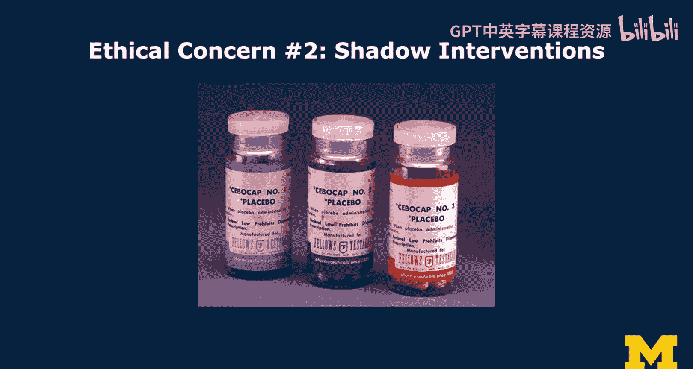
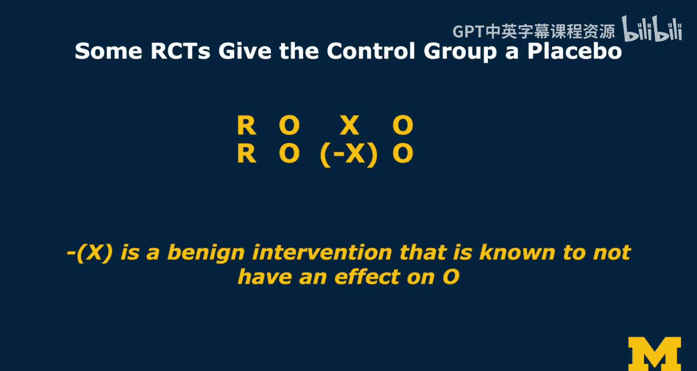
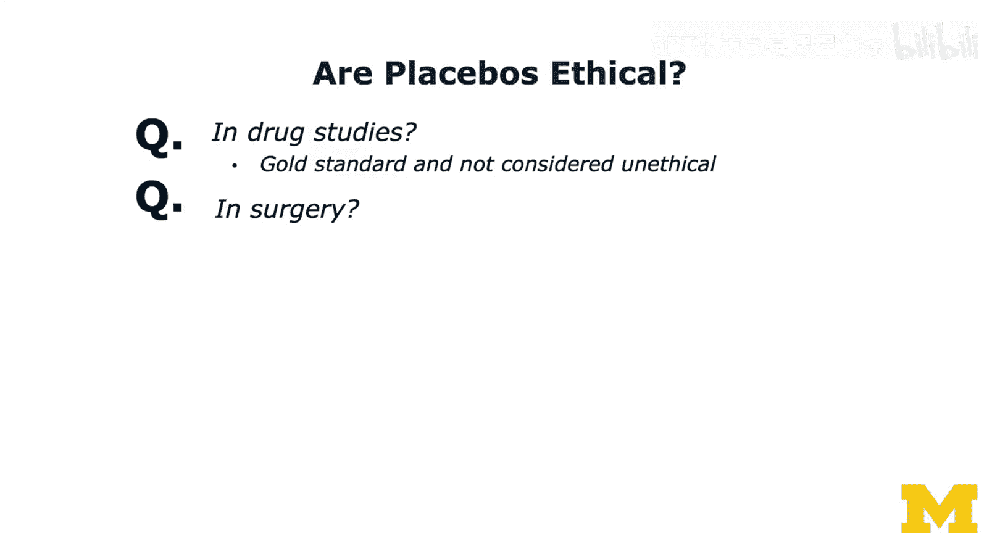
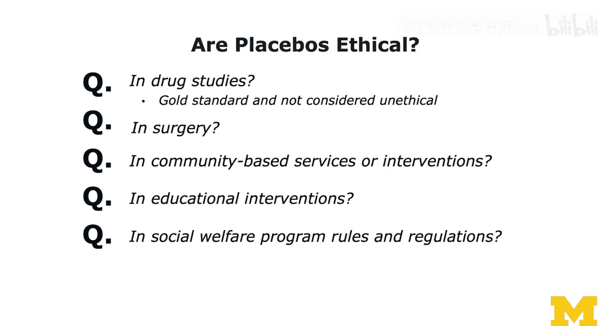
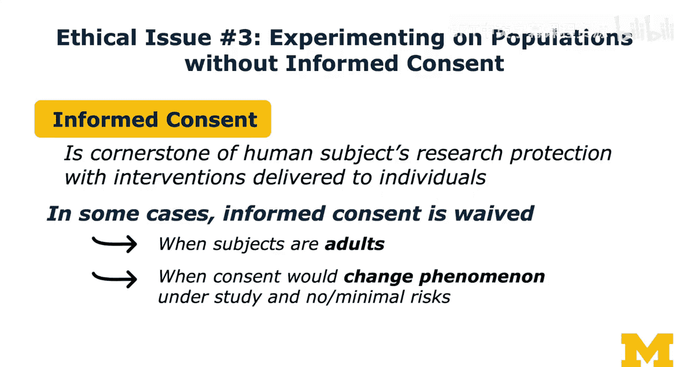
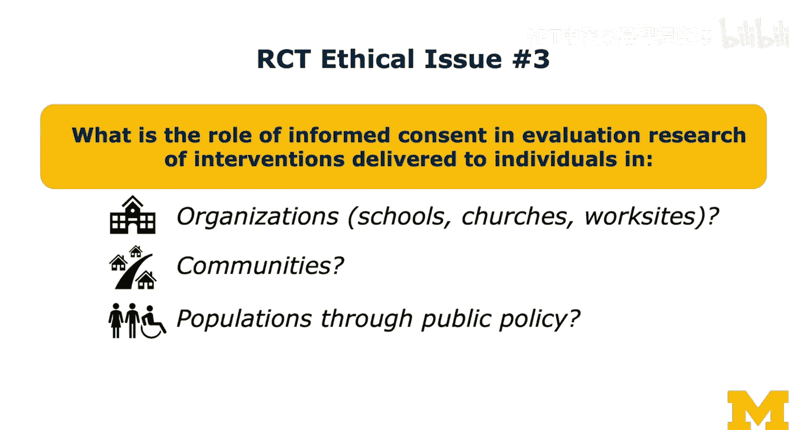
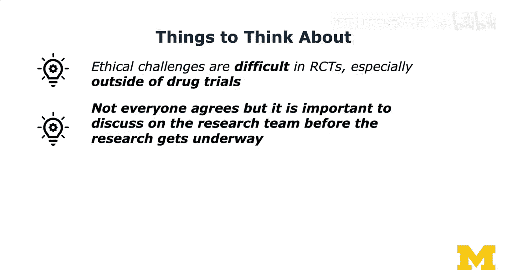
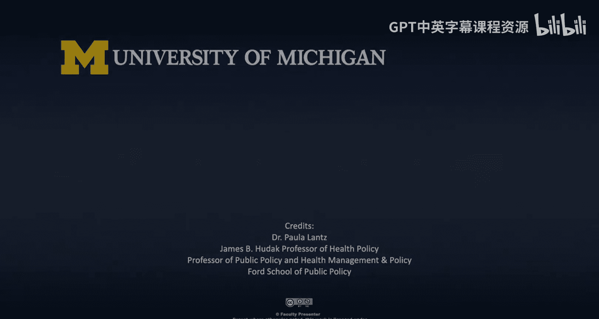

# 11：影子干预的伦理考量 🧭

在本节课中，我们将继续探讨与实验设计相关的伦理问题，重点关注“影子干预”或“安慰剂”的使用。我们将分析在公共部门研究中，向参与者提供明知无效的干预措施是否合乎伦理，并讨论知情同意原则在政策评估中的适用性。

---

上一节我们讨论了实验设计的一般伦理问题，本节中我们来看看一个具体且颇具争议的实践：使用安慰剂或影子干预。

安慰剂是一种我们明知对研究结果**零效应**的干预措施，但仍会提供给参与者。这样做的目的是观察参与者是否仅仅因为“接受了某种干预或关注”而产生反应。在药物试验中，这用于区分药物本身的疗效和安慰剂效应。其核心设计公式可表示为：

**干预净效应 = 真实干预组结果 - 安慰剂组结果**

在公共部门工作中，我们无法使用“糖丸”，但可以设计类似的无效干预，例如，将提供实质性服务的项目与仅仅发放宣传册这种已知效果甚微的做法进行比较。

---

然而，我们的核心问题是：在非医学领域的研究中使用安慰剂是否合乎伦理？

医学试验中使用安慰剂被视为是伦理的，因为我们需要理解药物效果中超出已知安慰剂效应的部分。但这一做法在其他背景下引发了争议。

例如，历史上存在一些有争议的医学实验，参与者接受了虚假的膝盖或背部手术（即被切开但未进行实际治疗）。结果发现，接受虚假手术的参与者在疼痛缓解方面，与接受真实手术的人取得了相似且持久的效果。这虽然有助于医学进步，但其伦理性受到质疑。

那么，在教育课程改革、社区服务或社会福利项目等研究中，是否存在我们需要理解的“安慰剂效应”？为了更好理解真实干预的效果，是否值得随机分配参与者接受无害或虚假的干预？这些都是棘手的问题，没有简单的答案。

---

除了安慰剂问题，另一个关键的伦理考量是**知情同意**。

在之前讨论的所有医学干预（包括虚假手术）案例中，参与者都签署了知情同意书，同意参与研究项目（尽管他们可能在数月后才被告知自己接受的是真实还是虚假手术）。知情同意是医学领域人体研究伦理的基石。

但在某些情况下，知情同意可以被豁免，研究仍可被视为符合伦理。通常需要满足以下条件：
*   研究对象必须是成年人。
*   如果参与者知晓自己正在参与研究，其行为会因此改变，从而影响研究现象。
*   干预措施被视为**无风险**或**最低风险**。

---

那么，在针对组织（如学校、教堂、工作场所）或整个社区乃至人口的政策变化评估中，知情同意扮演什么角色？

回想我们讨论过的墨西哥“繁荣计划”评估案例：农村地区被随机分配是否参与该计划的推广。对于这类大规模政策干预，几乎不可能获得每个人的知情同意。

此外，试想一下，如果询问社区：“您是否愿意参与一个随机决定您是否获得政策改变的实验？”人们很可能会拒绝。谁愿意成为政府实验的对象呢？

因此，要求对社会福利、环境、劳动力市场等政策干预获取知情同意，实际上会使使用实验设计来评估它们变得**不可能**。

---

所有这些伦理问题无疑都提出了严峻的挑战。它们需要研究团队进行大量的讨论和关注。

以下是如果你参与此类讨论时需要牢记的一些要点：
*   挑战是困难的，没有简单的答案。
*   在最严谨的研究方法与保护研究对象（无论是否在药物研究中）之间，确实存在张力。
*   即使在高度重视研究伦理的人士中，也可能存在分歧。

重要的是，在你所参与的政策或项目评估工作启动前，作为研究团队，必须深入思考所有伦理影响。在最终确定研究方法前，有许多关于伦理标准的实用指南和良好范例可供参考。

---

本节课中我们一起学习了在公共部门实验设计中使用安慰剂（影子干预）所引发的伦理困境，以及知情同意原则在政策评估中的复杂应用。我们认识到，在追求科学严谨性与保障研究对象权益之间需要审慎权衡，这要求研究者在设计阶段进行深入、集体的伦理反思。