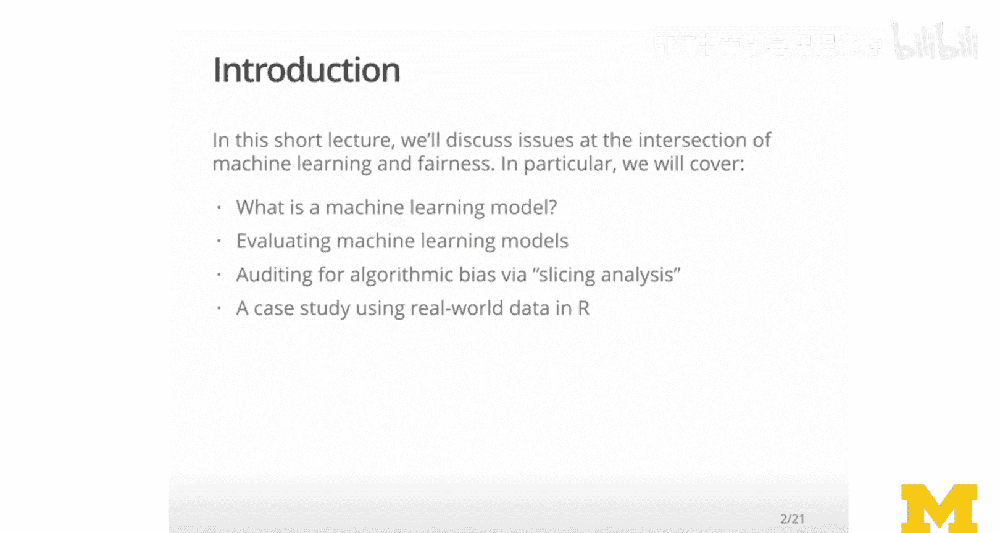
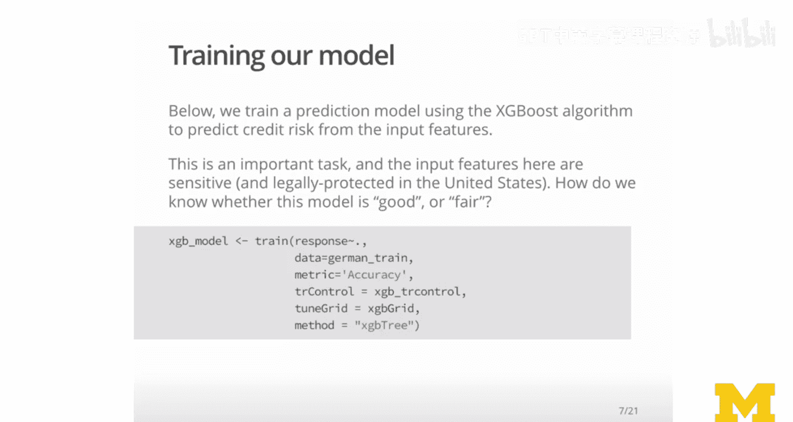
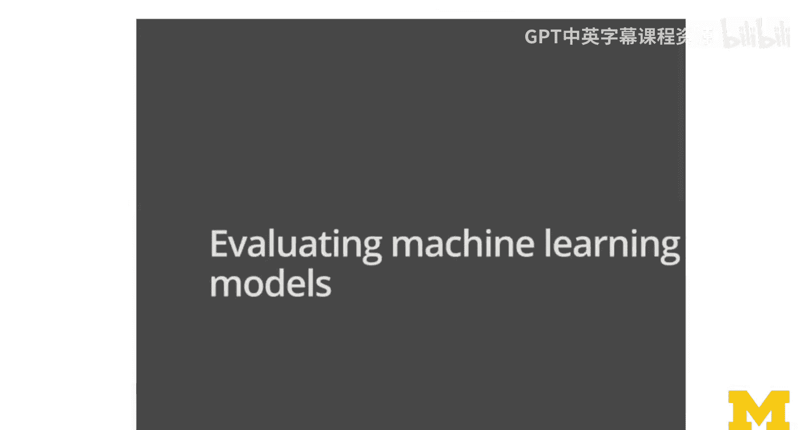
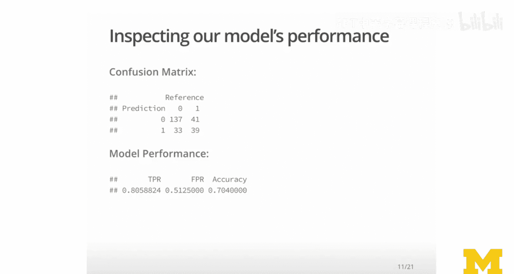
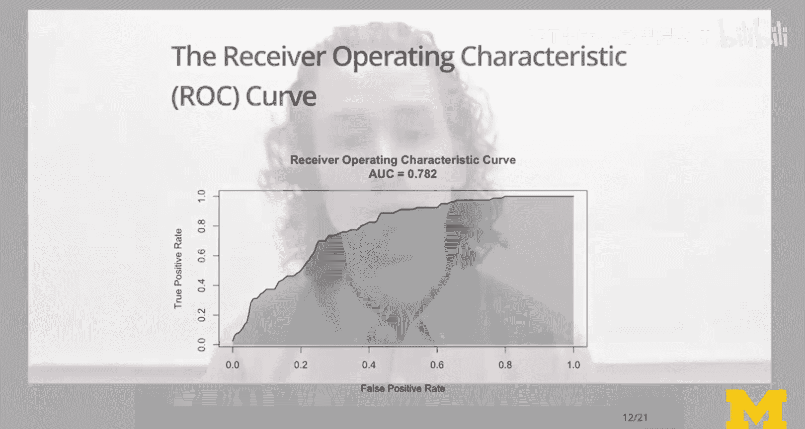

# 公共部门的R数据分析：12：模型偏差评估方法 🧠


在本节课中，我们将学习机器学习模型偏差评估的核心概念与方法。我们将从理解什么是机器学习模型开始，探讨如何评估模型性能，并重点介绍一种名为“切片分析”的技术，用于审计模型中的算法偏差。课程将通过一个真实的信用风险建模案例来演示这些概念。


## 什么是机器学习模型？ 🤖

上一节我们介绍了课程概述，本节中我们来看看什么是机器学习模型。

为了便于讨论，你可以将机器学习模型视为一个将输入映射到输出的数学函数。其形式可表示为：



**Y_hat = F_θ(X)**


其中：
*   **Y_hat** 是模型产生的预测。
*   **F_θ** 是我们的模型函数。
*   **θ** 是模型参数，在训练过程中学习得到。
*   **X** 是输入观测值，可以代表一个人、一张图片或一段音频等。

具体到今天的案例，我们将研究一个信用风险模型。模型的任务是：看到一个贷款申请人及其相关特征（X），预测该个体属于高风险（可能违约）还是低风险（可能还款）。我们将使用一个历史贷款申请数据集来训练模型。

输入特征（X）可能包括申请人的支票账户状态、年龄、职业等信息。我们试图预测的目标（Y）是该个体在历史数据中实际表现出的风险等级（高或低）。训练机器学习模型，本质上就是估计那组参数 θ，使模型能根据特征做出风险判断。

## 模型评估方法 📊

我们已经了解了机器学习模型的基本构成，接下来我们探讨如何评估一个模型的性能。

通常，我们会将数据分为两部分：一部分用于训练模型（估计参数 θ），另一部分作为测试集，用于评估模型在未见过的数据上的表现。我们在测试集上使用训练好的模型进行预测，并将预测结果与真实的标签进行比较，从而计算各种预测准确性和模型偏差的指标。

以下是评估模型有效性的一些常见指标：
*   **准确率**：正确预测的样本比例。
*   **交叉熵**：衡量模型分配给正确类别的概率质量。
*   **混淆矩阵**衍生指标：如假正率（FPR）和真正率（TPR）。

让我们更详细地了解混淆矩阵及其用途。

混淆矩阵本质上是模型预测结果与真实标签的交叉表。当预测与真实标签一致时（矩阵对角线），模型预测正确；不一致时（非对角线），模型预测错误。





*   **真正例**：真实标签为正面（如“高风险”），且模型也预测为正面。
*   **假正例**：真实标签为负面（如“低风险”），但模型预测为正面。

我们可以直接从混淆矩阵中计算出真正率（TPR）和假正率（FPR），以及准确率（对角线元素占总数的比例）。用于计算这些指标的R代码将在课程资料中提供。

## 通过切片分析审计算法偏差 ⚖️

在掌握了模型性能评估的基础后，本节我们将重点转向如何检测模型可能存在的偏差，即“切片分析”。

仅仅知道模型的整体性能（如准确率或AUC）是不够的。一个在整体上表现良好的模型，可能对某些特定人群（如不同性别、年龄组）的表现显著更差，这就构成了算法偏差。切片分析通过将测试数据划分为不同的子组（“切片”），并分别评估模型在每个子组上的性能，来揭示这种偏差。

以下是进行切片分析的关键步骤：
1.  **定义切片**：根据你关心的敏感属性（如性别、种族、年龄区间）将数据分成多个子集。
2.  **分别评估**：在每个数据切片上，独立计算模型评估指标（如准确率、TPR、FPR、AUC）。
3.  **比较结果**：对比模型在不同切片上的性能指标。如果存在显著差异，则表明模型可能存在对该属性的偏差。

在我们的信用风险案例中，我们可以按“性别”对测试数据进行切片，然后分别计算男性和女性申请人群体上的模型性能。如果模型对女性的假正率（即错误地将低风险女性判为高风险的比例）显著高于男性，那么该模型在性别维度上就存在不公平的偏差，可能导致女性申请人更不公平地被拒绝贷款。



## 案例研究：信用风险模型审计 💳

现在，让我们将前面所学的概念应用到一个具体的案例中——审计一个信用风险模型。

我们使用一个公开的贷款申请数据集。首先，我们按常规流程训练一个信用风险预测模型。然后，我们不仅仅查看它在整个测试集上的AUC（假设为0.8），而是进行深入的切片分析。

例如，我们可以编写R代码来执行以下分析：
```r
# 假设 `test_data` 包含测试数据和预测结果，`gender` 是性别列
# 计算整体性能
overall_auc <- calculate_auc(test_data$label, test_data$prediction_score)


# 按性别切片分析
male_data <- subset(test_data, gender == "male")
female_data <- subset(test_data, gender == "female")

auc_male <- calculate_auc(male_data$label, male_data$prediction_score)
auc_female <- calculate_auc(female_data$label, female_data$prediction_score)

# 比较差异
print(paste("整体 AUC:", overall_auc))
print(paste("男性 AUC:", auc_male))
print(paste("女性 AUC:", auc_female))
# 可以进一步计算和比较TPR、FPR等指标
```
通过这样的分析，我们可能会发现模型在不同性别、年龄或贷款用途的群体间存在性能差异。识别这些偏差是确保机器学习模型在公共政策等领域公平、负责任地使用的第一步。

## 总结与核心要点 🎯



本节课中，我们一起学习了机器学习模型偏差评估的完整流程。

我们从定义机器学习模型开始，将其理解为一个带有参数θ的函数 **F_θ(X)**。接着，我们探讨了如何使用训练集/测试集划分、混淆矩阵、真正率（TPR）、假正率（FPR）以及ROC曲线和AUC等指标来评估模型性能。最后，我们深入学习了**切片分析**这一核心技术，它通过将数据按敏感属性分组并比较组间性能差异，来审计模型中的算法偏差。


核心要点在于：一个模型的整体性能优秀，并不代表它对所有人群都公平。在公共部门或任何具有社会影响的领域应用机器学习时，进行系统的偏差评估是至关重要的伦理和实践要求。切片分析为我们提供了一套实用的工具来揭示和度量这种偏差。