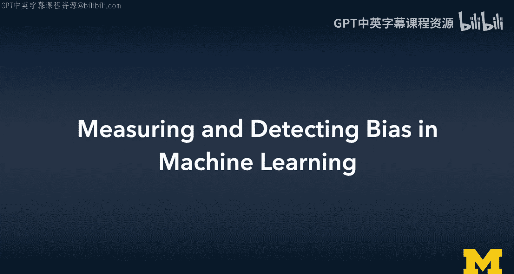
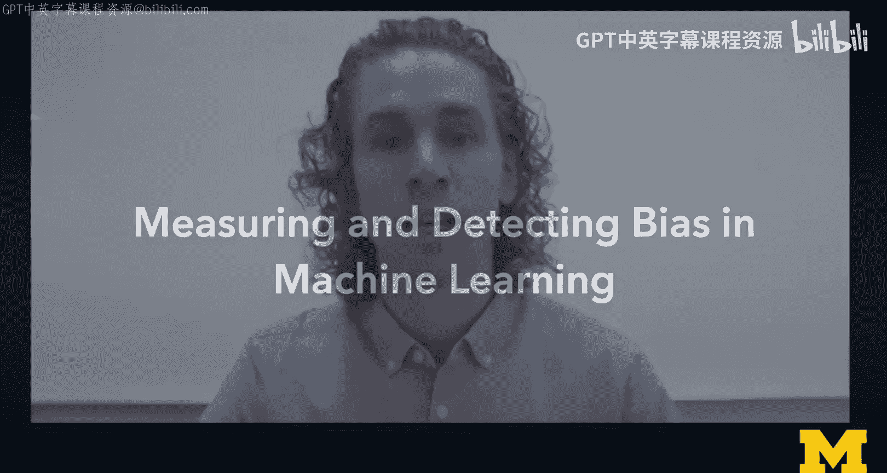
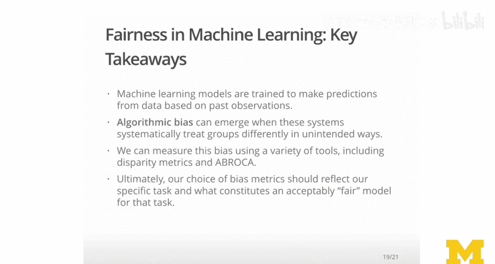

# 机器学习算法偏差检测技术：13：偏差检测与缓解方法 🧐

在本节课中，我们将学习如何检测机器学习算法中的偏差。算法偏差是现实世界和政策问题中一个关键议题，它可能导致不公平的结果。我们将探讨两种主要的偏差检测技术：切片分析和相关性能指标，并简要了解缓解偏差的常见方法。

---

## 什么是算法偏差？⚖️

算法偏差有时被定义为计算机系统中**系统性且可重复的错误**，这些错误会产生不公平的结果。例如，算法可能以不同于其设计初衷的方式，优先对待某一类别。

在我们的模型中，这可能意味着它会以非预期的方式，系统性地**优待或歧视**特定年龄、性别或其他特征的申请者群体。这显然是不可取的。机器学习领域正在积极开发技术来审计模型的这种偏差，并在检测到后尝试缓解它。

---

## 切片分析：检测偏差的核心技术 🔍

上一节我们介绍了算法偏差的概念，本节中我们来看看如何检测它。一种核心方法称为**切片分析**。其思想很简单：我们本质上沿着人口统计学的界线**切分**我们的测试数据集，以观察不同的人群切片。

我们会评估模型在这些切片上的性能，并进行比较，以查看模型的性能在这些不同的群体或数据切片之间是否存在系统性差异。接下来我们将具体操作。

以下是进行切片分析的两个关键步骤：
1.  根据敏感属性（如年龄、性别）将数据分成不同的子组。
2.  分别计算并比较模型在各子组上的性能指标。

---

## 偏差检测指标（一）：准确率差异

我们可以使用多种指标来比较模型在不同群体间的预测性能差异。其中一个指标是**准确率差异**。顾名思义，它就是比较不同群体间准确率的差异。

例如，我创建了一个变量来衡量申请者年龄是否大于等于30岁，并比较了这两个群体的准确率。

对于年龄大于30岁的个体，模型的准确率比年龄小于30岁的个体**高出10%**。因此，我们的模型显示出明显的准确率差异证据，这里的准确率差异正好是10%。

根据该模型的用途以及对不同群体性能可能存在的限制，这在模型部署中可能是一个潜在问题。

---

## 偏差检测指标（二）：ROC曲线间面积（ABROCA）

上一节我们看到了在特定阈值下的性能差异，本节中我们来看看一个更全面的指标。另一种测量算法偏差的方法是切分数据，**分别绘制每个群体的ROC曲线**，并测量它们之间的差异。

我们可以使用一个名为**绝对ROC曲线间面积**的指标来实现，简称ABROCA。ABROCA的绘制方法是：为数据中的两个或多个群体分别绘制ROC曲线，并测量这些曲线之间的面积（如下图中阴影部分所示）。

随着该面积变大，我们的模型显示出群体间越来越大的性能差异，我们可能将此视为算法偏差或群体间性能差异更大的证据。

同样，我们的模型似乎显示出性能差异的证据：对于主要群体（年龄大于等于30岁的个体），他们的曲线（此处为红色曲线）更高且更靠左；而对于年轻的贷款申请者（蓝色曲线），曲线更低，表明模型在测试数据上的预测性能稍差。

---

## 如何选择偏差检测指标？📊

以上只是我们可能用于切片分析的两个指标示例。

我们可能选择使用**准确率差异**，特别是当我们的模型希望在**特定阈值**下具有低算法偏差时。在我们的案例中，用于决定个体预测属于高风险还是低风险的阈值是预测分数是否高于0.5。

相比之下，我们可能使用**ABROCA**，当我们希望拥有一个在**所有分类阈值**上都具有低算法偏差的分类器时。也就是说，不仅是在预测高风险概率大于或小于50%时，而且在我们希望模型对于非常高风险和非常低风险的预测都能良好校准时。

当我们希望模型即使在**不平衡数据集**上也能有良好表现时，也可能选择使用ABROCA。

---

## 核心要点总结 ✨

除了准确率差异或ABROCA，我想强调**正确的评估指标始终取决于上下文**。因此，从数据收集到部署，参与模型开发的你和其他每个人都有责任确保使用适当的指标来评估模型的偏差，而上述只是众多可考虑选项中的两个。

本节课中我们一起学习了以下关键要点：
1.  机器学习模型是我们为了根据过去观察数据进行预测而估计的数学工具。在这个过程中，**算法偏差可能出现**，我们将其定义为群体以非预期的方式受到系统性不同对待。
2.  检查我们的模型是否存在这种偏差非常重要，特别是要使用**能反映我们特定任务**以及**构成该任务公平模型标准**的适当偏差指标来进行检查。
3.  我们讨论了几种在特定情况下可能选择使用的指标，包括**准确率差异**和**ABROCA**。但我希望你能更深入地探索机器学习和这个新兴领域的文献，以确保为你问题选择的方法能反映该任务的偏差考量。

---

## 关于偏差的深度讨论与缓解方法 💡

Josh，感谢你对机器学习中偏差问题的精彩介绍。当想到偏差时，尤其是身处一所公立大学的信息学院，我们对此思考很多，关于算法偏差的讨论也很多。我脑海中常浮现的一个问题是：**程度——多少偏差算过多？** 你在讲座中多次提到一个非常重要的观点：这取决于你的问题和具体情境。

这是一个非常具有挑战性的问题。就了解“可接受的偏差程度”而言，我非常不愿意给出任何建议，因为这确实很大程度上取决于我们正在解决什么问题、它可能如何影响将与模型交互或被其预测的个体，并且它也可能反映模型所用政策背景下的法律环境等因素。我认为这是每个人现在都在努力解决的问题，并且随着机器学习模型被部署到越来越多的任务中，这个问题变得越来越紧迫。

这关联到你的第二个问题：**当我们观察到这些类型的偏差时，如何缓解它们？** 实际上，有一个相当长时间的完整文献，特别是在教育领域，可以追溯到几十年前，研究如何测量教育测试中的偏差等。即使在过去的十年里，机器学习领域也真正聚焦于这个问题。

关于如何消除模型中的偏差，有几种技术可以做到这一点。它们通常分为以下三类：
*   **预处理**：通常试图通过消除敏感属性与数据其余部分之间的关联来使数据公平。它会在你训练模型之前实际更改你的数据，以尝试从中消除偏差。
*   **处理中**：尝试改变机器学习模型的学习过程，以确保模型以更公平的方式进行参数估计，从而做出的预测与你想要消除偏差的敏感属性关联更小。
*   **后处理**：可能采用一个训练好的模型，并以随机（如随机化）或确定性的方式改变其预测，使这些预测的偏差更小。

这只是用于此目的的三种主要技术家族，每个类别下都有许多具体方法。我认为这是机器学习研究中一个重要且新兴的领域，也是另一个需要谨慎选择所用工具并了解其可能影响的领域。

另一个我认为非常有趣的问题，尤其是在观察ABROCA曲线时会出现，那就是：当你测量偏差并且只使用这些单个指标之一时，它不一定告诉你**哪个群体正在受到歧视**，或者你的准确率在哪里变化、如何变化。然后，你总是必须将其转化为实际问题：我们实际预测的是什么？我们看到一些工作表明，在某些阈值下，两个群体之间可能存在相当大的差距，而在其他阈值下，这种差距实际上可能扭转甚至翻转。这两者都是偏差的证据，但其中一些可能更多地与历史上对某一群体的偏见有关，而另一些则可能无关。这给试图理解这一点并试图从中制定公共政策的决策者和领导者带来了很多问题。我认为我们才刚刚开始弄清楚如何做到这一点。

这些都是具有挑战性的问题，确实需要多元化的视角来解决——从我所在的计算机科学和工程领域，到我希望许多学生将继续成长的政策领域。我认为，这就是为什么通过R和本课程向新朋友介绍这一点如此令人兴奋的部分原因。我真的很鼓励学习本课程的朋友参与对话，并在他们处理的任务和我们的工作中开启这些对话。

---

本节课中，我们一起探讨了机器学习算法偏差的定义、两种重要的检测技术（切片分析、准确率差异与ABROCA），并简要了解了缓解偏差的预处理、处理中和后处理三类方法。理解并应对算法偏差对于构建公平、可信的机器学习系统至关重要。