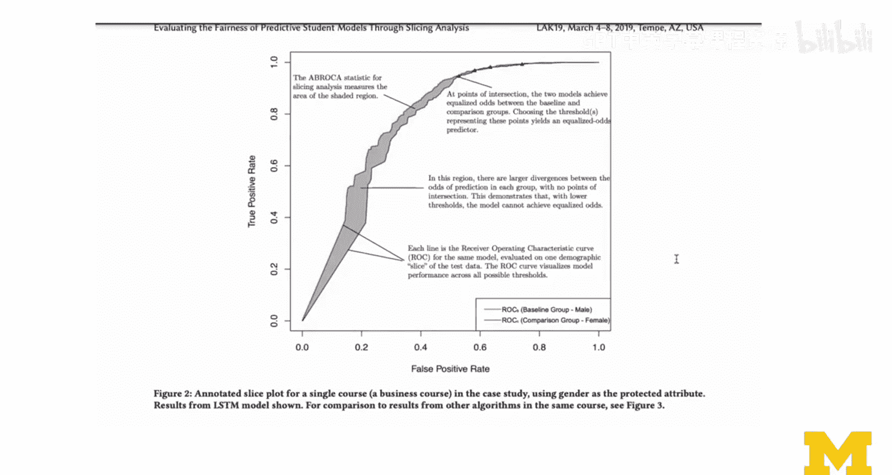
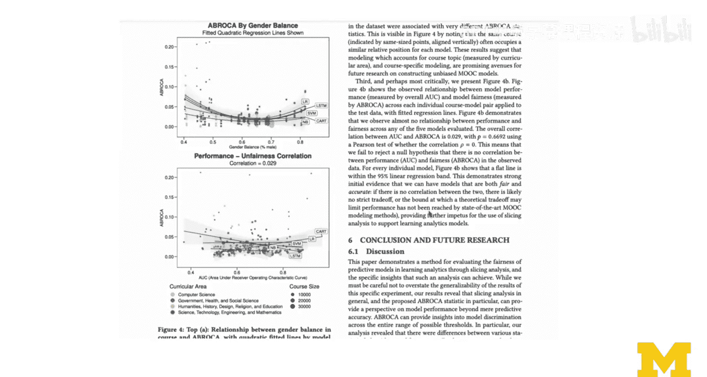
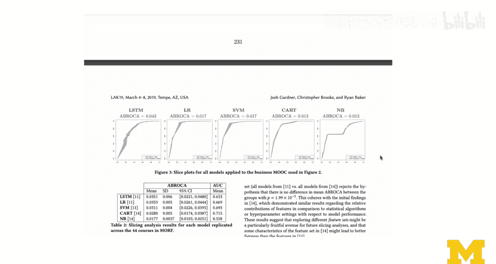

# 公共部门的R数据分析：14：切片法测量模型偏差 📊

在本节课中，我们将学习如何使用切片分析法来检测和评估预测模型中的偏差。我们将通过一个真实的研究案例，探讨如何通过比较不同人口统计群体（如性别）的模型性能曲线，来识别模型可能存在的系统性偏差。

---

今天，华盛顿大学的博士候选人乔希·加德纳再次加入我们。乔希和我曾合作进行研究。正如我可能在课程中提到的，我的研究领域是学习分析。我关注人们如何学习，我们如何预测他们是否会学习或可能存在哪些不足，以及我们如何对此进行干预。

这项研究在2019年的学习分析会议上获得了最佳论文奖。乔希是主要作者，我和宾夕法尼亚大学的同事瑞安·贝克是合作者。乔希，再次感谢你的加入。很高兴来到这里，也很高兴讨论我们的工作。这项工作的特别之处在于，它分析了密歇根大学慕课的数据，这正是现在学习本课程的学生类型。事实上，已有数百万学生在Coursera等平台上在线学习我们的课程。这为我们提供了一个巨大的机会，以前所未有的规模尝试理解全球学习情况。在慕课领域，我们感兴趣的一个预测目标是所谓的“辍学率”或“完成率”。因此，在这项工作中，我们实际上查看了许多不同的课程，以了解是否能建立一个好的慕课辍学预测模型，以及该模型在不同人口统计特征上是否存在偏差。

---

## 理解ROC曲线与切片分析 📈

上一节我们介绍了研究背景，本节中我们来看看具体的分析结果。论文中有一张很好的图表，该论文是开放获取的，链接在课程资料中。这张图表展示了我们的度量指标——AUC（ROC曲线下面积），并比较了两个不同“切片”的结果。需要提醒的是，这是一种切片分析。我们选取感兴趣的类别（在本例中是人口统计特征，具体是性别，分为男性和女性），并绘制这两条曲线。乔希，也许你可以为我们解读一下这里的图表结果。

对于好奇的学生，我们在课程中关于机器学习的公平性与偏差的讲座里，对这些绘制的曲线背景有更详细的介绍。我们看到的图表是每组一条线，但每条线显示的是相同的信息。具体来说，它展示了当我们改变预测的阈值时，模型在该组个体数据上的**真正率**和**假正率**。

模型会预测一个介于0到1之间的分数，可以将其视为模型估计个体**不会**完成课程的概率。当我们改变用于判定“完成者”或“未完成者”的阈值时，随着我们在0到1之间应用不同的预测截断点，就形成了这条曲线。

这条曲线被称为**受试者工作特征曲线**。我们通常使用其下方的面积（AUC）作为衡量模型质量的指标。

但如图所示，我们还可以为每个组单独创建曲线，并观察它们之间的差距。这告诉我们模型对这两个组的预测质量是否存在差异，即模型有多大可能正确分配一个反映个体真实完成状态的分数。当这两条组间曲线相距越远，就表明我们的模型可能在两个组之间的预测质量上表现出系统性的差异，我们可能将其解释为算法偏差的证据。

乔希，在这个例子中，实际上所有ROC曲线的例子都是，曲线越贴近左上角（即假正率为0，真正率为1），就代表模型拟合得越好。我们在这里看到了一个非常有趣的差异，因为有一条红线明显更接近（或至少在一定程度上更接近）那个理想的左上角位置，这表明它是一个更好的模型。而蓝线相比之下则表现不足。所以在这个例子中，针对男性的模型比针对女性的模型更好，对吗？

是的。同样重要的是要记住，我们这里只有一个模型，我们正在观察它在两个独立子群体或人口“切片”上的表现，这就是为什么我们称之为切片分析。我认为这是一个现实世界中发生的例子，许多预测模型都存在这种情况：模型对某一群体的效果明显优于另一群体，或者对两个不同群体的预测存在系统性差异，并且恰好对某一群体更有利。如果我们从未选择以这种方式分解模型的性能并分别查看这些曲线，我们可能完全意识不到这些预测中的系统性差异。因此，我认为这说明了为什么在机器学习模型生命周期的每个阶段（从探索、调优到可能部署用于实际任务时）进行审计或检查都很重要。

---

## 跨课程与模型类型的偏差分析 🔍

上一节我们通过一个具体课程的例子看到了偏差的存在，本节中我们来看看如何将这种分析扩展到更广泛的场景。我认为这个模型很有趣。我们专门针对一门商业课程运行了这个分析。但密歇根大学慕课组合的一个有趣之处在于，我们实际上提供了大量不同的课程，再次面向数百万学习者。因此，我们也开始将这种曲线分析应用于许多不同的课程。你能为我们讲解一下如何理解这些结果吗？如果我们必须查看数百条这样的曲线，可能会有点让人不知所措。我知道在撰写这篇论文时，我也在深入研究。那么，我们可以做些什么来审视一个更大的课程组合，看看我们的模型是否存在任何偏差趋势？

我认为这指出了为什么这些度量指标通常很有用。当然，将模型的偏差或预测准确性提炼成一个数字有点简化主义。但它也有好处，因为它允许我们可能跨许多不同的课程、子群体或模型来比较这个指标。这正是我们接下来所做的分析：研究课程人口的不同特征如何与这种算法偏差度量（AUC差异）相关联。我们发现，偏差度量与课程人口特征（特别是课程中自认为男性的学生百分比）之间存在一些明确的系统性关系证据。

总的来说，我们发现，随着课程向男性学生倾斜变得更加不平衡，差异趋于增加。同样，当课程向男性学生比例低得多的方向变得不平衡时，偏差也趋于增加。换句话说，当课程在两个群体之间更加平衡时，偏差往往最低；但当更多人来自某一个子群体时，模型可能自然地倾向于对这些群体效果更好。我认为这是我们在现实世界机器学习模型中常见的现象：数据中谁被代表会影响模型对这些群体的质量。

AUC统计量的另一个我非常喜欢的地方是，你可以比较不同类型的预测模型。在过去的10到15年里，构建预测模型的机会和方法呈爆炸式增长，出现了许多不同的技术，包括深度学习技术、经典贝叶斯技术、决策树等等。我们在这项工作中所做的一件事是，实际上研究了不同的建模技术如何与偏差相关联，以及它们可能产生不同的ROC曲线。也许我们可以看一下那张图并讨论一下。

我认为这触及了一个非常有趣的问题，克里斯，当你的学生更深入地探索机器学习领域时，他们会遇到这个问题。这在机器学习文献中有时被称为**偏差-方差权衡**。

具体来说，我想在这里指出的是，随着我们的模型对数据中的个体特征及其相互关系变得更加敏感，它们可能捕捉到更微妙的关系，并能够产生更准确的预测。但同时，这些更敏感的算法也可能更容易受到更大的算法偏差的影响，并捕捉到我们实际上不希望它们敏感的那些关联。

很难理清其中一些效应。但在我们的工作中，我们发现这些更复杂、更灵活的基于深度学习的模型（例如一种称为长短期记忆网络或LSTM的模型）确实倾向于获得更好的预测性能，但组间差距（以AUC差异衡量）也更大。相比之下，一些更简单的方法（如你提到的称为朴素贝叶斯的经典贝叶斯技术）往往预测质量较低，但组间差距也较小。这指示了我们在现实世界中选择用于特定问题的模型时，经常需要考虑的一些权衡。

我认为很多工作（过去15年教育领域、教育数据挖掘和学习分析领域的工作确实如此）倾向于寻找一个准确的模型，并进行一些模型比较，关注准确性或其他预测性能指标。但正如你在这里展示的，还有一个公平性因素需要我们讨论和审视。因此，我认为这种AUC差异度量，以及描述它的这些曲线，对于理解我们应该使用哪种模型非常强大——不一定哪个是“最好”的，因为“最好”有不同的维度，而是我们可能希望在这样一个平台上实际部署哪一个。

我同意。克里斯，我还想强调，如果学生好奇想看看这篇论文，他们会发现关于这些模型使用方式的一些具体细节，这些细节让我们相信AUC差异是评估慕课模型偏差的好方法。但是，外面也有很多不同类型的问题和许多不同的方法来衡量算法偏差。这取决于建模者和参与机器学习建模过程的每个人，以确保他们选择的度量标准适合他们正在处理的问题。因此，我也鼓励学生思考，对于他们正在分析的问题，这是否是一个合适的偏差度量标准，并探索其他可能更合适的度量方法，这取决于他们处理的问题。

乔希，再次感谢你加入我，分享更多关于机器学习偏差主题的信息，并分享这项获奖工作。对于学生们，如果你们感兴趣，这篇论文的链接在课程资料中，请随时查看并讨论。这是一个很棒的讨论。谢谢你邀请我，克里斯。

---

## 总结 📝

本节课中我们一起学习了如何使用切片分析法来检测预测模型中的偏差。我们通过一个慕课辍学预测的实际案例，理解了如何通过绘制和比较不同人口统计群体（如性别）的ROC曲线来识别模型性能的系统性差异。我们还探讨了课程人口构成如何影响模型偏差，以及不同复杂度的模型（如LSTM与朴素贝叶斯）在预测准确性和公平性之间存在的权衡关系。最后，我们强调了根据具体问题选择合适的偏差度量标准的重要性。