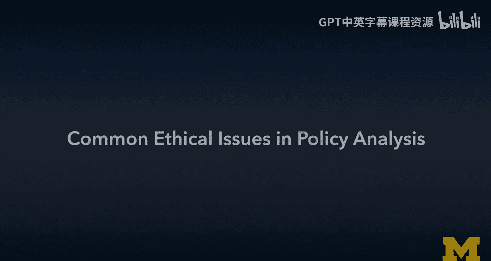
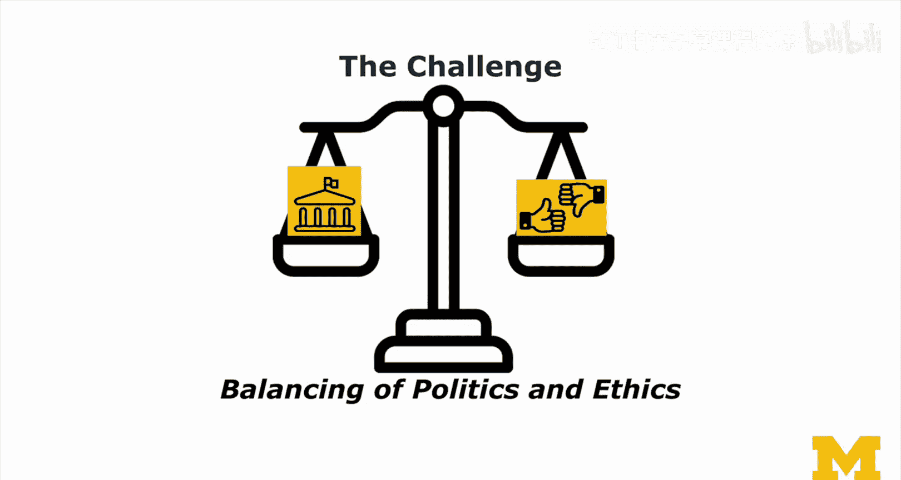
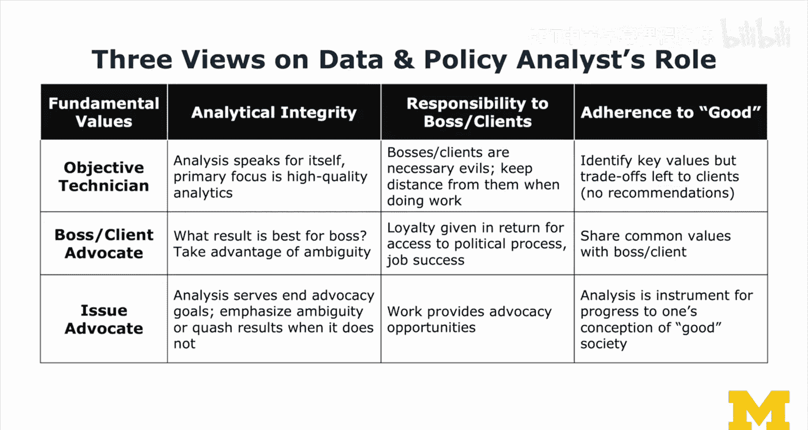
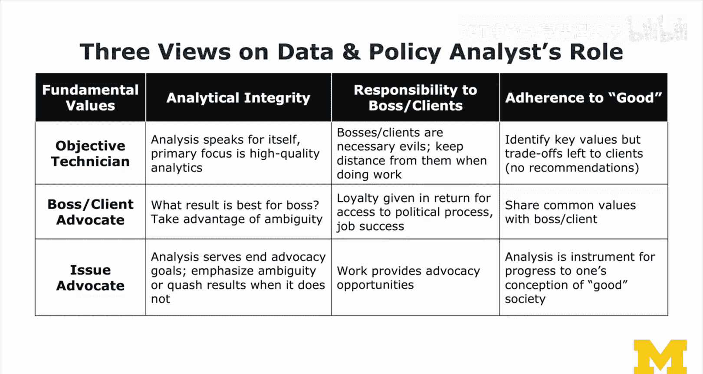
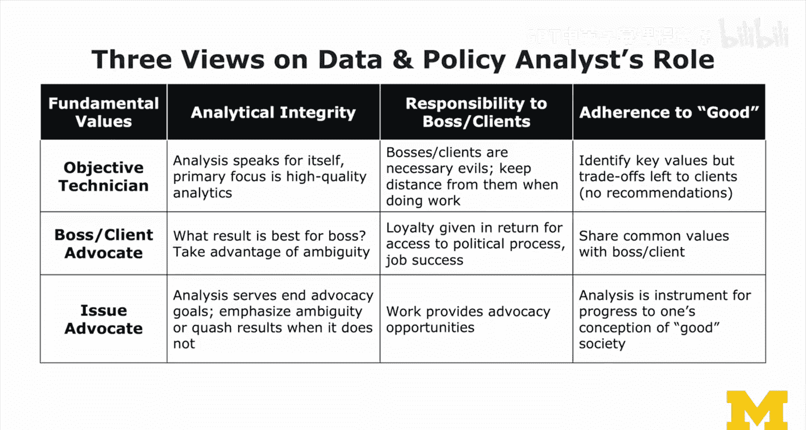
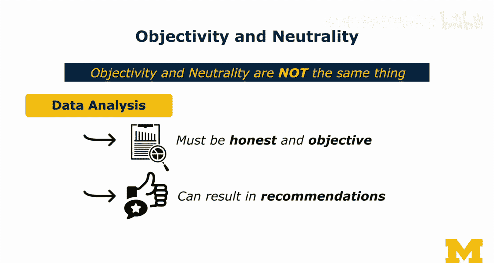
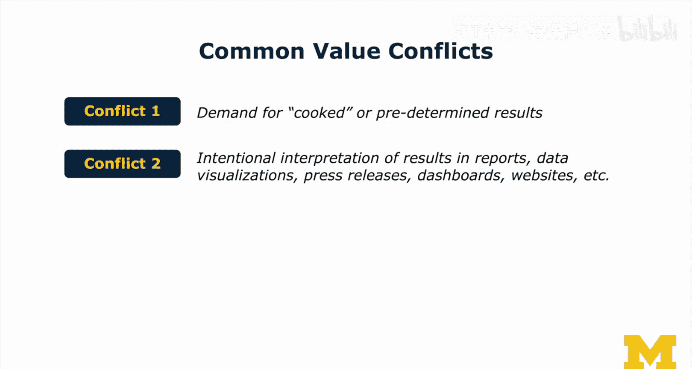
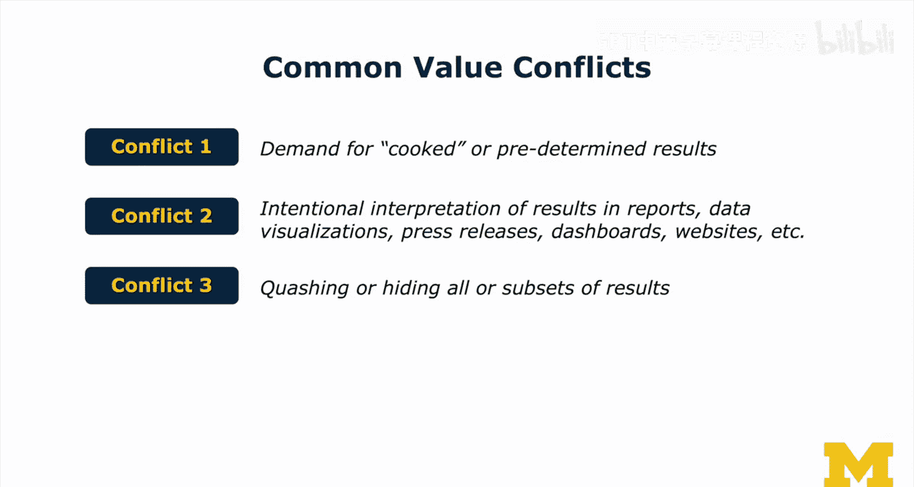

# 15：政策分析常见伦理问题 🧭

在本节课中，我们将要学习公共部门政策与数据分析中常见的伦理挑战。这些挑战通常源于分析师在平衡伦理实践与政治压力时所面临的困境。我们将探讨分析师角色的不同视角，以及这些视角如何影响其忠诚度和处理价值权衡的方式。

## 分析师角色的三种视角 🔍

正如我们之前所讨论的，政治是公共部门决策中一个正常但充满挑战的部分。对于数据和政策分析师而言，许多挑战源于对分析师角色及分析过程的不同看法。以下是分析师在决策过程中的三种普遍但不同的角色视角。

### 1. 客观技术专家

这种观点认为，数据分析师的主要关注点在于分析的**完整性**、对良好分析实践的**遵守**以及**客观性**。最终，数据和结果应能自我说明。高质量、客观且技术可靠的分析工作是最重要的。

*   **核心公式**：`高质量分析 = 完整性 + 遵守规范 + 客观性`
*   **对客户/上司的态度**：上司或客户是必要的，但在实际工作中应保持距离，以防止他们影响过程或结果。

### 2. 上司/客户倡导者

在这种观点下，数据分析师是其直接上司或特定客户（如部门领导、立法者、民选官员等）的倡导者。最佳的分析结果是**对上司或客户最有利**的结果。

*   **核心动机**：分析师对上司或客户负有责任甚至忠诚，这不仅关乎工作安全，也关乎获取政治权力和影响力。
*   **潜在影响**：这并不意味着分析师会捏造结果或使用糟糕的分析方法，但确实意味着存在利用分析**模糊性**的压力，也可能涉及不发布结果、声称结果不确定或仅呈现部分结果。

### 3. 议题倡导者

这种观点认为，分析师更像是当前社会或政策议题的倡导者。分析师的工作动机是利用数据分析来推动特定关切领域（如公共卫生、教育、国家安全、气候变化等）的改进。

*   **核心动机**：分析工作为分析师强烈关注的议题提供了推动进展和倡导的机会。分析师有动力去产出能服务于倡导和积极政策变革等最终目标的结果。
*   **潜在影响**：由于焦点更在于最终结果而非分析工作本身，这种视角也增加了利用模糊性的动机，并可能涉及不发布或压制结果。

## 不同视角下的价值权衡 ⚖️

上一节我们介绍了分析师角色的三种不同视角，本节中我们来看看这些视角如何影响对“良好分析工作”的价值判断。这三种视角对价值构成和权衡的看法有所不同。

对于**客观技术专家**而言，这类分析师能够且应该根据核心价值，识别不同政策选项中的重要价值及其权衡。然而，他们**不提出建议**，事实上对此感到不适，他们只希望数据和结果自己说话。

对于**上司/客户倡导者**，分析师与上司或团队成员之间通常对工作的最优影响存在一套**共享的价值观**。这使得团队能够识别价值权衡，并在考虑更大政治环境的情况下提出建议。

对于**议题倡导者**，最强烈的价值观是那些与议题领域内被视为“良好”的、基于价值的进展相一致的价值观。分析被视为一种工具，有助于推动实现针对特定议题或社会问题的、基于价值的未来愿景。

从事政策和数据分析工作的个人，在其职业生涯中可能会发现自己扮演过所有这些角色。无论在哪种角色中，都绝对应该尽力完成高质量、客观的工作。这些不同观点都不意味着目标应该是使用草率的技术、误导性的分析或数据可视化。

## 客观性与中立性的重要区别 🎯

这里需要强调一个重要区别：**保持客观**与**保持中立**不是一回事。

*   **保持客观**意味着诚实、使用最佳的分析和科学实践、尽可能避免偏见、揭示有问题的数据问题、强调注意事项并解释结果。作为数据分析师，我们应始终努力做到客观。
*   **保持中立**则是另一回事，它意味着对结果揭示的内容不持观点，不基于结果参与提出建议或推动某些决策。

关键在于，**参与提出建议并不意味着你在分析中不客观**。你可以是客观的，但对一个客观分析的结果并不保持中立。

## 常见的伦理冲突与价值困境 ⚠️

政策分析领域的权威学者韦默和维宁指出，政策与数据分析师最常见的伦理冲突，是**对客户或议题的责任与其他价值观之间的冲突**。在面临此类冲突时，可能使分析师伦理判断复杂化的因素包括：当前及未来的就业状况、持续接触某个政策议题或感兴趣环境的机会、对上司或客户的忠诚度，以及个人声誉。

以下是分析师面临的最常见的价值冲突：

*   **对预设结果的要求**：客户或上司要求在进行分析之前就得出某个特定结果（例如，“能否运行一些数据来证明X？”）。
*   **对结果的故意曲解**：在数据可视化、新闻稿、仪表板或网站上故意错误呈现或解释结果。
*   **压制或隐藏结果**：压制或隐藏不支持某种叙事或期望建议的全部或部分结果。
*   **建议与分析结果不符**：提出的建议与数据分析的实际结果不匹配。

## 总结 📝

本节课中我们一起学习了公共部门政策分析中常见的伦理问题。我们探讨了数据分析师的三种不同角色视角（客观技术专家、上司/客户倡导者、议题倡导者），理解了它们如何影响分析工作的价值取向和潜在伦理困境。我们明确了**客观性**与**中立性**的关键区别，并列举了实践中常见的价值冲突，如要求预设结果、曲解或压制结果等。认识到这些挑战是应对它们的第一步。在下一节中，我们将讨论当面临此类伦理困境时可以且应该采取的措施。