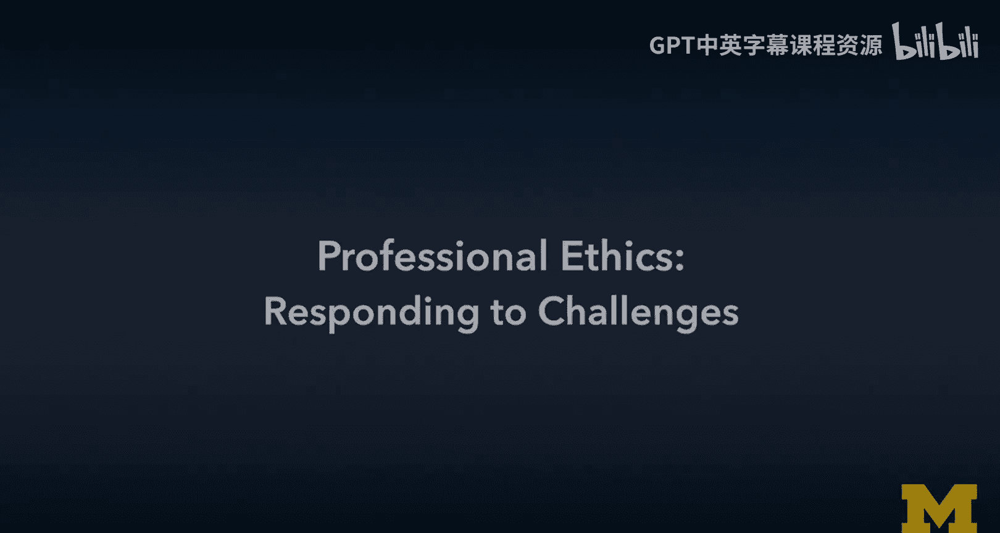
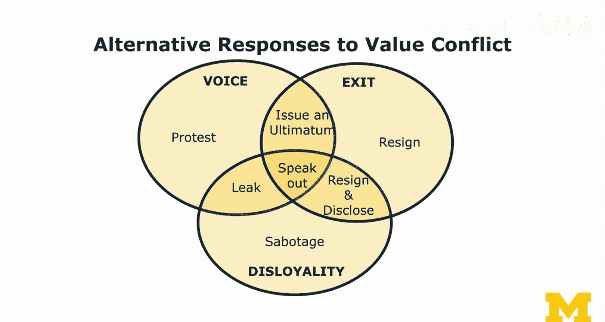
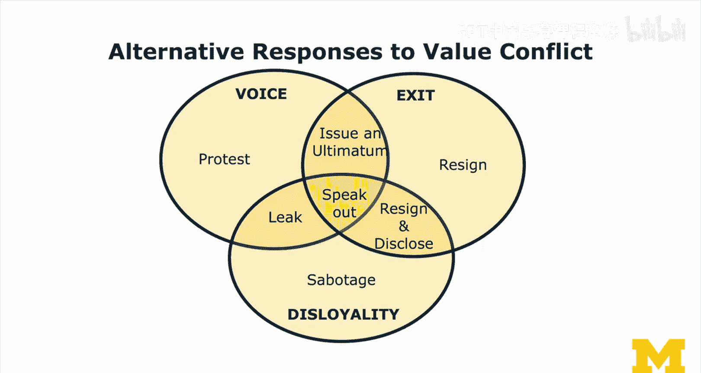

# 公共部门的R数据分析：16：职业伦理：应对挑战的策略 🛡️

在本节课中，我们将学习当数据分析师在公共部门工作中面临无法控制的伦理挑战时，可以采取哪些通用应对策略。我们将探讨从表达关切到最终采取行动的多种选择。

## 概述

上一节我们讨论了公共部门数据分析中常见的伦理挑战。本节中，我们来看看当您发现自己面临此类挑战时，可以采取哪些具体的应对策略。

## 声誉的重要性

首先，请记住，作为一名遵循最佳实践、工作值得信赖的优秀数据分析师，您的声誉至关重要。只需一次参与产出误导性或欺骗性结果、隐瞒特定发现或在解读上误导他人的团队工作，就足以毁掉您的声誉。因此，您需要非常谨慎。

## 核心应对策略

您确实拥有一些选择。其中一个选项是违背您的伦理标准，继续完成工作。当然，我建议您不要这样做，但这确实是一个选项。

让我们聚焦于您的其他选项，这些选项展示在下面的维恩图中。该图略显复杂，我将为您逐步讲解。

总的来说，您有三个初始选项，由图中的三个大圆圈表示。您的三个选项是：**发声**、**退出**或**不忠**。

*   **发声**：意味着向您的上司或指示您进行不道德行为的人表达或沟通您的关切。您可以提出异议并解释原因，就此进行对话。因此，首先要做的是表达关切。
*   **退出**：意味着离开或退出项目，或者完全辞去工作，而不是应对这些伦理挑战带来的压力。
*   **不忠**：意味着按照您的伦理指引行事，而不是按照要求去做。不制作糟糕的可视化图表，不产出误导性结果，做与给您带来伦理挑战的要求相反的事。

## 首选策略：发声

再次强烈建议您从某种形式的“发声”开始。您应该能够自如地阐述您的关切及其背后的原因。您可能会说服团队中的其他人，他们可能未曾考虑过这一点，并可能转而理解您的立场。

以下是关于如何有效“发声”的建议：

*   亲自表达关切，而非书面形式。但如果您要与上司会面，可以准备一些笔记。
*   更多地以对团队和组织的风险与不利影响来表达关切，而非针对您个人。不要将其表述为“您的伦理原则受到挑战”，而应表述为“这些是指导我们工作的伦理原则”。

## 策略的组合与升级

在表达关切时，您可以持续坚持您的关切。如果表达关切后没有回应，您的下一步可以是**以退出或辞职相威胁来表达关切**，这被称为发出最后通牒。您可以在“发声”和“退出”圆圈重叠的区域看到这一点。

如果您担心表达关切会导致您被解雇，而您宁愿辞职也不愿被解雇，那么您可以**不发声直接退出**。

然而，在退出时您可能也有选择。您可以安静地辞职，不公开表态或做任何其他事情。

现在，让我们引入“不忠”这个圆圈。您可以首先发出最后通牒，表示如果某项工作以不道德的方式进行，您将辞职，然后在辞职时披露此事。向记者或您政府组织内的更高权威披露所发生的情况。这样，您既在退出，也在进行不忠行为。这里的“不忠”意味着您再次违背了被要求做的事，并且是以一种公开的方式。

您还可以进行**破坏**，这意味着成为告密者。在这种情况下，您不会向任何人表达关切，也不会辞职，而是秘密地、匿名地将您的关切报告给某种监督机构、人力资源部门或比您直属上司更高权威的人。

您也可以在内部表达关切，同时匿名地将有关问题的信息泄露给媒体或团队外部的某个机构或个人。

当然，正如您所看到的，这些不同的圆圈以各种方式和组合重叠，对于“发声”、“退出”和“破坏”这些基本行动，存在许多可能的排列组合。

如果您同时做三件事：表达关切、退出组织、并以一种让您的组织蒙羞（即不忠）的方式公开此事，那么您将处于那个勇敢的区域，即所有三个圆圈重叠的区域，被标记为“公开揭露”。

## 决策考量

当然，无论您选择做什么都取决于您自己，并且将取决于许多因素，每种情况都会有所不同。显然，如果辞职对您来说并非一个真正的选择（对大多数人来说可能都不是），您就不能以辞职相威胁。

我可以告诉您，在我的一生中，我曾三次处于极具挑战性的伦理困境中，以至于我首先表达了关切。当那似乎无济于事后，我发出了退出项目的最后通牒。我还曾有一次威胁要退出并公开此事。我碰巧认识一些大报社的记者，我分享了这对我来说是一个如此成问题的伦理困境，我认为我不能参与其中，并且公众也应该知道。

我不会分享细节，但建议是，这些是我一生中压力最大的经历之一。因此，我希望您永远不会面临需要您做更多事情而不仅仅是表达关切的伦理挑战。

## 总结

本节课中，我们一起学习了当面对公共部门数据分析工作中的伦理挑战时，数据分析师可以采取的多种应对策略。我们介绍了以“发声”作为首选步骤的重要性，探讨了“发声”、“退出”和“不忠”这三种核心策略，并分析了它们之间可能组合形成的更复杂行动，如发出最后通牒或成为告密者。最终的选择取决于个人处境，但维护职业声誉和伦理底线至关重要。