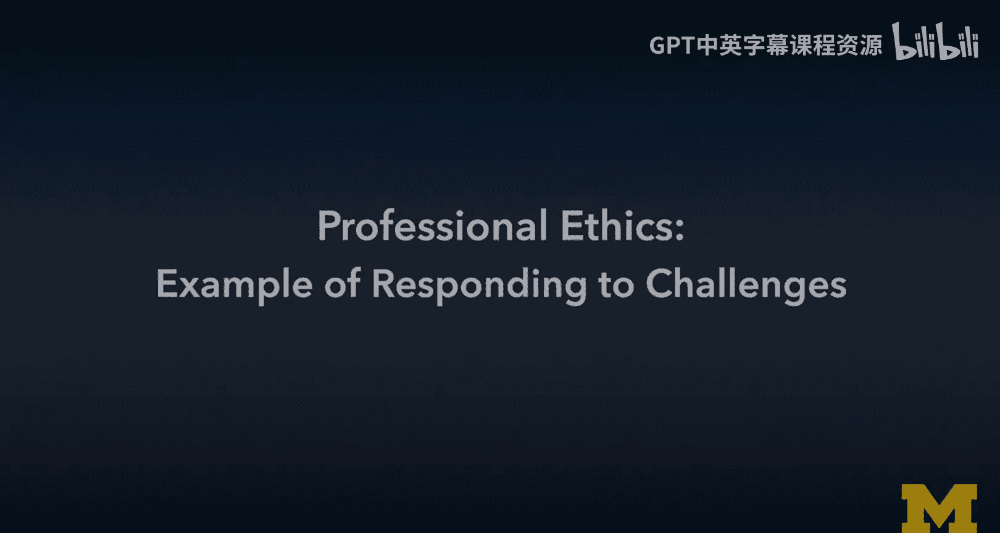
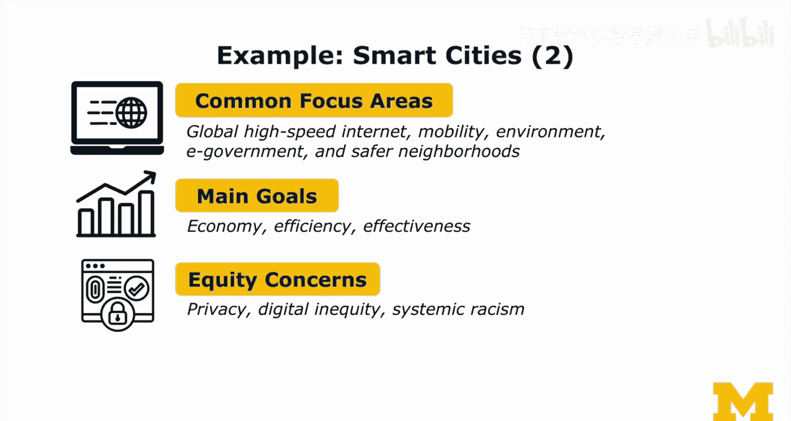
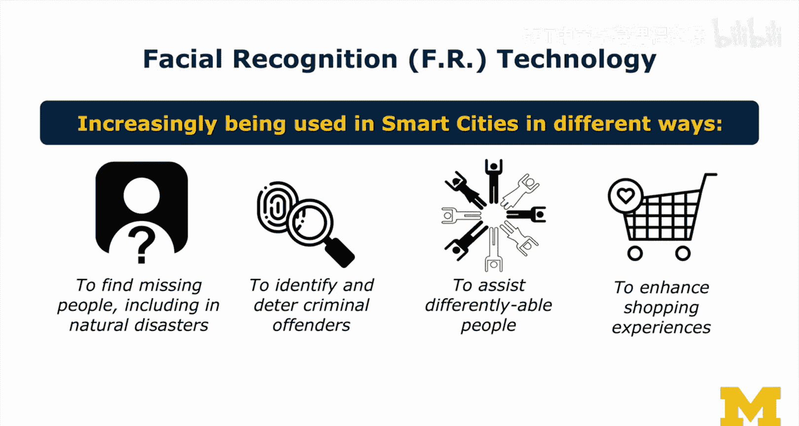
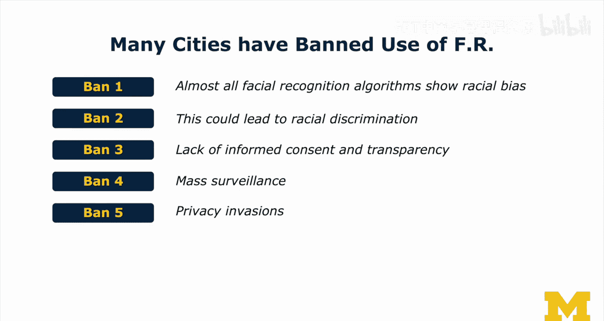
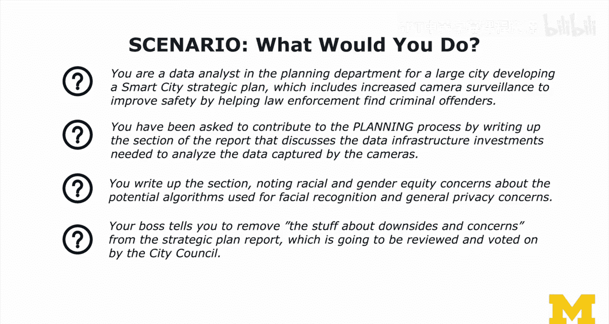
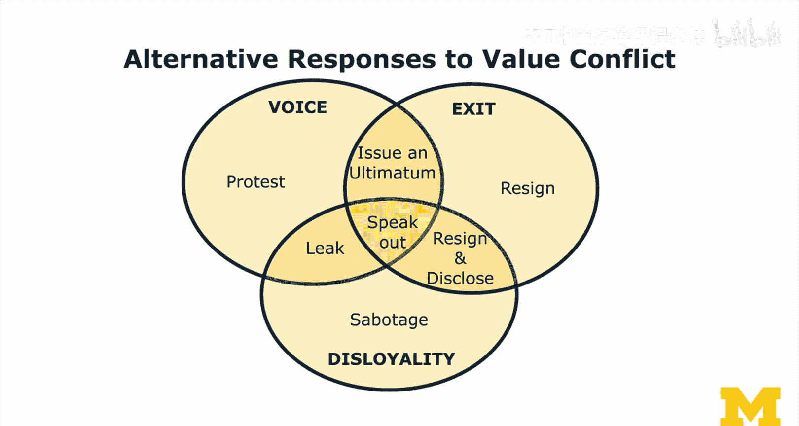
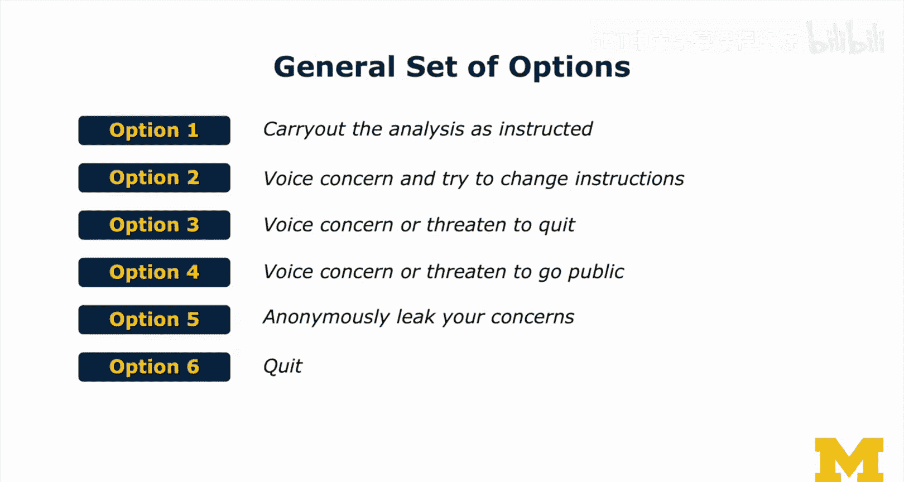

# 公共部门的R数据分析：17：职业伦理应对挑战实例 🧭

在本节课中，我们将通过一个具体案例，探讨数据分析师在职业生涯中可能遇到的伦理挑战，并思考如何应对。我们将以智慧城市中的人脸识别技术应用为背景，分析其中涉及的伦理问题，并讨论当你的专业意见与上级要求冲突时，可以采取的行动方案。

## 智慧城市与人脸识别技术背景

上一节我们介绍了职业伦理挑战的普遍性，本节中我们来看看一个具体的应用场景：智慧城市中的人脸识别技术。

首先，什么是智慧城市？智慧城市通常指那些有意利用现代信息和通信技术来推进公共部门目标和公共利益的市政区域。其活动范围广泛，具有一些共同特征。

以下是智慧城市的一些常见特征：
*   **基础设施发展**：包括物理、制度、社会和经济发展。
*   **新的数据收集活动**：特别是通过传感器、摄像头、社交媒体和众包。
*   **信息系统整合**与**先进的数据分析技术**。

智慧城市倡议的一些常见重点领域包括通信、交通系统、环境质量与可持续性、电子政务以及更安全的社区（尤其侧重于减少犯罪）。其主要目标围绕经济、效率和有效性三大支柱。

然而，智慧城市活动也带来了一系列与公平性相关的担忧，包括隐私、数字不平等，以及这些新活动可能如何加剧与系统性种族主义或制度性歧视相关的现有问题。人脸识别技术就是其中一项引发诸多争议的流行元素。

## 人脸识别技术的应用与伦理关切

了解了智慧城市的框架后，我们聚焦于其中一项具体技术。人脸识别技术在智慧城市中有多种应用方式。

以下是其主要应用场景：
*   帮助寻找失踪人员，包括失踪儿童、走失的痴呆症患者或自然灾害中的失踪者。
*   识别、抓捕并威慑犯罪行为和罪犯。
*   协助残障人士，提升购物体验等。

与此同时，关于人脸识别技术的伦理关切也相当突出，许多城市已通过法律禁止其使用。

以下是导致这些禁令的主要关切点：
*   **算法偏见**：几乎所有人脸识别算法都显示出严重的种族准确性偏差，尤其对有色人种，特别是黑人女性。
*   **歧视风险**：技术中的偏见和不准确可能导致种族及其他形式的歧视。
*   **缺乏知情同意**：使用该技术时常缺乏知情同意。
*   **缺乏透明度**：关于其使用及背后目的常缺乏透明度。
*   **大规模监控担忧**：存在对大规模监控的合理公共担忧，引发隐私侵犯问题。
*   **数据泄露风险**：存在潜在的数据泄露担忧。

## 伦理挑战场景模拟

在明确了技术背景和伦理问题后，现在让我们进入一个模拟的职业场景。

假设你是一名数据分析师，就职于一个大城市的规划部门，该部门正在制定智慧城市战略计划。该计划包括增加摄像头监控，通过协助执法部门寻找罪犯来提高安全性。你被要求参与规划过程，负责撰写报告中讨论数据基础设施投资的部分，这些投资用于分析遍布全市的摄像头所捕获的数据。

你撰写了该部分，但指出了用于人脸识别的潜在算法存在的种族和性别公平性问题，以及普遍的隐私担忧。你的上司阅读了你为报告撰写的草案文本，然后告诉你：“请从战略计划中删除所有关于缺点和担忧的内容”，因为该计划将提交给市议会审查和投票。你的上司要求你不要谈论人脸识别算法的偏见或此类技术的其他问题。

那么，你会怎么做？

## 应对策略与可选方案

面对上司的要求，你需要考虑如何回应。正如之前所讨论的，你有一些选择。通常，你应该从表达你的关切开始，尝试说服你的上司，你认为指出使用人脸识别技术所引发的一些伦理问题很重要。你的上司可能也应该知道许多城市已禁止其使用及原因。希望这就足够了。

但如果这还不够，你需要思考还能做什么。你能自行告知市议会你的担忧吗？你应该与记者交谈吗？你应该与组织中人力资源部门的其他人沟通吗？同样，你有一些选择。在一般情况下，你的可选方案如下。

以下是面对此类伦理指令冲突时，你可以考虑的几个选项：
1.  **执行指令**：按照上司的指示完成分析。
2.  **表达关切并尝试改变指令**：向上司说明伦理担忧，争取修改报告内容。
3.  **表达关切并以辞职相威胁**：如果你对此事感受强烈，这可能是你设定的底线。
4.  **表达关切并威胁公开或匿名泄露担忧**。
5.  **直接辞职**。

提前思考在特定情况下可能采取的行动是有益的。建议你与朋友甚至家人讨论，这可能会揭示你在思考特定伦理情境及如何应对时的一些细微考量。这些情况很棘手，没有绝对正确或错误的答案，但如果你在身临其境之前思考过一些场景，就能准备得更充分一些。

## 总结

本节课中，我们一起学习了如何在一个具体的智慧城市人脸识别技术应用场景中识别伦理挑战。我们分析了该技术带来的公平性、隐私和歧视风险，并通过一个模拟的职业困境，探讨了数据分析师在面对上级不当指令时可以采取的一系列应对策略，从沟通说服到更坚决的行动。提前思考并准备应对方案，能帮助我们在实际工作中更好地坚守职业伦理。