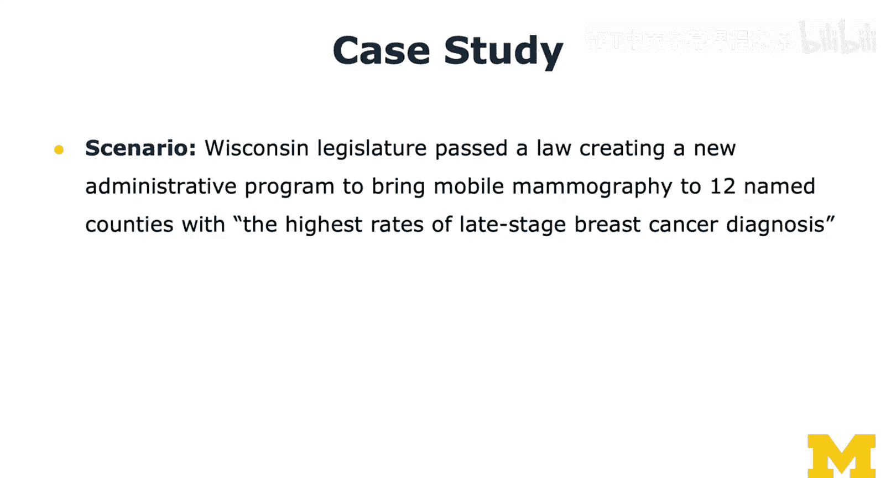
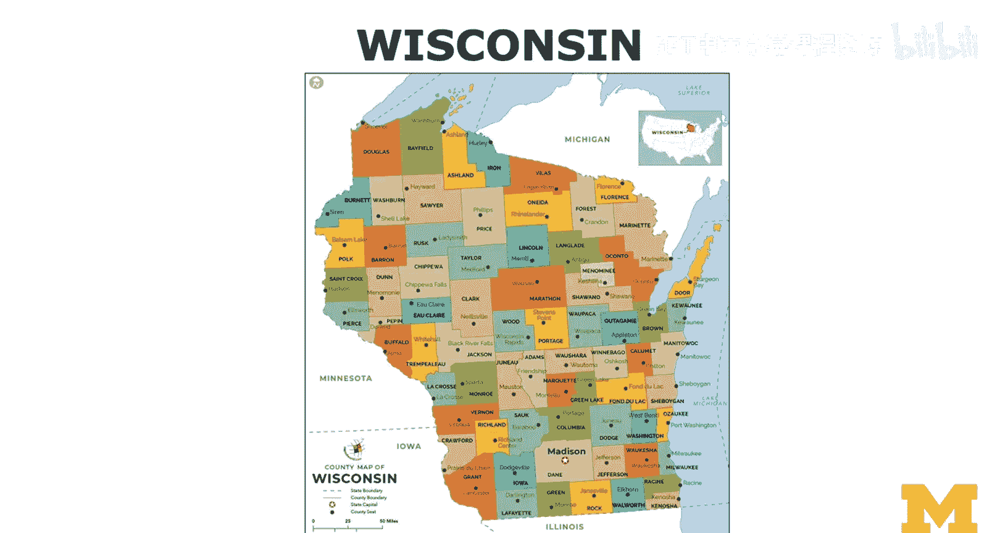
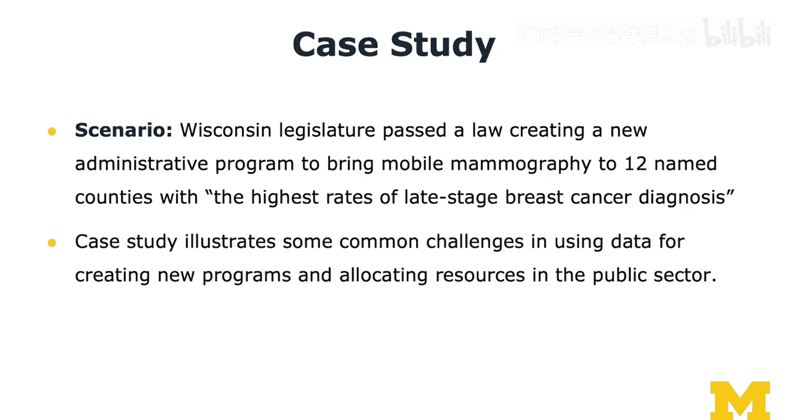
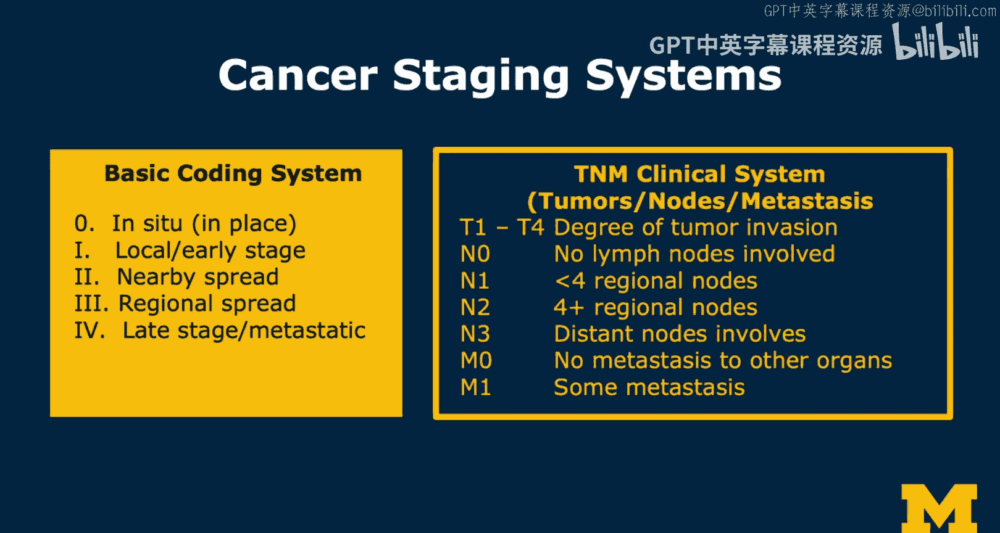
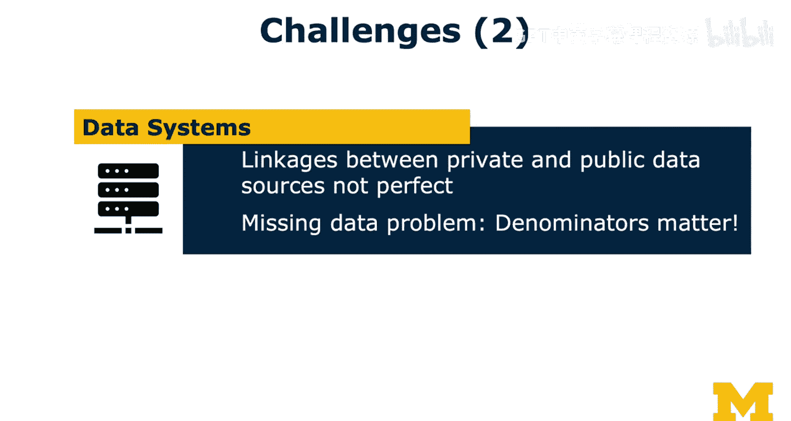
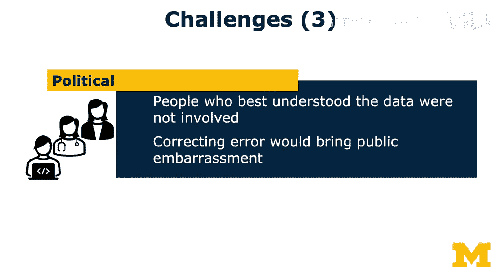
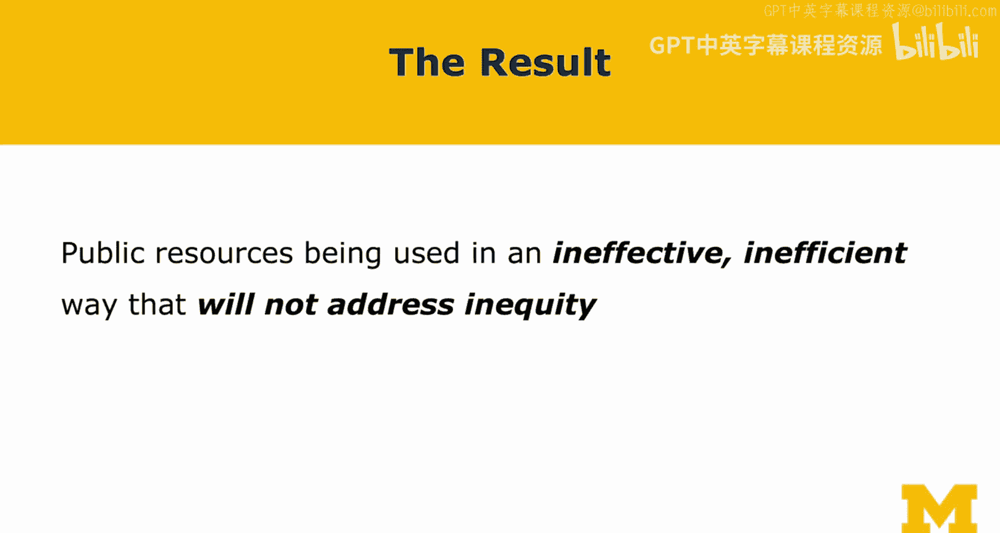

# 公共部门的R数据分析：案例研究：威斯康星癌症分期系统案例研究 📊

在本节课中，我们将通过一个真实的案例研究，探讨公共部门数据分析中可能遇到的典型挑战。这个案例发生在我职业生涯早期，当时我在威斯康星州担任流行病学家。我们将看到，即使意图良好，数据问题、沟通障碍和组织结构也可能导致公共资源的错误配置。

## 案例背景 🏛️

上一节我们介绍了案例的背景，本节中我们来看看具体的事件经过。

当时，我主要从事关于乳腺癌的数据分析工作，为州立法机构提供大量信息。一天早上，我在报纸上读到，威斯康星州的立法者刚刚投票通过了一项新法律。这项法律旨在创建一个由行政部门实施的新管理项目。

这个项目将为农村地区提供移动乳腺X光摄影服务。乳腺X光摄影是一种放射成像技术，用于检测其他方式难以发现的早期乳腺癌。

这项新立法特别点名了该州**晚期乳腺癌诊断率最高**的12个县，计划为这些地区提供移动服务。因为在这些地区，癌症的治疗预后通常较差。

## 发现问题 🔍

立法机构希望实施一项新的公共卫生项目来解决一个严重问题，这本身是好消息。然而，坏消息是，当我看到被点名的县名单时，我立刻意识到出了一个错误。

在此之前，我已经收集和分析有关乳腺X光摄影使用和癌症诊断分期的数据超过一年。我知道，名单上的大多数县实际上拥有**最高的乳腺X光筛查率**和**最低的晚期诊断率**。

我重新运行了一些分析以确认我的怀疑。结果证实，新法律确实点错了县。在这个项目中，12个被点名的县里有10个是错误的。

## 问题根源：数据与沟通 🗣️

总的来说，发生的是一个数据问题。让我来解释一下。

在立法部门，许多律师负责为立法者起草法案。在起草这项立法时，一位律师要求提供关于乳腺癌诊断分期的县级具体数据，但他**没有告诉分析师他为何需要这些信息**。

因此，分析完成了，结果也共享了，但没有任何关于结果解读的帮助，也没有与我或其他可能提供帮助的专家进行任何讨论。

在许多州，法律规定行政部门的人员未经邀请不得主动联系立法部门，当然也不能对可能的新法律或新政策发表意见。因此，政府不同分支之间有时存在所谓的“防火墙”，这很常见。

但由于这种沟通的缺乏，立法部门的人员并不理解数据背后发生了什么。

## 数据系统的具体问题 💻

以下是导致数据问题的具体技术细节。

威斯康星州中部有一个优秀的医疗系统，它为其服务的农村县（主要是州中部往北以及州北部东西向的广大农村地区）的女性进行了大量的乳腺X光筛查教育和推广。我知道来自其他数据，该系统的乳腺X光筛查率是全州最高的之一。

此外，这个优秀的医疗系统在其数据系统中使用了一种复杂的方法来记录诊断时的癌症分期，即 **TNM系统**（肿瘤、淋巴结、转移系统）。

然而，州癌症登记系统对于“诊断分期”这个变量使用了一种**简单得多的格式**。不幸的是，当这个医疗系统依法向州里报告数据时，这两种分期系统**未能正确合并**。

这两种数据系统对于晚期诊断的癌症病例沟通良好。然而，对于早期阶段，这个表示诊断分期的变量在两种格式下**未能很好地对接**。这导致州系统错误地将这个大型农村医疗系统的大部分早期诊断病例标记为**数据缺失**。

## 案例中的挑战总结 ⚠️

让我们回顾一下这个案例中的挑战。

以下是本案例中遇到的主要挑战类型：

1.  **组织挑战**：包括政府分支之间有效沟通的障碍。这很常见。
2.  **数据系统挑战**：包括链接或协调来自私人和公共来源的数据。这也很常见。在这个特定案例中，数据链接问题产生了大量缺失数据，进而导致了有偏见和不准确的结果。在解读分析结果时，理解缺失数据始终很重要。
3.  **政治挑战**：在公共部门进行数据分析时，这些挑战同样常见。在这个案例中，一个挑战是最了解数据的人（包括我自己）处于不同的“孤岛”中，没有被纳入起草新立法的机密过程。另一个挑战是，当我将错误提请我的上司和其他领导注意时，他们决定保持沉默并保密。因为纠正错误会让起草并推动该法案快速通过立法程序的立法者感到尴尬（这种快速通过并不典型），也可能让行政部门中进行了有缺陷分析却未被发现的员工感到尴尬。

因此，这个案例非常不幸的最终结果是：公共资源被使用了三年，直到后来该项目重新授权时才正确点名了县。这些资源被用于启动一个无法满足我们之前讨论过的公共利益的四大支柱（经济、效率、效能、公平）的项目。

## 经验教训与总结 📝

本节课中我们一起学习了这个案例的始末。那么，这个案例研究对你作为一名成长中的分析师有哪些启示呢？

以下是你可以汲取的一些关键经验：

*   **明确分析需求**：当被要求进行分析时，务必弄清楚是谁需要、为什么需要、试图回答什么问题以及用于什么目的。
*   **协助解读结果**：确保尽你所能帮助解读结果，特别是关于任何可能由缺失数据、数据链接或其他数据问题引起的偏见或问题。

我必须说，这是我职业生涯早期一次令人难过但大开眼界的经历。我再次与你分享这个故事，不是因为它非常不寻常，当然也不是为了批评我当年共事过的任何人，而是因为它揭示了在公共部门进行重要数据分析工作时一些非常常见的挑战。

通过这个案例，我们看到了清晰沟通、理解数据局限性和跨部门协作对于确保数据分析真正服务于公共利益是多么重要。