# 19：墨西哥贫困人口养老金案例（第一部分）📊

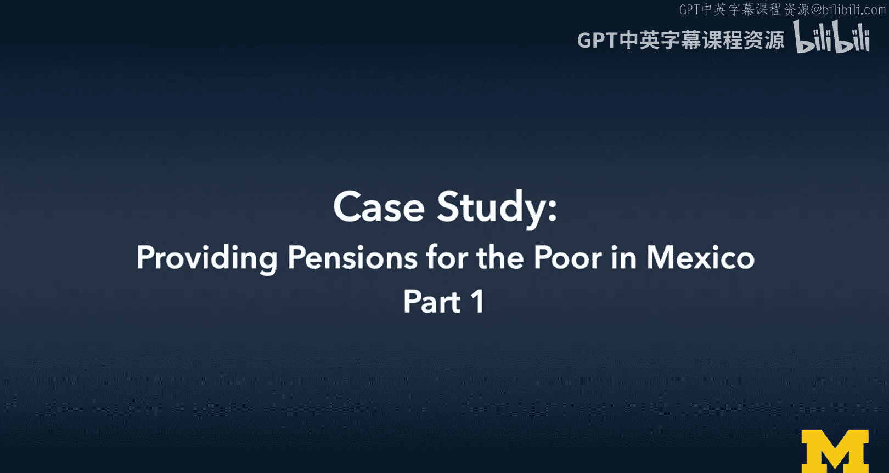

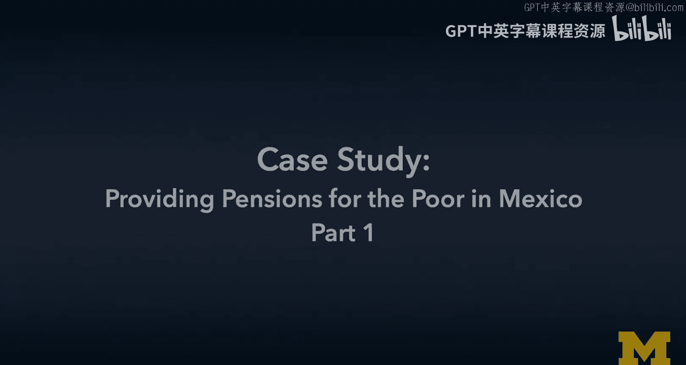

## 概述

在本节课中，我们将学习一个关于墨西哥农村老年人养老金政策的真实案例研究。我们将了解政策分析的背景、步骤，以及如何运用数据分析来支持决策。这个案例将综合运用我们之前学到的关于数据在公共部门中的作用、政策分析和数据可视化的知识。

## 案例背景介绍

我是Paula Lance教授。今天，我很高兴向大家介绍一个案例研究。Brooks教授和我认为，这个案例能将本系列课程的所有内容融会贯通。在本系列中，我们一直在讨论数据及数据分析在公共部门的重要作用，包括它如何帮助决策者、各类政策分析的重要角色、数据可视化及其他数据分析方法的关键作用，以及它如何切实影响政府的重要工作。

因此，我们为您准备了一个案例研究。我将解释其背景，然后我们会讨论相关的作业。稍后您也会收到书面的作业说明。

这个案例研究涉及一项重要的社会福利政策议题。同时，您将置身于一个需要在时间压力下进行政策方案分析的场景，这无疑是现实世界的写照。

## 场景设定

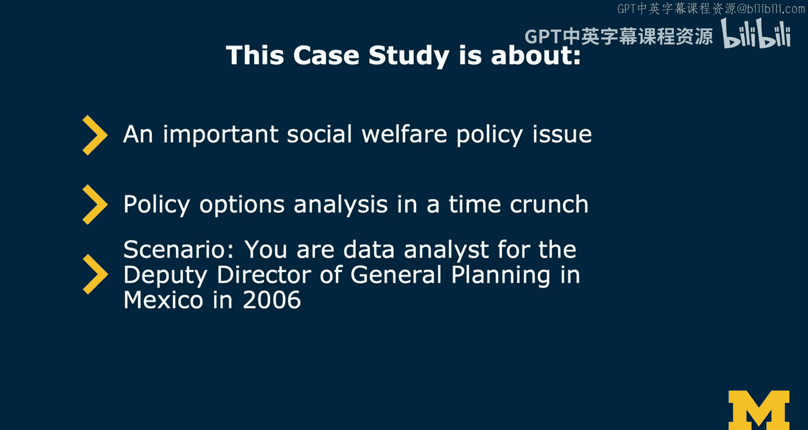

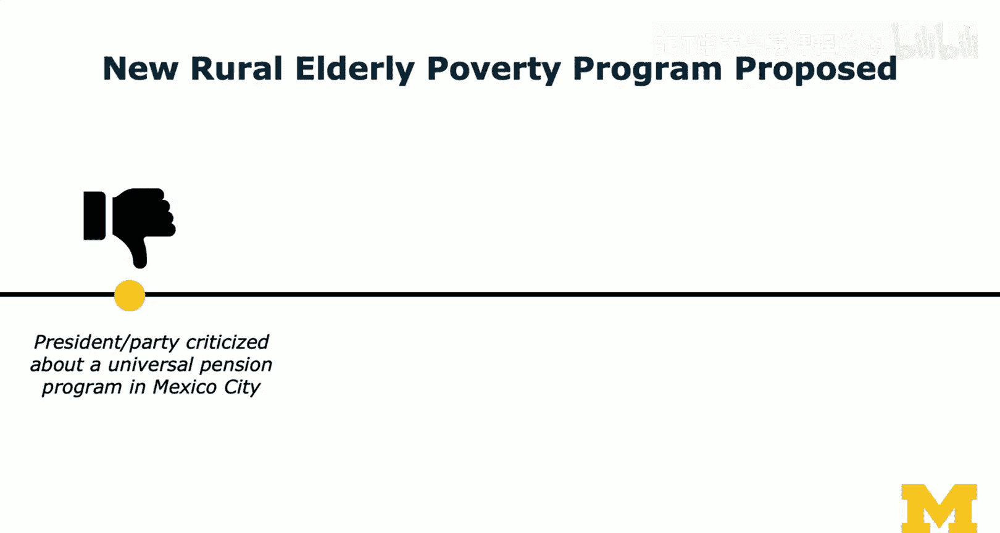

场景设定是：您作为一名数据分析师，在一个团队中工作，该团队服务于墨西哥总规划部副部长。我们将时间倒回2006年。需要说明的是，这是一个真实世界的场景，本案例中讨论的事情确实发生过。

在2006年的墨西哥，一项针对墨西哥农村老年人的新扶贫计划被提交给国会，并且国会批准了该计划。然而，在该计划通过立法程序的过程中，并没有确定谁有资格参与该计划的具体标准。

## 问题背景

以下是更多背景信息。此前，总统及其政党曾因墨西哥的另一项扶贫计划而受到批评。那是一项在墨西哥城实施的全民养老金计划。在该计划中，所有被定义为70岁及以上的老年人都开始领取养老金。但人们担心，一些并不贫困的人也在用公共资金领取这份养老金，而他们并不需要。这似乎效率不高，尤其是在目标是解决贫困问题时。

因此，一项新的计划被提出，旨在更侧重于农村老年人，并再次致力于减少贫困。总统Calderón要求您所服务的规划部长提交资格标准，以确保养老金发放给有需要的老年人。

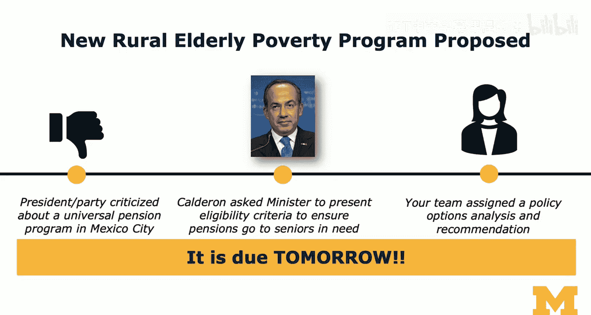

您的团队被指派进行一项政策方案分析。这里的政策议题是：确定这项新计划的资格标准。分析工作还包括提出建议，并且截止日期是明天。朋友们，这在现实中并不少见，这种情况经常发生。

正如我提到的，总统的预算案即将通过，但相关人士表示，只要知道标准是什么，就会为此拨款。

## 政策分析步骤

请记住经典政策方案分析的步骤。

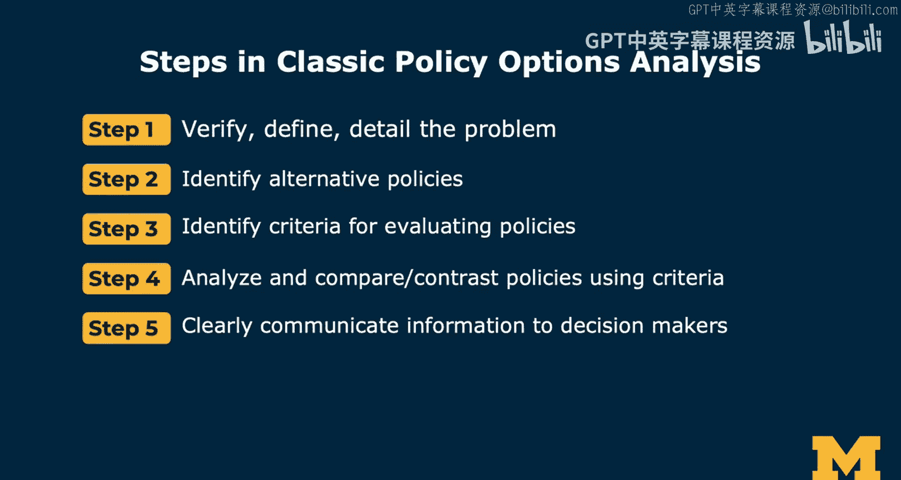

**第一步**，明确要解决的问题。我们必须定义问题并获取一些细节。

**第二步**，确定一些备选政策。在本案例中，即确定谁有资格获得这项新养老金的不同标准设定方式。

**第三步**，确定用于评估政策变化或方案的标准。

**第四步**，使用一套明确的标准，分析和比较不同的政策方案。

**第五步**，将信息清晰地传达给决策者。

## 第一步：问题定义与背景

那么，第一步，2006年墨西哥的背景是什么？这里有一些关于贫困率的数据。很多时候，我们得到的数据并不完全符合我们的期望，但这里我们有一些关于65岁及以上人群贫困率的数据（尽管新政策是针对70岁及以上人群设计的）。我们知道，在墨西哥的城市地区，当时65岁及以上人群的贫困率为35.6%，大约10%的人有可以依赖的养老金。而在农村地区，贫困率更高，2006年时为54.7%，生活在农村地区的老年人中，只有不到1%的人拥有养老金。

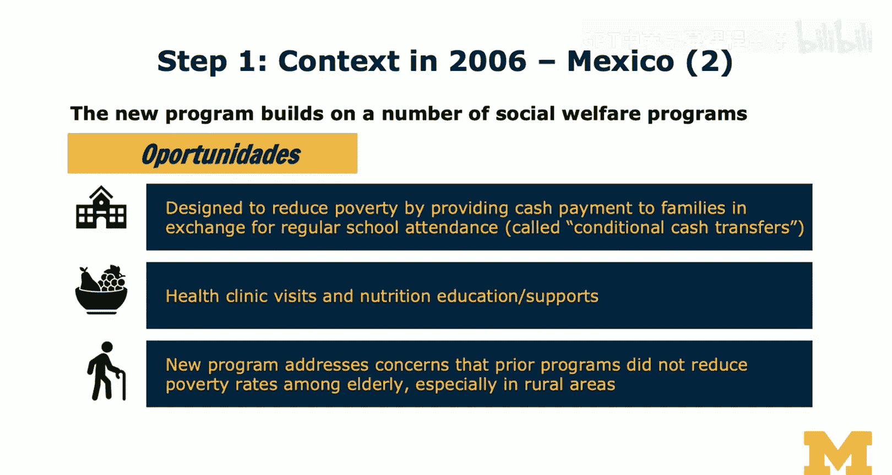

因此，我们确实看到墨西哥农村地区的贫困问题更为严重。

## 现有计划与新计划的关联

这项新提出的计划建立在墨西哥若干现有社会福利计划的基础之上。我希望您还记得我们在讨论项目评估和随机对照试验时提到的墨西哥“机会计划”。对该计划进行了一项随机对照试验，以评估通过向家庭提供有条件现金转移支付（条件是孩子定期上学、家庭成员特别是母亲进行健康诊所访问并获得营养和教育支持）来减少贫困的效果。

这项新计划在一定程度上建立在“机会计划”的基础上，因为“机会计划”关注的是农村社区。对该计划的一个担忧是，它没有针对老年人，也没有降低老年人的贫困率。

## 预算与时间压力

另一条信息，正如我提到的，这里有一些更详细的细节。2006年12月23日，墨西哥国会批准了2007年预算案。他们决定拨款85亿比索，用于向70岁及以上的老年人提供养老金，目标是解决农村贫困问题。这相当于每月支付约500比索，按美元计算大约是45美元。

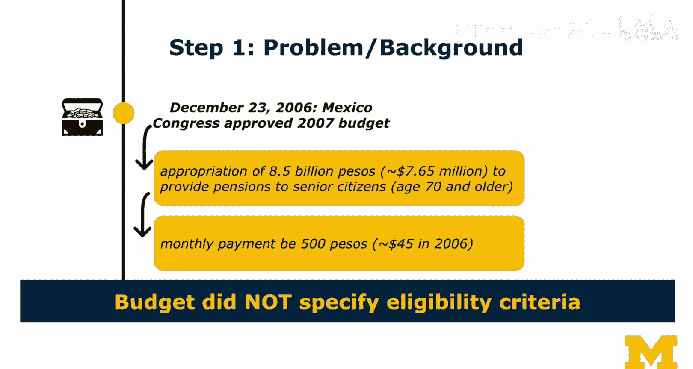

然而，预算案并未明确资格标准。该预算案的最终批准，要等到能够明确说明究竟谁将获得这项新养老金之后才能进行。

这就是第一步，有很多背景信息。但这对您理解我们接下来要进行的政策方案分析的更多细节非常重要。

## 第二步：确定备选政策方案

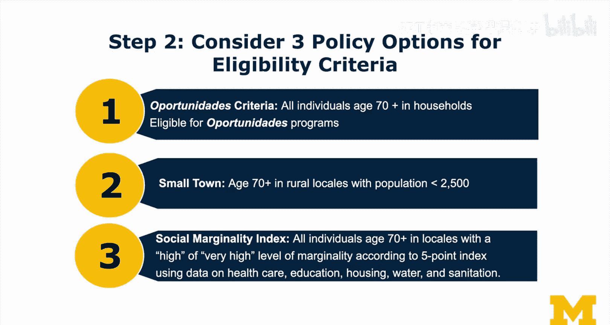

我们时间紧迫。在本案例中，已经为我们提供了三种关于资格标准的政策方案。

**方案一**：这正是为什么提到了“机会计划”。第一个方案的标准是，让我们直接将这项新养老金计划的目标人群定为：年龄在70岁及以上，且所在家庭已被确定为有资格参与“机会计划”的个人。这个现金转移支付计划并未真正惠及家庭中的老年人。

**方案二**：人们说，既然我们的目标是农村地区，那就直接针对墨西哥最小的城镇和村庄。因此，第二个标准是：这项新计划将针对人口少于2500人的农村地区中，年龄在70岁及以上的老年人。

**方案三**：第三个政策方案，即新养老金计划的资格标准，是使用墨西哥已经建立的一个指标，称为“社会边缘化指数”。墨西哥在当时已经开始使用这个社会边缘化指数，该指数根据医疗保健可及性、教育、住房、供水和卫生设施等方面的数据，将墨西哥每个地区标记为1到5级，范围从低到非常高程度的边缘化。

同样，墨西哥所有地区都已被标记在这个社会边缘化指数量表上。该提案是：利用该量表，针对那些边缘化程度为高或非常高的地区，然后将这些地区的老年人作为新养老金计划的目标人群。

## 第三步：确定评估标准

好了，我们有了三个政策方案。政策方案分析的下一步是确定我们的分析标准。在本案例中，这也已经提供给我们了。我们不需要花时间去思考我们的标准将是什么，总统已经下达给我们了。

用于比较和对比我们三个政策方案的标准如下：

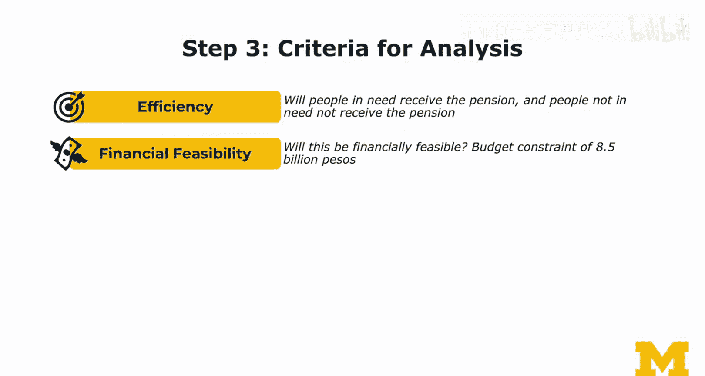

1.  **效率**：在本案例中，这意味着有需要的人是否将获得养老金？同时，没有需要的人不应获得养老金。因此，目标定位是否精准？
2.  **财务可行性**：您可能记得我提到过预算约束。国会准备批准一项预算，为该计划拨款85亿比索。但我们需要知道，如果使用不同的资格标准，按照该标准，是否有足够的资金满足需求？
3.  **行政可行性**：该标准在后勤和行政上是否易于实施？
4.  **政治因素**：我不指望您了解2006年墨西哥的政治情况，但我们确实需要考虑这一点。这些方案在政治可行性方面是否存在差异？不同的政治派别是否会对此有不同的反对意见，或者他们可能就某种方法达成一致？因此，我们确实需要考虑一些政治因素，特别是因为这是一项需要通过立法机构的事项。
5.  **伦理影响**：不同的政策标准方案会带来什么伦理影响？某个方案对所有受影响者是否公平？您是否认为它可能造成或加剧已经存在的不平等？

## 总结

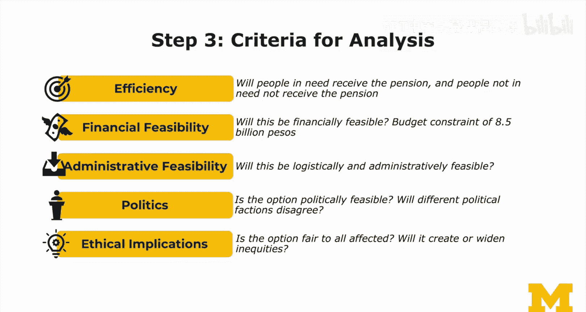

本节课中，我们一起学习了墨西哥农村老年人养老金政策案例的第一部分。我们了解了案例的背景、紧迫的时间压力，以及政策分析的前三个关键步骤：明确问题、确定备选方案和设定评估标准。我们看到了三个具体的资格标准方案，以及从效率、财务、行政、政治和伦理五个维度进行评估的框架。在接下来的部分，我们将运用数据分析来比较这些方案，并最终为决策者提供清晰的建议。