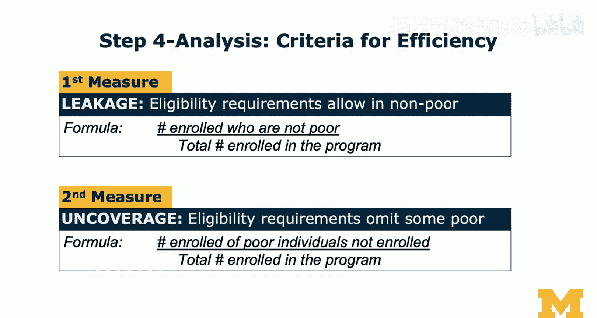
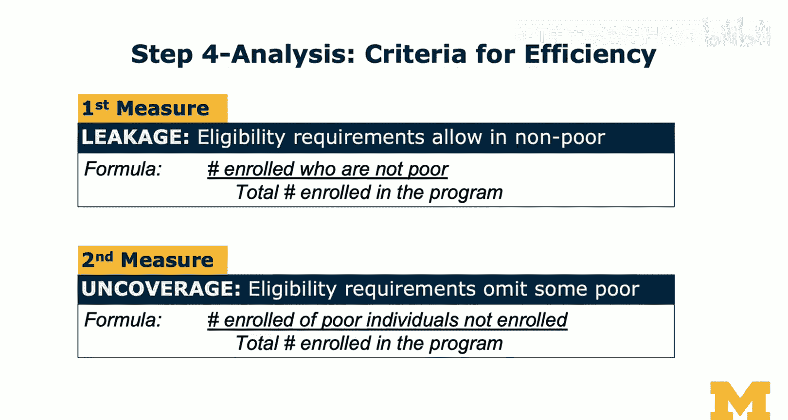

# 公共部门的R数据分析：20：墨西哥贫困人口养老金案例（第二部分）📊

在本节课中，我们将继续墨西哥贫困人口养老金政策的案例分析，重点进入政策选项分析的第四步：具体分析。我们将学习如何使用“效率”这一核心标准，通过“漏出率”和“覆盖率不足”两个关键指标来量化评估不同的政策选项。

上一节我们介绍了政策分析的前三个步骤，并确定了以“效率”作为核心评估标准。本节中，我们来看看如何对效率进行具体的量化分析。

## 效率的量化指标

为了评估政策选项的效率，我们引入了两个技术性指标：漏出率和覆盖率不足。以下是这两个指标的具体定义和计算公式。

### 漏出率

漏出率是衡量公共项目资源是否被非目标群体获取的指标。具体来说，它指的是由于资格要求设置不当，导致不符合条件的非贫困老年人也获得了养老金的情况。

漏出率的计算公式如下：

**漏出率 = (项目中非贫困的注册人数) / (项目总注册人数)**

### 覆盖率不足

覆盖率不足则衡量了政策是否遗漏了本应覆盖的目标群体。在本案例中，即指资格要求是否将我们真正希望帮助的贫困农村老年居民排除在外。

覆盖率不足的计算公式如下：

**覆盖率不足 = (未注册项目的贫困个体数) / (项目总注册人数)**

---

本节课中我们一起学习了政策分析中效率评估的两个核心量化指标：漏出率和覆盖率不足。通过这两个公式，我们可以将抽象的“效率”概念转化为具体的数据，从而对不同政策选项进行客观比较和评估。