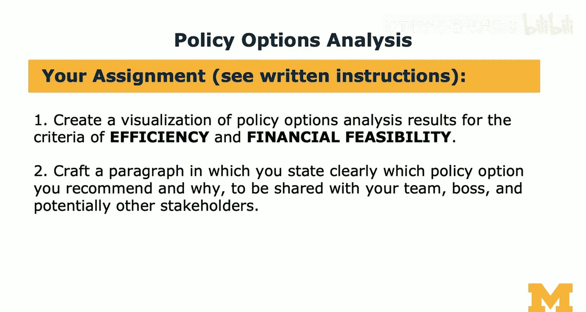
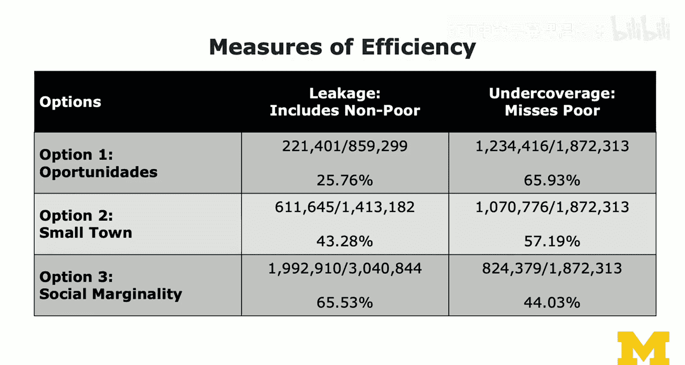
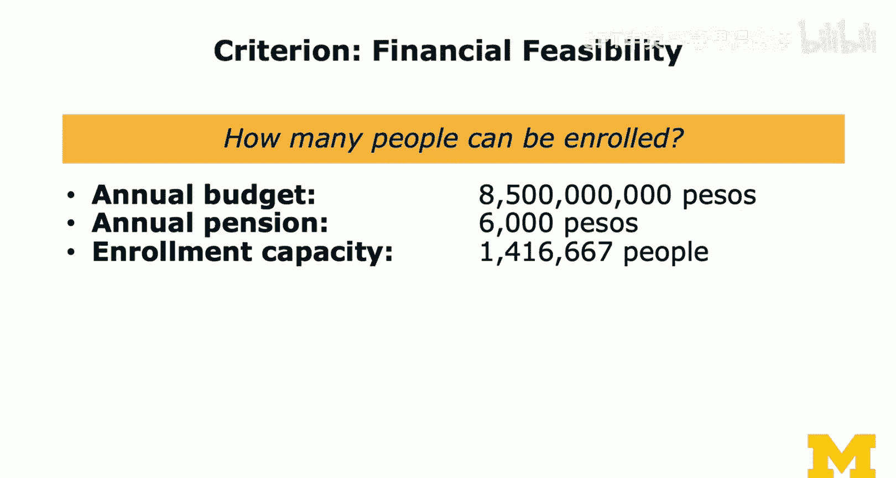
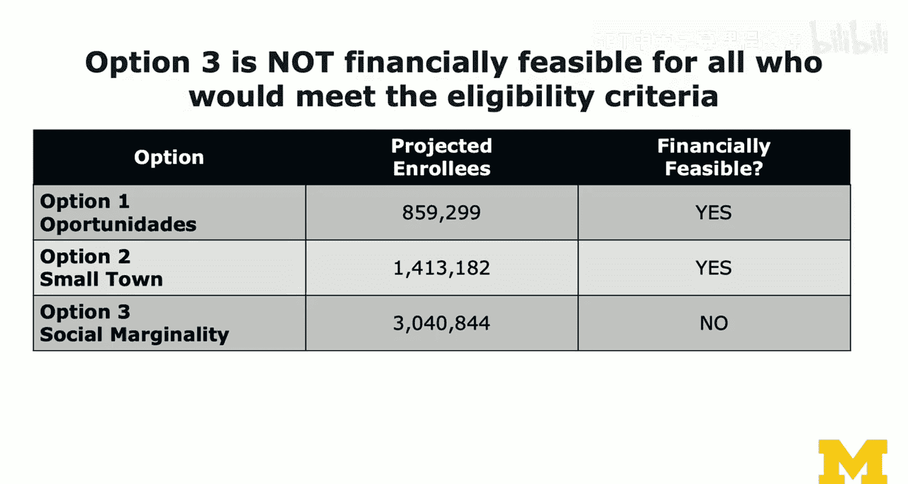
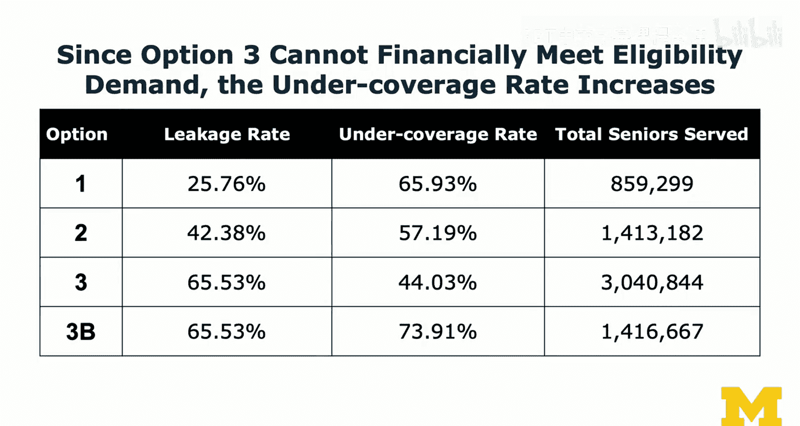
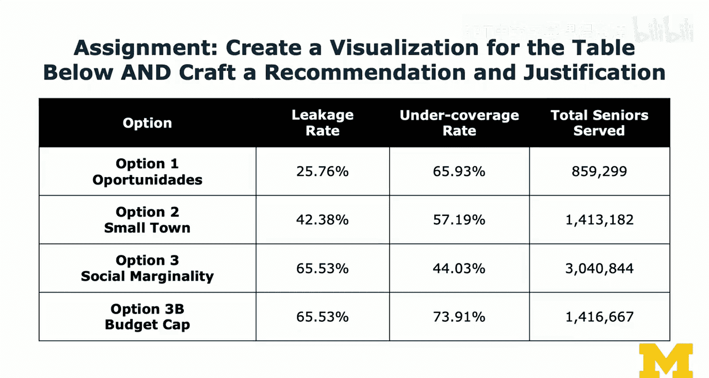
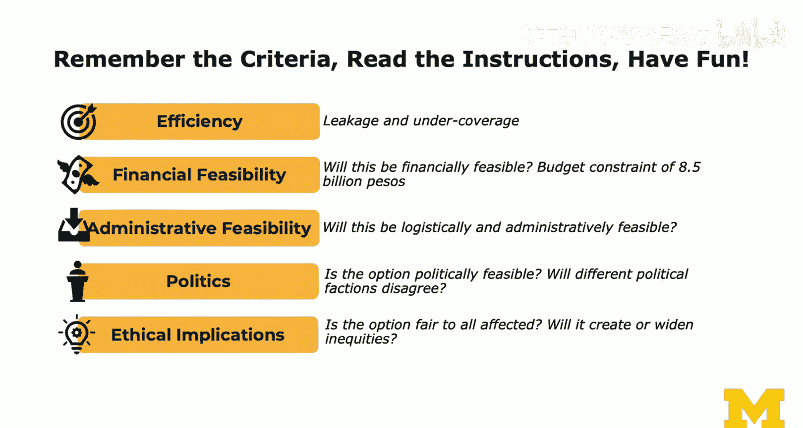

# 公共部门的R数据分析：21：墨西哥贫困人口养老金案例（第三部分）📊

在本节课中，我们将学习如何基于政策选项分析的结果，创建数据可视化图表并撰写政策建议。我们将使用墨西哥养老金案例中关于**效率**和**财政可行性**的分析数据，来比较三种不同的政策选项。

上一节我们介绍了政策选项分析的初步步骤，本节中我们来看看如何解读分析结果并完成最终的任务。

## 概述

本节课的任务分为两部分：
1.  为政策选项分析的结果创建一个数据可视化图表。
2.  撰写一段文字，陈述你推荐的政策选项及其理由。

以下是任务的具体要求：

*   可视化需涵盖**效率**（漏出率和覆盖率不足率）和**财政可行性**两个维度的分析结果。
*   推荐段落需基于分析结果，并考虑行政可行性、政治和伦理影响等其他标准。
*   你的成果将分享给团队、上级及其他潜在利益相关者。

## 政策选项分析结果

我们已为你完成了大部分的数据分析工作。以下是用于比较三种政策选项的关键数据。

### 效率指标

效率通过两个指标衡量：
*   **漏出率**：指符合条件但**并非贫困**的人口比例。公式为：`漏出率 = (非贫困的合格人数 / 总合格人数) * 100%`
*   **覆盖率不足率**：指**贫困**但**不符合条件**的人口比例。公式为：`覆盖率不足率 = (贫困但未覆盖的人数 / 总贫困人数) * 100%`

以下是三种政策选项的效率数据：

| 政策选项 | 漏出率 | 覆盖率不足率 |
| :--- | :--- | :--- |
| 选项1：机会匮乏家庭 | 25.76% | 66.00% |
| 选项2：小规模社区 | 60.53% | 50.00% |
| 选项3：高社会边缘化指数 | 65.00% | 44.00% |

### 财政可行性指标

该项目的预算设定为85亿比索，年度养老金为600比索。因此，该项目最多可服务的人数为：
`最大服务人数 = 总预算 / 年度养老金 = 8,500,000,000 / 600 ≈ 1,416,667人`

以下是各选项的预计合格人数与财政可行性的对比：

| 政策选项 | 预计合格人数 | 是否财政可行 |
| :--- | :--- | :--- |
| 选项1：机会匮乏家庭 | 1,200,000人 | 是 |
| 选项2：小规模社区 | 1,100,000人 | 是 |
| 选项3：高社会边缘化指数 | 3,000,000人 | **否** |

由于选项3的预计合格人数远超预算上限，必须设置名额限制。这导致其**覆盖率不足率**从44%上升至近74%（在分析表中标记为选项3B）。

## 任务指南

现在，我们来看看如何完成你的最终作业。

### 第一部分：创建数据可视化

你的第一个任务是利用上述数据创建可视化图表。以下是可供参考的思路：

*   可以使用条形图对比三种选项的漏出率和覆盖率不足率。
*   可以使用散点图或气泡图，将漏出率和覆盖率不足率作为两个坐标轴，用点的大小表示财政可行性。
*   目标是让图表清晰、直观地展示不同选项在效率和财政约束下的权衡关系。

请参阅书面作业说明以获取更详细的指导。

### 第二部分：撰写政策建议

在创建好可视化图表后，你需要撰写一段文字来提出建议。以下是撰写建议时需要考虑的要点：

*   **陈述你的选择**：明确推荐选项1、2还是3（或3B）。
*   **引用数据支持**：使用效率（漏出率、覆盖率不足率）和财政可行性的数据来论证你的选择。
*   **考虑其他标准**：除了作业要求的两个标准，还需简要提及行政可行性、政治接受度和伦理影响等因素。
*   **保持简洁有力**：这段文字将用于向决策者汇报，因此需要逻辑清晰、论据充分。

## 总结

本节课中，我们一起学习了如何基于政策选项分析的结果进行决策支持。你掌握了如何解读效率（漏出率、覆盖率不足率）和财政可行性的数据，并了解了创建数据可视化和撰写政策建议的基本方法。请综合运用在本系列课程中学到的所有技能，在这个模拟的真实政策场景中完成最终任务。

请务必阅读详细的作业说明。最重要的是，享受这个应用所学知识解决实际问题的过程。