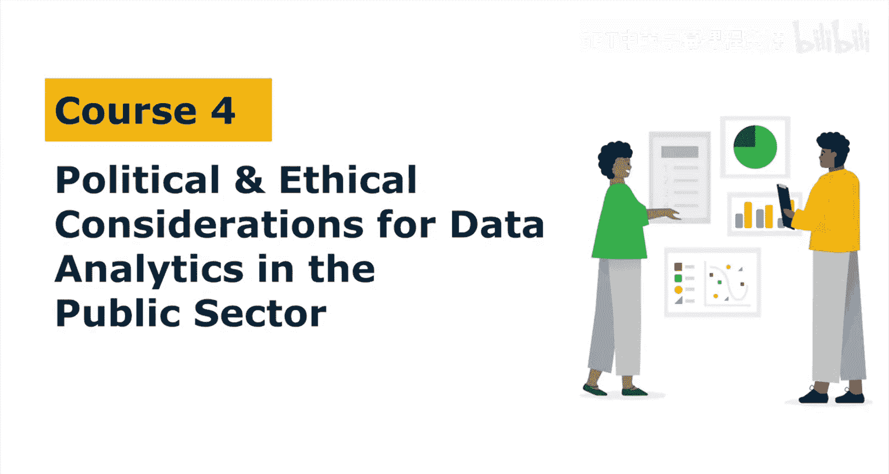
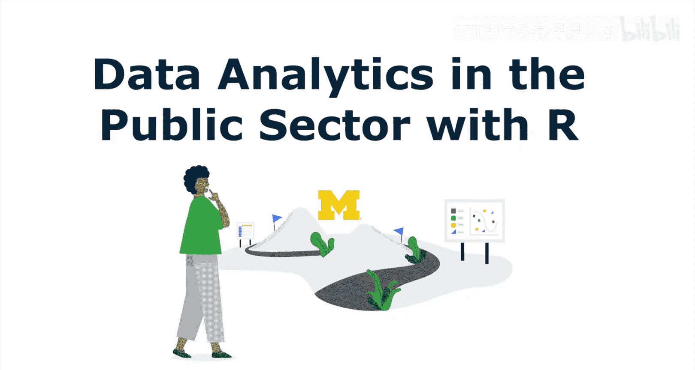
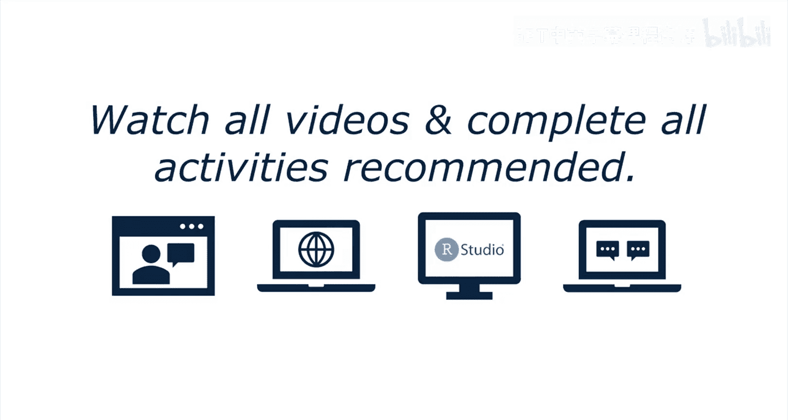
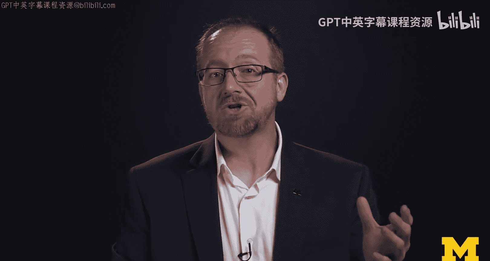
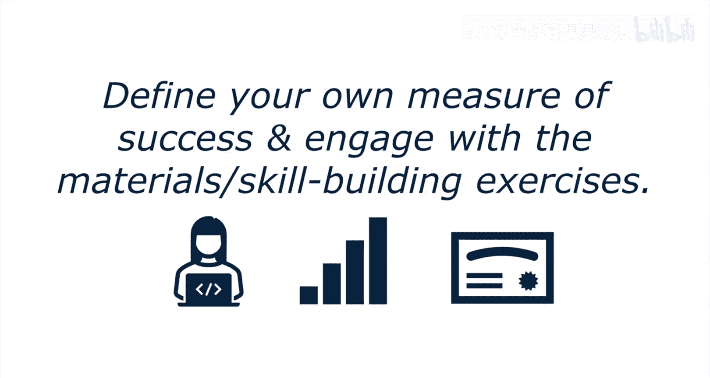

# 密歇根大学《公共部门的R数据分析（基础、数据探索、决策支持、）｜Data Analytics in the Public Sector with R》中英字幕 p01 0_密歇根大学欢迎辞.zh_en -BV1YZ421J7Fx_p1-

There are nearly 200 countries in the world in thousands of stateprovincial and regional governments with literally hundreds of thousands of local governments each one of these governmental units needs data and information to do its administrative and legislative work to allocate resources and make decisions the role of data and the need for talented and skilled people who can collect analyze and communicable data is essential to the work of the public sector This certificate is designed for current and future public sector professionals who are tasked with gathering。

 a， interpreting and sharing data to be used in public administration and public policymaking The certificate has four courses。

 each of which is designed to equip learners with analytic and technical skills and also how to apply them in the work of the public sector The four courses are fundamentals of public sector data analysis with R。

Exploratory data analysis for public administration with GG pod。

Assisting public sector decision makers with data and policy analysis and finally。

 political and ethical considerations for data analytics in the public sector。

Each course will help you build data analytics skills using R and will also increase your understanding of the public sector in the key ways as to how high quality data analytics are essential to the functioning and goals of government I'm Chris Brooks I'm Paula Lance we are here to introduce you to the data analytics in the public sector at R certificate and also to us your instructors we have enjoyed working together to design the four courses and are very glad to be your instructors for this learning experience let's tell you a bit more about ourselves I'm a faculty member in the School of Information at the University of Michigan I've had the pleasure to teach hundreds of thousands of students data science courses right here on the Coursera platform In those classes I focused on data science in the PythO ecosystem but in this course I'm excited to introduce you to the wonderful world R I'm a professor of public policy and health management and policy at the University of Michigan where I teach courses on the basics of public policy research methods for program and policy。

evaluationval。And public health and social policy。My academic training is in social demography。

 epidemiology， and also health policy。Before I was a nerdy professor， which I love。

 I worked as a policy analyst for a county level juvenile court system and also as an epidemiologist and policy analyst for a State health department。

And in my research， which is focused on understanding and addressing social inequalities in health。

 I often work with the US federal government as well as state and local governments。

 primarily with their health and social welfare services departments I'm really excited to be part of this series and to be providing you with some of the foundational context for the important role of data analytics in the public sector you will mostly be learning with me and Professor Brooks。

 but we will also be joined along the way by a number of additional experts who are eager to share their knowledge and experiences with you we really want you to have an enjoyable worthwhile and successful learning experience so how can you do that First this certificate is building upon some knowledge and skills that you already have。

🎼We assume that you've already got some basic skills in working with data perhaps through spreadsheets and have been at least introduced to programming though maybe not yet in R。

 we also assume that you've had some exposure to introductory statistics In addition to this you'll be most successful in this course if you take a handson exploratory approach to learning the content we've tried to make that easy not only do you have the videos in the notebook showing the our code but we've embedded the our studio platform directly in the course for you to use so there's nothing you have to install on your own computer We do not assume that you have any prior experience working in the public sector or any sort of knowledge of public administration or public policy really the main things you need to do to be successful in this series of courses include stay engaged and try to establish a pace for progress that's feasible for you and all the many other things you have going on in your life Watch all of the videos and doing all of the activities recommended as well as required along the way This will mostly involve actually performing data analytics。

Using our studio but there's other activities in types of applied skill building as well Stay curious and passionate along the way know that you are investing in yourself in ways that will likely bring you new job opportunities and a very large sector of the global economy most importantly。

 be sure to define your own personal measure of success and engaged with the materials and skill building exercises we're providing along the way we hope you'll stay with us through all four courses By the end you will have mastered skills covered in an introductory R course along with fundamental material covered in introductory courses on public administration and public policy and this includes an important theme that runs throughout the series while high quality data and objective data analytics are vitally important to the work of the public sector data alone never tells decision makers what to do as this inevitably involves competing values ethical considerations and politics so let's get started we look forward to spending time with you in keeping you interested and engaged as we move along。

We hope you find our work together interesting， challenging， worthwhile。

 and most of all fun We'll see you soon in course one。

 the fundamentals of data analytics in the public sector。

 which will cover the core functions of public administration。

 the basics of survey and population data and how to use the our programming language to clean data and answer questions。

