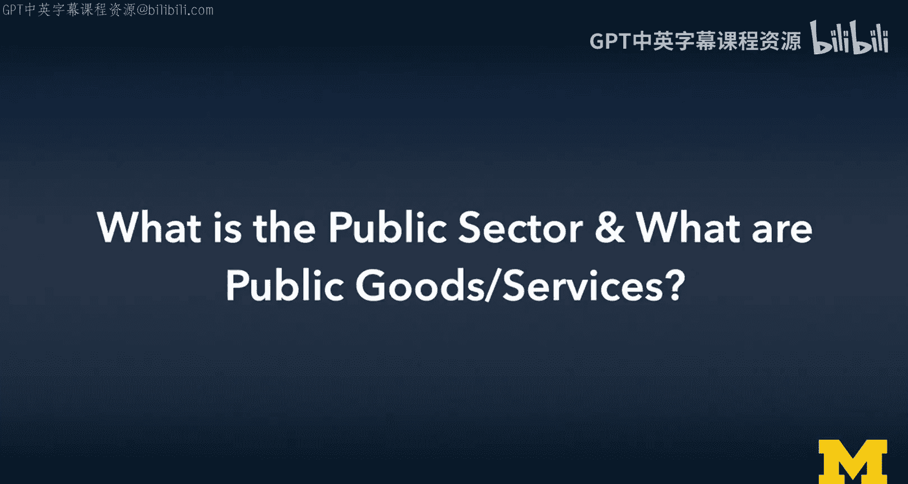
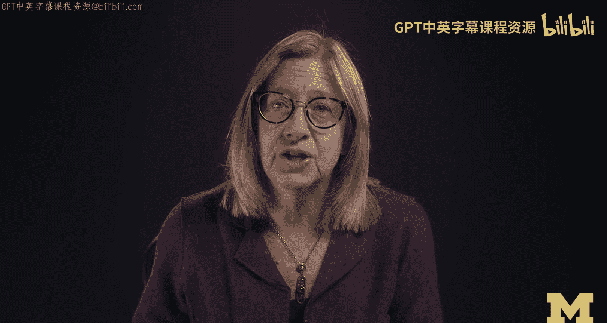
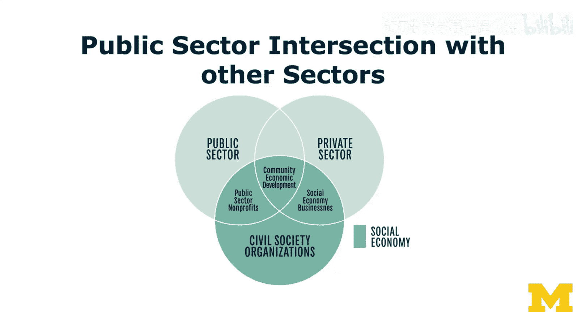
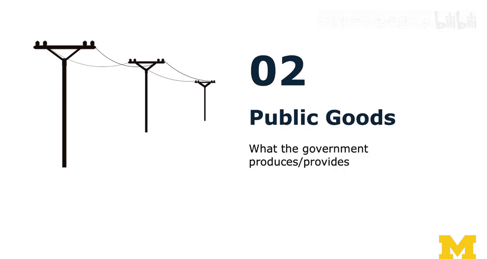
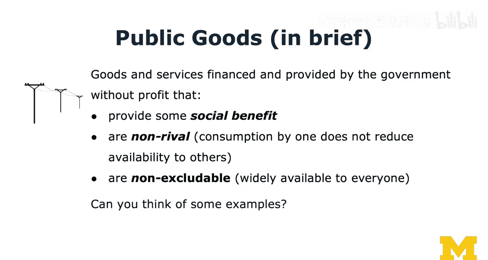
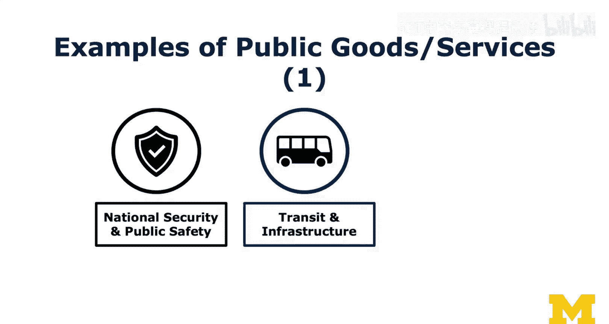
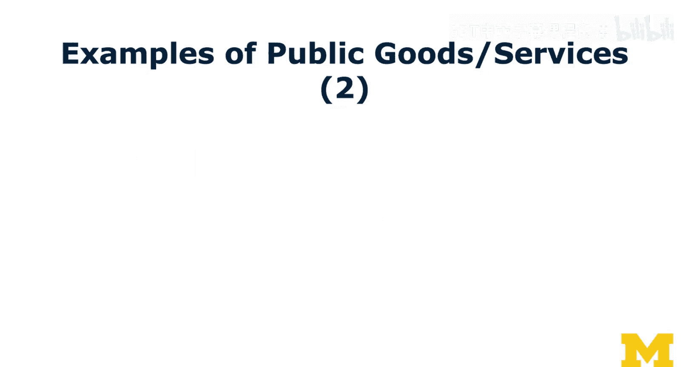
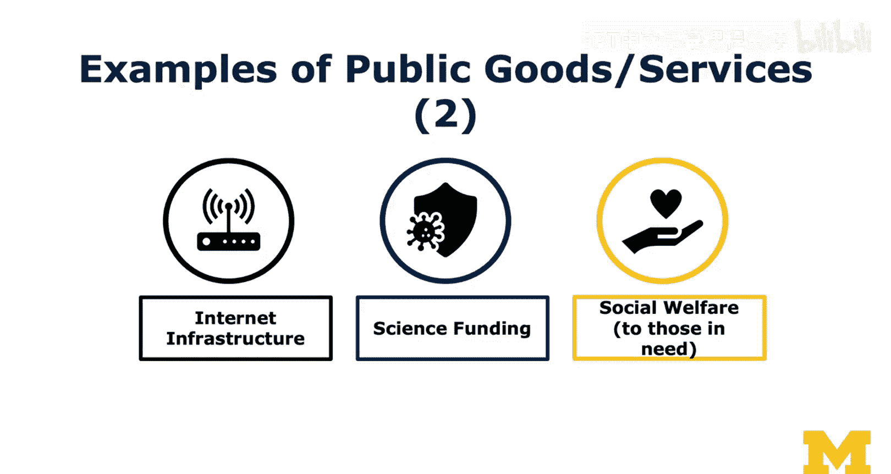
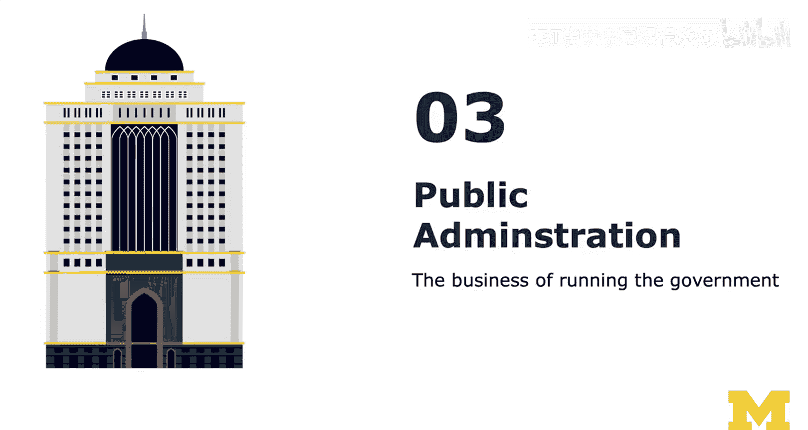
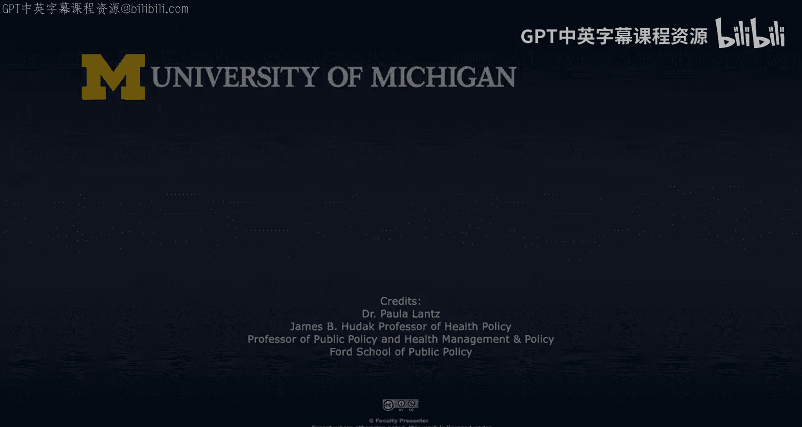

# 密歇根大学《公共部门的R数据分析（基础、数据探索、决策支持、）｜Data Analytics in the Public Sector with R》中英字幕 p02 1_公共部门定义与公共产品-服务解析.zh_en -BV1YZ421J7Fx_p2-

Before we get deep into the fun of data analysis techniques and applications in the public sector。

 we need to first set the stage and context。 So in this introductory session。

 we are going to start by defining some important terms and concepts。

 Let's first focus on four key terms， the public sector。

Public goods and services。Public administration and public policy。

 the obvious common thread throughout all of these is the term public， and in our context。

 public simply means government。First， what is the public sector。

 It is the activities and consequences of governmental actions and activities primarily related to the provision of public goods and services by the government。

 We generally think of economies of individual nations and also the world economy as having three main sectors。

 Numb one， the private sector or the activities of for profit businesses。Number two。

 the nonprofit sector， which is not for profit businesses and organizations like philanthropies。

 charities， churches， NGOs or nongovernmental organizations， advocacy groups， nonprofit universities。

 and so on。And then third， there is the public sector， which is the government。

 which is also a nonprofitfi sector I should add， the public sector is the activities and consequences of governmental action in the economy。

 the provision of public goods， such as roads， electrical grids， bridges， parks and recreation areas。

 and public services， such as mail delivery， garbage collection， education。

 different kinds of licenses and permits。

In terms of service， the government also provides regulations or rules regarding the activities of other sectors。

 including economic markets in the private sector。So in reality。

 these three sectors have some overlap， they do not all operate independently。

 and there are some important types of private public partnerships and places in the economy where the private。

 public， and nonprofit sectors collaborate and engage in the production of goods and services together。

 as shown in this Ven diagram。However， for our primary purposes。

 there really are three main sectors in the economy。

 and the public sector refers to what is produced by the government。

So next what are public goods in general， we do talk about the public good。

Or the mission of the government in what it provides。Again。

 the government provides goods and services， and it also provides protections that either the other two sectors。

 the private sector， and the nonprofit sector are not willing or able to provide or cannot do so without the resulting markets creating some big social equity problems。

In addition， there is a very specific term in economics called public goods。

The definition of public goods is goods and services that are financed and provided by the Government without profit that。

Provide some social benefit。Our non rival。And this means that consumption by one person does not reduce the availability of this good or service to another person。

And also， they are non excludable， meaning that they are widely available to everyone。

 Let's take a moment and have you think of some examples of public goods。

I'm sure you could think of many examples because there are really literally hundreds out there but here's just a few examples that I can offer to you。

 good example of a public good is national security or what the government does to protect people from foreign threats。

Public safety is a public good， and that's protection from local or domestic threats。

 Other public goods include public transportation and transit and infrastructure。

 we hear that word all the time， infrastructure is a public good and it things like energy infrastructure roads。

 bridges， tunnels， dams， many other examples of infrastructure。 air。

 water and other environmental protections are public goods。

 and also public health protections are public goods。

 as I think we've all realized all too clearly during a pandemic。 Let's go on。

 some other examples of public goods include internet infrastructure。

 and I want to make a little note here， as with any type of infrastructure。

 the emphasis as a public good is on the infrastructure not the actual service。 So in this case。

 the public good is the infrastructure for bringing internet to people， but not。

The actual internet service most of us have to pay for that right so the public good is that a government has provided the infrastructure that in turn allows businesses。

 organizations and individuals to be able to connect to the internet couple more examples of public goods。

 government support in terms of funding for scientific research and also social welfare goods and services to those in need this includes things like income support。

 food， housing， and health care。

So to summarize， the public sector is primarily about the government providing goods and services。

 including things we call public goods， the next thing we want to define is public administration。

Fundamentally， public administration is the business of running the government。

