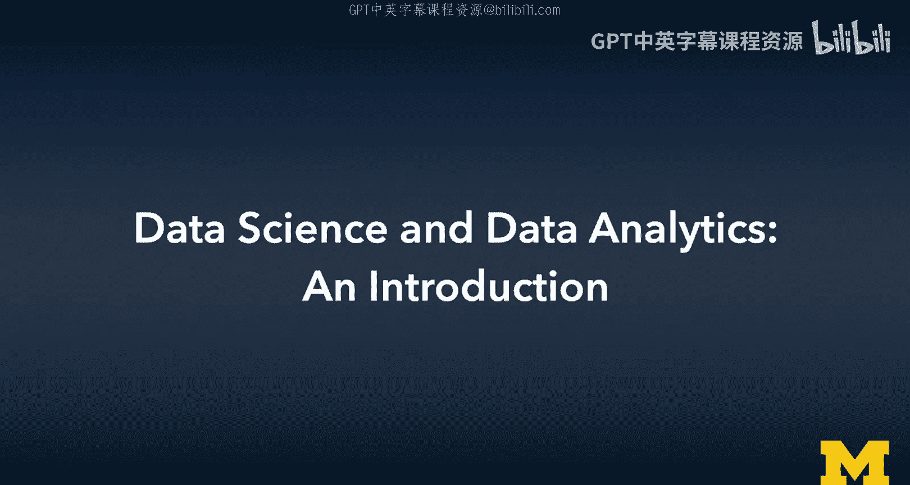
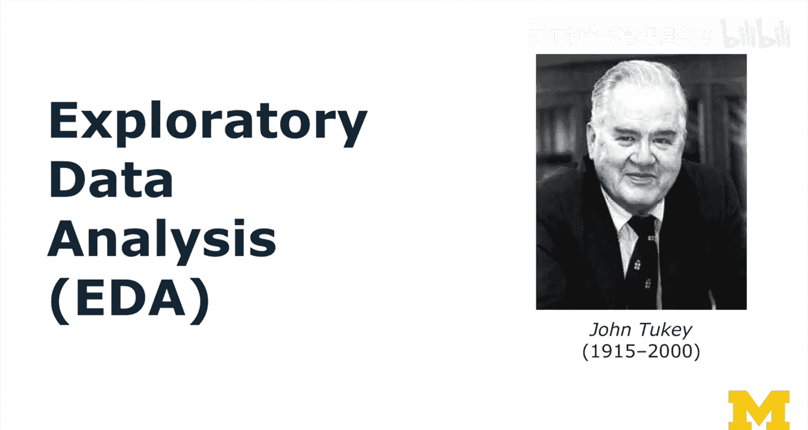
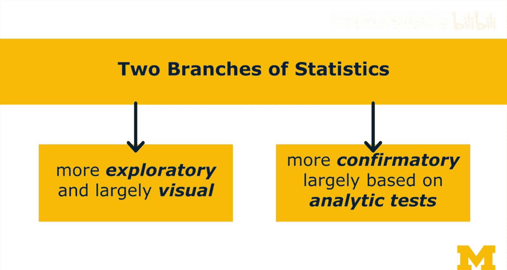
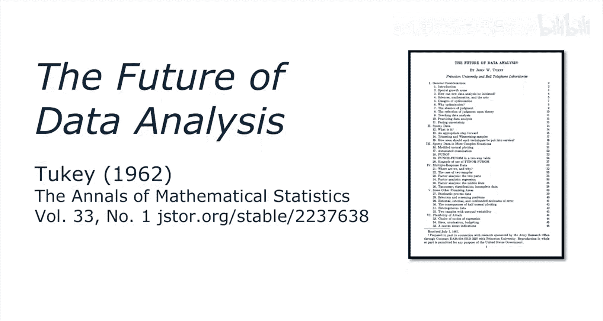
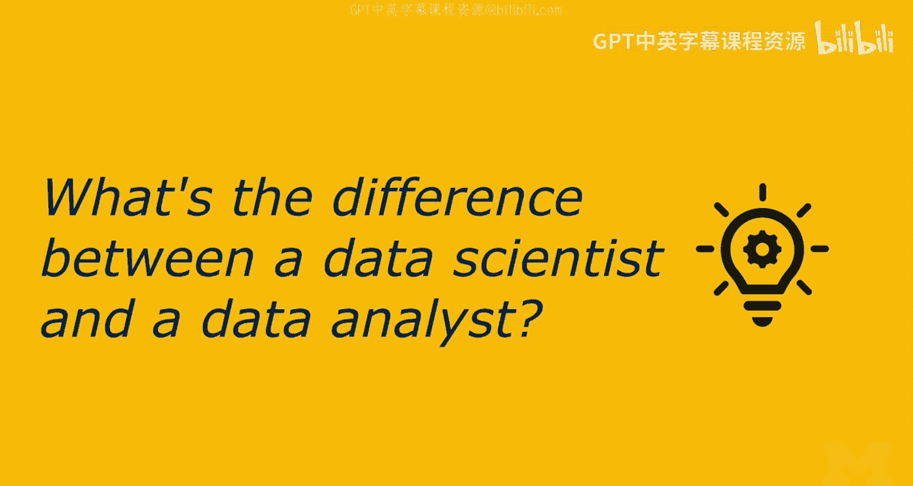
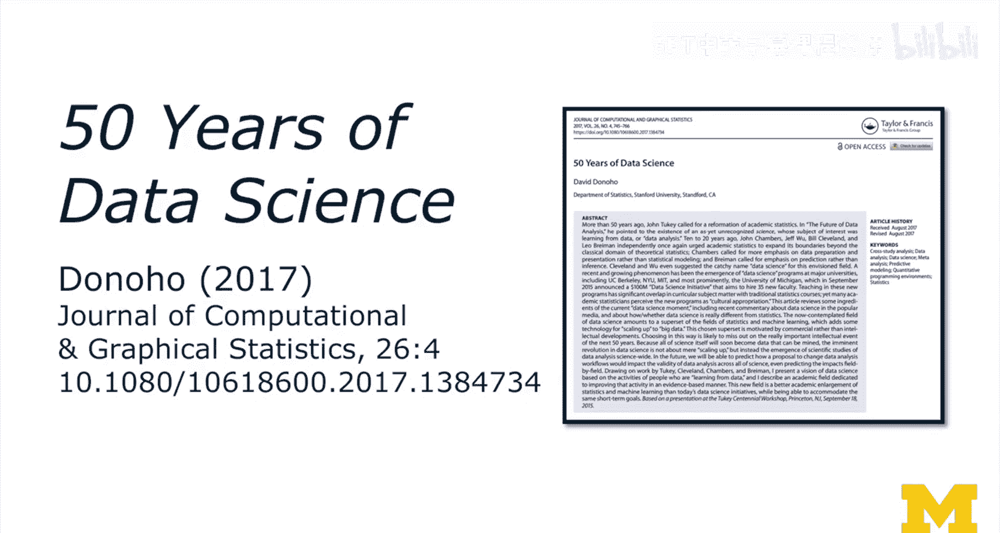
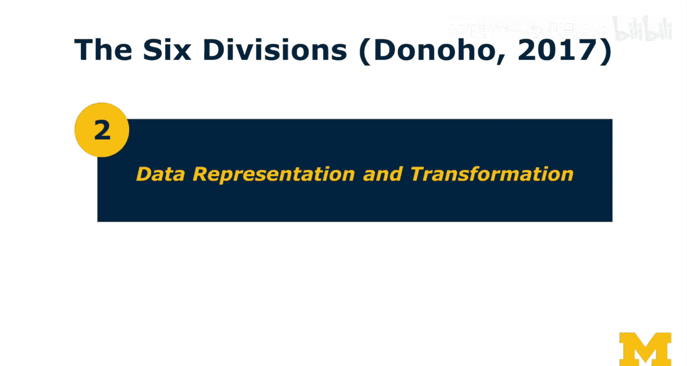
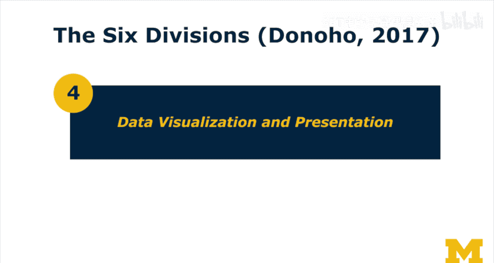
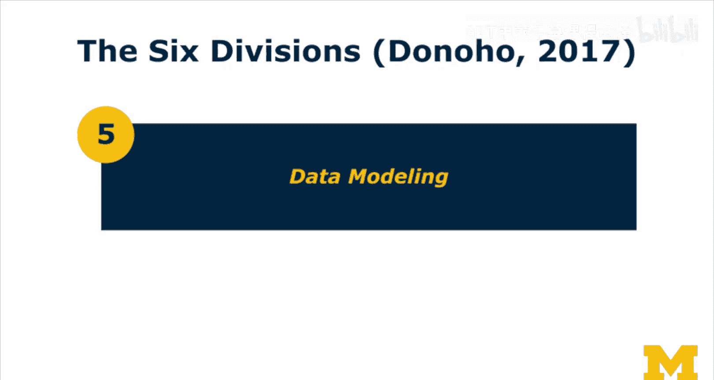
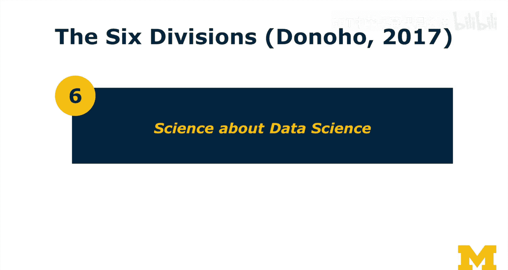

# 密歇根大学《公共部门的R数据分析（基础、数据探索、决策支持、）｜Data Analytics in the Public Sector with R》中英字幕 p03 2_数据科学与数据分析导论.zh_en -BV1YZ421J7Fx_p3-

In this course， we'll be taking an authentic look at how data science and data analytics can be applied within the fields of public administration and policy。

 There's going to be minimal formalisms of mathematical concepts。

 Instead we're going to mostly focus on how you actually implement investigations and interrogate public data through the R programming language。

 A lot of what we're going to be doing is called Exploratory data analysis or ED This term was the title of John Tuki's 1977 book on the topic。

 Tki was an influential statistician known for a statistical modeling and testing work。

 but he felt that the world of statistics had too much emphasis on hypothesis testing。

 and he coined this phrase Exploratory data analysis to encompass the set of techniques。

 the data analysts can use to better understand and gain insight into their data。 Through this work。

 Tki indicated that he really felt that statistics had two branches to it。

 one which was more exploratory and largely visual and the other which was more confirmatory which was largely based on a。

Now， Tki's work is actually really quite important to this course。

 and we're going to spend a fair amount of time looking at the different ways in which we can apply EDA in R。

 But Tki actually represented a shift in thinking about data。 In 1961。

 he published a paper on the future of data analysis。

Where in the very first sentence， he questions whether he is actually a statistician at all。

 and he instead orients us to practice data analysis。

 which he suggests involves procedures for analyzing data techniques for interpreting the results of such procedures。

 ways of planning the gathering of data to make its analysis easier。

 more precise or more accurate and all the machinery and results of mathematical statistics which apply to analyzing data。

 And this is what distinguishes this course from other courses that you might find that teach you to use R。

 Well there are plenty of courses which introduce you to statistics with R。

 we're going to do so in the context of public policy。

 and thus are real goals to help become an R powered data analyst。😊。

Now， I often to get the question。 what's the difference between a data scientist and a data analyst。

 And this is actually not so clear。 If we fast forward to 2015。

 we could see David Donoho's reflection back on the work of Tki in a presentation he gave at Princeton at the Tki Centennial workshop。

 which he later published as 50 years of data science In it。

 Donoho suggests that the field has continued to evolve along the lines。

 Tki held out and lists numerous other influential applied statisticians。

 including John Chambers and Bill Cleveland， who helped bring various other exploratory data analysis methods to bear  building on this Donoho suggests that data science is really made up of six different activities。

😊。

First， data gathering， preparation and exploration， whether it be cleaning data。

 aligning data to codebooks or exploring it visually。

 this single category may encompass up to 80% of what data scientists' time and activity is spent on。

 We're going to spend a lot of time in this category throughout the course series learning the tools and techniques that can make you effective at rapidly understanding your data。

The second category is data representation and transformation。

 and this includes both computational formats like databases。

 as well as mathematical representations。

In this course， we're going to spend time largely with a very specific and now nearly ubiquitous data representation format called the data frame。

 and we're going to do this all in R。 There are many other kinds of data representations used by data scientists。

 though graphs， trees and networks are one classes highly used。

 especially for modeling social relationships， while embeddings and vector spaces are another when used with modeling text data。

The majority of public administration and policy data is situated in relational or tabular data。

 though， like Cvs comma separated value files。 So we're going to focus on that in this series。

 The third category he called computing with data In this category。

 his very first statement was that we as data scientists should seek to become polygoths to learn multiple computer languages to transform and work with data。

 This course is going to focus only on one language in particular。

 but I'd highly recommend you consider learning other languages and tools if you can afford the time to do so as each has its own advantages and opportunities。

 The fourth category Donoho called data visualization and presentation。

 and it overlaps somewhat with the exploration category。

 but focuses more on the mechanisms of visualization and the conveying of information to the reader。

 We're going to touch on numerous topics here about how to make compelling and meaningful visualizations。

 Well we can't give a full discussion of the topic that would be a degree in its。

Right， we'll talk a bit about how you can use R to create dashboards。

 a really nice capability that lets you go from data to interactive visualizations relatively quickly。

 The next category， data modeling will be one place that we only touch on。

 Data modeling is a big topic and covers everything from basic linear regression to deep neural networks。

 big data approaches。 and well the breadth of the field called machine learning。😊。

An in depthth study of this area requires either jumping into traditional inferential statistics。

 content or machine learning algorithms and methods。 However。

 there's a growing number of opportunities to focus on the application of data modeling through applied machine learning。

 including here at the University of Michigan through our online master of applieded science degree。

 The final category Donoho calls the science about data science。 And he implores people like me。

 academics who use and trained data science to understand what is being practiced in the wild。

 How can we make people better at doing data science and turn our scholarly investigation on the practices that we teach others。

😊。

This is something we're not going to talk about in this course per se。

 but I hope you will feel the effects of my work in this area。

 My research at Michigan is focused on learning analytics。

 The use of data science methods to understand and optimize learning。

 teaching diverse data science courses。 both in the university and in MOs like this one is the perfect playground for me to understand and work on my scholarship。

 So please， if you see something being done in an interesting way。

 a method of teaching or perhaps a piece of data you think could improve your learning in a course like this。

 feel free to leave me comments and let me know。 Okay。

 that's a quick overview of the area of data analytics and data science。

 We're going to tackle this in a very applied manner with real world data sets。

 examples and questions all in R。 Let's dive in。😊。

