# 密歇根大学《公共部门的R数据分析（基础、数据探索、决策支持、）｜Data Analytics in the Public Sector with R》中英字幕 p04 3_公共行政与公共政策内涵解析.zh_en -BV1YZ421J7Fx_p4-

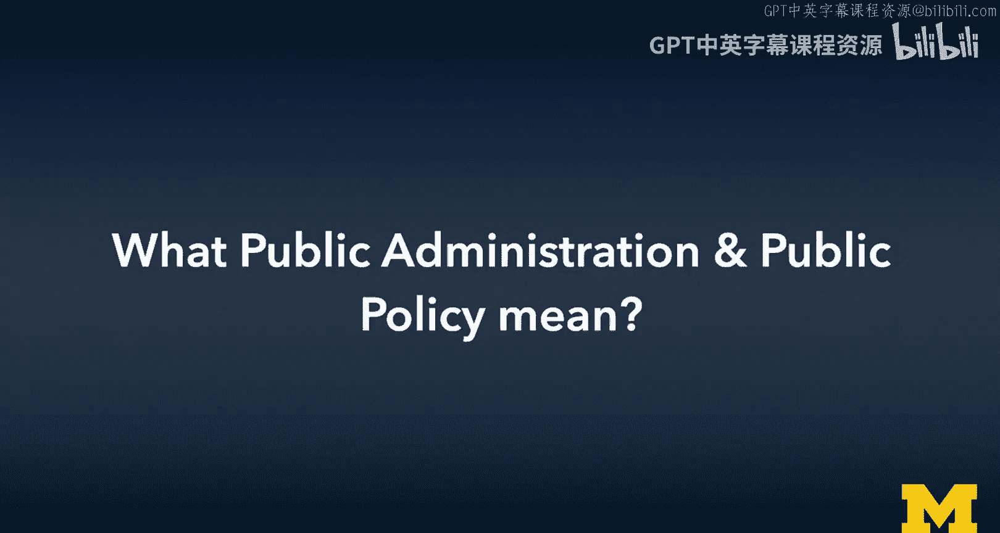

The next thing we want to define is public administration。Fundamentally。

 public administration is the business of running the government。

It's a professional field that's akin to business administration。

 but here it's applied to the administration of all the activities of the public sector it's a big concept in field。

 but we can summarize it as。

The work and means by which the purposes and goals of the government are implemented and achieved。

And the activities involved in carrying out the functions， policies。

 and programs of the government and the provision of public goods。

We tend to think of public administration as being primarily the executive branch of government。

 in general， the governments of most democracies， which is the most common form of government in the world right now。

 most democracies are organized into three branches， the legislative branch。

 where laws and priorities are made。

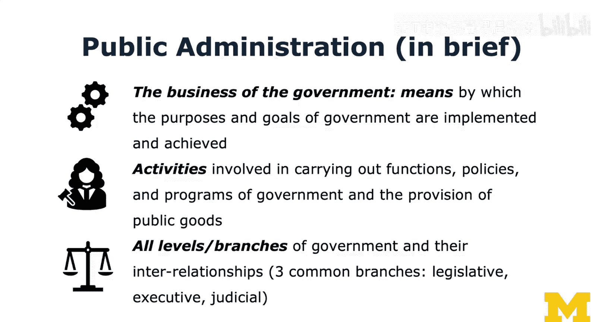

Second， the executive or administrative branch， where laws and priorities are implemented and executed。

And third， the judicial branch or the court system in which laws are enforced and interpreted。Well。

 public administration is indeed the core of the executive branch or administrative branch of government。

The work of the other two branches， the legislative and judicial， also require administration。

 so public administration is about the work of all levels and branches of government and their interrelationships。

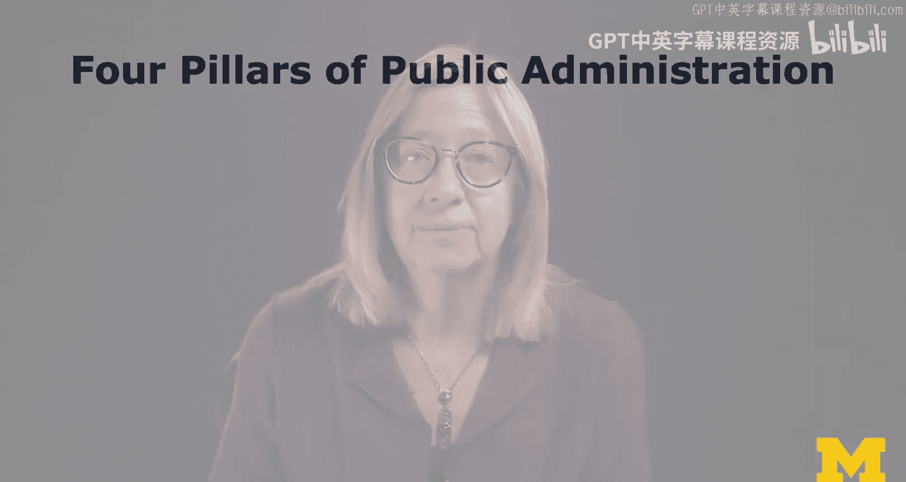

I would now like to introduce two frameworks related to public administration that we will be using throughout this entire learning experience。

 We'll be talking about them in greater depth as our time together goes on。 But right now。

 I would just like to introduce them to you。 The first framework is something called the four pillars of public administration。

 which you can think of as the mission or the primary goals of public administration。

 The first pillar is economy。Or how best to use and distribute scare resources while almost everyone everywhere thinks taxes are too high and the government takes in too much money from people and businesses。

 it is also the case that most governments do not have enough money or other resources to do all the things that they need and want to do。

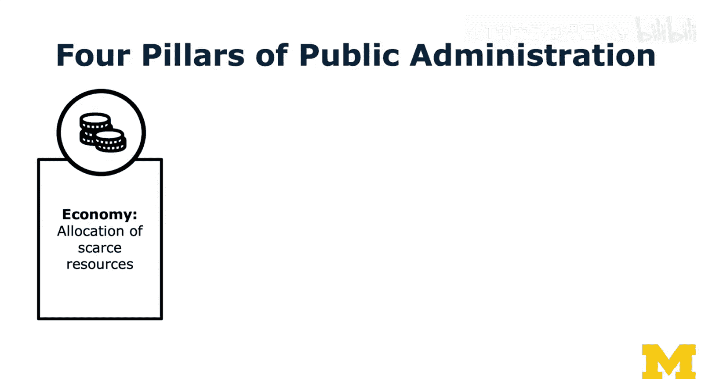

So part of public administration is figuring out what resources can be garnered and then how to best allocate them the second pillar of public administration is efficiency。

This relates back to the economy pillar and means that public administrators must figure out what actions will specifically achieve the most benefit for certain investment of resources。

 The goal is to be as efficient as possible with resources。

 or to achieve the most for the least amount， The third pillar a public administration is effectiveness。

 The allocation investment of resources must also be effective。 It must have an impact。

 It must help to reach a goal， lessen or mitigate a problem or provide some kind of measurable benefit。

 and the fourth pillar is equity。

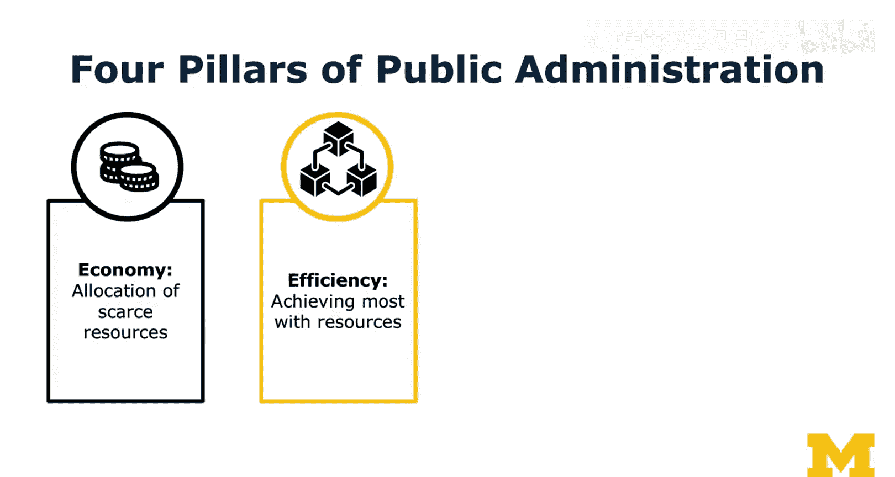

Most governments， by design， in their constitution or laws， have a strong focus on social equity。

Which means that there must be fairness in the public provision of opportunities。

Resources and benefits to different groups of people or communities。

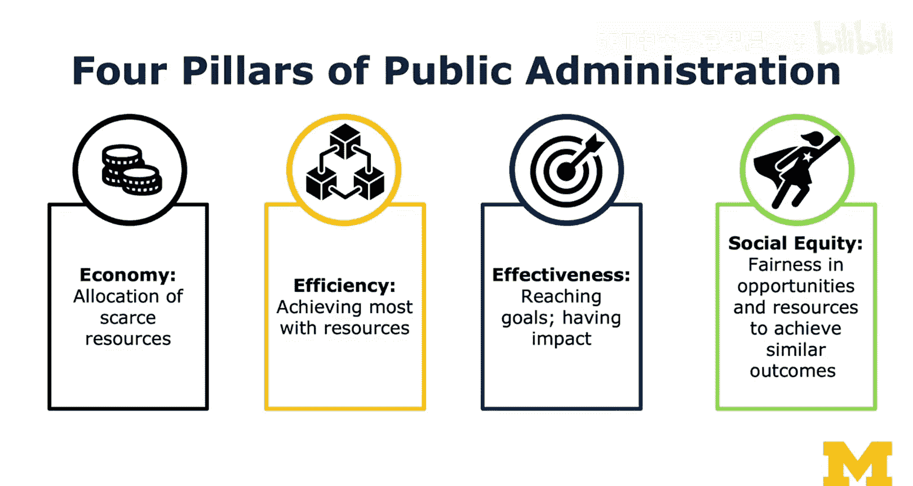

Please note that equity does not mean equality or sameness in the resources， opportunities。

 and outcomes。Equity means providing fairness and opportunities and resources。

This often involves providing varying levels of additional assistance and support。

Depending upon specific needs， abilities， and biases and discrimination that might exist in society。

 all four of these pillars of public administration are dependent upon data。

Data collection and analytics are fundamental to achieving the four pillars the second conceptual model of public administration that I want to introduce today is one that focuses on what public administration does or what is called the core functions of public administration。

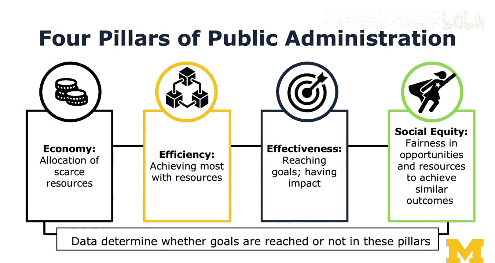

We will be talking about all of these in much more detail as we move along。

 but for today here's just a quick peek at the model of the seven main core functions of public administration。

Planning， organizing， staffing， directing， budgeting， reporting， and coordinating。

All are important and all rely heavily on information， metrics and sophisticated data analytics Okay。

 we're almost finished with our definitions our fourth key concept to define is public policy。

 like public administration， public policy is its own field of study and professional practice。

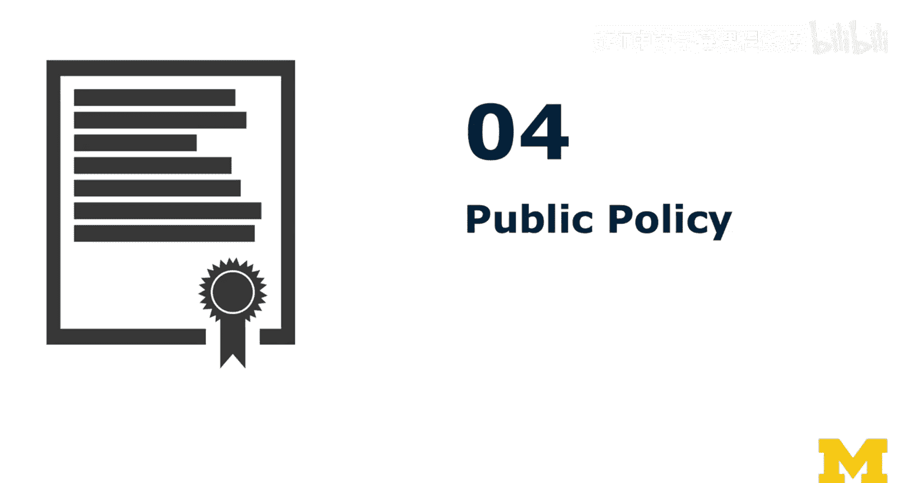

We will be getting more into the weeds of public policy in a later course for today I will provide you with a very simple explanation of public policy Public policy is the constitution's laws。

 regulations， court rulings， administrative rules， executive orders， guidelines。

 recommendations and other courses of action that a government might take and it also，😊。

Can include in its definition the funding priorities made by a governmental entity In summary。

 it's the rules and planned or defined courses of action made by governments at all levels。

 the local city or municipal government， a city， district parish division level of government。

 the state provincial regional level and also the national level。

 and in addition there actually are some international policies and international law。

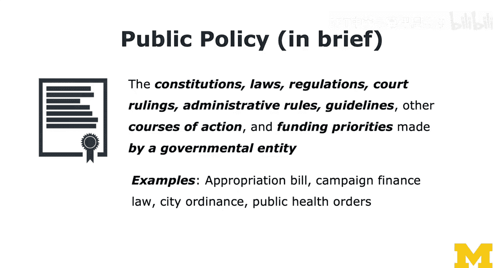

There are thousands of examples of public policy in every country。

 and again we'll be getting into this in more detail later， but for now。

 there are a few things I'd like you to keep in mind about public policy。

 a few generalizations we can make。

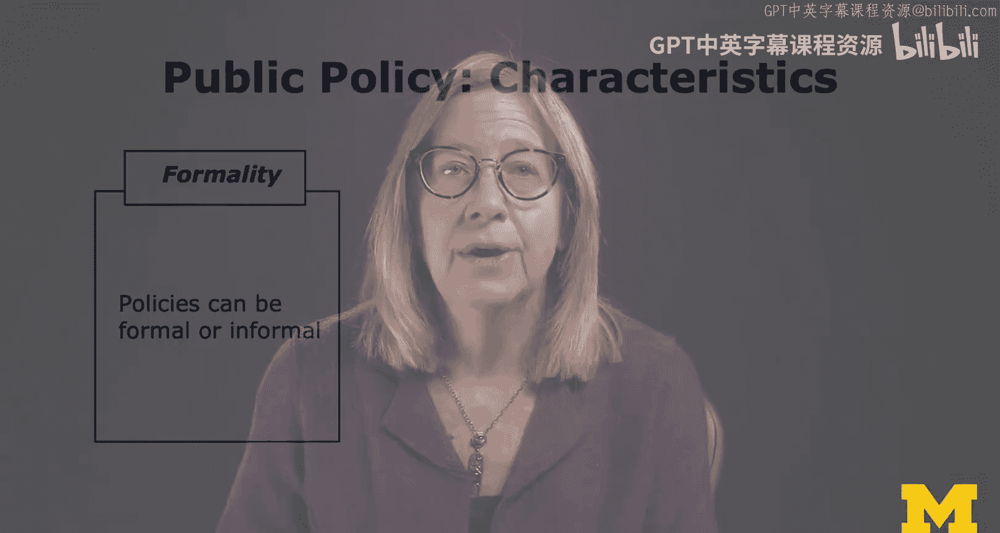

First， public policy can be and is very formal in many cases。

 It's formal because it includes things like laws， regulations， high court rulings。

 things where there's consequences if people don't follow them。

 but public policy can also be more informal。 It can be things like sets of guidelines from a government。

 such as recommended mask behavior in a pandemic。

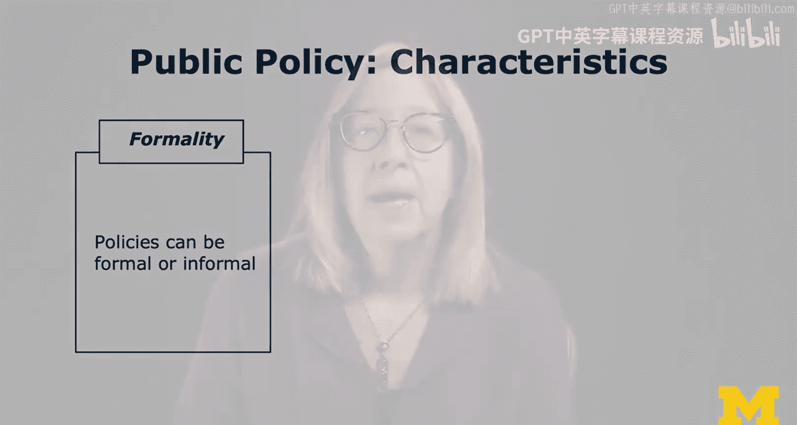

Things like educational or mass media campaigns， a social marketing campaign focusing on how to quit smoking。

 promoting infant breastfeeding， making warnings to the public about texting and driving。

 things like that where there's no consequences if you don't follow them are still considered public policy。

 their specific courses of action and information， provision that a government is taking a second generalization about public policy is that it occurs in all branches of government。

We tend to think of public policy as primarily something that legislators or lawmakers do。

 and that is definitely true。

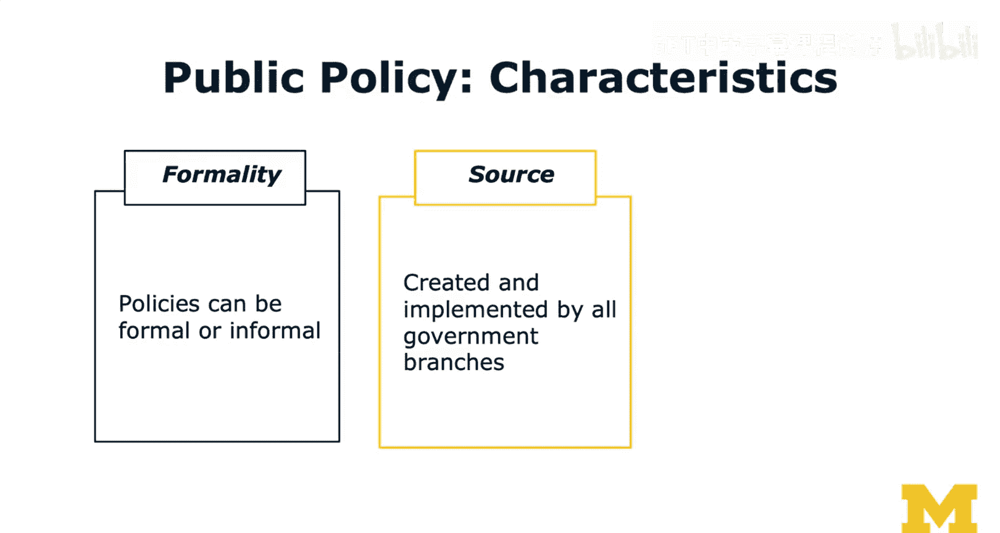

However， the other branches of government also create public policy。

 the judicial or court system creates policy through decisions that interpret the law and set new case law precedent。

And while the executive branch does not create laws， it does create administrative rules。

 regulations， executive orders， new programs， and many informal policies like guidelines。

 recommendations and information campaigns。So all branches。

 divisions and levels of government create public policy and a third characteristic of public policy is that it is very far reaching。

Public policy affects all three sectors of the economy。

 it affects government itself or the public sector。

It also affects the nonprofit sector and certainly the private sector public policy also has a huge impact on the general public。

 so public policy is very powerful and has an influence in every person， family， organization。

 institution， and business in the world。

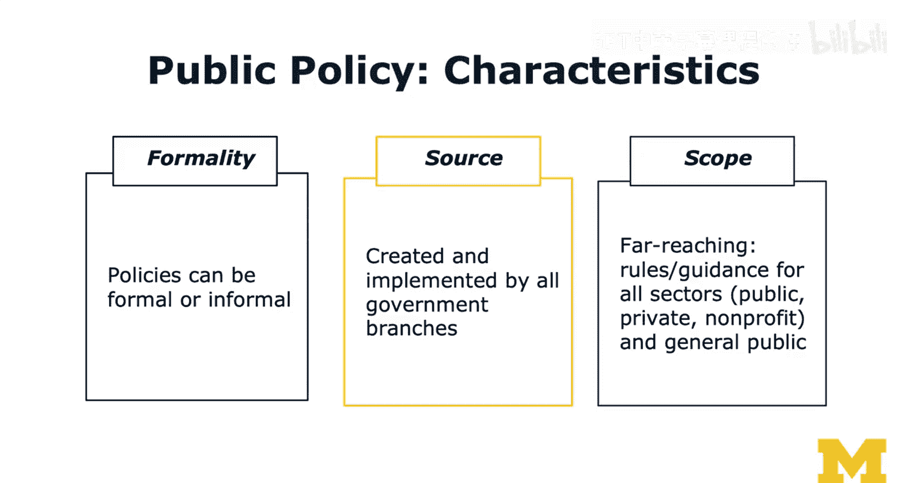

All right， let's review the four complex and overlapping terms we just defined。

The public sector is the part of the economy in which the government provides public goods and services。

Public administration is the means by which the government does its business。

 it has a set of overarching pillars or principles， and a set of seven key or core functions。

Public policy authorizes guides and puts limits on the public sector along with other sectors and individuals as well。

And finally， most important part， data are fundamentally important for the work of the public sector in providing the public good。

In the functions of public administration， and in the design， implementation。

 and evaluation of public policy， data analytics matter greatly for the pillars and functions of public administration。

 for public policy， design and evaluation。

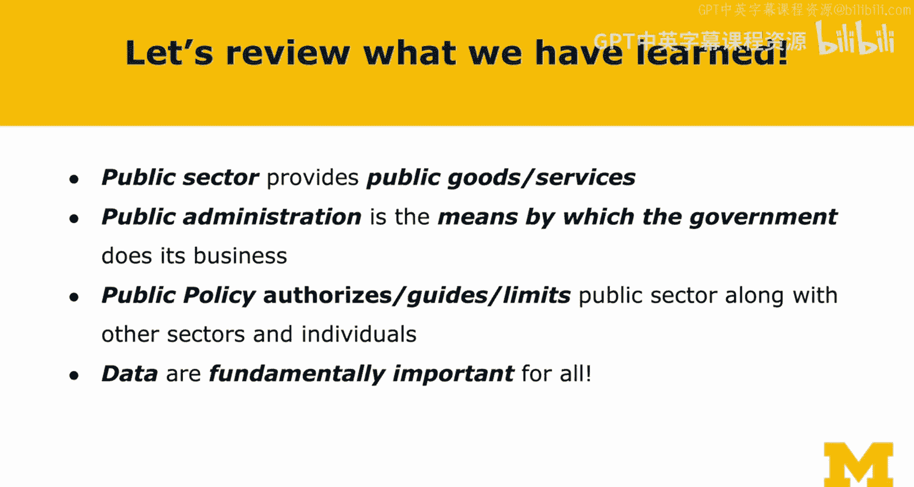

And for the public good。

