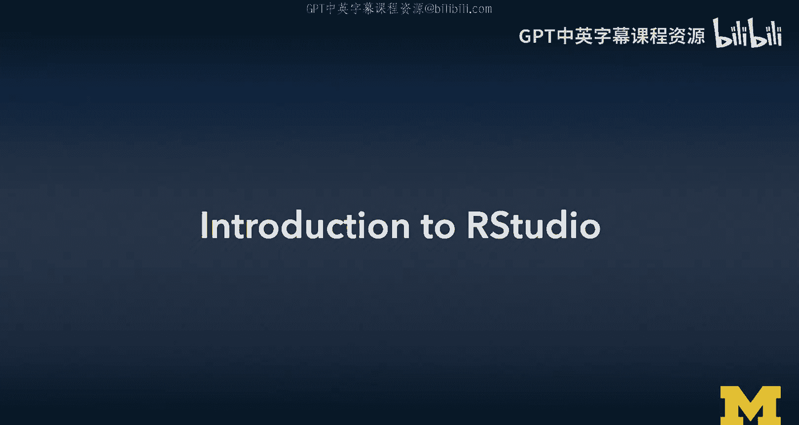
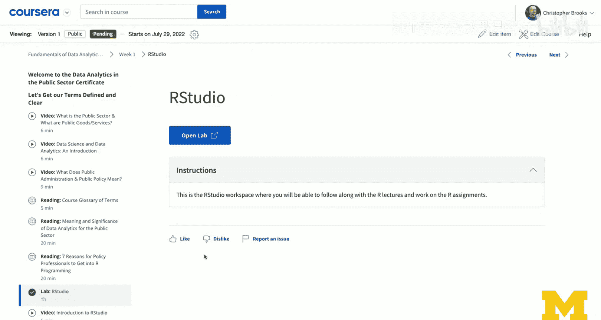
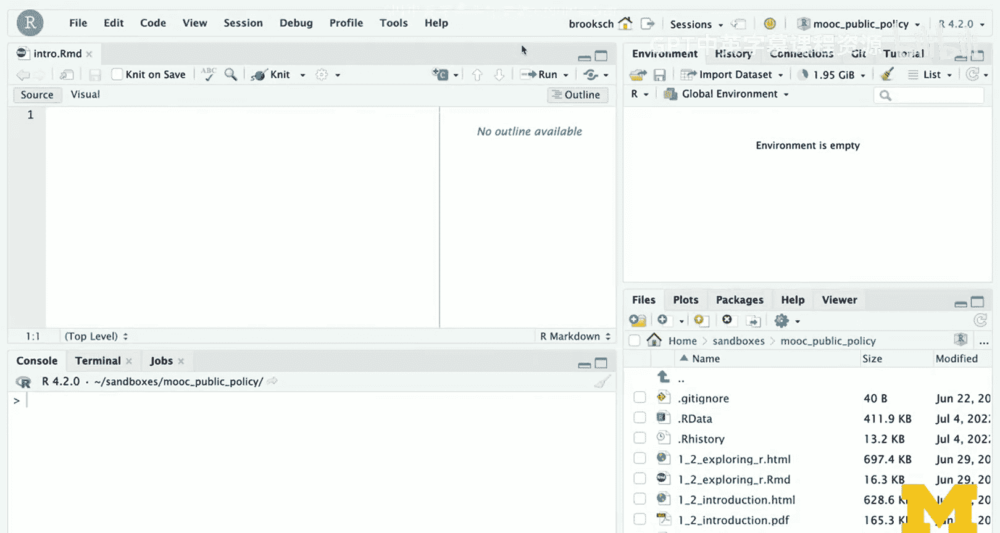
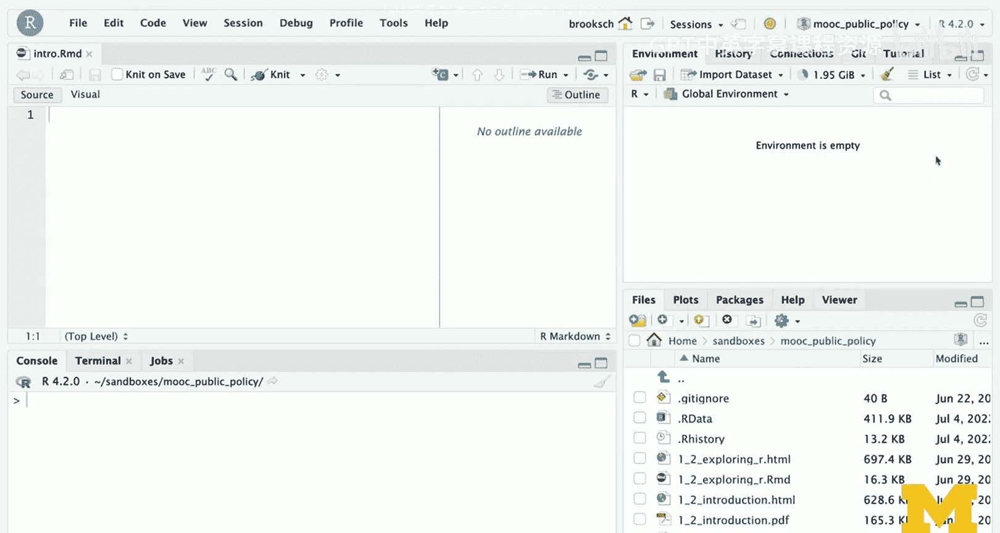
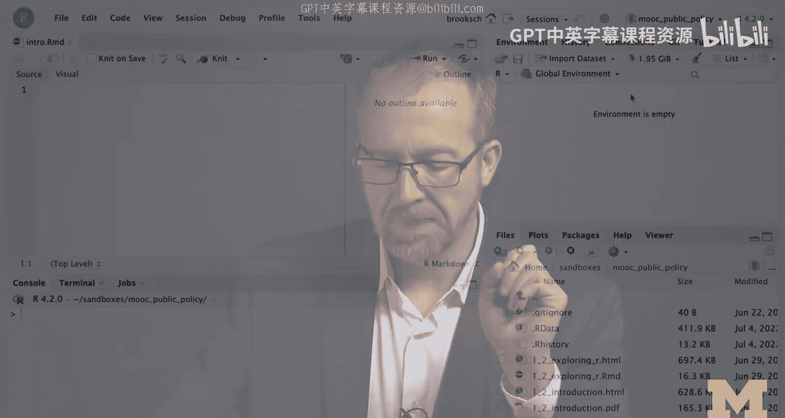
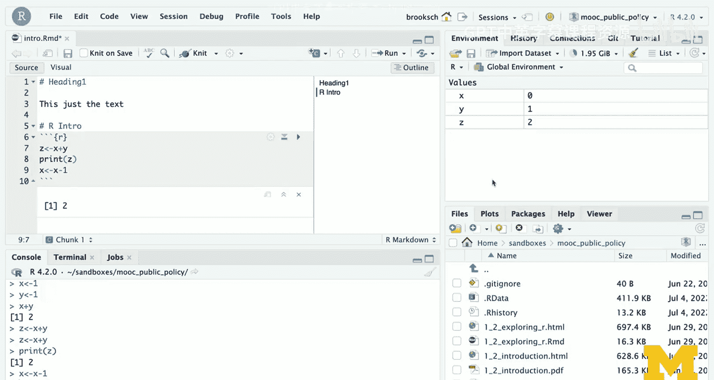
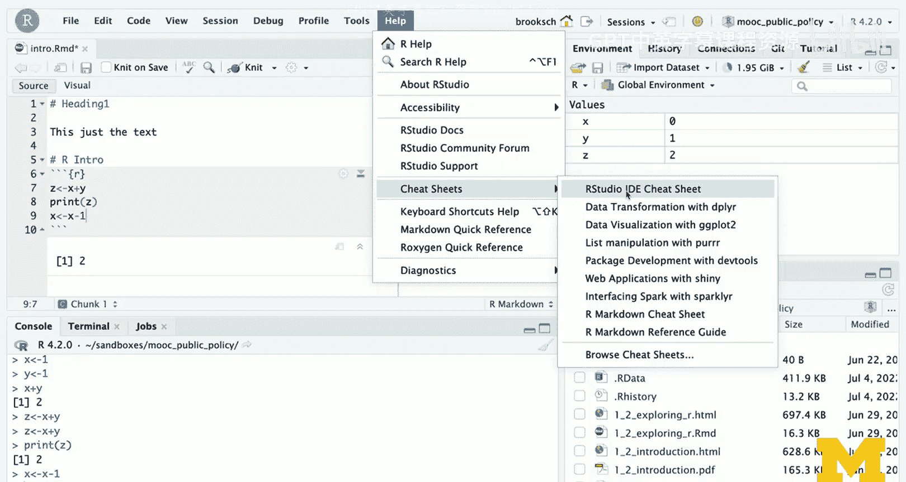
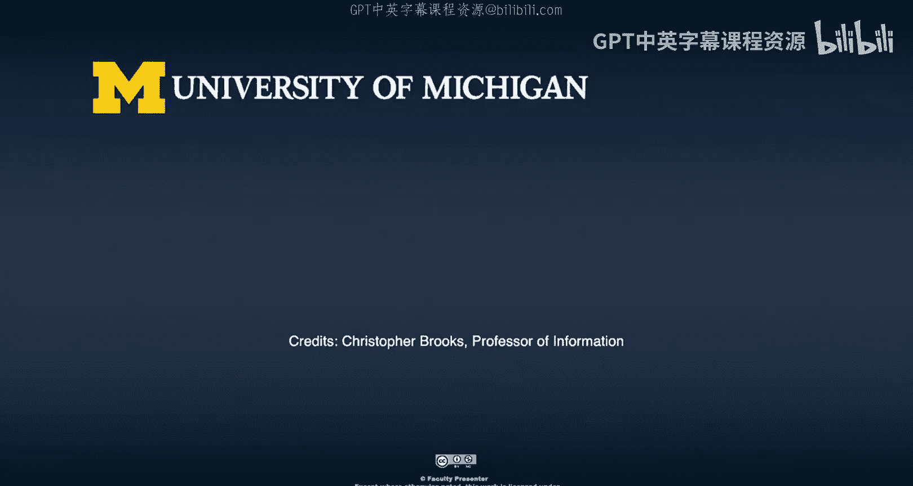

# 密歇根大学《公共部门的R数据分析（基础、数据探索、决策支持、）｜Data Analytics in the Public Sector with R》中英字幕 p05 4_RStudio开发环境入门.zh_en -BV1YZ421J7Fx_p5-

I want to show you how to launch our studio in the Coursera platform。

 We're going to use our studio for most of our technical work here and you can use it for free inside of the Coursera platform So this is what your system should look like you'll see that you've got weeks on the left and you've got a variety of different content here that we've put together for you including our videos as you go down you'll see something called our studio and it will say lab you should be able to click on this it'll bring up a new launcher screen and then you should be able to open that lab you can do all of the work for this course。

 including following along with my lectures as well as doing the assignments and exploring R in the online Coursera-based R studio we've installed this package in Coursera for you in the course and so you can just launch that and follow along You're welcome of course to go download our studio and download the lectures and follow along there as well if you want to on your own machine。

So here's our studio。 you can see that there's broadly there's four different panes that we're going to use in the upper left here is our source pane。

 Now that's actually the file we're working on right here and you can see that I'm going to be doing most of my work there and that's where most of my lecture material will show up in the bottom is the console Now this is actually really useful to use you're not going to see me use it a lot in this course in my lectures but I'll show you a little bit here and I think you'll get to use it quite a bit。

The upper right hand corner here is called the environment pane。

 There's actually a few other things that can happen in this paine， but for our case。

 we're going to use it to explore our data in the environment。

 And then the bottom right hand corner is the files and plots and packages pane。 Now。

 we're actually going to use this in a couple of different ways right now in the default is that we're going to see files。

 and you'll be able to see the Coursera file system that has all of the lectures for this course there。

But this is also where plots are going to show up when we start plotting where we could see a list of packages。

 for instance， that we might want to install， where we can get help on individual functions。

 or we can see other different aspects of our。This is a really handy pan。

 sometimes I'll just have it minimized because it won't be useful for a given lecture。

 but it's really helpful。We can actually take here and we can click on any of these RMD our markdown books and that'll actually load it up in the source pane。

 so you see I had one called Intro。 RMD and now I've loaded one here and this is actually one of the lectures that I was working on today。

And that's how you're going to be able to follow along with the lectures。

 And you can just execute the data in there。 I'll leave that lecture for later。 Now。

 down in the console， this is a place we can just experiment with R。 Every time we type in here。

 this is an R interpreter running。 So here I'm just asking R， what is one plus1。

 And when I hit enter， it's going to execute that。 And it's going to give me the answer 2。

 or I can say I want to assign X， This is how we do an assignment statement in R to1。

 And then I want to assign Y。To one。And then I want to find out what is x plus y。

 and so you could just experiment a little bit in the console in this interactive way back and forth。

You'll see in the upper right hand corner， the environment pane that we now actually have those variables and I'll introduce that in another lecture。

 but that's what this area is going to be really useful for is exploring that。

Most of the lectures I'll have， I'll actually minimize that console down。

 but let me bring it back up for one more demonstration。In the Coursera system。

 you can actually access the operating system terminal as well， and so this， if you're used to it。

 is a console access。Now， we're not going to use that at all in this class。

 But if you're interested in exploring other packages or understanding how the system works。

 you do things like a list all of the files on the system and so forth that can be done in here。

 But don't worry if that doesn't make sense or or seem like it's， it's a bit much。

 We're not going to be using this pan much at all。 up here in this intro note book。

 We're going to actually be writing in something called R mark down。

 And so most of this is just the text that we would write otherwise。

But there's a couple of little things that we can do to add headings。

 So this is going to be my first heading。 and you can see that an outline started to build over here on the right hand side。

So maybe I want to do another heading R intro， and you can see that showed up there and you can navigate by clicking on these headings。

We can actually see a visual representation as well of this notebook by clicking on visual。

 it renders it into HTML， which can be nice， although for some reason it didn't render my heading here correctly Let's jump back to the source。

When we want to actually build code chunks in here， are code chunks。

 we start them with three back ticks followed by an R， followed by three more back ticks。 Oh， here。

 this is even even I can learn some things here with that space needed after that to make the heading correct。

Inside of here， we could just make the regular R statements that we want to make since x and y already exist。

 for instance， I can say Z is assigned to x plus Y if I want to。

 that should be an assignment statement。To run one of these chunks， we actually have a few options。

 If I just want to run that line， you can hold down control and hit enter， and it'll run that line。

 and you'll see it run in the console。Let's say you've got some more things in this chunk。

 maybe you're going to print out Z。Maybe you're going to take x and assign it to x minus1。

If you want to run that whole chunk， you can press the play button here。Okay。

 so it printed out two and it changed our variables as we would expect up here。

Now， I'm going to introduce you to the whole R studio environment through interactive lectures。

 So don't feel like you have to learn everything right here。

 What I want you to know is that this environment is going to be the place where we do most of our learning and that you don't have to install anything in this course in order to learn R。

 You can just open this within the Coursera shell。 Maybe open the videos in another window and follow along an experiment。

😊，I want to show you one more thing in our studio that I think is really handy。

 although there's many more things inside of this development environment。 That is。

 if you go to the help menu， you'll see down here， there's an area called cheat sheets。

 These cheat sheets are actually produced by the people who have created the packages we're going to be using。

Our studio is written by those same people， and you can see information about each one of these。

 And these are just Pdf。 So if you click on this， it's just going to open a Pdf in your browser。 So。

 for instance， here's the R studio cheat sheet on the actual R studio IdeE。

 And it's going to walk you through some of the details about what all the buttons do what you're going to see when you type and so forth。

 Now， you don't need to use these cheat sheets。 But they're actually really well done。

 And I would encourage you to check them out。 And I'm going to put a few of those in the course for you to download as well。

 because they're a wonderful resource。😊。

