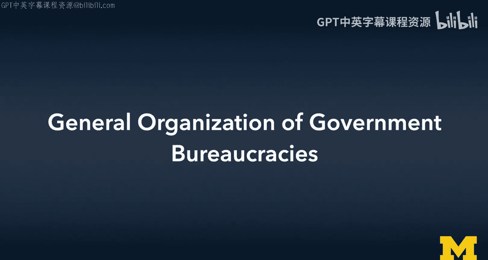
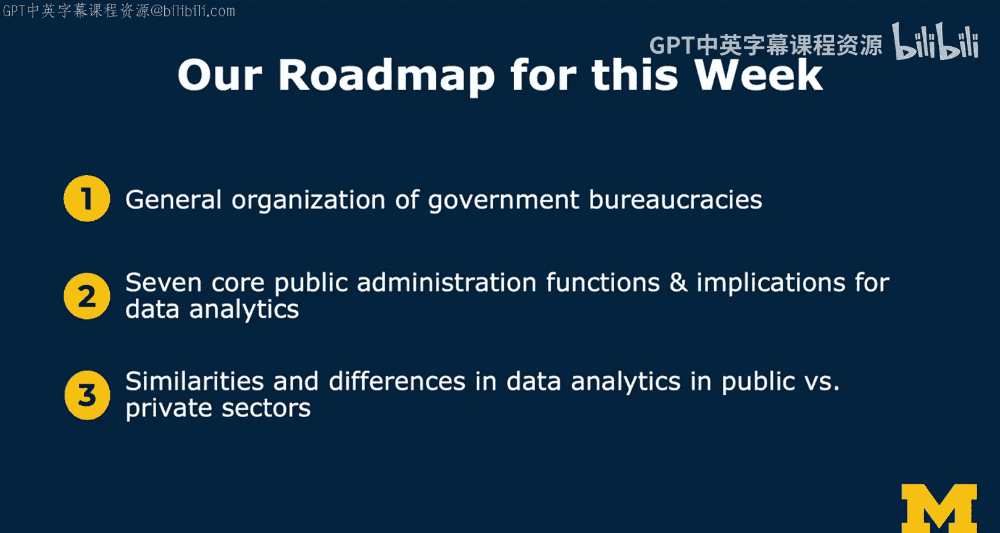
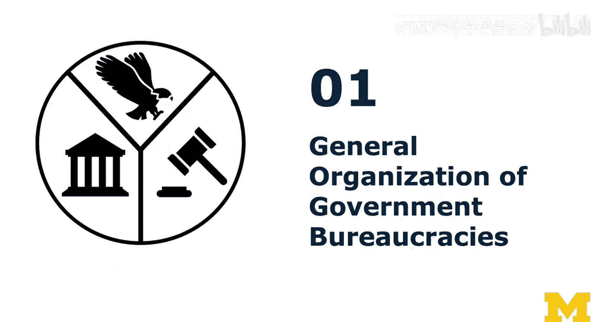
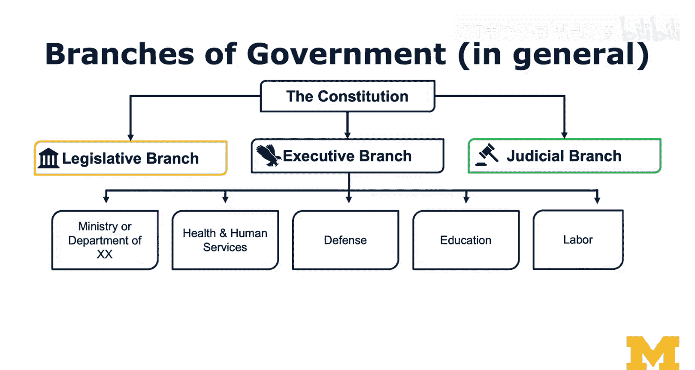

# 密歇根大学《公共部门的R数据分析（基础、数据探索、决策支持、）｜Data Analytics in the Public Sector with R》中英字幕 p06 5_政府官僚机构组织架构.zh_en -BV1YZ421J7Fx_p6-

Welcome back。In our time together this week， we're going to continue to set the stage for understanding the important role of data analytics in the public sector。

In the next series of videos we're first going to very briefly talk about how government is generally structured or organized。

 which is called the bureaucracy of government we are then going to talk more about the seven core functions of public administration and the role of data analytics in each of these functions。

And we will then consider the similarities and differences in data analytics in the public versus private sectors。

To start， here's a question for you to ponder。 How many governments do you think there are in the world。

This is actually something that's very hard to count。

But those who have tried to count recently say that there are first of all。

 195 countries or nations in the world。With an additional number of territories， commonwealths。

 or other related geopolitical units that are tied to countries， often through colonization。

In addition， every one of those almost 200 countries is divided into subnational units such as regions。

 provinces， department， states， or other units。The best estimate of the number of first order subnational governmental units worldwide ranges between。

3600。In 5，200 worldwide， again， this is hard to count。And then we have local governments。

 which are even harder to count in the United States alone， it's estimated that there are almost 36。

000 different local governments。Counies， parishes， cities， towns and townships。In Brazil。

 it's estimated that there are around 5，000 self governing municipalities。In Spain。

 where I have been spending some time lately， this country is divided into 17 autonomous communities and over 8000 municipalities。

So there are literally tens of thousands of local governments on the planet。

 and the good news is that they all have data that need to be collected， organized， managed。

 analyzed， and communicated。The topic of governments， how they run and organized， where power lies。

 the role of citizens， and many other political issues is very interesting and important。

 but it's also very complex and unfortunately outside of what we can cover in the course。Nonetheless。

 one thing we can say with confidence is that every government， no matter what type。

Has an organizational structure for its different branches and their parts。

And this structure functions as a bureaucracy。The definition of bureaucracy is a complex organization that has multiple subunits and many。

 many layers of systems and processes。When understanding the role of data analytics in the public sector and specifically related to public administration and public policy。

 it's important to first understand how your own government is structured and organized。

And the point here is not that you should be able to name every single ministry， agency。

 department office of the government and its subunits and all their connections that would drive anybody crazy。

The point is to get a general understanding of the organizational structure in order for you to understand all the different。

 yet important places where data are being collected， managed， analyzed， and hopefully used。

So let's start with the national governments。National governments in general are structured in ways that have different branches that in turn have multiple subunits。

For example， as we talked about before， in most democracies， there are three branches of government。

 the legislative。Branch， which is divided into different parts， which in turn are further divided。

 the judicial， which is divided into different levels of courts。And the executive branch。

 which does tend to be the most complicated。In general。

 the administrative or executive branch of government is divided into ministries， agencies。

 departments or other divisions， these things are called different things in different countries。

But the different divisions typically focus on an important topic of public concern。

Like health and human services， defense or national security， education， labor， commerce， energy。

 the environment， transportation， Treasury justice could go on these subunits also can focus on cross cutting issues across these different policy。

In public issue topics， this includes things like budgeting and finance and human resource management。

