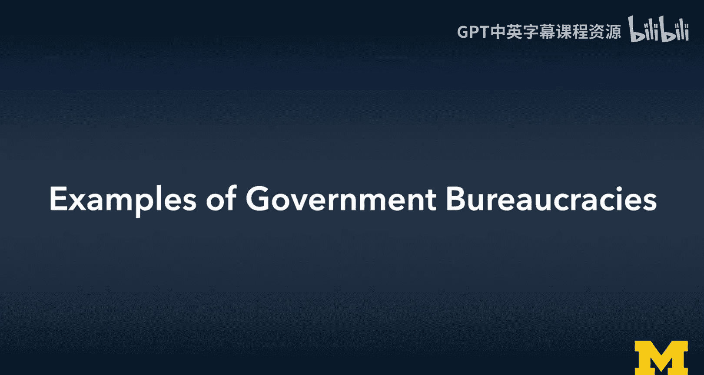
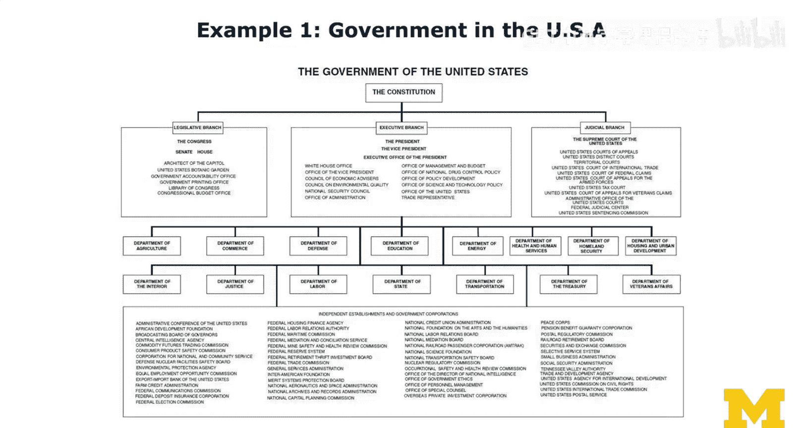
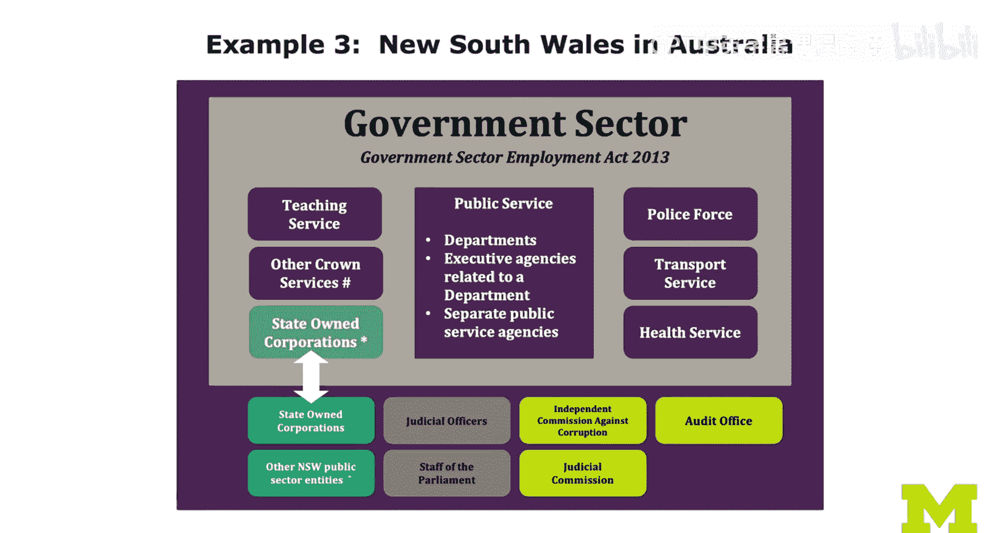
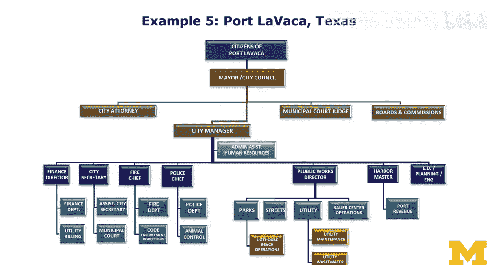
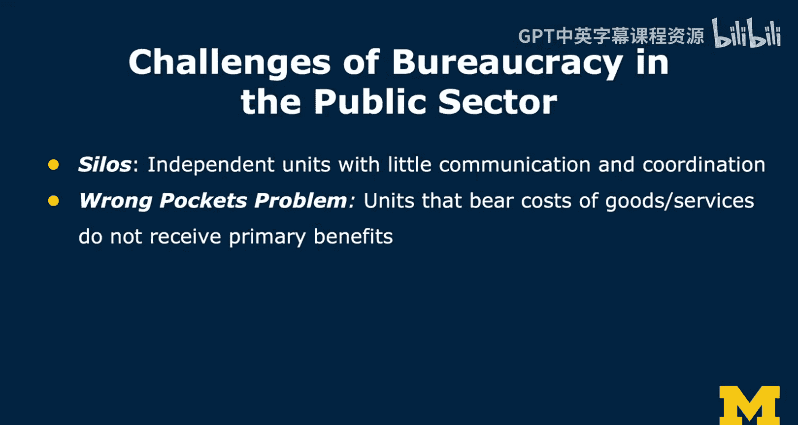
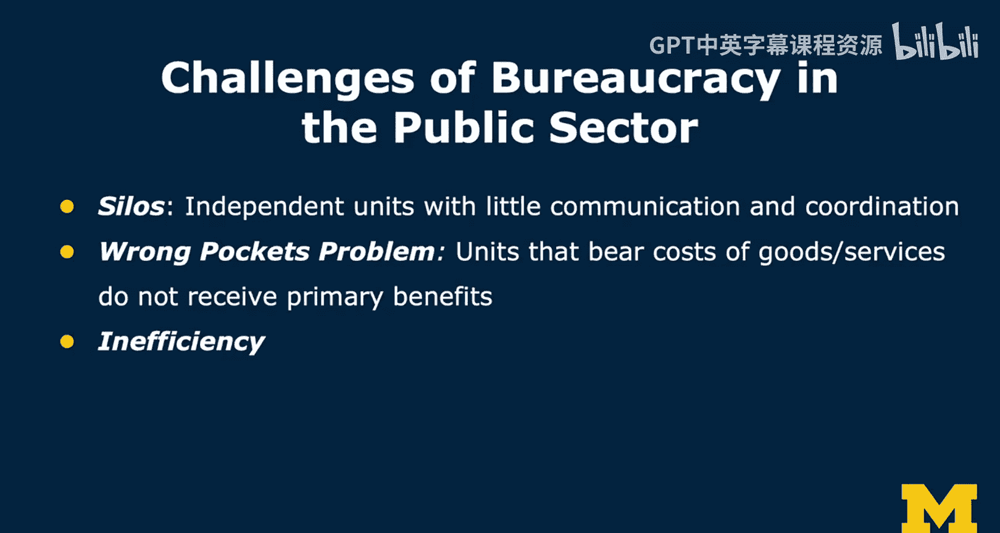
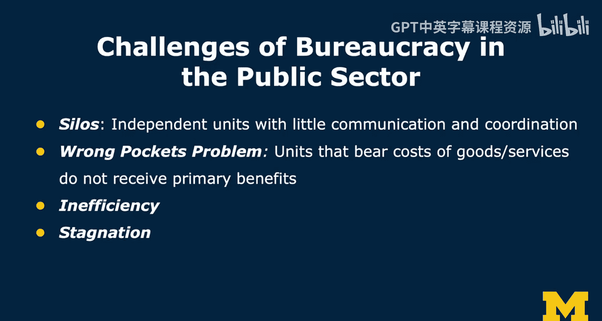

# 密歇根大学《公共部门的R数据分析（基础、数据探索、决策支持、）｜Data Analytics in the Public Sector with R》中英字幕 p07 6_典型政府机构实例分析.zh_en -BV1YZ421J7Fx_p7-

I have a few examples of governmental organizational charts to show you now。

The purpose here is not to get down into the details of these government bureaucracies and how they're organized。

 rather the purpose is to show you that the organization is actually so complex and layered in almost every case that it is virtually impossible to read and digest these organizational charts。

For example， let's start with the organizational chart for the US federal government system。

It's quite complicated， especially the executive branch。YouI know you can't read this。

's not it's not readable without a magnifying glass。

 but the point here is that if you did take the time to look at it and go through it。

You would get a snapshot or a general picture of how things are primarily structured， if you will。

 the saffoldton or the skeleton of how the US。 federal government is organized。

 and that is a good place to start when you're trying to understand government。

 how it's designed and organized， and where data lie in all of the different sub placess。

Now， each ministry or department or major agency of a national government also has its own organizational chart to help visualize its bureaucratic structure。

For example， here is the organizational chart for the Ministry of Health and Welfare in India。

It's still complicated and hard to read， but if you are working as a data analyst in this ministry。

 you would need to understand its organizational structure in order to understand the different types and roles of data throughout as a third example。

 here is the organizational chart for the government of the state of New South Wales in Australia。

It's a bit easier to read， but note that it's easier to read because it doesn't actually list all the different departments and agencies。

 another way to try to get a handle on how a government bureaucracy is organized and designed you can sometimes learn a lot from looking at it the structure of its website For example。

 the province of British Columbia and Canada lists all of its different ministries on its website and you can then click on each one to understand more about how each ministry itself is further organized and structured。

Finally， in the fifth example provided today， we have the organizational chart for the city of Port Lavaca。

 Texas in the United States， don't worry if you've not ever heard of the city before。

 it has a population of only about 12，000 people。The point here is that even small cities and municipalities have bureaucracies that are organized in different and complicated ways。

 which you can see in this organizational chart。And the bigger point is that wherever you are doing data analytic work in the public sector。

 from the highest levels of national government to the smallest cities and towns。

You need to know how the government is organized and structured。

What part of the bureaucracy you are in and how it connects to other parts？

There are some grand challenges to working in bureaucracies in the public sector。

 besides the obvious ones， which are， first of all。

 they are complex and hard to understand in a holistic way。

And this is made even more difficult by the fact that government bureaucracies are constantly getting reorganized。

 restructured， reshuffled， often when there's a change in leadership， parts of a bureaucracy get。

Rethought about and reorganized。For example， in the less than three years that I work for the Department of Health in the State of Wisconsin。

 it went through two major reorganizations that not only change the organizational chart but also reporting lines。

 where people sat in offices and at desks and also some programs and functions。

 some other challenges of working in large bureaucracies in the public sector are first。

 the big problem of silos， or the fact that governments are divided into lots of independent units with little communication and coordination between them。

A second problem is what's referred to in public administration as the wrong pockets problem this is when a governmental unit bears the costs of providing goods and services but does not necessarily receive the primary benefits of doing so。

Let me give you an example。The Department of H and a government is often charged with providing housing and some social welfare services to those who are homeless or have a high risk for homelessness。

But many of the benefits for providing shelter to people who are homeless。Go to emergency services。

 jails， schools， and healthcare provision。Other units or other silos are getting the primary benefits while the housing unit is bearing most of the cost。

Third， because of the silos， the lack of coordination and the wrong pockets problem。

 big bureaucracies are inefficient。

They just are and I don't think I need to say anymore。

 I think we all know and recognize this they don't always function in ways that get the most for the least amount of effort。

And fourth。Despite constant tweaks or small changes in the organizational structure。

 bureaucracies have a real resistance to。Meaningful reform and change， which leads to stagnation。

A lack of creativity and innovation in terms of getting important work done and in meeting the goals of the four pillars of public administration。

So in summary， it is important to understand that the work of data analytics in the public sector is always situated within a bureaucracy。

And that data analysts need to understand the bureaucratic structure。

And also some of the challenges of working within it。

