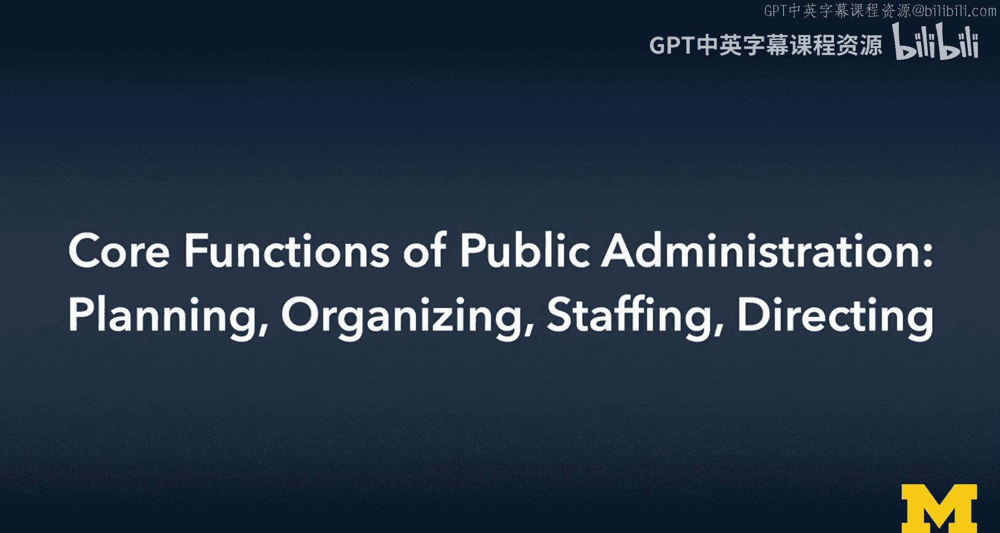
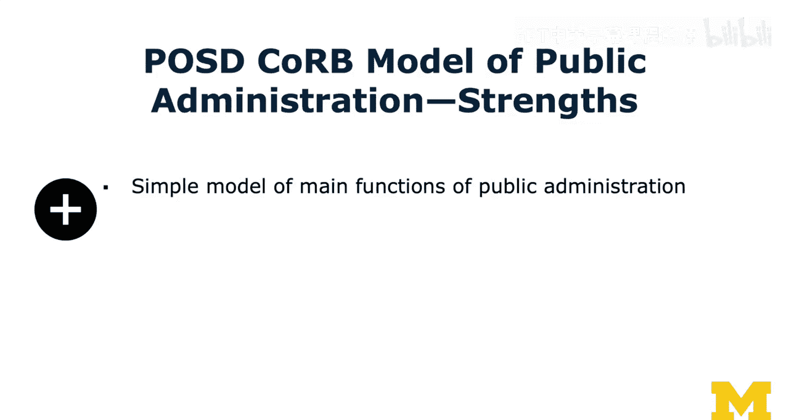
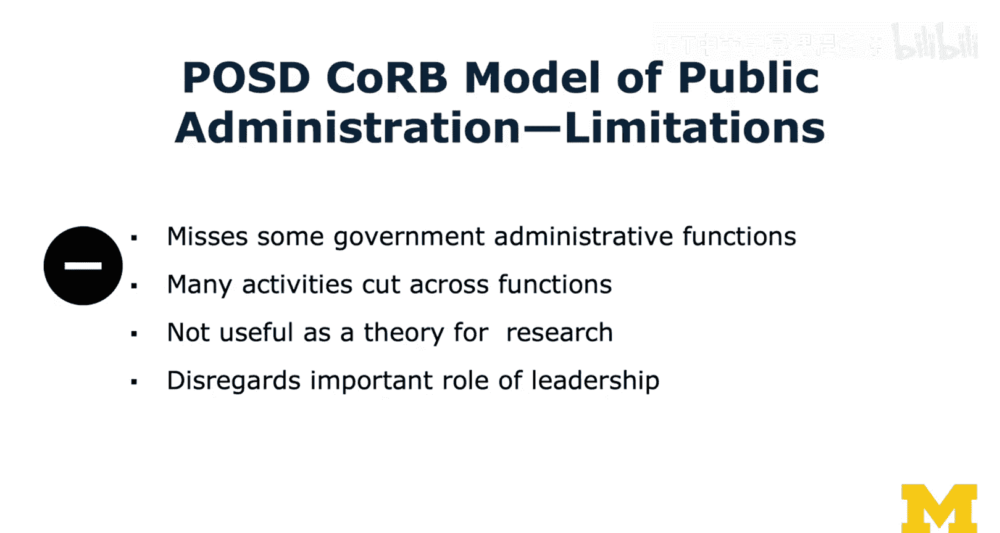
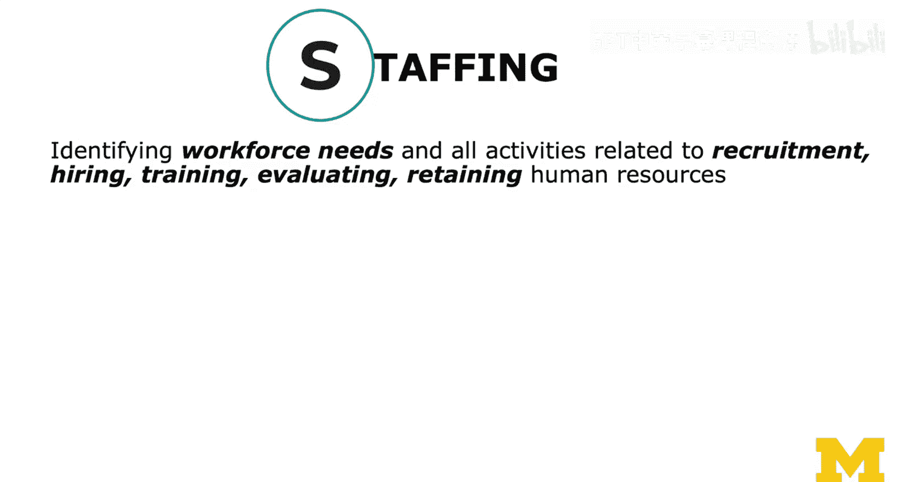
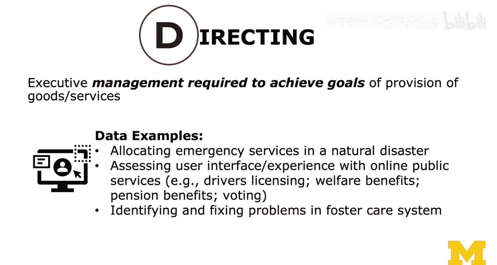

# 密歇根大学《公共部门的R数据分析（基础、数据探索、决策支持、）｜Data Analytics in the Public Sector with R》中英字幕 p08 7_公共行政核心职能：规划、组织、人事、指挥.zh_en -BV1YZ421J7Fx_p8-

Welcome back。In this session we're going to continue discussing the core functions of public administration and their implications for data analytics as introduced in a previous session。

 we are using a classic model for understanding public administration that focuses on seven core functions。

Planning， organizations， staffing， and directing。And budgeting， reporting。

 and coordinating functions some people refer to this model by its acronym， the post Corb model。

I personally don't think this is necessary and we're not asking you to memorize this model The important thing to know about this model and what are considered its strengths are first。

 it's a simple model that focuses on what are considered the core most important activities needed to run the government and the public sector and these are all activities and functions for which data analytics are extremely important。

 Second， the model applies across different countries in forms of government and to different levels of government。

 local regional national within countries。 Third， this model actually applies to business administration and the public sector as well the main functions for running the government are the same administrative functions needed to run a business or any other type of organization Now we can admit this model does have some limitations First it does miss some of the activities and functions of public administration they're actually more than seven things that。

Are needed to be accomplished。Second， it considers the function separately， while in reality。

 many of the functions are operating simultaneously。For example。

 budgeting and planning often go hand in hand Also reporting is an important element of directing and coordinating organizing and staffing often occur together as well。

 so focusing on the functions individually understates the complexity of the actual work of public administration some other limitations of the simple model are that it is not really useful for academic research in the field of public administration and that it doesn't emphasize the important role of different types of leadership for each functionNonetheless this is a useful model for our purposes which is providing a framework for understanding the important role of data and data analytics in the public sector understanding the core basic functions of public administration will allow you to start to see the many。

 many types of data and analyses that are needed to perform these basic functions both individually。

And in combination。So let's start walking through the functions in the model， first， planning。

Planning is defined as the organized and strategic way of deciding the future direction and goals of a governmental entity and the actions in resources needed。

Some examples of how data are fundamentally important to the planning function include。

Forecasting the revenue that will be coming in and the payments going out of a pension system。

 Another example is assessing or analyzing how projected demographic changes。

s as population aging will have on the need or demand for public services like medical care。

 public transportation， home based services， or even driver's license renewal the next function is organizing。

And this is the function of identifying the necessary financial resources or money。

 but also the human resources， the raw materials， and the organizational and physical infrastructure needed to provide public goods and services。

Some examples of the organizing function and the role of data include。

Figuring out what is needed to move paper information collection and storage systems to online systems。

 and this is something that many many governments across the world are working on right now。

Another example is identifying the needed resources and creating the details for implementing a new unemployment insurance program during an emergency like the COVID pandemic the staffing function focuses on human resources and involves identifying public sector workforce needs。

And all of the activities related to the recruitment， hiring training， evaluating。

 retaining and firing of people who work for the government。

 one third of the global workforce is in the public sector。

Again， one out of three people with a job on the planet are working for a government。

 so the staffing function is critically important and some examples of data analytics and the staffing function are。

Assessing the current workforce for demographic diversity， skill level， and retention issues。

Surveying public servants for the interests and needs they have related to professional and skill development。

Growing and learning on the job is important for everyone， regardless of what sector you're in。

Another example is comparing the wages for positions in the public sector with similar positions in the private sector and moving on the directing function。

This is about the oversight， management and leadership required to achieve the goals of the government in providing goods and services。

Some examples include。Acquiring and then allocating emergency services and resources in a natural disaster。

Assessing user interfaces and experiences with online public service systems such as drivers's license renewal。

Welfare benefits， pension benefits， voter registration。

Third example is identifying and fixing problems in the foster care system。

