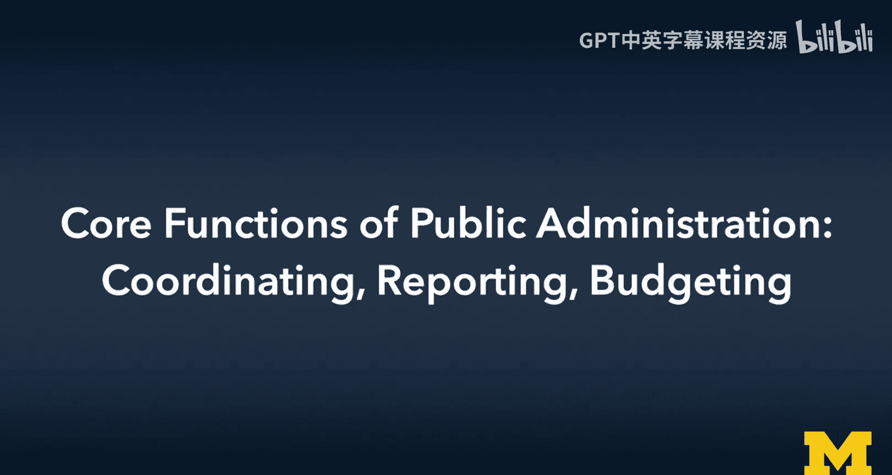
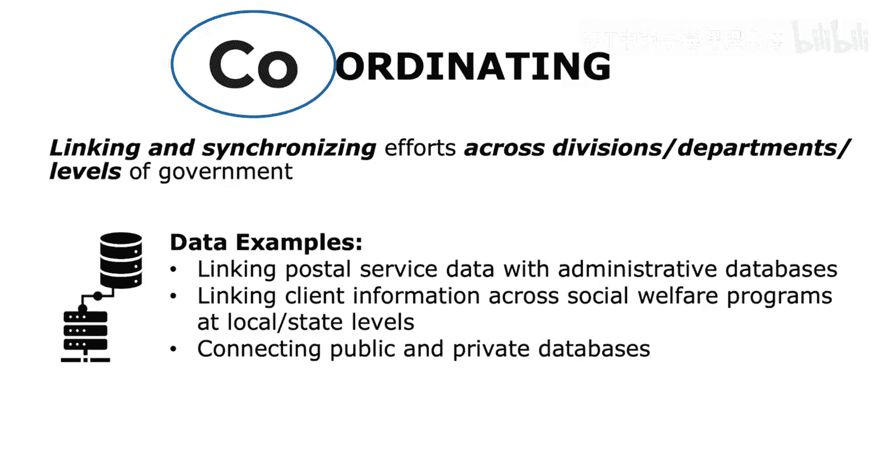
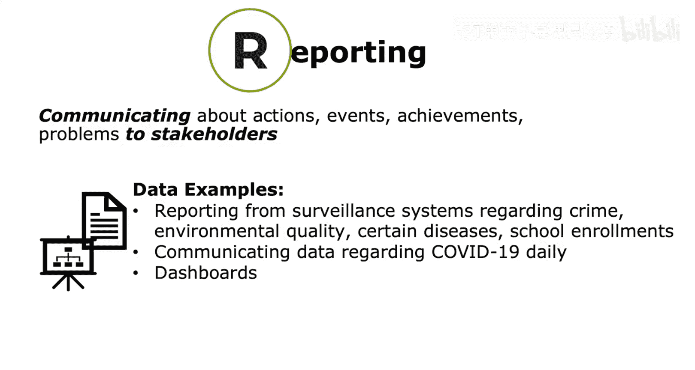
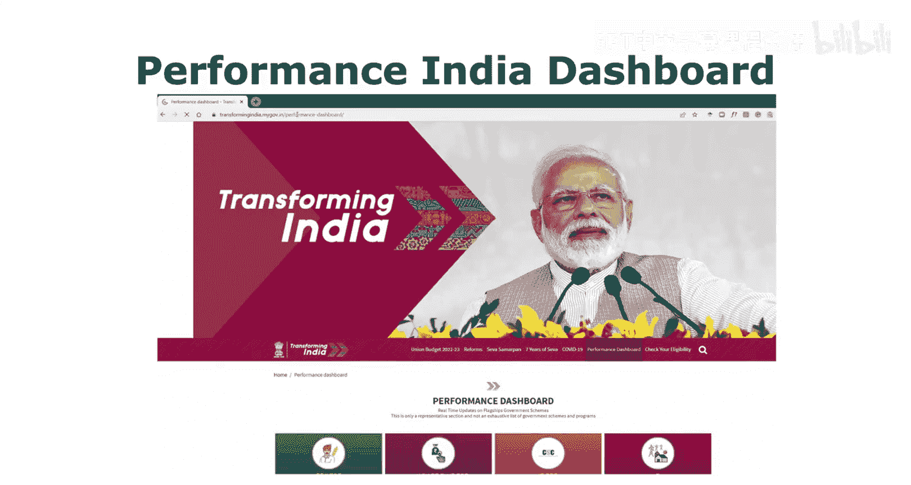
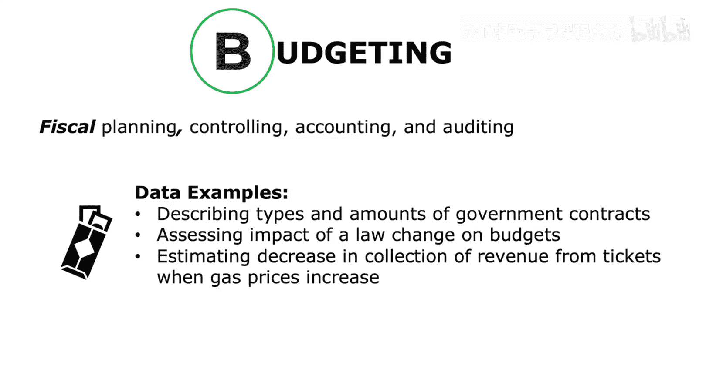
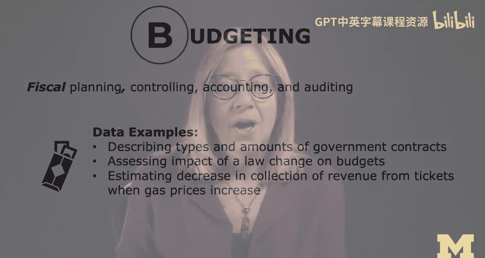

# 密歇根大学《公共部门的R数据分析（基础、数据探索、决策支持、）｜Data Analytics in the Public Sector with R》中英字幕 p09 8_公共行政核心职能：协调、报告、预算编制.zh_en -BV1YZ421J7Fx_p9-

Continuing with our discussion of the core functions of public administration and the important role of data analytics in each one。

 let's now turn to the coordinating function， this primarily involves the linking and synchronizing of efforts across those silos we talked about before across the divisions。

 departments， units and levels of government。

Some examples that involve data include linking Postal service data。

Wwhichch could include data about address changes with other governmental databases such as property tax data systems。

 welfare program systems， and public health insurance systems。

 another example is linking client information and their use of social welfare services across programs。

 which again are often in different silos， and provided at different levels of government。

And also there are many examples of where private sector and public sector data need to be merged。

 and we certainly will be talking about that more as this course goes on。

The reporting function。This is a critically important aspect of public administration the government needs to report data to legislatures and to the public for two main reasons。

 first it's often required by law or regulation。Second。

 reporting information or data to the public in clear and concise ways is extremely important above and beyond what is required by law。

In cultures that value government， transparency， honesty and open dialogue。

 transparency has been shown to be critically important to trust in the government。

 Some examples of the reporting function。 and there are many， but here's just a few。Ongoing monthly。

 quarterly， and or annual reporting of data from public surveillance or tracking systems and by surveillance。

 I mean when the government is keeping track of something over time。

This includes examples such as crime Statistic reports。Public school enrollment reports。

And maybe you didn't know this a large number of diseases are legally required to be reported to the government and then reported out to the public。

 another example is COVID-19 reporting most national and subnational governments have been reporting daily COD-19 statistics to the public since early days of the pandemic this includes daily counts of new cases。

Deaths and then vaccination rates， dashboards are one way in which governments report to the public what's going on。

Many governments have started using dashboards that summarize progress towards a number of different stated goals as a way。

 again of reporting to the public and being transparent about both progress。

And challenges， one example of a governmental dashboard used for reporting is the impressive performance India dashashboard。

This dashboard tracks in real time the country's progress towards 36 goals that are actually a subset of a larger number of goals related to India's huge strategic plan related to transforming the nation。

I urge you to take a look at this website and other governmental dashboards to see the wide variety of designs and uses。

 and also to think about how many different types of data and data analytics are the backbones of these reporting dashboards the last of the seven core functions we need to discuss is budgeting。

 which involves fiscal planning and approval of budgets， and then also the controlling， accounting。

 auditing and other financial activities associated with public revenue generation and expenditures。

This is also a huge function that is data driven as well。

Some examples of the budgeting function include using data to describe the types and amounts of contracts that a government holds with the private sector。

Assessing the impact of a new law change on a budget for a service program。

Can also include things like estimating the potential decrease in the collection of revenue from tickets when gas prices increase。

 this is a problem for governments。 All right， this was just an introduction to the core functions of public administration and the important role of data analytics and all of them as we continue on and you jump into actually working with in analyzing data we will be revisiting these core functions along the way。

