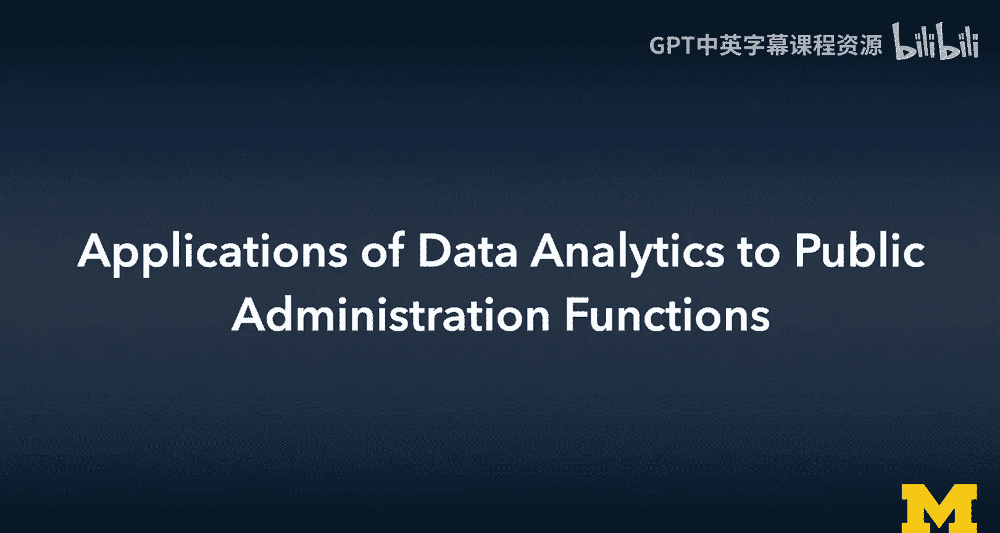
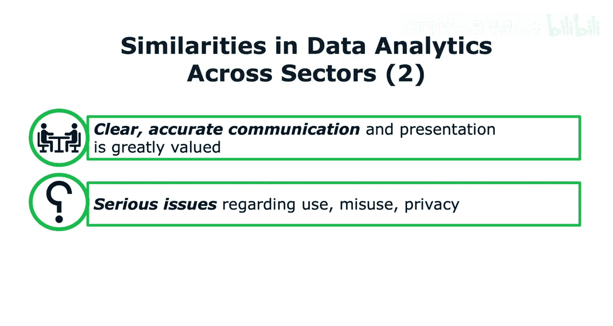
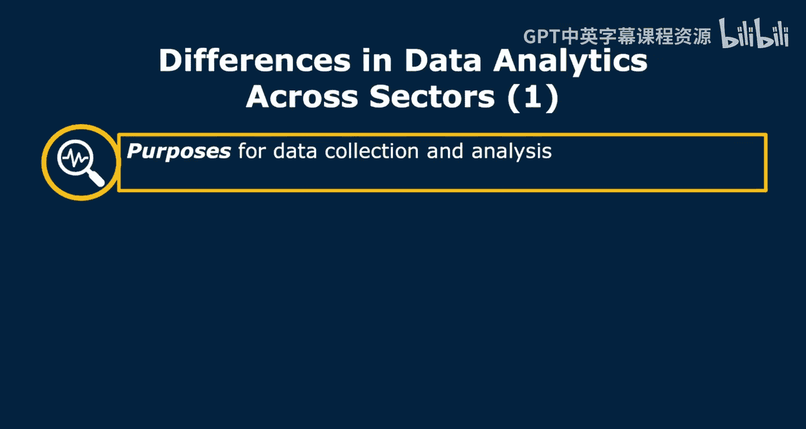
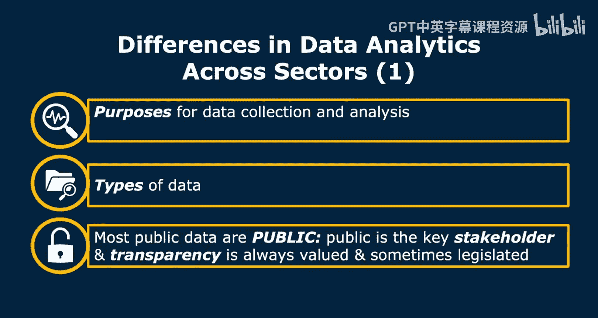
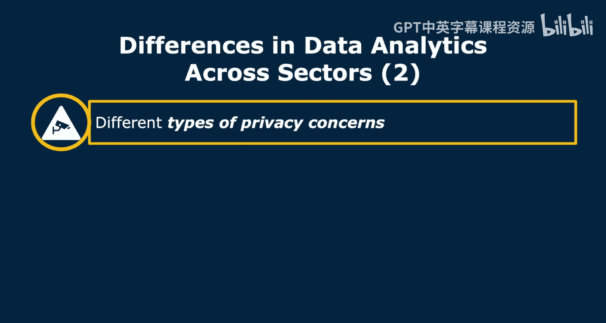
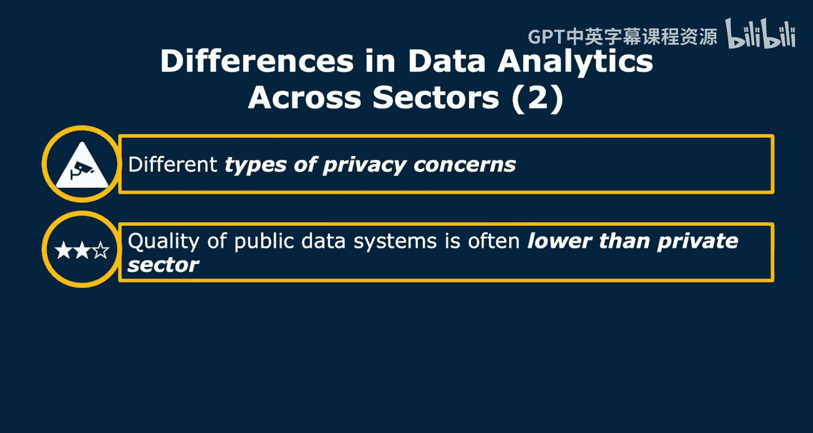
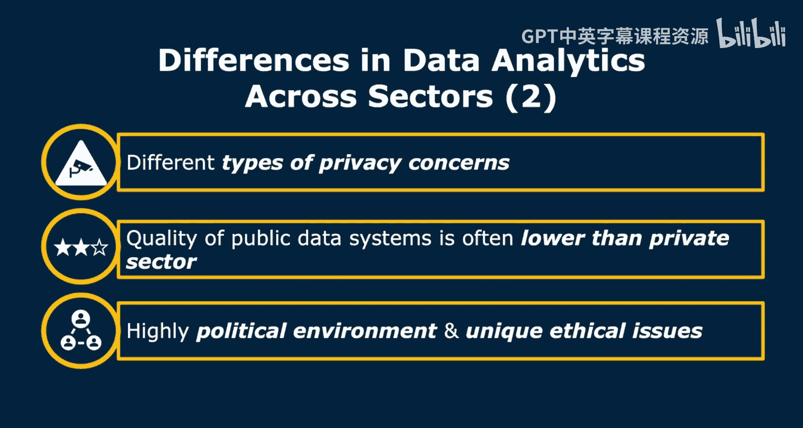
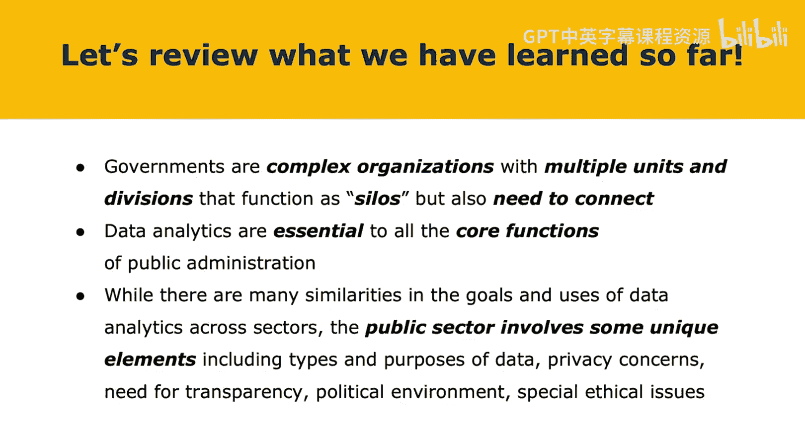

# 密歇根大学《公共部门的R数据分析（基础、数据探索、决策支持、）｜Data Analytics in the Public Sector with R》中英字幕 p10 9_数据分析在公共行政职能中的应用.zh_en -BV1YZ421J7Fx_p10-

In this session， we're going to take a look at both the similarities and differences for data analytics in the public nonprofit and private sectors。

First， there are many similarities in data analytics across these different sectors。

We all know that data are everywhere we are constantly sharing information and data about ourselves。

 with businesses， with service providers， with organizations， with the government on social media。

 and on and on。And all organizations across sectors collect， analyze。

 and use mountains of data in their work to ask and answer important questions。Second。

 data driven resource allocation and decision making is essential for evidence based or evidence informed organizational policy and practice in all of the sectors。

Third， the quality of data and their analytics matter。

 the stakes are high in all sectors for having good data that people can actually use to inform resource allocation and decision making。

Another similarity in the use of data and data analytics across sectors is that clear。

An accurate sharing， communication and presentation of data are valued across sectors。And finally。

 there are very complex and serious ethical issues regarding the use。

 misuse and privacy of data across the sectors， so there's a lot that is very similar in data analytics。

Even so， there are really important differences between data analytics。

 primarily between the public sector and other sectors， and primarily between public sector。

 meaning government and the private sector。While the analytic methods and techniques used are pretty much the same。

 there are really important differences and there are so many differences that we have actually launched this data analyticstic specialization for the public sector the first major differences are in the purposes for and the types of data that are commonly analyzed。

 public sector data analytics is focused on the various functions of public administration as we have discussed。

And analytics are also used in policy analysis， which we will discuss in course three。

Added to this is the wide range of goods and services provided by the public sector where outcomes matter a great deal。

 and these outcomes include the four pillars that we've been talking about of economy spending public revenue wisely without making a profit。

Efficiency， effectiveness and equity， So we have very different types of data and their purposes for analytics。

Another key difference is the public nature of data analytics and the public sector。

Most public data and democracies are public， not all， but most。

 as the general public provides a major portion of the public revenue and is a major stakeholder for what the government does。

While the data itself are not always made public， the results of public data analyses are almost always made public in some way。

In some countries， including the United States and many other places。

 data and results that are not routinely made public can also be obtained by citizens through freedom of information or other kinds of laws。

The public nature of government data and analysis is based on stated values of transparency and trust。

Of course， trust in government hinges on much more than data transparency。

 but from our perspective and our focus on data， we do need to understand that issues with data privacy and secrecy。

Versus transparency are very different between the public and private sectors。

And there are enormous issues regarding data privacy with the public sector。

Some data are fully public， while other data are absolutely not public and need to be protected with great rigor and care。

The government collects a great deal of personal information about people and businesses that needs to be protected from misuse from hacking and other privacy issues。

Now this can get complicated because in some data systems。

 some data elements are public while other elements within the system are private。

Let me give you an example in many places， the fact that someone died。In their date of birth。

And their date of death are public record， so anyone can request that information。

 however the cause of death is not part of a public record。

 and so that needs to be protected and kept private。Similarly， in many places。

 whether or not someone is registered to vote and if they voted is considered public information。

 but not who they voted for。

Another big difference between data analytics and the private versus the public sector is the quality of the data and thephistication of the data analyticslytic tools available。

 as we all know， high quality data collection， management and analyses involves resources and money。

In general， this is a very general statement， but in general。

 businesses in the private sector often have more money or decide to invest more of their resources into information systems and data management and analysis than governments do。

And while the quality and sophistication of public data management and analysis has definitely grown over the past 20 years or so。

 it is still a big problem in every government。And it's a huge problem。

 the lower you go in terms of government level， it's still a big problem with national governments and it becomes more and more of a problem when you get to regional。

 county， city， municipal governments。Think about those thousands and thousands of city。County。

 provincial， state and other subnational units of government in the world。

The ability for them to collect， organize， manage， retreat， analyze， communicate， and protect data。

In high quality and sophisticated ways is a very serious challenge in most of these governments。

And finally， but very importantly， data analytics in the public sector is inherently a political endeavor。

The most basic definition of politics is when humans get together to make decisions。Well。

 the public sector is all about a large number of humans getting together to make decisions that have a huge impact on all sectors and people and involve the allocation of scarce resources。

This， as you all know， involves a lot of disagreements because the role of values。

 political ideology， and culture also is a big part of this。

The stakes are very high when data show that a government is not doing its job with efficiency。

 effectiveness， or achieving equity。The stakes are also high when data show that there might be a misuse or misallocation of resources or even corruption。

The stakes are high when data reveal that the PE programs or projects of elected or appointed government officials are not working or not achieving their goals。

The results of data analytics in the public sector often produce results that make people angry and concerned。

 and this sometimes can result in pressure to change the results or to hide or suppress the results。

 and I have stories to share with you and I will。So in this course and throughout this program。

 we will be spending time along the way to talk about some of the unique。

 ethical and political challenges of data analytics in the public sector。

To summarize what we have discussed so far in regard to the context of data analytics in the public sector。

We have talked about how governments are complex organizations with multiple units and divisions that often function as silos。

 but also need to connect。We've talked about a set of core functions that are essential for the administration of the public sector and how data analytics are essential to each and every one of these core functions。

 and while there are many similarities in the goals and uses of data and analytics across sectors。

 the public sector involve some unique elements。This includes the types and purposes of data。

Privacy concerns the need for transparency and the political environment and special ethical issues that occur when you're doing data analytics in the public sector。

 You are now ready to jump into actual data analysis with Professor Brooks。

Enjoy getting into the real fun of data， keeping in mind the broad and unique context of the public sector that we've been discussing thus far。

