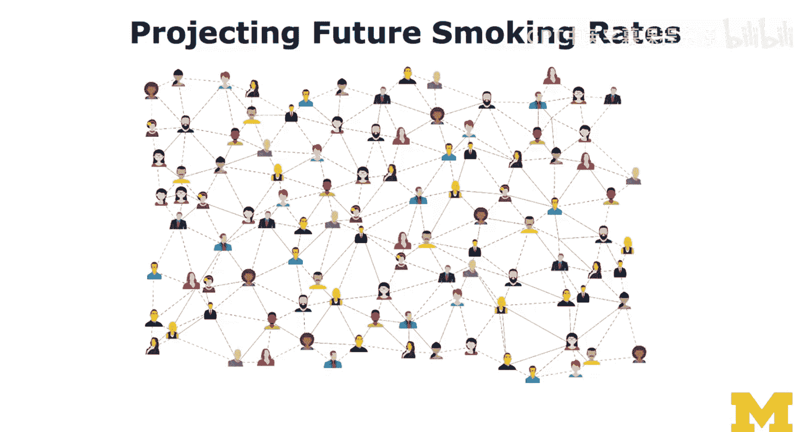
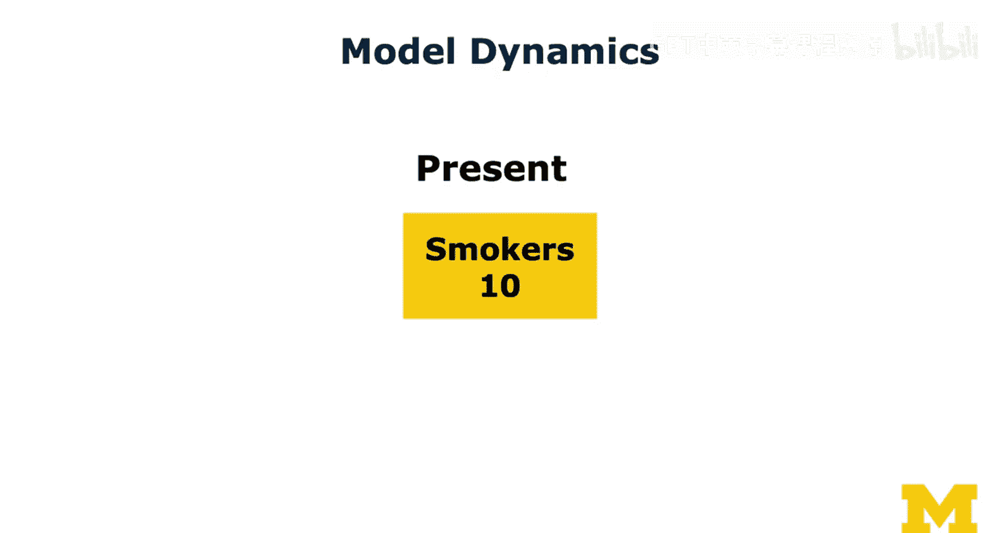
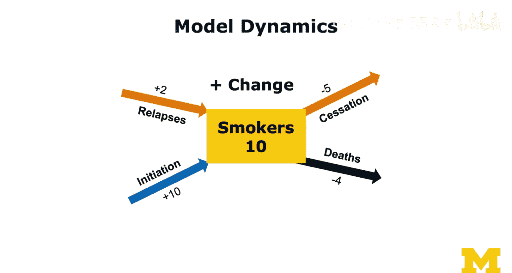
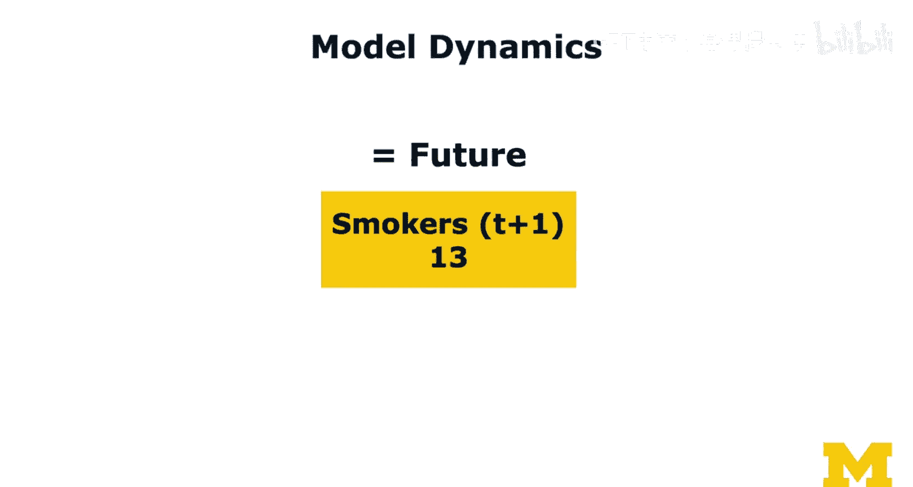
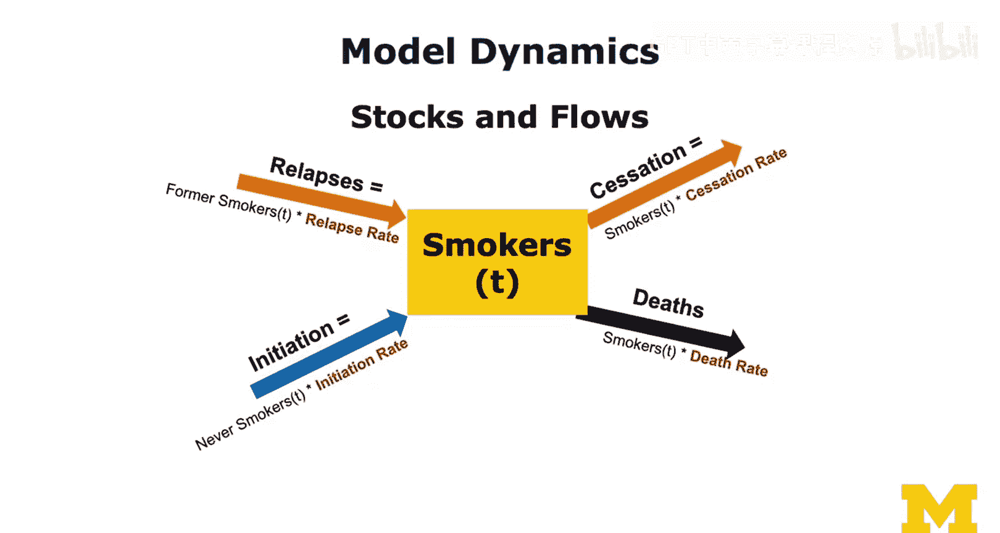

# 密歇根大学《公共部门的R数据分析（基础、数据探索、决策支持、）｜Data Analytics in the Public Sector with R》中英字幕 p100 21_政策微观仿真：区室模型解析.zh_en -BV1YZ421J7Fx_p100-

Hello， my name is David Mendez I'm an associateiate Prosor in the Department of Health Management and Policy at the University of Michigan School of Public Health。

Today I am going to talk about simulation models。in health policy and in particular I'm going to focus on a specific type of simulation models called compartment models or macro simulation models in general。

 in order to explain how macro simulations or compartment models work。

 I am going to use specific example from smoking rates from trying to use simulation to predict or to project future smoking rates。

Prevalence and smoking status at different ages and so on。 So what。

Is the main。Issue of a compartment model there are actually two features that we need to pay attention to one is what we call the stock is how many individuals we have in a certain category at a certain time。

And that is what we call the present。And now， if we want to know what is。What we're going to have。

 what's the number of individuals we're going to have and different classifications during the next period in the future。

 we need to know the rules of change what。R。The conditions and the rules that make individuals change their。

Classification in the future。 so in general， we are going to focus in this equation。

 the smokers at time T plus one in the future。Are equal to the number of smokers at time T depress plus change Now let's take a look at the present。

 this is what we call a compartment， so we are keeping track of smokers and let's say that in that compartment of smokers we have 10 individuals。

That's the present。 What is that we are going to project。

 We are going to try to project how many smokers we are going to have in the next period。

 for example。

In this specific compartment。The changes are the individuals who get in to the smoker stock or to their smoker compartment in this period and the individuals who。

Go out of that specific compartment in that specific period。 thus the change。

 So who are those individuals， Well， those individuals are the ones who quit smoking。

Theyre ones who died。And also the ones that come in to the smoker stock。

 those are the ones that initiate smoking and the ones that relapse so those are former smokers。

 people who quit before that now are retook the habit。So in this case， I have。10 smokers。

Now that the present， but then we have five that left that stock because they quit four that died 10 that came in because of started the smoking behavior。

 so those are initiators and two that got in because they relapse， so 10 minus4 minus5 plus2。

So we have 10 minus4，6 minus51 plus 2 is 3， so the net change will be3。

 so the smokers that we have before there were 10， we have a net。

Change of three。 So in the next period， we should have 13 smokers。 That's the future。 Now， how do we。

Compute， how do we know that those individuals are going to go out or they are going to get in。

 how do we project the number of individuals who change。

 we estimate we gather either from data from published literature literature we gather parameters that are in red。

In express in those equations here， so we have the initiation rate， for example。

 which is the probability that an individual starts smoking at a certain age。

 so if we multiply the neighbor smokers， the stock of never smokers times the probability that any one of them start smoking。

 then we have the inflow of new smokers or individuals who initiate into the category of smokers。

 another example if we know and we can estimate we can take a look at publish data or estimate ourselves from data。

 we should be able to gather what we call the cessation rate， or the probability that smoker quid。

A certain period， there a certain time or a certain age。

 and if we multiply that cessation rate times the number of smokers。That we have in a category。

 then we know the total number of individuals who leave the smoker stock because they。

Quite smoking so。If we have those parameters。That are in red， the relapse rate， the initiation rate。

 the death rate， and the cessation rate， and these parameters can be very specific regarding age。

 gender， and so on， socioeconomic status as deaggregated as you need。

Then we have an accurate representation of what's going to happen in the future。

