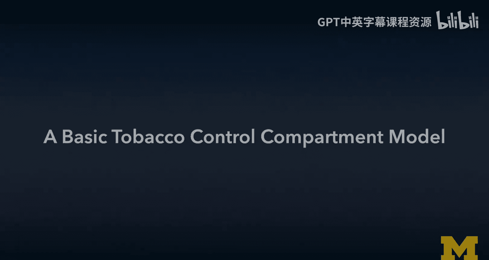
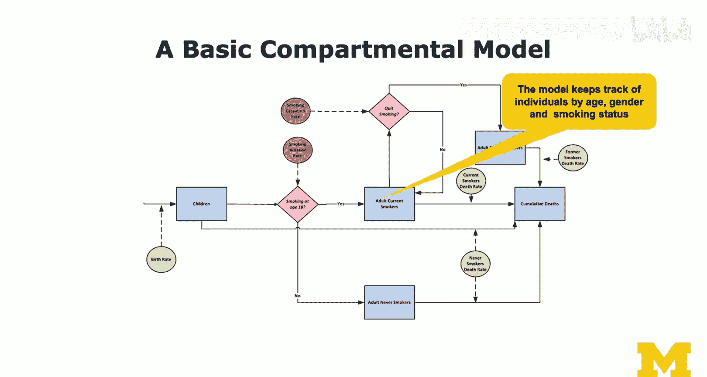
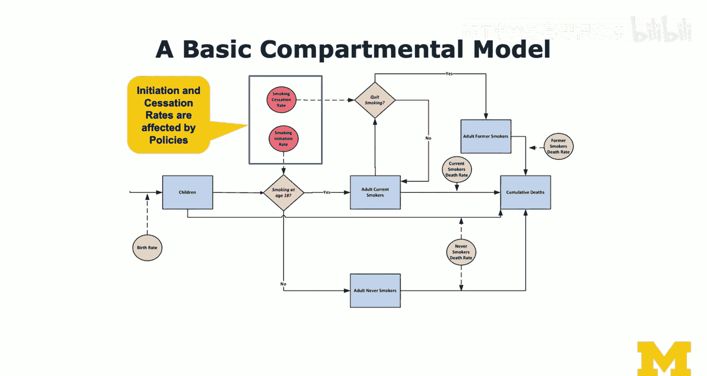
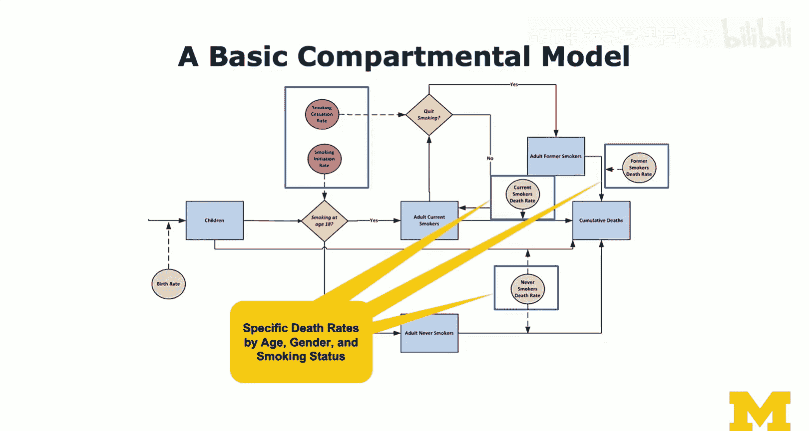
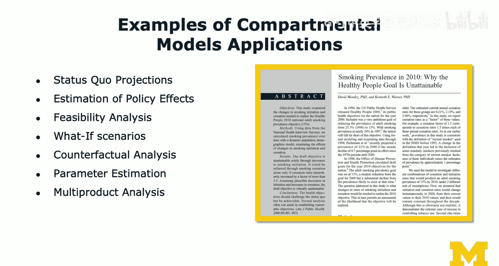
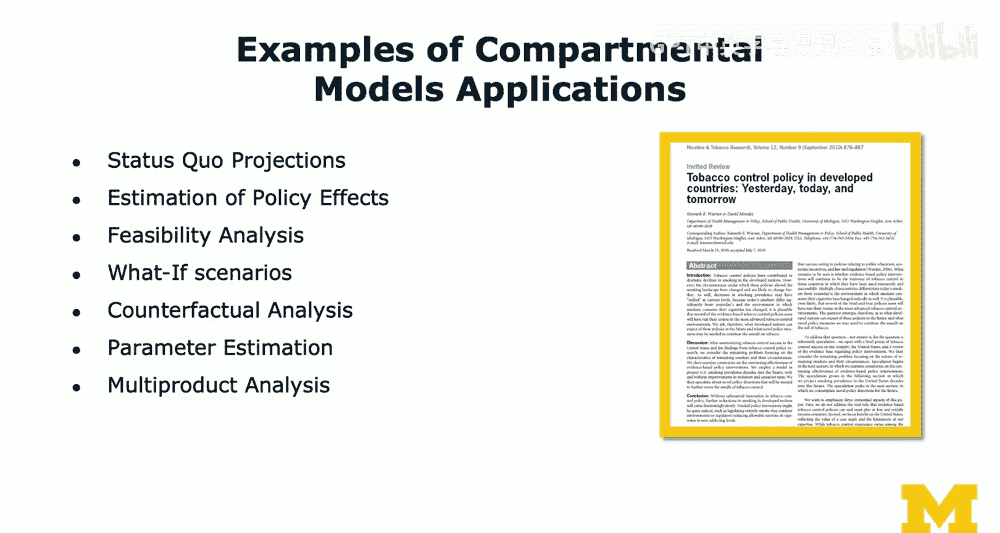

# 密歇根大学《公共部门的R数据分析（基础、数据探索、决策支持、）｜Data Analytics in the Public Sector with R》中英字幕 p101 22_烟草控制基础区室模型构建.zh_en -BV1YZ421J7Fx_p101-

Hello， my name is David Mendez， I'm an associateoc professorfe in the Department of Health Management and Policy at the University of Michigan School of Public Health。

I am going to talk in these modules about the basic compartment model of tobacco control。

And what we would like to do with this model is to keep track of the number of individuals that smoke or by smoking steps。

 we actually follow them by age， gender， and different categories， but they。

main feature that we are paying attention to is the smoking statuss。

 are they smoking now where they are smoking before former smokers or they have never initiated smoking that those are they never smokers。

 as we discussed in the previous module。

We have a certain number of parameters that have been estimated either with data within the model or outside the model that define the rates of change from one compartment to another compartment。

 particularly we are focusing in this box and the initiation and cessation rates。

 and the initiation rates， if you remember is the probability that is a single individual starts smoking at a certain age and the cessation rate is the probability given individual stop smoking a certain age and those parameters are important because through that。

We can exert policy interventions so they respond to policies if we put a policy that raises。

 for example， taxes in that cigarettes， those are going to affect both initiation and cessation rates and subsequently then you'll see the compartments。

 the stocks are going to change particularly we see that the smoking compartment will go down。

 the prevalence of smoking will go down in certain magnitude。

Besides those parameters that we use for control， we keep track of other characteristics of the population。

 and that is regulated by other parameters that are。

Embbedded in the model， for example， specific that the threads by age。

 gender and smoking status are reflected are embedded into our model once we have that the model set up then we can anticipate what is going to happen in the future。

 we can keep track of the number of individuals over time that move from one category to the next and we can then use this compartment model for different problems and to answer different type of questions some of those questions are in bullet form here but I'm going to just mention about a couple three of them in this case I'm going to start with the estimation of policy。

ffectThis is a paper using a compartmental model named Simmoke that Professor David Levy from Georgetown University put forth in 2011 using this model he projected the impact of smoking mental ban。

 mental cigarette ban， and results were used recently by the were cited by the Food and drugug Administration in their efforts to now ban in 2022 a cigarettes ban from the market。

Another example will be feasibility analysis in this paper。

 Professor Ken Wener from the University of Michigan。

 and I did a study in which we concluded we demonstrated that a goal that the。

CDC or the government has set for the nation in terms of smoking rates or smoking prevalence by the year 2010 was invisible。

 so the goal that was set in 1999 was to have 12% smoking prevalence by the year 2010 using the parameters that we have estimated and a compartment model myauth and I were able to demonstrate that achievement of that goal in 10 years was going to be nearly impossible so alerted the government of that issue and we proposed a new goal for that so our expectations。

Our projections were right on target in 2010 we are very far from the 12% goal another example of how we use compartmental models would be what if scenarios and in this paper Professor Ken Warrner and I use a model to look at what was the best the best scenarios that we could achieve developing countries。

 if we manage the initiation and cessation rates， so if we put in place policies that manage initiation and cessation rates in a feasible manner what would be what they should expect。

Of smoking rates over time there are， of course， many other applications but I hope these three serve as an introduction of what compartment models can do in health policy Thank you。

