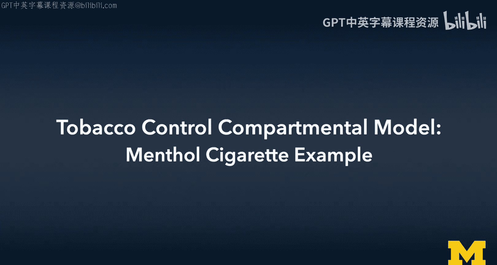
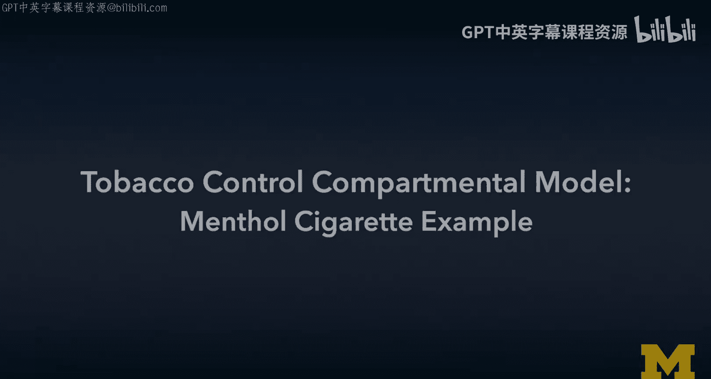
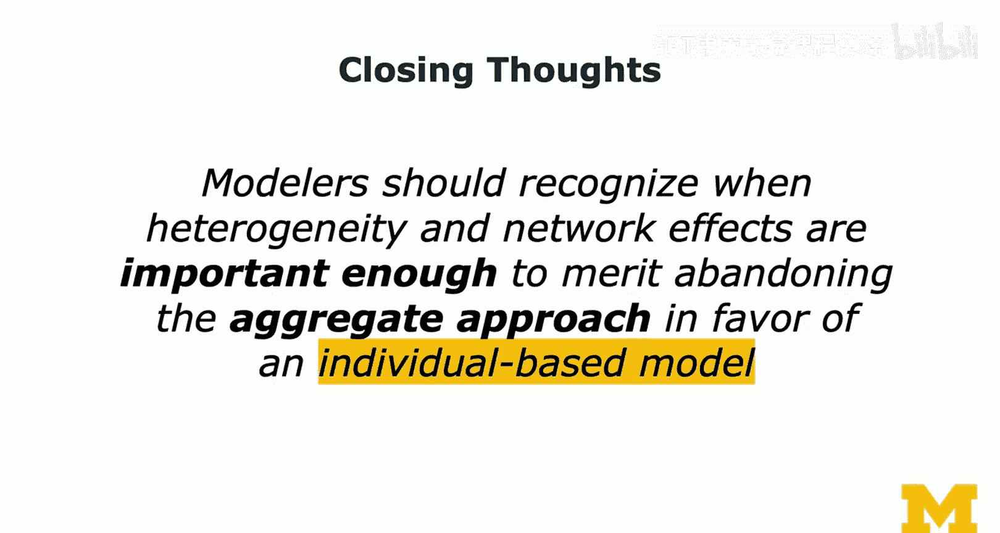

# 密歇根大学《公共部门的R数据分析（基础、数据探索、决策支持、）｜Data Analytics in the Public Sector with R》中英字幕 p102 23_烟草控制区室模型：薄荷醇香烟案例研究.zh_en -BV1YZ421J7Fx_p102-

Hello， my name is David Mendez and I'm an associate professorfe in the Department of Health Management and Policy at the University of Michigan School of Public Health。

In this module， I'm going to talk about a specific compartment model that keeps track of mental smokers。

In the population， so this is an expansion of the previous model I presented and we now have a specific compartments for mental smokers and non- mentalal smokers and the goal is to keep track of the number of individuals over time that flow among or between those two compartments。

 after we finish the model we used this model to estimate the harm that mental cigarette inflicted in the population between 1980 and 2018。

 let's focus on the first row of the table， the first column shows that because of mental cigarettes there were。

10137808 extra smokers， the number of death。Due to mental cigarettes where about 378。

000 among the U population during that period， those 380。

000 premature extra death because of smoking lost those individuals who died prematurely lost about 3 million live years。

 that's for the whole population， the second row shows the impact on the African American population。

 the first column just tell us that 1。5 million extra smokers among the Africanam Americanic population were due to mental cigarette smoking。

 that's 15% of all the extra smokers among the general population among the whole US population which is compatible。

With the proportion of African Americans among the population during 1980 to 2018。

 which is about 12%， but the second column is striking。So， he says that。で？Exus death。

Due to mental smoking among the African American population we about 156，471。

 that's 41% of all the mental death。Because of mental all the excess death due to mental smoking during that period。

 so African Americans were 12% of the population， but they burned， they bore 41% of all the death。

Due to smoking due due to mental smoking and more striking either even is the cumulative excess。

 the live year loss， the number of live year loss that was 1。4， 1。

5 a million live year lost because of mental smoking among the African American population that's 50% of all the extra live year lost due to mental smoking。

So African Americans， again， were 12% of the population。But they bore。50% of all day。

Live year loss due to mental the third row list or percents what would be the amount the expected harm among the Africanam Americanican population if African-am Americanic population had not been targeted for smoking mental and they would have the same parameters as the general population so look at the difference between row two and three and that we were able to determine because of a compartmento model this graph presents exactly what I show you in the table before these are the cumulative excess initiators these are the cumulative excess premature death and these are the cumulative excess live year loss。

Exactly the same numbers that I presented in the table。 Now。

 the compartmental models are very useful to compute， predict， project， estimate。

Kind of either damage， harm or benefits that would happen in the future。

 or that would be hypothetical given counterfactual scenarios， like with the mental smoking。

Now we need to be careful with how we interpret and how we use compartmental models。

Because at the beginning of the compartmental modules。

 we talk about that those compartments represent a number of individuals so it's a conglomerate of individuals and we treat those individuals as if they were the same。

 they were homogeneous， but there's a lot of heterogeneity in the population that we ignore because we think that's not going to be relevant for the specific problem。

 but sometimes，That heterogeneity is important and we just miss it using compartmental models and we also cannot totally represent interactions among individuals in the population in compartmental model。

 so when they are in the compartment we ignore the interactions that cause some effect in the population in that compartment and that might trigger some different change in that population so if we get into the point that we think that those interactions are important and that taking or looking at heterogeneity in the population in more depth is important then the。

The aggregate that approach might not be the best way to proceed and then we follow an individual based model。

 so we change the model that we use into something more deaggregate in which we don't follow groups of individuals like we do in the compartments。

 but we follow。A specific。Individuals， so we follow individuals with all the heterogeneity or all the individual characteristics。

 the characteristics that make them different from others and their interactions too those kind of models we call them either micro simulationimulation models or agent based models。

 the agent based models are the more flexible ones in which we allow for interactions among individuals and then take a look at what the effect of those interactions produce at the macro level。

 they micro simulationimulation models are you know more specific about。Looking at individuals。

 but know the interactions of individuals so we can look at。

A very wide group of individuals different from each other。

 different characteristics of the heterogeneity is abundant。

 so we can model all sorts of conditions for individuals。

 but we follow them one by one without taking a look at the interaction。

That's something that is important， sometimes and enough。 Sometimes then again， we get。

We need to figure out the effect of interactions。 What happens if a person has many friends who are smokers and they interact and convince that person to a smoke。

 That's the kind of interaction that we follow in compartmental in agent based mode。

 And so thank you very much。

